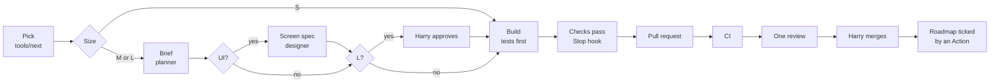

# Agent workflow

How we build Flimme with agents: which agents and skills we need, how a feature is split up and goes from plan to merge, how each layer is tested, where design and game feel come in, what keeps token use down, and a timeline to the closed beta. Written on 29 October 2026 as a proposal to discuss. Nothing in it is set up yet.

It builds on the [roadmap](product/roadmap.md) (its tasks, rules and milestones), [decisions.md](decisions.md), the testing sections of [app-structure.md](architecture/app-structure.md#testing) and [server-structure.md](architecture/server-structure.md#testing), [operations.md](architecture/operations.md#continuous-integration) for CI and environments, and the [Figma file](https://www.figma.com/design/v2ZGLbGmzZ7032V9AI5vWM). The questions for Harry are in [Decisions for Harry](#decisions-for-harry).

## Contents

1. [The short version](#the-short-version)
2. [What makes agent work slow and expensive](#what-makes-agent-work-slow-and-expensive)
3. [Full stack or split by layer](#full-stack-or-split-by-layer)
4. [The roster](#the-roster)
5. [How a task flows](#how-a-task-flows)
6. [Slices for the first release](#slices-for-the-first-release)
7. [Design and game feel](#design-and-game-feel)
8. [How each layer is tested](#how-each-layer-is-tested)
9. [Where agents run, and how many at once](#where-agents-run-and-how-many-at-once)
10. [Tracking work](#tracking-work)
11. [Guardrails](#guardrails)
12. [Models, effort and budgets](#models-effort-and-budgets)
13. [Timeline](#timeline)
14. [Week 0: what we'd set up](#week-0-what-wed-set-up)
15. [Decisions for Harry](#decisions-for-harry)

## The short version

- **Plan by feature, build by layer.** A feature (a "slice", such as joining by code) gets one plan. It's built in order across the `api` schema: the backend lands the contract with its tests, the types are regenerated, then the app builds on them. No full-stack agents.
- **Read once, brief many.** One planner reads the docs and writes a brief of about a page. Everyone after it reads the brief, not the 885 KB of docs.
- **Most roles are skills, not agents.** Eight agents and about sixteen skills. A skill costs nothing until it's used; an agent starts from an empty context and rebuilds it.
- **Machines check first.** Formatting, types, lint, tests and generated types are checked by hooks and CI before any agent reviews anything.
- **Ceremony by size.** Small tasks go straight to code. Large ones get a brief Harry approves, a design or game spec, a stronger reviewer and a check on a real phone.
- **Opus thinks, Sonnet types, Haiku files.** The expensive model goes where the ambiguity is.
- **Timeline.** Internal alpha around the end of December, closed beta from about 18 January 2027, public launch around mid to late February, with Harry on it about half days. See [Timeline](#timeline).

## What makes agent work slow and expensive

| Cause | Why it costs | The rule here |
| --- | --- | --- |
| Every agent reads the docs in full | The docs are about 885 KB, roughly 220,000 tokens. `schema.sql` alone is 124 KB and `data-model.md` 65 KB | Only the planner reads docs, and only the sections a task links to (a script prints one section by its anchor). The brief quotes the rules it needs |
| Long chains of handoffs | Each agent rebuilds the context the last one had | At most: brief, build, one review |
| Several reviewers per pull request | Each one reads the same diff and context | One reviewer, one round; a second look only at the fix |
| CI ping-pong | Push, wait for CI, fix, push again, each round a new wake-up | A hook runs the same checks before the agent may stop. CI only confirms |
| Screenshot loops on UI | Images are heavy, and nobody can judge a swipe's feel from a still | Screenshots once, small, at the end. Feel is judged on a phone |
| One long session per milestone | The context fills up, gets compacted and loses detail | A fresh session per task |
| The most capable model at maximum effort everywhere | Up to 100 times the cheapest model's price per token | Model and effort per role ([Models, effort and budgets](#models-effort-and-budgets)) |
| Guessing | A wrong guess costs a rewrite and a second review | Stop and ask (the roadmap's rule 6). Open questions are part of the brief |
| Permission prompts | The agent sits waiting for a click | An allowlist of read-only and test commands |
| Figma reads | This file's screens page alone returns about 125,000 characters of metadata | Each frame is read once and kept as a short screen spec |

If the other project was slow for a reason that isn't in this table, it gets a rule too.

## Full stack or split by layer

**Recommended: plan each feature as a whole, build it layer by layer.**

Why not full-stack agents:

- **Three toolchains.** SQL with pgTAP and the Supabase CLI; Python with uv and pytest; TypeScript with Expo, Jest and Maestro. An agent carrying all three sets of conventions loads about three times the instructions on every run, and does each one less well.
- **The seam already exists.** The app only talks to `api` functions, their status answers, the Realtime events and the generated types. The backend pull request lands with its tests, the types are regenerated, and the app task starts on real types. A mismatch then breaks the type check, not a live game.
- **The roadmap is already split this way.** M4.2 adds the host's powers in SQL; M4.13 adds the host menu in the app.
- **Lanes run in parallel.** While the app agent builds the lobby, the backend agent can build the deck.
- **Access rules get a focused review.** Row-level security and `security definer` functions are where a mistake leaks data. They're easier to review when a pull request is only SQL.

Where full stack would win: tiny changes, such as an optional argument plus a button. With two repositories that's two pull requests anyway, which is the next question.

### One repository or two

The app repository is still empty, so this is the cheapest moment to choose.

| | One repository (`app/`, `supabase/`, `server/`, `docs/`) | Two repositories, as today |
| --- | --- | --- |
| Agents and skills | One `.claude/` folder | Shared through a small Claude Code plugin, or copied |
| A contract change | Migration, regenerated types and the app's wrapper can sit in one place; the "types out of date" CI check is local | The types are generated in one repository and committed in the other; the CI check has to compare across repositories |
| Context | Docs and code side by side | The app agent clones the backend repository to read the docs |
| Costs | CI path filters; EAS builds from a subfolder; the roadmap's "Where" column changes | None now |

**Recommended: one repository.** Keep one task, one branch, one pull request either way; in one repository the app's pull request simply follows the backend's.

> **Decided on 29 October 2026: one repository.** How it's set up is in [groundwork.md](architecture/groundwork.md#the-repository).

## The roster

### Agents

Each agent is a file in `.claude/agents/` with its own instructions, tools, model and effort. A task normally runs in a fresh session acting as `backend-dev` or `app-dev`; the others are called in as subagents, with their own context and model, and return a short result.

| Agent | Job | Model, effort | Runs | Reads | Writes |
| --- | --- | --- | --- | --- | --- |
| **Harry** (lead) | Picks the next slice, approves large briefs, merges, runs device checks, answers questions. Owns accounts, legal and the stores | | Daily | Briefs, pull requests | Answers in decisions.md |
| **planner** | Turns a task or a slice into a brief: the contract, the rules quoted, the tests to write, the files touched, open questions. Sizes every task once | Opus 5.5, high | Each medium or large task, and once per slice | The linked doc sections, decisions.md, the code it touches | The brief, in the pull request |
| **designer** | UX, UI and motion: screen specs, the design system and motion tokens in code, Figma updates, visual review of UI pull requests | Opus 5.5, high | Each UI slice and UI pull request | Figma (once per frame), screen specs | Screen specs, tokens, the feel checklist |
| **game-designer** | Rules, pacing and the beats of the signature moments; simulating the match rules; the playtest protocol and its analysis; tuning the starting values | Opus 5.5, high | At gates: M0.7, the M6 kickoff, after each playtest, the beta reviews | game-modes.md, deck-engine.md, playtest notes, metrics | Moment beats, tuning proposals |
| **backend-dev** | SQL migrations, `api` functions and pgTAP tests; the Python server | Sonnet 5.5, medium. Opus 5.5 for large game-logic tasks | Each backend or server task | The brief, the code | Code, tests, the pull request |
| **app-dev** | The Expo app: screens, state, wrappers, Jest tests | Sonnet 5.5, medium | Each app task | The brief, the screen spec, the code | Code, tests, screenshots |
| **reviewer** | One pass over the diff against the brief and the layer's checklist. Blocking findings only, plus at most three nits | Sonnet 5.5, medium. Opus 5.5 for access rules and game rules | Each pull request | The diff, the brief, the checklist | Review comments |
| **qa** | The bot player script, Maestro flows per slice, a bot game on staging after merges, the load test, the security checklist walk, triage of end-to-end failures | Sonnet 5.5, medium | Per slice and per milestone | Briefs, flows | Flows, reports |
| **scribe** | Bookkeeping: decisions.md lines, missing translation keys, release notes, broken doc links | Haiku 5.5, low | After merges, weekly | Merged pull requests | Small doc edits |

**Left out on purpose:**

- **A separate architect.** Contracts are the planner's job. A cross-cutting question (turning schema.sql into migrations, the vote queue's design) is a planner run at a higher effort. Fable 5.1 is kept for the rare hardest problem, started by hand.
- **An ops agent.** Ops tasks are few, and most are Harry's dashboards. The implementer writes workflow files and Fly config with the `ops` skill.
- **A copywriter agent.** A `copy` skill, used by the designer and app-dev.
- **A test writer per task.** The planner writes the list of tests from the docs' rules, so the tests come from the spec rather than from the code, without paying for a second agent.

### Skills

Two kinds: procedures (how we work) and knowledge (how this codebase works). Only a skill's one-line description sits in context until it's used.

| Skill | Kind | Used by | What's in it |
| --- | --- | --- | --- |
| `task` | Procedure | Every task session | The loop below, started as `/task M4.8` |
| `slice` | Procedure | planner, Harry | Grouping tasks into a slice, one brief, which specs it needs, the order |
| `brief` | Procedure | planner | The brief template, reading docs by section, the test list format |
| `review` | Procedure | reviewer | A checklist per layer, what counts as blocking |
| `playtest` | Procedure | game-designer, qa | The protocol, the observation sheet, turning notes into tuning changes |
| `feel-check` | Procedure | designer, Harry | How to write and run a device checklist for a UI pull request |
| `supabase-sql` | Knowledge | backend-dev, reviewer | Migrations (expand then contract, never edit a merged one, `create or replace` collisions), the `api` rules (`_v2`, statuses as answers, the room lock, `internal.rate_limit`, `security definer` with a fixed `search_path`, grants and row-level security), pgTAP patterns (playing as a given seat, the synthetic seed) |
| `realtime-contract` | Knowledge | backend-dev, app-dev | Topics, events, payloads, who sees what |
| `python-server` | Knowledge | backend-dev | Load, compute, write; handlers safe to run twice; the pgmq loop; recorded TMDB responses; uv and pytest |
| `expo-app` | Knowledge | app-dev | Thin routes and fat features; one wrapper per `api` function; TanStack Query or Zustand; the room's state decides the screen; both locales; `track()`; accessibility labels |
| `design-system` | Knowledge | app-dev, designer | The tokens, the components, never a raw color or size, building a screen from its spec |
| `motion` | Knowledge | app-dev, designer | Reanimated 4 on the UI thread, spring and duration tokens, the haptic vocabulary, Reduce Motion, the signature moments, performance rules |
| `copy` | Knowledge | app-dev, designer | Voice and tone, French first and never a literal translation, button lengths for the display font, banned phrases ("for kids"), the glossary |
| `figma` | Knowledge | designer | The map of frames and node ids, reading a frame once, keeping it as a screen spec |
| `privacy-and-kids` | Knowledge | everyone writing code | No personal data in logs or events, no PostHog events in rooms capped under 13, no trailer under 13, the names filter |
| `ops` | Knowledge | backend-dev, app-dev | CI workflows, EAS profiles, Fly deploys, the Supabase CLI |

**Built-in skills we reuse** rather than rewrite: `/code-review` (the reviewer's engine, at medium effort, high for access rules), `/security-review` on access-rule pull requests, `/simplify`, `fewer-permission-prompts`, `run` to launch the app, and Figma's own `figma-use` and `figma-design-to-code`.

### CLAUDE.md

One short file at the root, under about 120 lines, read by every session: what the app is, a map of the folders, the commands, a pointer to the `task` skill, and the rules nobody may break. Each of `supabase/`, `server/` and `app/` gets its own small CLAUDE.md with that layer's commands, loaded only when an agent works there.

The rules, all from the docs:

1. Postgres decides the game, the server decides the deck, the phone shows what they say.
2. The app reaches Supabase only through `api`. An incompatible change ships as `_v2`.
3. Statuses are answers, not errors.
4. Every rule a doc states gets a test in the same pull request.
5. decisions.md wins over any doc. A choice nobody made stops the task and goes to Harry.
6. The phone never waits on the network to show the next card.
7. Nobody ever sees who noped a film, and swipes never reach other phones while a game runs.
8. No TMDB data in git, no personal data in logs or analytics.
9. Every string exists in French and English.
10. Migrations only add. Mistakes are fixed forward.

## How a task flows

### Sizes

The planner sizes all 141 first-release tasks in one pass at the start. A rough guess: half are small, a third medium, the rest large.

| Size | Typical tasks | What happens |
| --- | --- | --- |
| **S** | One function or one component, rules in one doc section: M1.10, M1.11, M3.8, M4.3, M5.4, M6.7, M8.6 | No planner. The session reads the roadmap line and its one linked section. `/code-review` reviews. Harry merges |
| **M** | A function with several rules, or a screen with its states: M1.8, M1.9, M2.7, M4.8, M4.11, M6.12 | A planner brief, a design spec for UI, the reviewer agent |
| **L** | Game logic, concurrency, the signature screens: M1.4, M4.10, M6.4 to M6.6, M6.9, M6.11, M6.14, M6.15 | The brief is approved by Harry first. A design or game spec. The reviewer on Opus. A device check |

### The loop



1. **Pick.** `tools/next` lists the tasks whose "needs" are merged, with their size and lane. It's a script reading roadmap.md, so it costs no tokens.
2. **Brief** (M and L). The planner writes it into a draft pull request. Open questions stop the task here.
3. **Spec** (UI tasks). The designer adds the screen spec, or links the one already in `docs/design/screens/`.
4. **Approve** (L). Harry reads the brief: two minutes that save a rewrite.
5. **Build.** A fresh session on the task's branch writes the brief's tests first, then the code. A hook formats every edited file.
6. **Self-check.** When the agent tries to stop, a hook runs lint, types and the affected tests. It can't finish red.
7. **Pull request.** The title starts with the task id. The body is the brief plus "How it was tested", with each command and its result.
8. **CI** confirms: the full suites, pgTAP, the generated-types check.
9. **Review.** One reviewer run on the diff and the brief, ticking each test from the brief's list. Blocking findings get fixed; nits ride along or are dropped.
10. **Merge.** Harry. On merge, a GitHub Action ticks the roadmap box.
11. **Verify**, at the end of a slice: qa runs a bot game on staging; for UI slices, Harry runs the feel check on a phone.

### The brief

```markdown
# M4.8 Join with a code · app · M

**Goal.** One sentence.
**Done when.** Copied from the roadmap.
**Rules.** Quoted, each with its doc link.
**Contract.** Functions and arguments, every status answer, Realtime events, payload types.
**Tests to write.** One line per rule: given, when, then.
**Files.** To add or change, and the SQL functions touched (for scheduling).
**Screen spec.** A link, for UI tasks.
**Out of scope.** What not to build.
**Questions.** Anything nobody decided. The task waits for the answer.
```

About a page. If it runs longer, the task should probably be split.

### A worked example: joining with a code

The slice is M4.1 (backend), M4.8 (app), M4.14 (ops) and M4.15 (app).

1. **planner**, one brief for the slice: `api.join_room` takes the room reference and gains the `closed` answer; every answer and the message for each; the link format `/join/<code>?r=<ref>`. Tests: a stale link can't join the newer room that reused its code; `via` and `link_opened_at` are stored; every answer has a message.
2. **designer**, the spec for screen 05: six boxes over the keypad, joining as soon as the sixth digit is typed, what a wrong code does (the boxes shake, an error haptic, the digits clear), the copy for each answer in French and English, screen-reader labels.
3. **backend-dev**, M4.1 in its own session: the migration, pgTAP tests, the regenerated types. Reviewed on Opus, since it's an access rule. Harry merges.
4. **app-dev**, M4.8: the wrapper returns answers as values, and a Jest test walks every answer and fails if one has no message. Two screenshots, the screen and one error. The designer reviews them; then Harry's feel check: typing six digits feels instant, and the shake reads as "try again", not as a crash.
5. **M4.14** is Harry's (the domain and its verification files), with the `ops` skill writing the files. **M4.15**, the route, is app-dev again, tested from a cold start on both platforms.
6. **qa** adds a "join by code" Maestro flow to the nightly run.

## Slices for the first release

The first release's tasks, grouped into features. Each slice gets one brief; the specs column says what the designer or game designer writes first.

| # | Slice | Tasks | Specs first |
| --- | --- | --- | --- |
| 1 | Backend foundation | M1.3 to M1.15 | None |
| 2 | Catalog | M2.1 to M2.14 | None |
| 3 | App shell | M3.1 to M3.12 | Design system and motion tokens (M3.4) |
| 4 | First launch | M4.3, M4.6, M4.7 | Screens 01 to 04 |
| 5 | Hosting | M4.4, M4.9 | Screens 06 and 07 |
| 6 | Joining | M4.1, M4.8, M4.14, M4.15 | Screen 05 and the join sheet |
| 7 | The lobby | M4.5, M4.10, M4.11, M4.12 | Screens 08, 09 and 24 |
| 8 | Host powers and reports | M4.2, M4.13, M7.1, M7.2 | The host menu and the report sheet |
| 9 | The deck | M5.1 to M5.8 | None |
| 10 | Swiping | M5.7, M6.2, M6.3, M6.9 to M6.12, M6.18, M7.3 | Screens 11 to 13, the hints; the swipe and the flip |
| 11 | The match | M6.1, M6.13, M6.14 | Screen 14; the near miss and the match |
| 12 | The Final Cut | M6.4, M6.5, M6.15 | Screen 15; the countdown, the veto, the reveal |
| 13 | Endings | M6.6, M6.7, M6.8, M6.16, M6.17 | Screens 16, 25 and 26 |
| 14 | Settings and privacy | M8.4 to M8.9 | Screen 22 |
| 15 | Analytics and operations | M9.1 to M9.7 | None |
| 16 | The group test | M6.19, M6.20 | The playtest protocol |

## Design and game feel

### What "like Duolingo" should mean here

**Borrow the feel, not the hooks.**

Take:

- **Every touch answers.** The design already has Duolingo's most recognisable trait: buttons with a hard 4-pixel lip that press down (the `Arcade/Lip` effects in the Figma tokens).
- **Instant feedback**, with haptics and, where it fits, sound.
- **Celebrations at the right moments**, and only there.
- **Progress you can see**: avatars with how far each player is, "2 of 3 of you liked this", the countdown.
- **A playful voice** in the copy, in both languages.

Leave out: streak guilt, notifications that play on loss, sessions that never end. Three reasons:

1. **The goal is a pick within 5 minutes, not time in the app.** Time to a pick is the headline metric; any animation that slows the game hurts it.
2. **Families and kids are the bet.** Apple and Google look hard at manipulative patterns in apps children use, and the docs already say "one ask at a time".
3. **The habit that fits a movie night is weekly and social.** Friday, "what do we watch?"; open the app; pick fast; enjoy the match; share the recap; someone else hosts next week. Every bit of polish should serve one of those steps.

### The motion system

The Figma's Motion page already sets the durations and easings. During M3.4 the designer turns them into tokens in code, adds what the Figma can't hold (springs, haptics, sound) and writes the `motion` skill, so every screen moves the same way. Details in [groundwork.md](architecture/groundwork.md#motion-haptics-and-sound).

- **Durations and easings, from the Figma:** instant 80 ms, fast 150 ms, base 250 ms, slow 400 ms, celebrate 800 ms; easings standard, exit and arcade (an overshoot for stamps and buttons). **Springs**, added in code, for anything a finger drives: the card's drag and throw, presses.
- **Rules.** Nothing blocks input. Every animation can be interrupted. The next card is already mounted. Reduce Motion swaps flights for fades. Nothing runs on the JavaScript thread during a gesture.
- **A haptic vocabulary**, one meaning per pattern: a selection tick when a card crosses the commit line, a light tap on a button press, a firmer one on a throw, success on a match, a hard knock on a veto, a soft tick each second through the last 5 of the countdown.
- **Sound**, decided on 29 October 2026: only for the match and the reveal, when four phones on a couch play it at the same instant. Off everywhere else, quiet when the phone is set to silent, and never pausing the TV or music.

### The signature moments

The game designer defines each moment's beat (when, why, what it tells the players); the designer defines how it moves. Each gets a short spec before its slice starts.

| Moment | The beat | The feel |
| --- | --- | --- |
| A swipe | An answer in under a second | The stamp grows with the drag, the card tilts, a tick at the commit line, the throw follows the finger's speed |
| "Shuffling" | Under a second of anticipation | A deck shuffle, not a spinner |
| The near miss | "One more yes and it's a match" | The toast slides in, the card takes the like glow (`Glow/Like`) |
| The flip | Curiosity without leaving the stack | A flip in place, under 300 ms, possible mid-stack |
| It's a match | Every phone at once | The marquee bulbs chase, the poster scales in, avatars pop one by one, a haptic burst |
| The Final Cut | 60 seconds of tension, vetoes secret | A countdown ring that turns red for the last 10 seconds, ticks, the veto slams, "locked in" |
| The reveal | Vetoes all at once, then the points | Vetoed posters fall away, the winner takes the spotlight (`Gradient/Spotlight`) |
| The winner and the recap | Pride, and something to share | The ticket and the share card |

The waiting states count too: Reconnecting, "Offline: 6 swipes waiting", "Jo is still joining".

### How design quality is checked

1. **Spec before code.** The designer reads each Figma frame once and writes a short screen spec: layout, every state (loading, empty, error, offline, each status answer), copy keys, motion and haptics, accessibility. The Figma predates the docs, so the spec follows the docs where they differ; M0.9 brings the Figma itself up to date.
2. **A component gallery** in development builds (M3.4 already asks for one): every component in every state. After M3.4 the code is the source of truth for components, and the Figma is for new screens and moments, so nobody maintains both.
3. **Screenshots, once.** At the end of a UI pull request, one to three small screenshots compared with the spec by the designer, in one round.
4. **A feel check on a real phone**, by Harry, with a short checklist the designer writes for that pull request: what to try and what it should feel like. Agents can't judge a gesture or a haptic from a screenshot, and trying makes them loop.
5. **Frame rate.** The M3.12 spike sets the bar on a low-end Android; the feel checks catch regressions.

### The game design track

- **Week 0: simulate the rules.** A small script plays bot groups of 2 to 10 with made-up tastes over a popularity-shaped deck, under the first release's rules: how often each group size matches before card 40, how often the Final Cut decides, how long a pick takes. It tests the mechanics, not real taste, and it feeds M0.7 before any SQL is written. One thing it may show: with a crowd deck, 70% of 8 to 10 players rarely like the same film, so the Final Cut would be the normal ending for big groups. Fine, if we know it.
- **The M6 kickoff:** the pacing of a 5-minute game and the beats above.
- **Playtests** (M6.20, M10.3, M12): who plays, what to watch for, three questions afterwards, and a write-up that turns into changes to the starting values, which the docs already list.
- **Scope.** The first release left the recap card, Play again (then M16.1 to M16.3, now M6.21 to M6.23) and reactions (M16.7) until after launch. All three are cheap, already designed, and carry both fun and growth. **Decided on 29 October 2026:** the recap card and Play again join the first release; reactions wait.

## How each layer is tested

| Layer | What the agent writes | Runs | Who judges |
| --- | --- | --- | --- |
| SQL | pgTAP tests, one per rule, with several seats played in one test | `supabase test db`, on every pull request | The tests; the reviewer ticks them against the brief |
| Server | pytest on the pure functions, contract tests on the local database, recorded TMDB responses | Every pull request | The tests |
| App logic | Jest and Testing Library: the vote queue, room state to screen, payload checks, a message for every status answer | Every pull request | The tests |
| App screens | Component gallery screenshots; a Maestro flow per slice | Flows nightly on EAS against staging, and before a release | The designer, once per pull request |
| A group game | The bot player script (M6.19) fills a room so one phone or a Maestro flow can play a whole game | After each merge to `main`: a bot game on staging must reach a pick | The script, no model involved |
| Feel | A checklist per UI pull request | Harry's phone | Harry |
| Fun | The playtest protocol | Real groups | The game designer's write-up, then Harry |

EAS's free plan allows 15 builds per platform a month, so JavaScript changes go out as EAS Updates and a new build is made only when the native fingerprint changes.

## Where agents run, and how many at once

**Two places:**

- **Harry's Mac.** UI work that needs a simulator, Maestro, the spikes and feel checks on real phones, and Docker for `supabase start`.
- **Cloud sessions** (claude.ai/code). Backend, server and app logic tasks, briefs and reviews, running while Harry does something else. This cloud container has Postgres 16 installed but no Docker daemon, so `supabase start` doesn't run here as it is. A setup script for the cloud environment can add pgTAP and pgvector to the local Postgres and load stand-ins for Supabase's auth, Realtime and Queues, which is how the original 120 checks ran.

**Three lanes plus Harry:**

| Lane | Path |
| --- | --- |
| A, backend game | M1, then M4's backend, M5, M6's backend, M7 and M8's backend |
| B, catalog server | M2, then M8's server tasks, M9's server tasks |
| C, app | M3, then M4's app, M6's app, M8 and M9's app |
| Harry | M0's accounts, legal, the stores, merges, device checks |

**At most three tasks at once.** Beyond that, Harry's review queue becomes the bottleneck and conflicts multiply.

**Conflicts to design out:**

- **The same SQL function in two parallel tasks.** Two migrations that each `create or replace` the same function from the same starting point: whichever merges second silently undoes the first. M5.7 and M6.2 both change `api.cast_vote`, for example. The brief lists the functions a task touches, `tools/next` never starts two tasks that share one, and branch protection requires a branch to be up to date before merging, so CI runs on the merged result.
- **Generated types.** Regenerated in every pull request; a conflict is resolved by regenerating, never by hand.
- **roadmap.md.** Ticked by an Action after the merge, not inside the pull request (a change to the roadmap's rule 5), so parallel pull requests don't all collide on one file.
- **Translations.** One JSON file per feature, as app-structure.md already says.

## Tracking work

- **roadmap.md stays the source of truth.** Its task lines are regular enough to parse (`- [ ] **M4.8** … · needs …`), which is all `tools/next` needs.
- **One task, one branch, one pull request**, as the roadmap says. The brief lives in the pull request body, so the plan, the code, the review and the test evidence sit together. For M and L tasks, the planner opens the draft pull request.
- **On merge**, an Action ticks the box and updates the "Progress" line.
- **Questions** from briefs go to Harry; the scribe writes the answers into decisions.md.
- **A board** (GitHub Projects) can be generated from the roadmap later if a visual board helps. Linear is connected here too, but it would be a second source of truth.

## Guardrails

**Hooks**, run by Claude Code itself, cost no tokens:

| Hook | Does |
| --- | --- |
| After each edit | Formats the file |
| Before each edit | Refuses edits to `docs/archive/`, the generated types, merged migrations and `.env` files |
| When the agent stops | Lint, types and the affected tests; if anything is red the agent carries on, a few times at most |
| Before a push (git) | The same checks |

**Permissions.** Read-only and test commands are allowed without asking; pushes, deploys and anything touching production ask.

**Connected services:**

- **Supabase:** local and staging only, read-only. Never production: its SQL tool would otherwise reach live data.
- **Figma:** the designer only.
- **GitHub:** pull requests, reviews, CI results.
- **PostHog:** later, for the weekly review (M14).
- **Sentry:** needs authorising in claude.ai's connector settings before agents can read crash reports; useful from M9.

## Models, effort and budgets

Prices per million tokens, Anthropic's current list:

| Model | Input | Output | Input, relative to Haiku |
| --- | --- | --- | --- |
| Haiku 5.5 | $0.10 | $0.50 | 1 |
| Sonnet 5.5 | $2 | $10 | 20 |
| Opus 5.5 | $4 | $20 | 40 |
| Fable 5.1 | $10 | $50 | 100 |

On a Claude subscription the cost shows up as usage limits rather than a bill, and the more capable models use them up faster.

What follows from it:

- **Agent sessions are mostly cached input**, and a cache read costs the same on Opus 5.5 and Sonnet 5.5 ($0.20 per million). So Opus costs at most about twice Sonnet per task, and less when it finishes in fewer turns. What counts is the cost of a finished task, not of a single request.
- **Spend Opus where the ambiguity is** (briefs, design, game rules, access-rule reviews, large game logic), **Sonnet where the brief has removed it**, **Haiku on mechanical work**, and **Fable on the rare problem nothing else cracks**, started by hand.
- **Effort is the second dial.** Opus 5.5 defaults to medium. Planner, designers and security reviews at high; implementers and reviewers at medium; the scribe at low.
- **Pick the model when a session starts.** Switching mid-session throws the cache away. Subagents have their own context anyway.
- **Multi-agent workflows** only for big one-off jobs where parallel reading pays off: sizing the roadmap, writing all the screen specs, walking the security checklist.

**Budgets.** Rough targets to check against real numbers after the first ten tasks: an S task in under about 100,000 tokens, an M in about 200,000 to 300,000, an L in up to about a million, most of it cached. Writing each session's usage into its pull request for the first two weeks shows which steps cost the most.

## Timeline

Assumptions: Harry spends about half days on reviews, decisions, device checks and the human tasks; two or three agent tasks run at once; the spikes don't force a redesign; enrolling in Apple's and Google's programmes doesn't stall.

| Weeks | Dates | What happens |
| --- | --- | --- |
| 0 | 2 to 6 Nov | **Setup and M0.** Harry: Apple and Google enrolment, the TMDB email, the accounts, the name shortlist, all on day one. Agents: the repository, CLAUDE.md, agents, skills, hooks and scripts; the planner sizes the roadmap; the designer extracts the tokens, drafts the motion system and does M0.9; the game designer runs the simulation for M0.7 |
| 1 to 2 | 9 to 20 Nov | **M1** backend foundation (lane A), **M3** app foundation with the spikes on real phones (lane C), M2.1 to M2.3 (lane B) |
| 3 to 4 | 23 Nov to 4 Dec | **M2** catalog and its first full load; the week of unattended sweeps then runs in the background. **M4** rooms and lobby (lanes A and C) |
| 5 to 7 | 7 to 25 Dec | **M5** the deck and **M6** the game, ending with the group playtest and a feel pass. The biggest block, and where most of the polish goes |
| 7 to 9 | 21 Dec to 8 Jan | **M7, M8, M9** in parallel (22 tasks, mostly small). The first store builds (M10.1, M10.2) and the start of Play's 14-day count. **Internal alpha** nights (M10.3) over the holidays, when families are together |
| 10 | 11 to 15 Jan | Alpha fixes (M10.4), **M11** store readiness, TestFlight's external review |
| 11 | From 18 Jan 2027 | **Closed beta** (M12) |
| 11 to 15 | 18 Jan to mid Feb | The beta: weekly reviews, tuning, the launch checklist |
| 15 to 16 | Mid to late Feb 2027 | **Public launch** (M13), after store review and a phased release |

**The range.** Full time and with no surprises, the closed beta could start in late December. Two or three hours a day, or a spike that changes the design, pushes it to early or mid February. The public launch follows the beta by about four weeks either way.

**The long poles:**

- **M6, the game.** The most work, and the part that decides whether it's fun. It's the last place to cut time.
- **Google's 14 days.** A new personal Play account needs 12 testers opted in for 14 days in a row before production. Starting that count with the first alpha build (M10.2) rather than after M11 keeps it off the critical path; the builds can keep updating during the count.
- **The holidays.** Harry's time may drop over Christmas, but the alpha nights fit them well.

## Week 0: what we'd set up

Once this proposal is agreed:

1. The monorepo, the tools and the rest of [groundwork.md](architecture/groundwork.md).
2. CLAUDE.md at the root and one per layer.
3. The eight agent files.
4. The sixteen skills, starting with `task`, `brief`, `supabase-sql`, `expo-app`, `design-system` and `motion`.
5. Hooks, settings and the permission allowlist.
6. Scripts: `tools/next`, `tools/doc-section` (prints one doc section by its anchor), and the Action that ticks the roadmap on merge.
7. The Figma map (frames and node ids) and the tokens in code. The variables are already readable: Staatliches for display, Schibsted Grotesk for text, IBM Plex Mono for data, the accent blue `#3649F5`, the marquee yellow `#F6C700`, the like green `#74C94C`, the nope red `#F03545`, the arcade lips and the glows.
8. The cloud environment's setup script, if cloud sessions are used.
9. The planner's sizing pass over the first release's 141 tasks.
10. The game designer's simulation of the rules.

## Decisions for Harry

Answered on 29 October 2026, except where marked open.

| Question | Answer |
| --- | --- |
| One repository or two? | One |
| How much time a day for reviews, decisions and device checks? | Harry checks most days; the timeline above holds |
| Where agents run | Both: backend and logic in the cloud, UI on the Mac |
| Who merges | Harry, everything, for the first two weeks; then small backend tasks merge themselves when CI and the review pass |
| Sound | On for the match and the reveal only, off elsewhere, quiet on silent |
| The recap card and Play again in the first release | Yes for both; reactions wait |
| What took ages in the other project? | Open: so it gets a rule here |
| Tracking | roadmap.md and pull requests; a board only if it helps |
