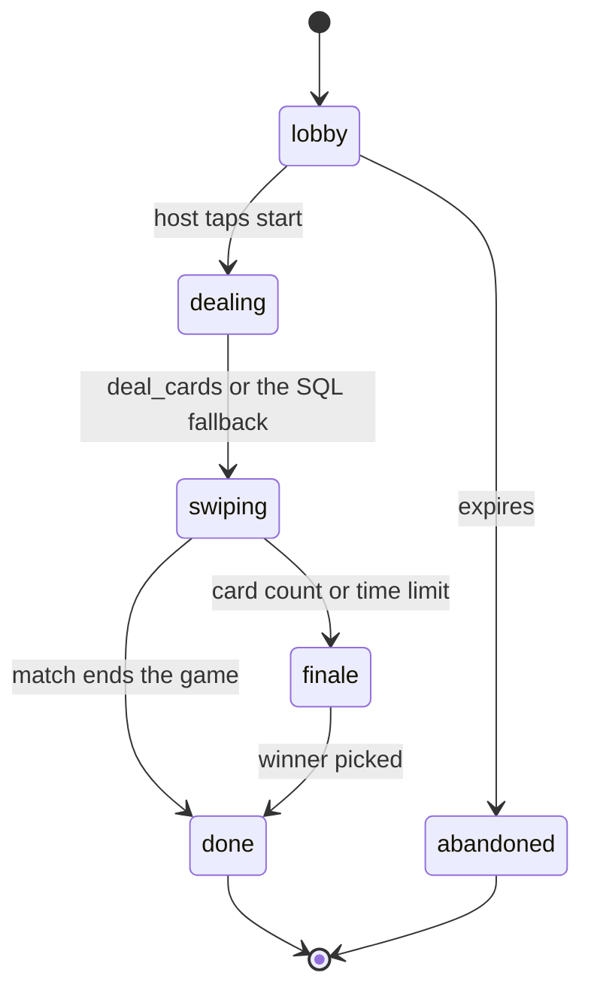
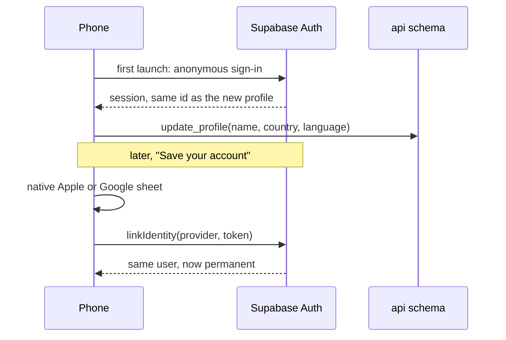

# App structure

How the MovieMatch app is built: the Expo project, its screens and navigation, where state lives, how it talks to the backend, sign-in, realtime, the offline vote queue, the card stack, the Letterboxd export on the phone, invites and deep links, translations, analytics and crash reports, testing, and builds and updates. Written on 29 October 2026, before the first line of app code. The app now lives in `mobile/` of the one repository (decided on 29 October 2026); its foundations are described in [groundwork.md](groundwork.md#the-apps-foundations).

It builds on the revival plan's [stack](../product/revival-plan.md#picking-the-stack) and [Expo upgrade notes](../product/revival-plan.md#upgrading-expo-and-packages), the [data model](data-model.md) (above all [The app's API](data-model.md#the-apps-api) and [Realtime](data-model.md#realtime)), the [Letterboxd integration](../integrations/letterboxd.md#connecting) and the [deck engine](deck-engine.md). Game rules, the onboarding flow as a product and how cards are chosen are covered elsewhere. Decisions are in [decisions.md](../decisions.md).

Facts about Expo, Supabase and the libraries were checked against their live documentation on 29 October 2026 (see [Sources](#sources)). Numbers marked as starting values are placeholders until playtests.

## Contents

1. [Principles](#principles)
2. [Project setup](#project-setup)
3. [Screens and navigation](#screens-and-navigation)
4. [Where state lives](#where-state-lives)
5. [Talking to the backend](#talking-to-the-backend)
6. [Sign-in](#sign-in)
7. [Realtime](#realtime)
8. [The vote queue](#the-vote-queue)
9. [The card stack](#the-card-stack)
10. [Letterboxd on the phone](#letterboxd-on-the-phone)
11. [Invites and deep links](#invites-and-deep-links)
12. [Translations](#translations)
13. [Analytics and crash reports](#analytics-and-crash-reports)
14. [Testing](#testing)
15. [Builds, updates and versions](#builds-updates-and-versions)
16. [Folder structure](#folder-structure)
17. [Spikes to run first](#spikes-to-run-first)
18. [Starting values](#starting-values)
19. [Changes this asks of the backend](#changes-this-asks-of-the-backend)
20. [Sources](#sources)

## Principles

1. **The server holds the truth; the phone shows it.** Rooms, seats, votes and matches are decided in Postgres. The phone renders what the `api` schema returns and what Realtime announces, and when in doubt it re-reads.
2. **The phone never waits on the network to show the next card.** Swipes are saved locally first and sent in the background.
3. **One way in.** The phone talks to Supabase only through the `api` schema, and to the recommendation server's HTTP API only for Letterboxd and account deletion.
4. **Room screens follow the room's state.** The phone never moves itself from the lobby to swiping or from swiping to the finale; it moves when the room's state changes.
5. **Thin routes, fat features.** Route files only lay out screens; logic lives in feature folders that can be tested without a phone.

## Project setup

| Choice | Detail | Checked |
| --- | --- | --- |
| Expo SDK 58 | React Native 0.88. Released 15 October 2026. `create-expo-app` still creates SDK 57 projects until the new Expo Go ships "within a few weeks", so the project starts with `npx create-expo-app --template default@sdk-58`, as the revival plan says | SDK 58 changelog |
| Development builds, not Expo Go | Native sign-in with Google needs native code, and the new Expo Go only supports SDK 58 anyway. Everyone runs a development build from EAS | Supabase Google guide, SDK 58 changelog |
| TypeScript, strict | SDK 58 makes React Native's strict TypeScript API the default; deep imports from `react-native/Libraries` are type errors | SDK 58 changelog |
| Expo Router | File-based routes give invite links for free. SDK 58 reworked its navigation core so navigation state is deterministic, and moved or removed some imports that came from React Navigation | SDK 58 changelog |
| Node | 22.13 or newer on 22, 24.3 or newer on 24, or 26 and later; odd versions are unsupported | SDK 58 changelog |
| Web output | SDK 58 defaults Expo Router projects to server output. At launch the web build only serves the invite landing page and the link verification files, so the project sets its web output explicitly (see [Invites](#invites-and-deep-links)) | SDK 58 changelog |
| Dark only | `userInterfaceStyle: "dark"`, matching the design. The old app said `"light"` | Revival plan |

**Packages**, installed with `npx expo install` so versions match the SDK:

| Need | Package |
| --- | --- |
| Backend | `@supabase/supabase-js`, `react-native-url-polyfill`, `expo-sqlite` (auth storage and the local key-value store) |
| Server data | `@tanstack/react-query` |
| Local state | `zustand` |
| Card stack | `react-native-reanimated` 4 with `react-native-worklets`, `react-native-gesture-handler`, `expo-haptics`, `expo-image` |
| Sign-in | `expo-apple-authentication`, `@react-native-google-signin/google-signin` |
| Letterboxd | `expo-web-browser`, `expo-document-picker`, `expo-file-system`, `fflate` (unzip, pure JavaScript), `papaparse` (CSV) |
| Invites | `expo-linking`, `react-native-qrcode-svg` (with `react-native-svg`), `expo-sharing` |
| Translations | `i18next`, `react-i18next`, `expo-localization` |
| Watching | `@sentry/react-native`, `posthog-react-native` (with the Expo packages its guide lists) |
| Tests | `jest-expo`, `jest` 30, `@testing-library/react-native` 14 or later; Maestro for end-to-end flows |

## Screens and navigation

The design file's 26 screens are the reference for what exists, not the final word. Routes, with the design's screen numbers:

| Route | Screen | Notes |
| --- | --- | --- |
| `/` | | Redirects: no name yet goes to `/welcome`, otherwise `/home` |
| `/welcome`, `/name` | 01 to 03 | First launch. The onboarding doc decides the content |
| `/home` | 04 | Host or join, Letterboxd nudge, last night's pick |
| `/join` | 05 | Code keypad |
| `/join/[code]` | | Invite link target. Calls `join_room`, then replaces itself with the room |
| `/host/mode`, `/host/vibe` | 06, 07 | Mode, then moods, services and the seen rule. "Open the room" calls `create_room` then `update_room_settings` |
| `/room/[id]` | | Layout for every room screen: subscribes to Realtime, keeps the room fresh, redirects by state |
| `/room/[id]/lobby` | 08 | With the "Shuffling" overlay while the room is `dealing` |
| `/room/[id]/invite` | 09 | Sheet over the lobby |
| `/room/[id]/taste-check` | 10 | Local to the lobby: the room is still `lobby` |
| `/room/[id]/swipe` | 11 to 13, 26 | Flipping is an animation, not a route. "Nothing left" is a state of this screen |
| `/room/[id]/final-cut` | 15 | Veto, then ranking |
| `/room/[id]/winner` | 16 | Then `/room/[id]/recap` (17), a sheet with the share card |
| `/room/[id]/closed` | 25 | Room abandoned or expired |
| `/profile`, `/profile/letterboxd`, `/profile/import` | 18 to 20 | Import status and the unmatched-films list |
| `/account/save`, `/account/delete` | 21, 23 | Linking Apple or Google; deleting the account |
| `/settings` | 22 | |

"It's a match" (14) is an overlay, not a route: in Quick Match it leads to the winner screen, in Final Cut the game carries on. "Reconnecting" (24) is a banner shown over any room screen.

**Room screens follow the room's state.** The room layout reads `api.rooms` and listens for `state_changed`, then shows the screen for that state. Going back is blocked once swiping starts; leaving is an explicit "Leave room" that calls `api.leave_room`.



| Room state | Screen |
| --- | --- |
| `lobby` | Lobby, or the taste check if the player opened it |
| `dealing` | Lobby with "Shuffling" |
| `swiping` | Swipe |
| `finale` | Final Cut |
| `done` | Winner, after the match overlay if there was one |
| `abandoned` | Closed |

## Where state lives

| Kind | Where | Examples |
| --- | --- | --- |
| Server data | TanStack Query, one query per `api` view or read function, kept fresh by Realtime events | Profile, room, seats, matches, rounds, Letterboxd status, app config |
| The card stack | A Zustand store, not persisted: the 3 mounted cards, the buffer behind them, the swipe in progress, the flip state | |
| The vote queue | A Zustand store persisted to `expo-sqlite`'s key-value store, so it survives a restart | Swipes not yet confirmed by the server |
| Session and UI | Zustand: connection status, the current room id and code, the last answered taste check card | |
| Auth session | Supabase's auth storage, on `expo-sqlite`'s `localStorage` as in Supabase's Expo quickstart | |

Cards are not TanStack queries: the deck changes under the phone (refills, propagated likes) and the stack needs to replace only what's behind the mounted cards. Everything else is a query, so screens get loading and error states for free.

## Talking to the backend

**One client, one schema.**

```ts
const supabase = createClient<Database, 'api'>(SUPABASE_URL, SUPABASE_PUBLISHABLE_KEY, {
  db: { schema: 'api' },
  auth: { storage: localStorage, autoRefreshToken: true, persistSession: true, detectSessionInUrl: false },
})
```

- Views with `.from('room_seats')`, functions with `.rpc('cast_vote', …)`. The `Database` type is generated from the `api` schema with the Supabase CLI (`supabase gen types` with `--schema api`) into `src/api/database.types.ts`, never edited by hand, and regenerated whenever the schema changes. CI fails if the committed file is out of date.
- Many functions return JSON (`cast_vote`, `my_next_cards`, `join_room`), which the generated types only know as `Json`. The app keeps hand-written types for these payloads in `src/api/payloads.ts`, with a small schema check for each in development and in tests.
- Each `api` function gets one typed wrapper in `src/api/`. Screens never call `.rpc` directly, so a `_v2` function is a one-file change.
- On React Native the auth client can't tell when the app goes to the background, so the app calls `startAutoRefresh` and `stopAutoRefresh` from an `AppState` listener registered once.
- **Statuses are answers, not errors.** `join_room` answers `ok`, `not_found`, `full`, `starting`, `in_finale`, `name_required` or `rate_limited`; `cast_vote` answers `ok`, `duplicate`, `closed`, `dropped` or `no_super_likes`. Each has a message or a behaviour in the app. Real errors (permissions, a card not dealt to the seat) go to Sentry.

**The recommendation server's HTTP API** is called with `fetch` and the player's Supabase access token, for two things only: the Letterboxd upload and account deletion.

## Sign-in



- **First launch** signs in anonymously. The auth trigger creates the profile with the same id. Supabase limits anonymous sign-ins per IP (30 an hour by default, changeable) and strongly recommends invisible CAPTCHA or Turnstile for them; worth turning on before launch.
- **Saving the account** links Apple or Google to the anonymous user with `linkIdentity` and a native ID token, so the user id, and with it the profile and history, stays the same. This needs manual linking switched on in the project. Supabase's guide shows the Google call with `token` and `access_token`; Apple needs a nonce, to confirm in a spike.
- **Platforms (default).** iOS offers Sign in with Apple and Google (App Store guideline 4.8, in the revival plan's checklist, requires Apple when Google is offered). Android offers Google only: Sign in with Apple isn't native on Android and needs a web sign-in flow.
- **If the Apple or Google account already exists** (a reinstall, a second phone), linking fails. Default: the app offers to sign in to that account instead; the guest's games aren't merged, and the guest account is deleted after 90 days without activity like any other.
- Development and preview builds use their own bundle ids, and each one is listed in Supabase's Apple provider settings.

> Store the session encrypted, with the key in SecureStore and out of backups, rather than as plain SQLite: see [security.md](security.md#the-app). Deleting an account must also revoke Sign in with Apple tokens ([store-listing.md](../product/store-listing.md#passing-review)).

## Realtime

Each room uses two topics from the [data model](data-model.md#realtime), both opened as private channels (`config: { private: true }`), which only works with "Allow public access" switched off in the project's Realtime settings.

| Topic | The phone | Used for |
| --- | --- | --- |
| `room:<id>` | Listens only | Server events: joins, settings, state, deck updates, near misses, matches, the finale, the result |
| `room:<id>:live` | Listens and sends | Presence (key: the seat id; payload: swipe count and done, updated every 5 swipes) and emoji reactions |

**What each event does on the phone:**

| Event | The phone |
| --- | --- |
| `member_joined`, `member_left`, `seat_updated` | Refetches seats |
| `settings_changed` | Refetches the room |
| `state_changed` | Refetches the room; the layout moves to the state's screen |
| `deck_updated` (with this seat's id) | Refetches its next cards and replaces everything behind the 3 mounted ones |
| `near_miss` | Shows "2 of 3 of you liked this" (Party mode) |
| `match` | Shows the match overlay; if `decided`, the winner screen follows |
| `finale_started`, `round_progress` | Refetches the round |
| `result` | Not used in v1: it announced the winner's deep links, which are dropped |

**Missed messages are normal.** Realtime only tells; the database decides. So the phone re-reads the room, its seats, its matches, the current round and its next cards whenever:

- the channel comes back after an error, a timeout or a close (with the "Reconnecting" banner while it's down, and retries with backoff);
- the app returns to the foreground;
- a vote answer says the room has moved on (`closed`).

Permissions on a private channel are checked when it connects and when a new token arrives; a channel whose token expires is disconnected. supabase-js should pass refreshed tokens to Realtime; a 10-minute game across a token refresh is one of the [spikes](#spikes-to-run-first).

While in a room and in the foreground, the phone calls `api.touch_room` every 30 seconds, so its seat counts as present.

## The vote queue

Every answer (nope, like, super like, seen it) goes through one persisted queue.

1. **The swipe.** The card flies off, the next one is already mounted, and the vote is appended to the queue with the room, the film, the answer, the seat, how long the card was on screen and the phone's time. A super like is spent locally at once.
2. **Sending.** One vote in flight at a time, in order, because the order matters on the server (refills at 15 cards left, the finale's card count). Each goes to `api.cast_vote`.
3. **Answers:**

   | Answer | The queue |
   | --- | --- |
   | `ok` | Removes the vote; shows a match or the finale if the answer says so |
   | `duplicate` | Removes it: an earlier try was saved |
   | `closed` | Removes every queued vote for that room and re-reads the room |
   | `dropped` | Removes it: someone has seen the film, so it's gone for the room |
   | `no_super_likes` | Removes it and gives the super like back on screen |
   | Network error, timeout, server error | Keeps it; retries after 1, 2, 4, 8, 16 then every 30 seconds |
   | Expired session | Refreshes the session, then retries |
   | Card not dealt to this seat | Removes it, sends it to Sentry, refetches the cards (see [Changes](#changes-this-asks-of-the-backend)) |

4. **Undo.** If the last vote is still in the queue, it's simply removed. Otherwise the app calls `api.undo_last_vote` once the queue is empty.
5. **Offline.** Swiping carries on through the cards already on the phone, with a small "Offline: 6 swipes waiting" note. When the buffer runs out, the swipe screen waits for the connection rather than inventing cards.
6. **Restart.** If the app is killed with votes waiting, it sends them before anything else when it reopens the room.

## The card stack

- **Three mounted cards.** Only the top 3 cards are rendered; the rest of the deck is plain data in the store. The phone fetches its next cards with `api.my_next_cards` and keeps a buffer of about 10 behind the mounted ones (a starting value). When it's down to 5 with no refill arriving, it calls `api.request_cards`, as in the data model.
- **Gestures** run on the UI thread with Reanimated 4 and Gesture Handler: drag to rotate, throw by distance or speed. Right is like, left is nope, up is seen it. Super like and undo are buttons.
- **Haptics:** a light tick when the card crosses the commit line, a firmer one when it's thrown, a success pattern on a match.
- **Flip.** Tapping flips the card in place to the back: synopsis, TMDB score, a seated player's Letterboxd rating, runtime, director, cast, tonight's services for the film, the trailer link and the reason label. Whether the card was flipped is sent with the vote.
- **Posters** come from TMDB at w500 (w780 on large screens), never the original size. The image base URL comes from `api.app_config` rather than being hard-coded. Each card shows its blurhash or thumbhash placeholder while loading, and the next 3 posters are prefetched with `expo-image`'s `Image.prefetch` into the memory and disk cache, so most cards appear from the cache with no fade.
- **Buttons and screen readers.** Every gesture has a labelled button. Each card is one accessible element ("Paddington 2, 2017, 1 h 43, comedy, family. On Sam's watchlist.") with actions for like, nope, super like, seen it and flip. With "Reduce motion" on, cards slide instead of flying.
- **Stale cards.** When `deck_updated` arrives, only the cards behind the 3 mounted ones are replaced. If the player gets past the mounted cards before the new cards arrive, the stack shows a short loading card rather than an old card that the server may have replaced.

## Letterboxd on the phone

The flow decided in [Connecting](../integrations/letterboxd.md#connecting), as the phone runs it:

1. **Consent**, with its wording version, before anything else.
2. **The export page** opens in a browser sheet with `expo-web-browser`: Safari View Controller on iPhone, Chrome Custom Tabs on Android. The URL comes from `api.app_config`, so it can change without a release.
3. **Back to the app.** On iPhone the call resolves when the player closes the sheet. On Android it resolves as soon as the tab opens, so the app waits for itself to come back to the foreground. Either way it then opens the file picker, and a "Pick the file" button stays on screen in case.
4. **The file picker** (`expo-document-picker`, copied to the app's cache) filtered to ZIP files. ZIP types differ between phones, so the app also accepts any file ending in `.zip` and checks it after picking.
5. **Unzipping** with `fflate`, decompressing only `profile.csv`, `diary.csv`, `watched.csv` and `watchlist.csv`, from the file's bytes (`expo-file-system`'s `File.bytes()`). `papaparse` reads the CSV files.
6. **What's sent**, exactly as the Letterboxd doc lists: the username from `profile.csv`; per film from `watched.csv` and `watchlist.csv`, merged on the phone: name, year, film link, watched, on the watchlist; per diary entry: name, year, entry link, watched date, logged date, rating, rewatch. The export date comes from the file name when it has Letterboxd's pattern, otherwise from the file's date. Nothing else is read.
7. **Upload** to the server's HTTP API with the access token and the consent version. The phone then deletes its copy of the file.
8. **Progress.** Matching runs in the background, so the import screen refetches `api.my_imports` every 3 seconds while it's open and pending, and `api.my_linked_accounts` when done. Unmatched films are listed from `api.my_unmatched_films`.

## Invites and deep links

- **The link** is `https://<domain>/join/482913`, the same path as the route, so Expo Router handles it whether it arrives as a universal link, an Android app link or the custom scheme. The domain and the scheme wait on the app's name.
- **Verification files.** iOS needs `apple-app-site-association` and Android `assetlinks.json` under `/.well-known/` on that domain. They live in the app repo's `public/.well-known/` and are served by the web export. The app config lists the domain in `ios.associatedDomains` and in Android intent filters with automatic verification. iOS reads the file at install and on updates, so changing its paths needs an app update.
- **Not installed.** The link opens the web page, which at launch only shows the code in large type and the store buttons; the player types the code after installing. Web guests who swipe in the browser come later, as the revival plan says.
- **QR code** in the invite sheet, drawn with `react-native-qrcode-svg`, encoding the same link. Guests scan it with their camera app; the app has no scanner of its own.
- **Sharing** uses the system share sheet: "Join my room: <link> (code 482 913)". The recap card is shared as an image with `expo-sharing`.
- **Rejoining.** The phone keeps the current room's code. Reopening the app calls `api.join_room` with it and gets the same seat back.

> The invite page also needs a Smart App Banner, the official store badges, the privacy policy link and the TMDB and JustWatch credits ([store-listing.md](../product/store-listing.md#invite-links-and-the-web-page)). If tablets are supported, Apple requires 13-inch iPad screenshots and reviews on iPad.

## Translations

- `i18next` with `react-i18next`, one JSON file per feature in `src/i18n/locales/en` and `fr`, plurals through i18next. The device language (`expo-localization`) sets the profile's language at first launch, and it can be changed in settings.
- **Server text arrives translated.** Titles and overviews come in the profile's language from `my_next_cards` and `title_cards`. Mood, genre and game mode names come from their `api` views, which hold every language. The app ships none of these strings.
- **Reason labels are rendered on the phone** from `reason_code` and `reason_params`: seat ids become display names from `room_seats` ("you" for `is_me`), title ids become titles from `title_cards`. One template per code per language, so a new code needs an app update; until the app knows a code, the card shows no label.
- Numbers, dates and runtimes ("1 h 43") are formatted with `Intl` in the profile's language.

## Analytics and crash reports

- **Crashes: Sentry**, with its Expo config plugin, its Metro config wrapper, `Sentry.wrap` around the root layout, and source maps uploaded by EAS Build and EAS Update. No names, codes or emails in events.
- **Product analytics: PostHog**, wrapped in `src/lib/analytics.ts` so screens call `track(event, props)` and never the vendor. Off by default (`defaultOptIn: false`) until the player accepts analytics, recorded as an `analytics` consent. Screens are tracked from the router's path. The person is the profile id, never a name. Per the monetization doc, kid profiles are never tracked individually.
- The event list belongs in a future analytics doc; the funnel the revival plan asks for (room created, first card, match) is the minimum.

> **Decided on 29 October 2026:** analytics are on by default wherever the law allows, with an opt-out in Settings, so `defaultOptIn: false` above no longer holds. The wrapper picks the mode by region: anonymous (no `identify`) in the EU, the UK and Switzerland unless the player opts in, identified elsewhere. The event list, naming rules, identity and the kids' rule are in [analytics.md](../product/analytics.md#consent-and-kids).

## Testing

| Level | Tool | What |
| --- | --- | --- |
| Unit | `jest-expo` with Jest 30, `@testing-library/react-native` 14 or later | The vote queue (every answer in the table above, retries, undo, restart), payload checks, reason label rendering, room state to screen, the Letterboxd CSV reader on a real export |
| Against the backend | Jest with a local Supabase and the schema loaded | The typed `api` wrappers, sign-in and linking, a room from create to match |
| End to end | Maestro, run on EAS Workflows (its Maestro job is in alpha) | Create a room, join by code, swipe to a match, the Letterboxd import with a test export |
| Bot players | A small script in `tools/` that joins a room by code and swipes through the same `api` | Testing a group game with one phone |
| Playtests | Real friend groups | The rest |

## Builds, updates and versions

| | Development | Preview | Production |
| --- | --- | --- | --- |
| Build | Development client | Internal distribution, TestFlight and Play internal testing | Store |
| Bundle id | `….dev` | `….preview` | The real one |
| Supabase project | Development | Staging | Production |
| EAS environment | development | preview | production |

- **Configuration** comes from EAS environment variables: the Supabase URL and publishable key, the server's URL and PostHog's key as `EXPO_PUBLIC_` variables, Sentry's auth token as a secret. Nothing is committed.
- **Over-the-air updates** with EAS Update, one channel per build profile. The runtime version uses the `fingerprint` policy, so an update never reaches a build whose native code doesn't match it. With SDK 58's default fingerprint preset, version bumps and changes inside `node_modules` no longer count as a new fingerprint.
- **Minimum version.** At launch and on every return to the foreground, the app reads `min_app_version` from `api.app_config`. Below it, a full-screen "Update the app" with the store link replaces everything. This is what lets the backend retire an old `api` function once a `_v2` has shipped.

## Folder structure

> **Replaced on 29 October 2026** by the structure in [groundwork.md](groundwork.md#structure): routes in `mobile/src/app/`, components in `ui/`, `shared/` and `screens/<screen>/`, logic in `features/`. The tree below is the original plan.

```
movie-swipe-app/
  app/                  routes only, as in Screens and navigation
  src/
    api/                the client, generated types, payload types, one wrapper per api function, the server's HTTP API
    realtime/           room channels, presence, the event table above
    features/
      auth/             session start, anonymous sign-in, saving the account
      room/             lobby, settings, invite, state to screen
      swipe/            card stack, card, gestures, vote queue
      finale/           veto and ranking
      letterboxd/       export flow, ZIP and CSV reading, upload, import status
      profile/          profile, settings, deleting the account
    components/         shared pieces: buttons, chips, avatars, poster
    theme/              design tokens from the Figma file
    i18n/               setup and locales/en, locales/fr
    stores/             Zustand stores
    lib/                analytics, storage, haptics, formatting
  public/.well-known/   link verification files
  tools/                bot player, type generation
  .maestro/             end-to-end flows
  app.config.ts, eas.json, metro.config.js
```

## Spikes to run first

Each is a day or less, on real phones, before building on top of it:

1. **Unzip a real Letterboxd export** with `fflate` on Hermes: speed and memory on a low-end Android.
2. **The file picker's ZIP filter** on iOS and Android, and coming back from the browser tab on Android.
3. **Linking a native Apple and Google sign-in** to an anonymous user: the id stays the same, the Apple nonce, and the error when the account already exists.
4. **A private room channel across a token refresh,** during a 10-minute game, plus a phone going offline and coming back.
5. **The card stack at full frame rate** on a low-end Android with 3 mounted cards and prefetching.

## Starting values

Placeholders until playtests.

| Value | Start |
| --- | --- |
| Mounted cards | 3 |
| Cards buffered behind them | About 10 |
| Ask for cards when down to | 5 (from the data model) |
| Posters prefetched | The next 3 |
| Presence update | Every 5 swipes (from the data model) |
| Room heartbeat | Every 30 seconds (from the data model) |
| Vote retries | After 1, 2, 4, 8, 16, then every 30 seconds |
| Import status refresh | Every 3 seconds while pending and open, up to 2 minutes |

## Changes this asks of the backend

Not applied to [data-model.md](data-model.md) or [schema.sql](schema.sql). For the main thread to review.

| Where | Change | Why |
| --- | --- | --- |
| `api.cast_vote` | Accept a vote on any active card in the room's pool, adding the deck entry if a re-rank removed it, instead of failing with "card was not dealt to this seat" | A refill re-ranks everything behind the 3 mounted cards. Votes queued offline, or a fast swipe past the mounted cards just as a refill lands, can arrive for cards the re-rank removed, and those swipes are lost |
| `api.app_config` | Add `tmdb_image_base`, `letterboxd_export_url` and `invite_base_url` next to `min_app_version` | So none of them is hard-coded in a build |
| `api.taste_check_cards()` | Return an empty list when the player doesn't need the taste check | Taste profiles are private, so the phone can't check the confidence itself |
| Letterboxd fixes | A function to resolve an unmatched film (search, then pick) | `api.my_unmatched_films` lists them, but nothing lets the player fix one |
| `api.create_room` | Optionally take the room settings | "Open the room" then becomes one call instead of `create_room` followed by `update_room_settings` |
| `api.cast_vote` | The optional `flipped` argument from the deck engine | Already in the deck engine's list |

## Sources

Checked on 29 October 2026:

- [Expo SDK 58 changelog](https://expo.dev/changelog/sdk-58): release date, React Native 0.88, Expo Go timing, Expo Router changes and server output default, Node versions, strict TypeScript API, fingerprint preset, PostHog integration command.
- [How to upgrade to SDK 58](https://expo.dev/blog/how-to-upgrade-to-sdk-58): React Native 0.86 to 0.88, removed APIs.
- Expo SDK 58 reference: [WebBrowser](https://docs.expo.dev/versions/latest/sdk/webbrowser/) (Android resolves on open), [DocumentPicker](https://docs.expo.dev/versions/latest/sdk/document-picker/), [FileSystem](https://docs.expo.dev/versions/latest/sdk/filesystem/) (`File.bytes()`), [Image](https://docs.expo.dev/versions/latest/sdk/image/) (`Image.prefetch`, placeholders).
- Expo guides: [runtime versions](https://docs.expo.dev/eas-update/runtime-versions/), [iOS universal links](https://docs.expo.dev/linking/ios-universal-links/), [unit testing](https://docs.expo.dev/develop/unit-testing/) (Jest 30 with SDK 58), [Maestro on EAS Workflows](https://docs.expo.dev/eas/workflows/examples/e2e-tests/).
- Supabase: [anonymous sign-ins](https://supabase.com/docs/guides/auth/auth-anonymous) (manual linking, rate limit, CAPTCHA), [identity linking](https://supabase.com/docs/guides/auth/auth-identity-linking) (`linkIdentity` with an ID token), [Google](https://supabase.com/docs/guides/auth/social-login/auth-google) and [Apple](https://supabase.com/docs/guides/auth/social-login/auth-apple) sign-in (native libraries, no native Apple on Android), [Realtime authorization](https://supabase.com/docs/guides/realtime/authorization) (private channels, public access off, token expiry), [Presence](https://supabase.com/docs/guides/realtime/presence), [custom schemas](https://supabase.com/docs/guides/api/using-custom-schemas), [CLI](https://supabase.com/docs/reference/cli) (`gen types --schema`), [Expo quickstart](https://supabase.com/docs/guides/getting-started/quickstarts/expo-react-native) (`expo-sqlite` storage), [stopAutoRefresh](https://supabase.com/docs/reference/javascript/auth-stopautorefresh).
- [Sentry for Expo](https://docs.sentry.io/platforms/react-native/manual-setup/expo/), [PostHog for React Native](https://posthog.com/docs/libraries/react-native) (`defaultOptIn`), [fflate](https://github.com/101arrowz/fflate) (pure JavaScript, file filter; React Native isn't mentioned, hence the spike).
