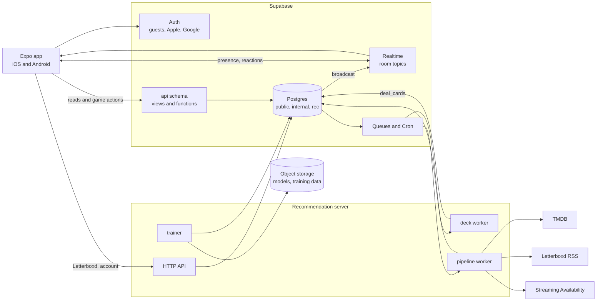
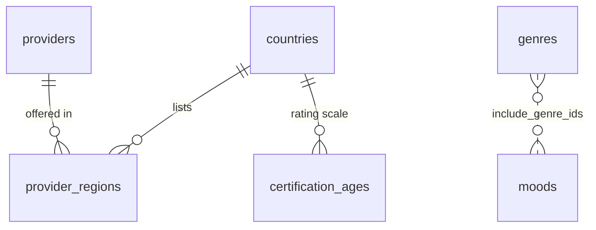
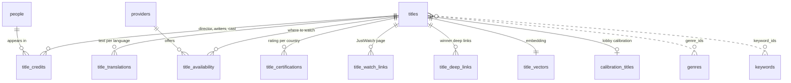
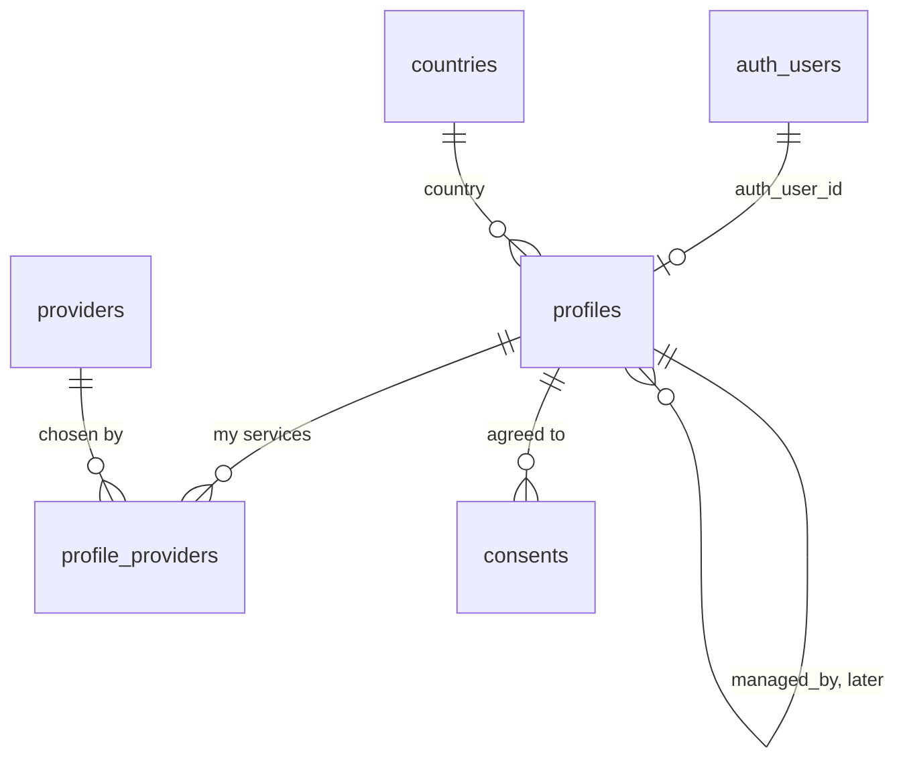
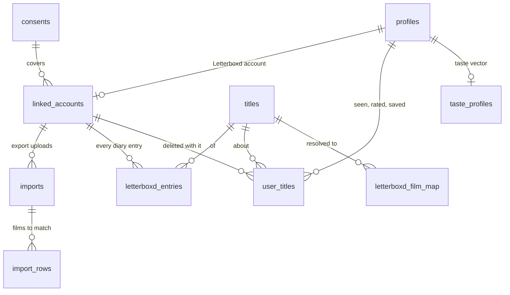
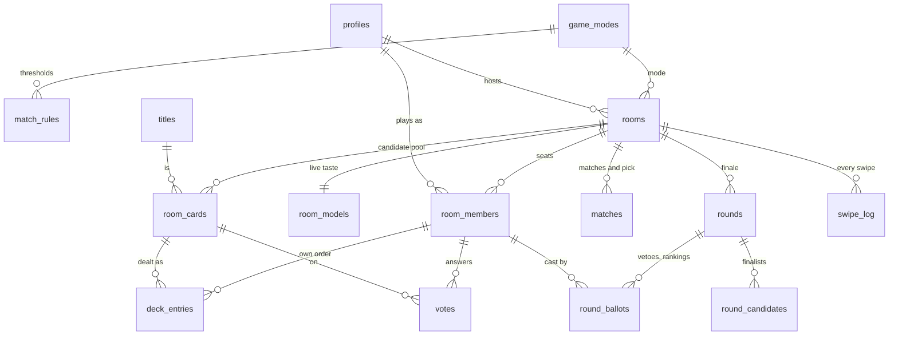
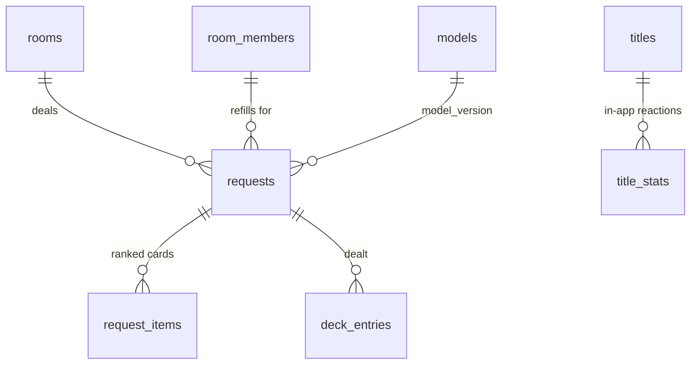
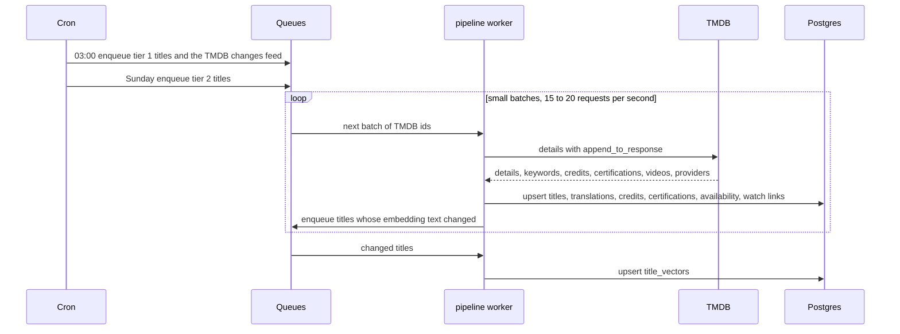
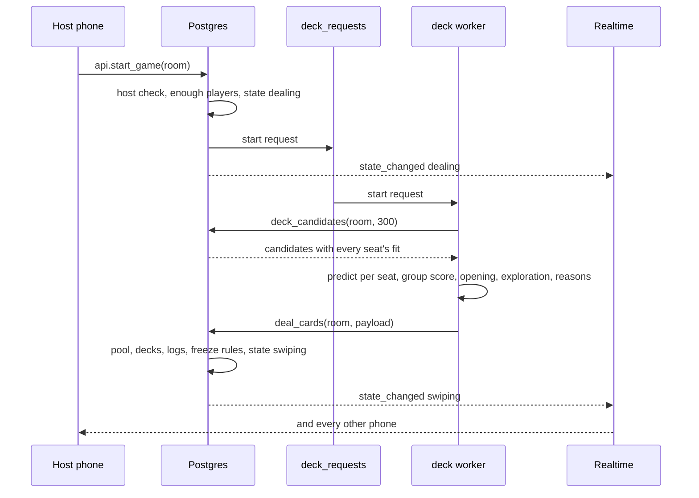
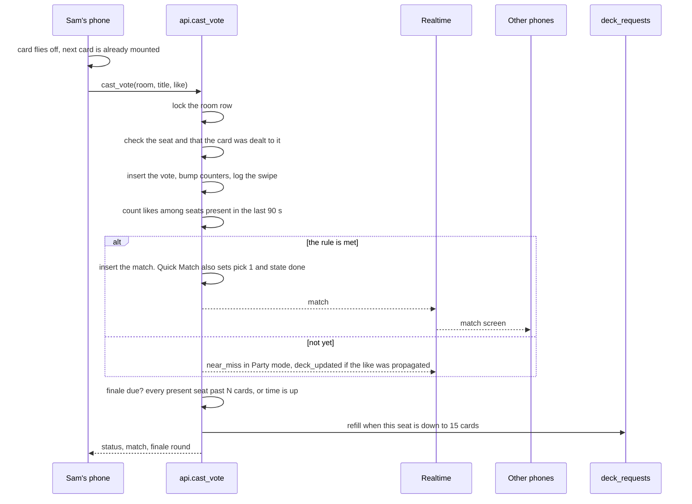

# Flimme data model

The database for the first public release of Flimme and how every part talks to it. It is built from the [revival plan](../product/revival-plan.md) (stack, catalog, deck engine, game design, Letterboxd) and the [monetization options](../product/monetization.md) (Host Pro, family modes, packs). Written in October 2026.

Companion docs: the [recommendation server](recommendation-server.md) (its processes, its contract with this database, the algorithm), the [deck engine](deck-engine.md) (how every card is chosen) and the [Letterboxd integration](../integrations/letterboxd.md) (the export, connecting, syncing). Decisions and open questions live in [decisions.md](../decisions.md).

> **Pending.** The [deck engine](deck-engine.md) needs changes that aren't in this doc or in schema.sql yet: a `card_history` table, mood scores per film, deck recipes, moods on the room instead of the seat, `allow_rewatch` as the default seen rule, and a taste check that no longer marks films as seen. The full list is in [Changes to the data model](deck-engine.md#changes-to-the-data-model). The other pre-coding docs ask for more: [game-modes.md](../product/game-modes.md#changes-to-the-data-model) (one finale stage, a rewatch answer, a time limit on every rule, the game functions still to write and fixes to existing ones), [tmdb.md](../integrations/tmdb.md#changes-to-the-data-model) and [streaming-availability.md](../integrations/streaming-availability.md#changes-to-the-data-model) (the catalog jobs, service variants, free services), [app-structure.md](app-structure.md#changes-this-asks-of-the-backend) (accepting votes on cards a refill removed, fixing unmatched Letterboxd films, app config keys) and [onboarding.md](../product/onboarding.md#what-this-needs-elsewhere) (a room reference on invite links). Streaming Availability is dropped from v1 ([decisions.md](../decisions.md)): `title_deep_links`, `providers.streaming_availability_id`, the `winner_links` queue and the `result` event go, and the winner screen shows where to watch from `title_availability`. The launch docs add more: [security.md](security.md#the-database-gaps-found) (default privileges, a restricted `api.title_cards`, removing a player and locking a room, per-IP rate limits, preset avatars and name filtering, a narrower role for the server's HTTP API), [server-structure.md](server-structure.md#consuming-the-queues) (queue grants for `app_server`, a `letterboxd_match` queue), [operations.md](operations.md#changes-this-asks-elsewhere) (`internal.ops_health()`, `internal.run_retention()`), [privacy.md](../product/privacy.md#what-we-store-and-why) (training and Letterboxd-ratings switches, two retention periods) and [analytics.md](../product/analytics.md#changes-this-asks-elsewhere) (more keys in `rooms.stats`, an aggregate-only `analytics` schema).

- **[schema.sql](schema.sql)** is the reference DDL for everything marked v1 below: tables, indexes, row-level security, roles, realtime policies, the queues, the app's API and the game functions. It loads cleanly on Postgres 16 with pgvector, and a 120-check test suite passed against it (see [What was tested](#what-was-tested)).
- **v1** means the first release: the revival plan's Launch items and roadmap phases 1 to 5.
- **Later** means after launch: the revival plan's Later items and every paid feature in the monetization doc. The [Later](#later-how-each-future-feature-lands) section shows where each one plugs in.

## Contents

1. [At a glance](#at-a-glance)
2. [Who does what](#who-does-what)
3. [Ten decisions that shape everything](#ten-decisions-that-shape-everything)
4. [Schemas](#schemas)
5. [Reference data](#1-reference-data)
6. [Catalog](#2-catalog)
7. [Players](#3-players)
8. [Film history and taste](#4-film-history-and-taste)
9. [Rooms and the game](#5-rooms-and-the-game)
10. [Recommendation data](#6-recommendation-data)
11. [Operations](#7-operations)
12. [How it fits together](#how-it-fits-together)
13. [The app's API](#the-apps-api)
14. [Who sees what](#who-sees-what)
15. [Realtime](#realtime)
16. [Queues and scheduled jobs](#queues-and-scheduled-jobs)
17. [Sizes and speed](#sizes-and-speed)
18. [Retention](#retention)
19. [Later: how each future feature lands](#later-how-each-future-feature-lands)
20. [Open questions](#open-questions)
21. [What was tested](#what-was-tested)

## At a glance

| | v1 |
| --- | --- |
| Tables | 47: 43 in `public` (reference data, catalog, players, film history, rooms and the game, operations) and 4 in `rec` (the recommendation server's logs, models and stats) |
| The app's API | 17 views and 18 functions in the `api` schema, the only schema the app can reach |
| Recommendation server | 4 processes in one codebase: deck worker, pipeline worker, HTTP API, nightly trainer |
| Queues | 7, from the database to the server |
| Realtime topics | 2 per room: `room:<id>` for server events, `room:<id>:live` for presence and reactions |
| External calls during a game | None. TMDB and Letterboxd are read by the server in the background; Streaming Availability is called once per game, for the winner |

## Who does what

The split follows one rule: **Postgres decides the game, the server decides the deck.**

| | Supabase | Recommendation server |
| --- | --- | --- |
| Owns | The truth: rooms, seats, votes, matches, the finale, sign-in, live messaging | Choosing cards: ranking, learning, every call to an outside service |
| Runs | The game functions (join, vote, match, finale) in one transaction each; the retrieval query; queues; schedules | Workers that consume queues, a small HTTP API, the nightly trainer |
| Talks to | Phones, directly | Postgres; TMDB, Letterboxd RSS, Streaming Availability; object storage. Phones only for Letterboxd and account requests |
| If it is down | Nothing works | Games still start and carry on with the SQL baseline deck. Imports and catalog refreshes wait in their queues |

Why the game stays in Postgres: a vote must save, count, check the match rule and broadcast in one transaction, in a few milliseconds, with no race between two last likes. Moving that into a server would add a network hop to every swipe and re-create the old app's two sources of truth. Why ranking goes to a server: the algorithm will grow (Letterboxd ratings, swipe history, global ratings, trained models, experiments), needs real ML libraries and long jobs, and doesn't need to be inside a transaction. Each seat keeps 15 cards of buffer, so a refill can take a second without anyone noticing.

## Ten decisions that shape everything

1. **Postgres decides, Realtime only tells.** Every vote, join and match is decided inside one database transaction; Realtime fans the result out. A phone that misses a message can always re-read the truth.
2. **The app sees only the `api` schema.** Phones read views and call functions in `api`; they have no access to tables. The schema behind it can change, and the server can take over a function, without breaking installed apps. Incompatible changes ship as `_v2` next to the old version.
3. **Postgres decides the game, the server decides the deck.** The server never writes votes, matches or room state. It writes decks through one function, `internal.deal_cards`, under the same room lock as votes.
4. **The server is never on the critical path.** If it doesn't deal within 8 seconds, the SQL baseline does.
5. **A player is a profile, not a login.** `profiles` has its own id and an optional `auth_user_id`. At launch they are always equal. Later, kid profiles are profiles with no login, managed by a parent, without changing any other table.
6. **Votes belong to seats.** A seat (`room_members`) is one player in one room. Votes, decks and ballots point at the seat. Deleting an account leaves an anonymous seat, and pass-and-play later is one phone controlling several seats.
7. **Titles have their own id.** TMDB numbers movies and TV shows separately, so the same id can be both a movie and a show. `titles.id` is ours, with `(media_type, tmdb_id)` unique.
8. **Facts are stored per source, and Letterboxd per account.** What a player has seen, rated or saved is one row per film per source (Letterboxd, calibration, the app). Letterboxd connects only through the player's own export, and each account keeps its own copy, so nobody can read or delete anyone else's. Disconnecting deletes exactly what came from Letterboxd, by cascade.
9. **Every card served is logged with what the model knew.** `rec.requests` and `rec.request_items` record the model version, experiment, score, features and exploration odds of every card dealt. Joined to votes, that is the training set, from the first game.
10. **Later features add, never rewrite.** Everything in the Later section is new tables, columns, enum values, config rows or api functions.

## Schemas

| Schema | Holds | Reached by |
| --- | --- | --- |
| `public` | All tables | Nobody directly. The api views and functions, the server |
| `api` | 17 views and 18 functions: the app's whole surface | Phones (it is the only schema exposed through Supabase's Data API) |
| `internal` | Game logic and helpers: match check, propagation, finale, dealing, retrieval, card payloads, broadcasting, queueing | api functions, triggers, the server |
| `rec` | Recommendation requests, ranked items, models, title stats | The server only |

Two roles matter besides Supabase's own: `authenticated` (every phone, guests included) and `app_server` (the recommendation server's database login).

## 1. Reference data

Small tables, filled by the server's ingest jobs.

**countries**: one row per ISO country. `catalog_enabled` marks the countries whose availability is ingested.

| Column | Type | Notes |
| --- | --- | --- |
| code | char(2) PK | ISO 3166-1, upper case |
| default_language | text | Language for TMDB text when a player has none set |
| catalog_enabled | boolean | Availability is ingested for this country |

**genres**: TMDB genres. `media_types` keeps TV-only genres (News, Reality, Talk Show) out of movie rooms, which the old app got wrong.

| Column | Type | Notes |
| --- | --- | --- |
| id | integer PK | TMDB genre id |
| slug | text unique | `horror`, `comedy` |
| names | jsonb | `{"en": "Comedy", "fr": "Comédie"}` |
| media_types | media_type[] | `{movie}`, `{tv}` or both |

**keywords** (id, name) and **people** (id, name, profile_path, popularity, updated_at) use TMDB ids as keys.

**providers**: streaming services.

| Column | Type | Notes |
| --- | --- | --- |
| id | integer PK | TMDB watch provider id (8 is Netflix) |
| name, logo_path | text | |
| streaming_availability_id | text | Service id for "Open in Netflix" links, null until mapped |

**provider_regions**: which services exist in which country, with TMDB's display order. Replaces the old 64,000-line `countries.json`. Key: (provider_id, country).

**certification_ages**: maps each country's ratings to a minimum age (`US PG-13` is 13, `FR 12` is 12, `FR U` is 0). Key: (country, certification).

**moods**: the mood chips.

| Column | Type | Notes |
| --- | --- | --- |
| slug | text PK | `cozy`, `mind_bending`, `laugh`, `scary`, `background` |
| names | jsonb | Per language |
| include_genre_ids, exclude_genre_ids, keyword_ids | integer[] | What the mood means for the deck |
| runtime_max | smallint | "Background noise" might cap runtime |
| sort, is_active | | Display order, switch off without deleting |

## 2. Catalog

About 40,000 popular movies at launch, written only by the server's ingest jobs. Nothing here is personal. Phones never read these tables; they get ready-made cards from `api.my_next_cards` and `api.title_cards`.

**titles**: one row per film (later, per show).

| Column | Type | Notes |
| --- | --- | --- |
| id | bigint PK | Ours, generated |
| media_type | media_type | `movie` at launch, `tv` later |
| tmdb_id | integer | Unique together with media_type |
| imdb_id | text | Kept for lookups, never shown |
| original_title, original_language | text | |
| release_date | date | |
| release_year | smallint | Generated from release_date |
| runtime_min | smallint | Time budget filter |
| genre_ids, keyword_ids | integer[] | GIN index on genre_ids for the deck filter |
| collection_id | integer | TMDB collection, so the opening never shows five sequels of one franchise |
| popularity, vote_average, vote_count | | From TMDB. vote_average is the "global rating" shown on the card |
| quality_score | real | Vote average weighted by vote count, 0 to 10, computed at ingest |
| poster_path, backdrop_path | text | The app requests w500 or w780, never /original |
| poster_placeholder | text | Blurhash or thumbhash shown while the poster loads |
| trailer_key | text | YouTube key for the card back |
| is_adult | boolean | Always excluded |
| is_active | boolean | Titles are deactivated, never deleted, because votes point at them |
| refresh_tier | smallint | 1 refreshed daily (popular), 2 weekly (long tail) |
| tmdb_changed_at, refreshed_at | timestamptz | For the changes feed and refresh scheduling |

**title_translations**: title, overview, tagline and an optional localized poster per language. Key: (title_id, language). A trigram index on `title` serves search.

**title_credits**: directors, writers and the top 8 cast. Key: (title_id, person_id, role).

**title_certifications**: the rating in each country and its `min_age`. Key: (title_id, country).

**title_availability**: the heart of the deck filter.

| Column | Type | Notes |
| --- | --- | --- |
| title_id, country, provider_id, kind | PK | kind is `subscription`, `free`, `ads`, `rent` or `buy` |
| checked_at | timestamptz | Last ingest that saw it |

Index `(country, provider_id, kind, title_id)` answers "is this film on any of tonight's services here" without touching the titles table.

**title_watch_links**: TMDB's JustWatch-powered watch page per title and country. JustWatch must be credited wherever availability shows.

**title_deep_links**: "Open in Netflix" links from Streaming Availability, fetched only for winners and cached until `expires_at`.

**title_vectors**: one 384-dimension gte-small embedding per title, built from a short text (title, year, genres, top keywords, director, main cast, overview). `model` and `source_hash` say which model made it and when the text changed. Kept out of `titles` so catalog reads never drag 1.5 KB vectors along. An HNSW index serves "films like this one"; the deck query filters first and compares against the few thousand eligible films directly.

**calibration_titles**: the 8 to 10 well-known films used in the lobby, each tagged with the taste axis it splits.

## 3. Players

**profiles**: one row per player. Created by a trigger the moment Supabase creates an auth user, guest or not.

| Column | Type | Notes |
| --- | --- | --- |
| id | uuid PK | Equal to the auth user id at launch |
| auth_user_id | uuid unique | Supabase auth user. Linking Apple or Google keeps the same id, so a guest keeps their history |
| managed_by | uuid | Null at launch. Later, the parent of a kid profile. Exactly one of auth_user_id and managed_by is set |
| display_name | text | Up to 24 characters, set with `api.update_profile`. Required to create or join a room |
| avatar_key | text | A preset avatar, never a photo |
| country | char(2) | Default room country when this player hosts |
| language | text | Language for titles and overviews on cards |
| created_at, updated_at, last_seen_at | timestamptz | |

Whether a profile is a guest is not stored: it is the `is_anonymous` claim in the Supabase token.

**profile_providers**: the services a player has, set with `api.set_my_providers`. Key: (profile_id, provider_id).

**consents**: what a player agreed to and which wording version. Kinds at launch: `letterboxd_import`, `analytics`. One active consent per kind.

## 4. Film history and taste

Everything the game knows about a player's taste. Private to the player; rooms only see derived results. Written by the server (Letterboxd, taste) and by api functions (calibration, after-game answers).

**linked_accounts**: a player's Letterboxd account. It can only be created by uploading the player's own export, and the username comes from the export's `profile.csv`, so nobody types a username. Several app accounts may link the same username; each keeps its own copy of the data.

| Column | Type | Notes |
| --- | --- | --- |
| id | uuid PK | |
| profile_id | uuid | One per provider per player. Uploading an export for a different username replaces the old link and its data |
| provider | linked_provider | `letterboxd` (later `trakt`, `tmdb`) |
| username | text | From `profile.csv`, lower case |
| consent_id | uuid | The consent the player gave before the first upload |
| exported_at | timestamptz | When the latest export was made. A film logged after it leaves the watchlist |
| rss_match_share, rss_checked_at | | How much of the public feed was found in the export when it was uploaded (see [the RSS check](../integrations/letterboxd.md#the-rss-check)) |
| feed_etag, feed_last_modified | text | For conditional RSS requests |
| last_synced_at | timestamptz | The export counts as a sync. Joining a room syncs again if this is over 6 hours old |
| sync_requested_at | timestamptz | A sync is queued; stops duplicate requests |
| next_sync_after | timestamptz | 14 days after the last successful sync, whatever triggered it |
| gap_detected_at | timestamptz | The feed moved past what we had; the app asks for a new export |
| last_error | text | Shown on the settings screen |

**imports**: one row per export upload, with counts and status. Powers "81 films imported, 1 to check".

**import_rows**: one row per film from the export's `watched.csv` and `watchlist.csv`, merged on the phone: watched (only a seen flag) and on the watchlist. Ratings come only from the diary; ratings without a diary entry and hearts are not read. Matched rows are applied and deleted; unmatched rows stay for the manual fix.

**letterboxd_entries**: every diary entry we have seen for a linked account: the whole diary from the export, then each new entry from the RSS feed. This is the player's timeline, and it keeps growing past the feed's 50 entries.

| Column | Type | Notes |
| --- | --- | --- |
| id | bigint PK | |
| linked_account_id | uuid | Deleted with the link |
| title_id | bigint | Null until the film is matched. Export rows take it from the matched film (same name and year); feed items carry a TMDB id |
| film_name, film_year | | As Letterboxd names it |
| watched_on | date | "Watched Date" in the export, `letterboxd:watchedDate` in the feed. Not the export's "Date", which is when it was logged |
| logged_on | date | "Date" in the export, the item's publish date in the feed |
| rating | numeric(2,1) | The rating on that entry |
| rewatch | boolean | |
| source | text | `export` or `rss`, whichever brought it first |
| export_uri, rss_guid | text | The export's `boxd.it` link for the entry, the feed's item id |

An export row and a feed item for the same film and watched date are the same entry (unique on account, film name, year and watched date).

**letterboxd_film_map**: shared by everyone, no personal data. Each Letterboxd film is resolved to a TMDB title once: from the feed's `tmdb:movieId`, else a TMDB search by title and year (plus or minus one), else a manual fix. Keyed by `boxd:<id>` for the export's film links and `slug:<slug>` for the feed's.

**user_titles**: the film history, one row per player, film and source.

| Column | Type | Notes |
| --- | --- | --- |
| profile_id, title_id, source | PK | source is `letterboxd`, `calibration` or `app` |
| linked_account_id | uuid | Set exactly when source is `letterboxd`; cascade deletes on disconnect |
| seen | boolean | Feeds the seen filter |
| rating | numeric(2,1) | 0.5 to 5 in half stars. For Letterboxd, the rating on the most recently logged rated diary entry |
| on_watchlist | boolean | Feeds watchlist overlap |
| reaction | reaction | `love`, `fine` or `nope`: calibration answers and the after-game question |
| rewatch_count, last_watched_on | | Recency weighting |

The `letterboxd` rows are the per-film summary the deck query reads. An export replaces them with its own state; then the diary entries are folded in (seen, the latest rating, number of watches, last watch). A film logged after the export leaves the watchlist; one re-added to the watchlist after an older watch stays on it. Each feed sync folds in only the films it touched.

The view **user_title_facts** merges the sources into one row per player and film.

**taste_profiles**: one per player, written by the server's taste worker.

| Column | Type | Notes |
| --- | --- | --- |
| profile_id | uuid PK | |
| embedding | vector(384) | Weighted average of the embeddings of films the player reacted to. Starting weights from the plan: 5★ +1, 4★ +0.6, 3★ +0.1, 2★ -0.5, 1★ -1, logged or watched without a rating +0.2; love +1, fine +0.2, nope -1; swipes in games add their own weights |
| affinities | jsonb | Readable weights by genre, decade, director and language, for "why this card" labels |
| signal_count | integer | How much the profile is based on |
| model, computed_at | | Which model built it, and when |

The embedding is what SQL retrieval uses. The server is free to keep richer per-player features of its own in `rec`.

> The weights above are replaced by the deck engine's [signals](deck-engine.md#signals), which also add a `confidence` column.

## 5. Rooms and the game

### Configuration

**game_modes**: one row per mode.

| Column | Type | Notes |
| --- | --- | --- |
| slug | text PK | `quick_match`, `final_cut`, `date_night` at launch |
| min_players, max_players | smallint | Date Night is 2 and 2 |
| ends_on_first_match | boolean | True for Quick Match and Date Night. In Final Cut, matches join the shortlist |
| defaults | jsonb | Room setting defaults for the mode |
| is_active, sort | | |

**match_rules**: when a like becomes a match, and when the finale starts. Seeded with the plan's starting values:

| Mode | Players | Instant match | Finale |
| --- | --- | --- | --- |
| Quick Match | 2 | Both like it | Final Cut of 3 after 40 cards |
| Quick Match | 3 to 4 | Everyone likes it | Final Cut of 4 after 50 cards or 8 minutes |
| Quick Match | 5 to 10 | 70% like it | Ranked vote of 4 after 50 cards or 10 minutes |
| Date Night | 2 | Both like it | Final Cut of 3 after 40 cards |
| Final Cut | 2 to 4 | Everyone likes it (joins the shortlist) | Final Cut of 4 after 30 cards or 10 minutes |
| Final Cut | 5 to 10 | 70% like it (joins the shortlist) | Final Cut of 4 after 30 cards or 10 minutes |

The 10-minute limits are my starting values; the plan only gives 8 minutes for 3 to 4 players.

> Proposed changes to these values (a time limit on every rule, 40 cards for every Quick Match size) are in [Time to a pick](../product/game-modes.md#time-to-a-pick).

### The room

**rooms**

| Column | Type | Notes |
| --- | --- | --- |
| id | uuid PK | |
| code | char(6) | Six digits. Unique among open rooms only, so codes are recycled |
| host_id | uuid | Moves to the longest-seated player if the host leaves |
| mode | text | References game_modes |
| state | room_state | `lobby`, `dealing` (start pressed, the server is dealing), `swiping`, `finale`, `done`, `abandoned` |
| country | char(2) | From the host's profile; drives availability and certifications |
| service_rule | service_rule | `any_member` (default: one screen) or `every_member` (long-distance) |
| offer_kinds | offer_kind[] | Default subscription, free, ads. Rent and buy are there for a later "rent it" option |
| runtime_max | smallint | "We have 2 hours" |
| seen_rule | seen_rule | `hide_seen` (default), `allow_rewatch` (only films everyone who saw them rated 4★ or more), `show_all` |
| quality | quality_preset | `standard` (150+ votes, 6.2+), `hidden_gems`, `guilty_pleasures` |
| max_age | smallint | Age cap from certifications |
| reveal | reveal_mode | `party` (near-miss teasers) or `blind` |
| max_players | smallint | 10 at launch |
| provider_ids | integer[] | Tonight's services, recomputed from the seats on every change |
| rule | jsonb | The mode's match_rules rows, frozen at start |
| seed | integer | Random seed for reproducible openings and wildcards |
| stats | jsonb | Written by the server when the room ends: duration, swipes, players. Feeds the recap card |
| created_at, dealing_at, started_at, finale_at, decided_at, ended_at | timestamptz | The funnel |
| expires_at | timestamptz | Lobbies that never start are abandoned after 3 hours |

**room_models**: the room's live taste. Starts as the average of the seated players' profiles; the server updates it from the votes at each refill and records genres the room dropped.

### Seats

**room_members**: one player in one room.

| Column | Type | Notes |
| --- | --- | --- |
| id | uuid PK | The seat id. Everything in the game points here |
| room_id | uuid | |
| profile_id | uuid | Who plays this seat. Null if the account was deleted |
| controlled_by | uuid | Whose device may act for the seat. Equal to profile_id at launch; a parent's profile for pass-and-play later |
| role | member_role | `host` or `guest` |
| display_name, avatar_key | text | Snapshot at join, so other players never read your profile |
| provider_ids | integer[] | This player's services tonight, prefilled from their profile |
| mood_slugs, genre_ids | | "Tonight I want", a soft boost in their fit |
| joined_at, left_at | timestamptz | Rejoining clears left_at and keeps the same seat |
| last_active_at | timestamptz | Heartbeat. Only seats active in the last 90 seconds count for match rules |
| calibrated_at, done_at | timestamptz | |
| swipe_count | integer | Progress ring |
| super_likes_left, vetoes_left | smallint | 2 super likes and 1 Final Cut veto per game |
| refill_requested_at | timestamptz | A refill is queued for this seat. Cleared when the server deals; resent if older than 30 seconds |
| watched_answer, post_reaction, followup_at | | "Did you watch it?" after the game |

### Cards, decks and votes

**room_cards**: the room's candidate pool, written through `internal.deal_cards`.

| Column | Type | Notes |
| --- | --- | --- |
| room_id, title_id | PK | |
| source | card_source | `ranked` or `wildcard` |
| state | card_state | `active`, `dropped` (someone has seen it, under hide_seen), `matched`, `finalist` |
| group_score | real | The server's group score (or the baseline's) |
| min_fit | real | The least happy player's predicted fit |
| fits | jsonb | Every seat's predicted fit |
| reason_code, reason_params | | "Because you all liked Arrival", "On Sam and Jo's watchlists", "94 min", "Wildcard". Params hold seat and title ids; the phone renders the text in its language |
| member_ratings | jsonb | A seated player's Letterboxd rating of this film, for the card back |
| like_count, super_like_count, nope_count, seen_count | smallint | Updated by the vote. Never sent to phones |

**deck_entries**: each seat's order through the pool.

| Column | Type | Notes |
| --- | --- | --- |
| room_member_id, title_id | PK | |
| room_id | uuid | With title_id, a foreign key to room_cards |
| sort_key | double precision | Fractional, so a card can be slotted between two others |
| source | deck_source | `opening` (first 10, same for everyone), `ranked`, `propagated` (moved up because someone liked it), `wildcard` |
| score | real | The score that put the card here |
| request_id | bigint | The `rec.requests` row that dealt it |

**votes**: one answer per seat per film. Key: (room_member_id, title_id), which also makes offline retries harmless.

| Column | Type | Notes |
| --- | --- | --- |
| answer | vote_answer | `nope`, `like`, `super_like`, `seen` (swipe up) |
| created_at | timestamptz | Server time |
| client_created_at | timestamptz | When the phone recorded it, if it was queued offline |

**swipe_log**: append-only record of every vote and undo, with the deck source, score and how long the card was on screen. Points at the seat, so it stays anonymous once an account is gone.

**matches**: every film that met the room's rule, plus the night's pick. `kind` is `unanimous`, `majority` or `finale`; `like_count` and `present_count` give "3 of 3"; `pick_order` 1 is the pick (2 and 3 for a double feature later).

### The finale

**rounds**: one finale per room at launch. `kind` is `final_cut` (veto stage, then rank stage) or `ranked_vote` (rank only). `stage_closes_at` is the current deadline.

**round_candidates**: the 3 or 4 finalists, seeded by matches, then likes (super likes count double), then group score. `vetoed_at`, `vetoed_by`, and `points` for the Borda count.

**round_ballots**: `veto`, `pass` or `rank` rows. One veto or pass per seat per round; one rank per seat per title.

## 6. Recommendation data

The `rec` schema belongs to the server. Phones can't see it.

**rec.requests**: one row per deal.

| Column | Type | Notes |
| --- | --- | --- |
| id | bigint PK | |
| room_id | uuid | |
| room_member_id | uuid | The seat for a refill; null when dealing the whole room |
| kind | text | `start`, `refill`, `rerank` |
| model_version | text | Which model ranked it. `sql-baseline` for the fallback |
| experiment, variant | text | A/B test assignment. Assigned per room, since the group is what gets the deck |
| strategy | jsonb | Exploration rate, misery line, weights used |
| candidates, latency_ms | integer | |
| is_fallback | boolean | Dealt by the SQL baseline because the server didn't answer |

**rec.request_items**: every card a request ranked for a seat: position, score, `explore` (picked to explore rather than exploit), `propensity` (the chance the policy picked it, which makes fair offline comparisons between models possible) and `features` (what the model knew). Joined to `votes` on (room_member_id, title_id), this is the training data.

**rec.models**: the model registry: version, kind (`baseline`, `taste`, `ranker`, `group`), status (`shadow`, `active`, `retired`), traffic share, parameters, offline metrics, where the model file lives, the training date range.

**rec.title_stats**: how the app's players react to each film, overall and per country: impressions, likes, super likes, nopes, seen, a smoothed like rate and seen rate. Rebuilt nightly from votes. In-app signals only, never aggregates of imported Letterboxd data (see [using the data](../integrations/letterboxd.md#using-the-data)).

## 7. Operations

**rate_limits**: counters per key and 10-minute window. `join:<profile id>` allows 10 join attempts per window, so the million 6-digit codes can't be walked. Supabase also rate-limits anonymous sign-ins per IP (configurable in the Auth settings).

**ingest_runs**: one row per catalog job run, with counts, errors and a resume cursor.

**app_config**: key and value pairs the app reads at launch through `api.app_config`, starting with `min_app_version` per platform, so an old build can be asked to update before an incompatible change.

## How it fits together

### Catalog ingest

- The first load of 40,000 titles is a one-off run of the same worker code from a laptop or CI, about 35 to 45 minutes at a polite rate.
- Availability rows a refresh no longer sees are deleted. Titles that drop out of TMDB are marked `is_active = false`.

> This schedule is replaced by [tmdb.md](../integrations/tmdb.md#keeping-it-fresh): a daily availability sweep per country, and full fetches weekly for watchable films and monthly for the rest.

### First launch

1. The app calls Supabase anonymous sign-in. The auth trigger creates the profile with the same id.
2. The player types a name: `api.update_profile` (name, country from the device region, language), then `api.set_my_providers`.
3. Signing in with Apple or Google later links the identity to the same auth user. Nothing in the database moves.

> Services are now asked the first time a room needs them, not at first launch: see [onboarding](../product/onboarding.md#first-launch).

### Create and join

1. The host calls `api.create_room(mode)`: a free 6-digit code, the host seat, the room model, the service list. Later, the hosting cap and the room's tier are decided here.
2. The invite is `/join/482913` as a link and a QR code.
3. A guest calls `api.join_room(code)`. It counts the attempt first, then answers `ok`, `not_found`, `full`, `starting`, `in_finale`, `name_required` or `rate_limited`. It never raises an error on a wrong code, since an error would roll back the attempt counter. A player who already has a seat gets the same seat back.
4. Each new seat recomputes the room's services and broadcasts `member_joined`.

### Lobby

- Each player sets tonight's services, moods and genres on their seat (`api.set_seat_prefs`). The host edits room settings (`api.update_room_settings`): time budget, seen rule, quality, reveal mode, age cap.
- Players without Letterboxd answer the calibration films (`api.submit_calibration`). Answers become `user_titles` rows, `calibrated_at` is set so friends see the tick, and a taste refresh is queued; the server rebuilds the profile in well under a second, before the host taps start.
- Phones send `api.touch_room` every 30 seconds and track presence on `room:<id>:live`.

### Start: dealing the deck

If nothing has arrived 8 seconds after the tap, the host's phone calls `api.start_game` again and the database deals the SQL baseline itself (`internal.deal_baseline`): the same candidates, the same order for every seat, logged as `sql-baseline` with `is_fallback`.

### A swipe

- **One lock per room.** Votes in the same room run one after another (a few milliseconds each), so two last likes can never both see "not yet". Rooms never wait on each other. Tested with two overlapping transactions.
- **Present players only.** A seat counts if it hasn't left and has been active in the last 90 seconds.
- **Seen it.** Under `hide_seen`, a "seen it" answer drops the card for the room and removes it from every deck that hasn't reached it. Under the other seen rules it abstains.
- **Super likes** spend one of the seat's two, count as likes and count double when seeding the finale.
- **Offline.** Votes are queued on the phone and retried. A retry returns `duplicate`; a vote after the room is decided returns `closed`.
- **Undo** removes the seat's last vote while its card is still active, restores counters and the super like, and logs the undo.

### Like propagation and refills

- The first like on a card moves it into every other seat's upcoming cards, between their 3rd and 4th, unless it was already closer. Those seats get `deck_updated` and refetch what's behind their mounted cards.
- At 15 cards left the vote queues a refill for that seat. The deck worker updates `room_models` from the votes, retrieves again (now with the live room signal), and calls `deal_cards` with `keep: 3`: the 3 mounted cards and any propagated card stay, the rest is replaced by the new ranking, and new cards are appended.
- If the phone gets down to 5 cards with nothing new, it calls `api.request_cards`. After 8 seconds without an answer from the server, that deals the SQL baseline for the seat.
- Late joiners get the active opening cards at join time and a queued refill.

### Leaving and coming back

- `api.leave_room` marks the seat, hands the host role to the longest-seated player, recomputes services and re-checks liked cards: if everyone still here liked a card, that's a match now.
- A phone that silently disappears stops counting after 90 seconds; the minute sweeper re-checks liked cards in rooms where a seat timed out.
- Reopening the app calls `api.join_room` with the room's code: same seat, and `api.my_next_cards` returns the rest of the deck.

### Finale

1. When the rule's card count or time limit is reached (after every vote, and by the minute sweeper), `internal.start_finale` seeds 3 or 4 finalists: matches first, then the most liked, then group score.
2. **Final Cut**: each seat may veto one finalist or pass, within 45 seconds. A veto can't remove the last two films standing.
3. **Rank**: each seat orders the remaining films within 60 seconds. Borda count picks the winner; ties go to more super likes, then group score.
4. The winner becomes a `matches` row with kind `finale` and `pick_order` 1, and the room is done.

The veto, rank and stage-closing functions are described here but not yet in schema.sql.

> The finale's rules change in [game-modes.md](../product/game-modes.md#the-finale): one 45-second round where players rank and veto at once, with secret vetoes, and the only film nobody vetoed wins. The functions still to write are specified in [Functions still to write](../product/game-modes.md#functions-still-to-write).

### After the match

Every path to `done` fires a trigger that queues `room_finished`. The pipeline worker then:

1. Writes `rooms.stats` for the recap card ("Paddington 2 in 3 min 42 s, 3 people, 41 swipes").
2. Turns "seen it" swipes into `user_titles` rows with source `app`.
3. Calls Streaming Availability once for the winner and fills `title_deep_links`, then broadcasts `result`. The phone shows TMDB's watch page until then.
4. Queues a taste refresh for every seat.

> Step 3 no longer applies: Streaming Availability is dropped from v1, and the winner screen shows the room's services that have the film.

On a later app open, "Did you watch it?" (`api.answer_followup`) saves the seat's answer and, if they watched the pick, a seen row with their reaction, and queues a taste refresh. The reminder itself can be a notification scheduled on the phone when the room ends.

### Letterboxd

Connecting by export, the RSS check, syncing and gaps are in [integrations/letterboxd.md](../integrations/letterboxd.md).

### Deleting an account, exporting data

- **Delete** (App Store guideline 5.1.1(v)): the phone calls the server's HTTP API, which deletes the auth user through Supabase's admin API. That cascades to the profile, services, consents, linked accounts, imports, diary entries, film history and taste profile. Seats in past rooms keep their votes but lose `profile_id`, `controlled_by` and their name, so the swipe log, training data and other players' history stay correct and anonymous.
- **Export** (GDPR): `api.export_my_data()` returns the profile, services, consents, linked accounts, the Letterboxd diary, film history, taste affinities and the player's own votes as JSON.

## The app's API

Everything the app does goes through the `api` schema with `supabase-js`: `.from('room_seats')` for views, `.rpc('cast_vote', …)` for functions.

**Views** (row-level security on the tables underneath decides the rows)

| View | Returns |
| --- | --- |
| `my_profile`, `my_providers` | Your profile and services |
| `country_providers`, `genres`, `moods`, `game_modes`, `calibration_titles` | Reference data for the pickers |
| `app_config` | Minimum app version and other launch settings |
| `rooms`, `room_seats`, `room_matches`, `rounds`, `round_candidates` | Rooms you have a seat in. `room_seats` flags `is_me` and `is_mine` |
| `my_votes` | Your own votes, for rejoining |
| `my_linked_accounts`, `my_imports`, `my_unmatched_films` | Letterboxd status (username, export date, last sync, `needs_new_export`) and the manual fix list |

**Functions**

| Function | What it does |
| --- | --- |
| `update_profile(name, avatar, country, language)` | Edits your profile |
| `set_my_providers(ids)` | Replaces your services |
| `create_room(mode, country)` | New room, host seat, code |
| `join_room(code)` | Join or rejoin, rate limited |
| `touch_room(room)` | Heartbeat every 30 seconds |
| `leave_room(room)` | Leave, hand over host, re-check matches |
| `update_room_settings(room, settings)` | Host, lobby only |
| `set_seat_prefs(room, services, moods, genres)` | Your settings for tonight |
| `start_game(room)` | Host: queue the deal; on a second tap after 8 seconds, deal the baseline |
| `request_cards(room)` | Running low with no refill: queue one, or deal the baseline after 8 seconds |
| `cast_vote(room, title, answer, seat, dwell_ms, client_at)` | The vote |
| `undo_last_vote(room, seat)` | Undo |
| `my_next_cards(room, limit, seat, language)` | Your next cards, ready to render: title and overview in your language, poster and placeholder, year, runtime, genres, TMDB score, director, cast, trailer, tonight's services for it, watch link, reason label, members' ratings |
| `title_cards(ids, language, country)` | The same card payload for any films: winner, finale, calibration |
| `submit_calibration(answers, room)` | Lobby calibration |
| `answer_followup(room, watched, reaction)` | "Did you watch it?" |
| `disconnect_letterboxd()` | Removes your Letterboxd link and everything that came with it |
| `export_my_data()` | GDPR export |

To write with the finale: `cast_ballot(round, kind, title, rank)`.

> How the app calls this API (one typed wrapper per function, generated types, status answers) is in [app-structure.md](app-structure.md#talking-to-the-backend).

**Rules for changing it**

- In Supabase, set the Data API's exposed schemas to `api` only, and turn off GraphQL (`pg_graphql`), which the app doesn't use.
- Adding a column to a view or an optional argument to a function is safe. Renaming, removing or changing a meaning is not: ship `cast_vote_v2` next to `cast_vote`, move new app builds to it, and drop the old one once `min_app_version` in `app_config` is past every build that used it.
- The optional `seat` argument on the vote, undo, cards and seat functions is what pass-and-play uses later; at launch phones leave it out.

## Who sees what

Every table in `public` and `rec` has row-level security on. Phones use the `authenticated` role (guests included); `anon` gets nothing.

| Data | Phones | Server (`app_server`) |
| --- | --- | --- |
| Catalog tables | No direct access. Cards come from `api.my_next_cards` and `api.title_cards` | Read and write |
| Reference data, game modes, calibration films, app config | Through api views | Read; writes reference data |
| Your profile, services | Through api views and functions | Read |
| Consents, linked accounts, imports, diary entries, film history, taste profiles | Your own Letterboxd status through api views; the rest never | Read and write |
| Rooms, seats, matches, rounds | Rooms you have a seat in, through api views | Read; writes `rooms.stats` only |
| Room cards, decks | Only through `api.my_next_cards`, for your own seat. Counters, scores and fits never | Read; writes only through `deal_cards` |
| Votes | Your own seat's, through `api.my_votes` | Read |
| `swipe_log`, `room_models`, `rate_limits`, `ingest_runs`, `letterboxd_film_map`, title vectors | Never | Read; writes the ones it owns |
| `rec` schema | Never | Read and write |
| Realtime `room:<id>` | Seated players read | The database sends |
| Realtime `room:<id>:live` | Seated players read and send | |

- Nobody can list rooms. A room is found only by its code, through `join_room`.
- Other players' answers never reach a phone as rows. In Party mode they arrive as counts; in Blind mode not at all.
- Phones can't send on `room:<id>`, so a fake `match` event can't appear there.

> Reviewed in [security.md](security.md): what holds, the gaps found (players who left keep room access, for one) and the Supabase settings this table depends on.

## Realtime

| Event | Topic | Sent by | Payload | The phone |
| --- | --- | --- | --- | --- |
| `member_joined` | room | join_room | seat, name, avatar | Adds the avatar |
| `member_left` | room | leave_room | seat, new host seat | Removes it, moves the crown |
| `seat_updated` | room | set_seat_prefs, submit_calibration | seat | Refetches seats |
| `settings_changed` | room | update_room_settings | changed fields | Refetches the room |
| `state_changed` | room | start_game, deal_cards, finale, end | state | Moves to the next screen ("Shuffling" while dealing) |
| `deck_updated` | room | cast_vote, deal_cards | seat ids | Those seats refetch behind their mounted cards |
| `near_miss` | room | cast_vote, Party mode only | title, likes, of | "2 of 3 of you liked this" |
| `match` | room | cast_vote, leave_room, sweeper | title, kind, likes, of, decided | Match screen |
| `finale_started` | room | start_finale | round, titles, kind, deadline | Final Cut screen |
| `round_progress` | room | ballot functions | stage, ballots in | Progress dots |
| `result` | room | the server, after winner links | winner, deep links ready | Winner screen |
| presence | live | phones | seat, swipe count, done | Progress rings, "Sam is done" |
| `reaction` | live | phones | emoji | Pops it on screen |

Message budget: progress travels in presence updates every 5 swipes rather than one message per swipe. Counting every delivery to every phone, a 4-player game with 60 swipes each comes to roughly 350 messages, so Supabase Pro's 5 million a month covers about 14,000 games.

> Phones open both topics as private channels, which needs "Allow public access" switched off in the project's Realtime settings. How the phone handles each event and missed messages is in [app-structure.md](app-structure.md#realtime).

## Queues and scheduled jobs

**Queues** (Supabase Queues): the database or the server's HTTP API produces, the server consumes.

| Queue | Produced by | Message | Consumer |
| --- | --- | --- | --- |
| `deck_requests` | start_game, cast_vote at 15 cards, join_room for late joiners, request_cards | kind, room, seat | deck worker |
| `taste_refresh` | calibration, after-game answer, Letterboxd export, feed sync with new entries, disconnect, end of room | profile, reason | pipeline worker |
| `letterboxd_sync` | join_room when the last sync is over 6 hours old; the hourly job for accounts with no sync in 14 days | linked account, reason | pipeline worker |
| `catalog_refresh` | cron | TMDB ids or the changes feed | pipeline worker |
| `embed_titles` | catalog refresh | titles whose text changed | pipeline worker |
| `winner_links` | end of room | room, title, country | pipeline worker |
| `room_finished` | trigger on rooms reaching `done` | room | pipeline worker |

> How the server consumes each queue (visibility timeouts, poison messages, why running a message twice is safe) is in [server-structure.md](server-structure.md#consuming-the-queues). It adds a `letterboxd_match` queue, and `app_server` still needs read and delete grants on the queues it consumes.

**Scheduled jobs** (Supabase Cron, inside the database, so schedules live next to the data and the server only consumes):

| When | Job |
| --- | --- |
| Every minute | `sweep_rooms` (to write): finales by time, stage deadlines, re-check matches after a seat times out, abandon expired lobbies |
| Hourly | `internal.enqueue_due_letterboxd_syncs()`: queue accounts with no successful sync in 14 days, for players who have played in the last 12 months. Any sync resets the clock, so frequent players never reach it |
| 03:00 daily | Queue tier 1 titles and the TMDB changes feed |
| 04:00 Sunday | Queue tier 2 titles |
| 04:30 daily | Retention cleanup |

The trainer's nightly run (title stats, training data export, training) is scheduled on the server host, since it is a long batch job rather than a message.

## Sizes and speed

| What | Rough size |
| --- | --- |
| `titles` | 40,000 rows |
| `title_translations` | 80,000 rows (English and French) |
| `title_vectors` | 40,000 × 384 × 4 bytes, about 60 MB before the index |
| `title_availability` | About 50,000 to 100,000 rows per enabled country |
| `letterboxd_entries` | An active logger adds about 300 a year; a few hundred bytes each |
| One 4-player game | About 200 room cards, 320 deck entries, 240 votes, 250 swipe log rows, 320 ranked items |
| `rec.request_items` | With a few hundred bytes of features per row, about 100 KB per game, so about 1 GB a month at 10,000 games |

The ranked items are the one table that grows fast; they move to object storage after 90 days (see Retention). Everything else fits comfortably in Supabase Pro's 8 GB.

**Retrieval query timing**, measured in this session on a 4-core container with Postgres 16 and pgvector 0.6, on a synthetic catalog of 40,000 films with random vectors, 10,300 of them eligible for the room:

| Players in the room | `deck_candidates(room, 300)` |
| --- | --- |
| 2 | about 105 ms |
| 4 | about 150 ms |
| 10 | about 220 ms |

The query body is unchanged since that measurement; only its schema moved. The plan's budget is under 150 ms. Two to four players meet it on this machine; ten don't yet. If real data on Supabase hardware is still slow: precompute each room's eligible set once at start, or cap candidates with an HNSW search around the room's average taste before scoring. The server's ranking adds its own time on top, inside the same "well under a second" behind the 15-card buffer.

## Retention

| Data | Kept |
| --- | --- |
| Lobbies that never started | Abandoned after 3 hours, deleted after 7 days |
| Finished rooms, seats, votes, matches, rounds | While the account exists (history, crews later). Anonymous once an account is deleted |
| `deck_entries` never voted on | Deleted 1 day after the room ends |
| `room_cards` nobody voted on | Deleted 7 days after the room ends |
| `swipe_log` | 13 months |
| `rec.request_items` | 90 days in Postgres; the trainer exports each month to private object storage as training data (Parquet), then deletes |
| `rec.requests` | 13 months |
| `letterboxd_entries` | While the link exists. Deleted on disconnect, account deletion, a new export for a different username, and with guest accounts inactive for 90 days |
| Scheduled Letterboxd syncs | Stop after 12 months without playing; the data stays until one of the above |
| `import_rows` | Matched rows at once; unmatched after 30 days |
| `title_deep_links` | Until `expires_at` (7 days) |
| `rate_limits` | 1 day |
| Guest accounts with no activity for 90 days | Deleted with their data |

Training exports carry seat ids, never profile ids, names or Letterboxd usernames.

> How these rules run (one daily job, plus server jobs for guest accounts and TMDB content) is in [operations.md](operations.md#retention-jobs). [privacy.md](../product/privacy.md#what-we-store-and-why) adds retention for training exports (24 months) and for a minimal proof of consent after deletion (5 years).

## Later: how each future feature lands

None of these need a change to a v1 key or relationship.

| Feature | From | What changes | Already in v1 |
| --- | --- | --- | --- |
| Host Pro, Night Pass | Monetization | New `entitlements` and `store_events` (RevenueCat webhooks, received by the server's HTTP API). `rooms.tier`, set in `create_room` from the host's entitlement | Room creation is one function |
| 3 free games a month | Monetization | `create_room` counts the host's rooms with `started_at` this month. New `hosting_credits` ledger for rewarded ads and passes. A second game asks for Apple or Google sign-in | Index on `rooms (host_id, started_at)` |
| Bigger rooms (free 6, Pro 20) | Monetization | `create_room` sets `max_players` from the tier | `rooms.max_players` |
| Deck packs, custom decks | Monetization | New `decks` and `deck_titles`; `rooms.deck_id`; retrieval restricted to the deck | The pool and deck split |
| Crews and history | Revival, Pro | New `crews` and `crew_members`; `rooms.crew_id`; api views for history. Built from in-app votes only | Finished rooms and votes are kept |
| Family profiles | Monetization, Pro | `profiles.birth_year`, consent kind `parental`, `rooms.kids_present` (no ads, affiliate links or sponsored cards) | `profiles.managed_by`, `my_profile_ids()` includes managed profiles, `rooms.max_age` |
| Pass and play | Monetization, Pro | Several seats controlled by one profile; the phone passes the seat id | `controlled_by`, the seat argument on api functions |
| Parent veto | Monetization, Pro | `vetoes_left` 1 for parents, 0 for kids | Rounds and ballots |
| Kid's choice night | Monetization, Pro | `room_members.vote_weight`; the match check sums weights | Seat-based counting in one function |
| Tournament bracket | Monetization, Pro | `finale_kind` value `bracket`; each heat is a round | `rounds.seq`, generic ballots |
| Double feature | Monetization, Pro | The server picks 2 or 3 films that fit the time budget together | `matches.pick_order` |
| Watchlist Showdown | Revival, free | New game mode; retrieval limited to films on 2 or more seated watchlists | Watchlist count in retrieval |
| Pick for me (solo) | Revival, Pro | Game mode with 1 player; the match check uses the mode's `min_players` | Rooms work with one seat |
| Era, language, hidden gems, guilty pleasures | Revival, Pro | `rooms.year_min`, `year_max`, `original_languages` | `release_year`, `original_language`, quality presets |
| Series mode | Revival | `titles` rows with `media_type = tv`, a room setting | `media_type` in the key |
| Web guests | Revival | None: anonymous sign-in works in the browser, and the api is the same | Guests are ordinary auth users |
| More languages | Revival | More translation rows | Translations are rows |
| Collaborative signals ("people who liked X in a room also liked Y") | Revival | New `rec.title_pairs` or learned title factors, built by the trainer | Every vote and every ranked card is logged from day one |
| Better embedding model | Revival | New vectors table with the new dimension, switch retrieval | `model` and `source_hash` columns |
| Other history sources (TMDB account, Trakt) | Revival | New `linked_provider` and `title_fact_source` values | Facts are stored per source |
| Push notifications | | New `devices`, `notification_prefs` and `notifications` (outbox), sent by the pipeline worker through Expo | Queues, the server |
| "Rent it" and affiliate links | Monetization | `offer_kinds` includes rent and buy; `affiliate_clicks`; host's phone only | `offer_kind` has rent and buy |
| Rewarded ads | Monetization | `hosting_credits` rows | |
| Venue mode | Monetization | `rooms.kind` and `venues`; likely the room server below | Seats and rules are per room |
| Sponsored cards | Monetization | `sponsored_placements`; `card_source` value `sponsored`; the server places them | Card sources and reasons |
| Room server (Durable Objects) | Revival | None in the schema: it calls the same api and internal functions | All game rules live in functions |
| Partner API (engine licensing) | Monetization | A new route set on the server's HTTP API | The server exists |

## Open questions

All open questions, with the decisions taken so far, are in [decisions.md](../decisions.md).

## What was tested

In this session, on a throwaway Postgres 16 database with pgvector 0.6 and small stand-ins for Supabase's `auth`, `realtime` and `pgmq` (the stand-ins are not part of schema.sql). The schema loads with no errors on a fresh database: 43 tables and 1 view in `public`, 4 tables in `rec`, 17 views and 18 functions in `api`, 27 functions in `internal`, 7 queues. Then 120 checks, all passing:

- **Access**: phones can't update a profile directly, read a catalog table, read room cards, read `rec` or call `deal_cards`; they can read the catalog views. Non-members see no rooms or seats; players see only their own profile and votes.
- **Profiles and lobby**: name validation, services, room creation and joining, a wrong code, settings by the host but not a guest, seat services making the room's union, start refused to a guest.
- **The server contract**: start puts the room in `dealing` and queues one request; joining while dealing says `starting`, rejoining keeps the seat; the server reads seats directly and deals through `deal_cards`, which starts the game, logs the request with model and variant and all 60 ranked cards, links every deck entry to it, and deals a 10-card shared opening.
- **Cards**: 5 ready-to-render cards in French for a French profile, with director, cast, providers, watch link and reason; the original title when there's no English text; the shared opening order; `title_cards` keeping the requested order.
- **Refills**: none at 16 cards left, exactly one at 15 and none repeated at 14; a re-rank with `keep: 3` keeps the 3 mounted cards, leaves 13 upcoming, clears the flag and sends `deck_updated`.
- **Fallbacks**: a start the server never answers is dealt by the SQL baseline on the host's second tap after 8 seconds; a refill it never answers is dealt the same way through `request_cards`; both are logged as fallbacks.
- **Game rules**: a unanimous match ends Quick Match and queues `room_finished`; like propagation moves a 10th card to 4th; a player leaving completes a match; Final Cut records a match without ending and opens the finale with that film seeded first; "seen it" drops a card for others; undo refunds a super like; 4 likes out of 5 is a majority match.
- **After the game**: calibration saves only calibration films and queues a taste refresh; the after-game answer turns the winner into a seen film; the export contains the profile and both games.
- **Realtime**: members read room events, can't send on the server topic, can send on `:live`; outsiders read nothing.
- **Letterboxd** (with a synthetic export shaped like a real one): phones can't start an import; the username comes from the export in lower case; consent recorded; films staged and the diary stored; after matching, 5 films applied and 1 left for the fix screen; ratings come only from the diary; a film watched without a diary entry is seen with no rating; watch dates and the watchlist kept; a film re-added to the watchlist after an older watch stays on it; diary entries get their film; the export counts as a sync with the next in 14 days. A feed sync adds 3 new entries, recognises 1 it already had (without duplicating it), lets the latest rating win, counts a rewatch, takes a newly logged film off the watchlist, pushes the scheduled sync 14 days out so the 14-day job skips the account, and stores the etag. A full feed with nothing known flags a gap and the app is asked for a new export, which clears it. A second account uploading the same username gets a separate copy; when it disconnects, its data and consent go and the first account's 56 entries are untouched. A different username replaces the old link and its entries. Joining a room queues one sync for a never-synced account and none when the last sync is recent; the hourly job queues a due account, skips a player away 13 months, and doesn't queue twice within the hour; the data export includes the username.
- **Limits and deletion**: joining a room queues a due Letterboxd sync once, not again on the next join; the 11th join attempt in 10 minutes is refused; deleting an account removes profile, consents, linked account and history, while seats and votes stay, anonymous.

Separately: two overlapping votes on the same card, through `api.cast_vote`, where the second waited for the first's lock and then matched; the retrieval timing above; all diagrams render with Mermaid 11.

Not tested: anything that needs a real Supabase project (Realtime delivery, the token's `is_anonymous` claim, the real Queues and their grants, the Data API's exposed-schema setting), the server itself, and the functions marked "to write".

> These checks were never saved to the repository. They get rewritten as pgTAP tests before migrations start, and schema.sql becomes the baseline migration: see [operations.md](operations.md#from-schemasql-to-migrations).
