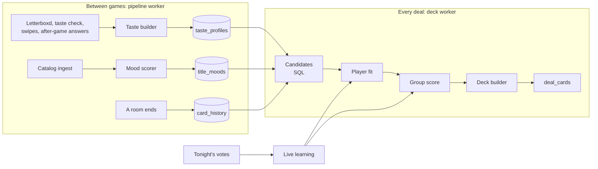
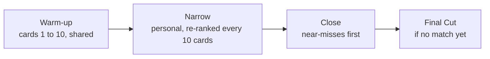

# Deck engine

How the recommendation server picks every card: what it knows about each player's taste and where that comes from (Letterboxd, the taste check, past games), how a film is scored for one player and for the group, how decks stay fresh from one game to the next, how moods work, how a game narrows to a pick, and what each game mode changes. Written on 29 October 2026 as the guide for building it.

It fills in stages 1 to 5 of [The algorithm, stage by stage](recommendation-server.md#the-algorithm-stage-by-stage) and replaces the weights and the slate in the revival plan's [A smarter deck](../product/revival-plan.md#a-smarter-deck). The server's processes and its contract with the database stay in [recommendation-server.md](recommendation-server.md); the tables are in the [data model](data-model.md). The changes this doc needs there are listed in [Changes to the data model](#changes-to-the-data-model) and not applied yet. Decisions are in [decisions.md](../decisions.md).

Every number here is a starting value to tune in playtests. They are all in [Starting values](#starting-values).

## Contents

1. [What the engine is for](#what-the-engine-is-for)
2. [The pipeline](#the-pipeline)
3. [Taste](#taste)
4. [Scoring a film for a player](#scoring-a-film-for-a-player)
5. [Scoring a film for the group](#scoring-a-film-for-the-group)
6. [Freshness](#freshness)
7. [Moods](#moods)
8. [Building a deal](#building-a-deal)
9. [How a game unfolds](#how-a-game-unfolds)
10. [Recipes](#recipes)
11. [The SQL fallback](#the-sql-fallback)
12. [Logging and upgrading](#logging-and-upgrading)
13. [Measuring it](#measuring-it)
14. [Changes to the data model](#changes-to-the-data-model)
15. [Starting values](#starting-values)
16. [Not in v1](#not-in-v1)

## What the engine is for

**Everyone in the room says yes to a film within about 5 minutes, and every game feels new.** The engine isn't looking for the perfect film for each person. It's looking for a film the whole group accepts, fast.

- **Fast.** A swipe takes about 3 seconds, so 40 cards is about 2 minutes, and the Final Cut about 2 more. For 2 to 4 players, the median time to a pick should stay under 5 minutes.
- **Fresh.** Under 10% of the cards a player sees should be cards they were shown in the last 30 days, Rematch cards aside.

Six rules shape everything below:

1. **One pipeline for every player.** A Letterboxd user, a new guest and a regular without Letterboxd go through the same code. The only difference is how much we know about them (their confidence), which decides how much their score leans on their own taste and how much on what people generally like.
2. **Taste is long-term; card memory is short-term.** A nope always keeps that film away from that player for a while. It changes their taste only when it's probably about taste.
3. **A real opinion beats a swipe.** A Letterboxd rating or a taste check answer about a film outranks any swipe on it.
4. **Nobody is miserable.** A film one player would hate doesn't make the deck, however much the others would like it.
5. **Every number lives in a recipe.** Game modes, moods and experiments change recipes, not code.
6. **Each stage is a plain function with fixed inputs and outputs.** Any one of them can be replaced, by a trained model for example, without touching the others.

## The pipeline



| Stage | Runs | Takes | Gives | Version 1 | Can become |
| --- | --- | --- | --- | --- | --- |
| Taste builder | Pipeline worker, on `taste_refresh` | A player's signals | Their taste profile: embedding, leanings, confidence | Weighted averages | Learned player factors |
| Mood scorer | Pipeline worker, after ingest or a mood change | Films and mood definitions | A score from 0 to 1 per film and mood | Rules, example films, keywords | Learned from rooms; tags from a language model |
| Candidates | SQL, `internal.deck_candidates` | The room, its seats, the recipe | About 300 eligible films, each with its crowd score, mood fit, and every seat's similarity and fatigue | Filters and a baseline score | A precomputed eligible set per room |
| Player fit | Deck worker | Candidates, each seat's profile and tonight's swipes | A fit from 0 to 5 per seat and film, with its features | A formula | A trained ranker |
| Group score | Deck worker | Fits, mood fit, the room's live taste | A group score per film, or dropped | Average without misery | A learned group model |
| Deck builder | Deck worker | Scored films, the phase of the game, the recipe | Cards per seat, each with its source, label and the odds it was drawn | Shuffle, variety, slots | A bandit choosing the exploration |
| Live learning | Deck worker, at each refill | Tonight's votes | The room's live taste, each seat's tonight leanings, dropped genres | Counts and averages | |

Like propagation and the match check stay in Postgres, inside the vote, as in the [data model](data-model.md#like-propagation-and-refills).

## Taste

### Signals

Everything we learn about a player and a film becomes one **value** between -1 (hates it) and +1 (loves it), with a date.

| Source | Answer | Value |
| --- | --- | --- |
| Letterboxd diary | 5★ / 4.5★ / 4★ / 3.5★ / 3★ | +1 / +0.8 / +0.6 / +0.35 / +0.1 |
| | 2.5★ / 2★ / 1.5★ / 1★ and ½★ | -0.2 / -0.5 / -0.75 / -1 |
| | Logged without a rating, or in `watched.csv` only | +0.2 |
| | A rewatch | +0.2 on top, up to +1 |
| Taste check, after-game "Did you watch it?", seen-film rating | Love it / It's fine / Not for me | +1 / +0.2 / -1 |
| Swipe in a game | Super like / Like | +0.8 / +0.4 |
| | Nope | -0.15, with the exceptions below |
| | Seen it | 0 (it marks the film as seen) |

The Letterboxd watchlist isn't a taste value: it gives the film a watchlist bonus in that player's fit.

**One value per film**, chosen in this order:

1. **A real opinion wins.** If the player has a Letterboxd rating, a taste check answer, an after-game answer or a seen-film rating for the film, the most recent of these is the value. Swipes on that film are ignored for taste.
2. **Otherwise, likes.** If they ever liked or super liked it, the highest of those. A later nope on a film they liked almost always means "not again so soon".
3. **Otherwise, nopes**, which mostly mean "not now":
   - 0 if we know they've seen it (Letterboxd, a "Seen it" swipe, a pick they watched): "not a rewatch tonight".
   - 0 if the room had moods and the film didn't fit them: "not what we asked for".
   - -0.4 if they noped it in 2 or more games: by then it's probably real.
   - -0.15 otherwise.

Swipes in rooms with an age cap under 13 count at 30%: what a parent swipes with the kids says little about their own taste. Real opinions count in full wherever they're given.

**Older signals count for less.** A value's weight halves every 2 years for real opinions (never below 0.25, so old favourites keep a voice) and every 6 months for swipes. Films from `watched.csv` with no diary entry have no date and get a weight of 0.5.

### From signals to a profile

The taste builder rebuilds a player's profile **from scratch** every time it runs, on `taste_refresh`, which is already queued after a taste check, an after-game answer, a Letterboxd sync, a disconnect and the end of every room. It never adds up as it goes, so anything learned later re-reads the past: once a film turns out to be seen, the old nopes on it stop counting.

It writes three things to `taste_profiles`:

| Output | In plain words | How |
| --- | --- | --- |
| Embedding | "Films like the ones you liked" | The weighted average embedding of films with positive values, minus half the weighted average of films with negative values, normalised. Weight = value × time weight |
| Leanings | "Patterns": how much you like each genre, decade, original language, director and runtime band | For each feature, the sum of value × weight over films that have it, divided by (the sum of their weights + 3). Directors need 2 or more films. Runtime bands: under 95 minutes, 95 to 120, 120 to 150, over 150. Stored in `affinities` |
| Confidence | How much we know, from 0 to 1 | n / (n + 15), where n adds up the time weights of films with a non-zero value, swipes counting half |

The "+ 3" means a genre needs several consistent films before it leans far: one loved horror film gives horror +0.25, ten give +0.77.

What confidence looks like:

| Player | n | Confidence |
| --- | --- | --- |
| New guest | 0 | 0 |
| After the taste check (8 answers) | 8 | 0.35 |
| After one game (about 50 swipes) | About 22 | 0.6 |
| After three games | About 70 | 0.82 |
| Letterboxd, 300 diary entries over a few years | About 180 | 0.92 |

### The taste check

The lobby's quick quiz, for players we know almost nothing about.

- **Who.** Players with a confidence under 0.3: in practice, new players without Letterboxd, until their first game. Everyone else is ready straight away; Letterboxd players show "Letterboxd linked".
- **When.** While waiting in the lobby. It never holds up the start, and it can be skipped.
- **The question is about the film, not tonight:** "What do you think of this one?", with Love it, It's fine, Not for me and Don't know it. A gut feeling about a film you haven't seen counts. Answers don't mark the film as seen. (The current Figma screen still asks "Would you watch it tonight?"; it changes to match.)
- **The pool.** About 40 well-known films over 8 kinds of film (horror, romance, arthouse, blockbuster action, animation, comedy, science fiction, non-English), in `calibration_titles`.
- **Order.** A player is never asked the same film twice. `api.taste_check_cards` returns up to 12 films they haven't answered, taking the kinds of film in turn, those with the fewest answers first, and the best-known film of each kind first, so a "Don't know it" is followed by a more familiar film. The check stops after 8 answers that aren't "Don't know it", or 12 cards.
- **"Don't know it"** says nothing about taste. It's stored only so the film isn't asked again.

### Rating seen films while waiting

Whenever a player is waiting on the others (they've finished their cards, they're between Final Cut stages, or they're on the winner screen), the app can ask about up to 3 films they swiped "Seen it" on in this game: Love it, It's fine or Not for me. It's optional and skippable. The answers are real opinions, so they beat any swipe.

The phone already knows which films it swiped "Seen it" on. It sends the answers with `api.rate_seen_films`, which saves them to `user_titles` (source `app`). The taste refresh at the end of the room picks them up.

## Scoring a film for a player

```
fit(seat, film) = 5 × ( c × taste + (1 - c) × crowd )
                + watchlist bonus
                + tonight
                - fatigue
                clamped to 0..5
```

| Term | What it is |
| --- | --- |
| `c` | The player's confidence |
| `taste` (0 to 1) | 0.6 × similarity + 0.4 × leaning. **Similarity** is the cosine between the player's embedding and the film's, as a percentile among tonight's eligible films (computed in SQL). **Leaning** is the average of the player's leanings for the film's genres (averaged together first), decade, language, director and runtime band, mapped from -1..1 to 0..1; features with no leaning count as 0 |
| `crowd` (0 to 1) | How much people generally like it: 0.65 × its quality score + 0.2 × the app's like rate for it + 0.15 × its popularity, each as a percentile among tonight's eligible films. Until a film has 50 impressions in the app, its quality score stands in for its like rate |
| Watchlist bonus | +1 when the film is on the player's Letterboxd watchlist (+1.5 in Date Night). Averaged over the group, this is the watchlist overlap |
| `tonight` (-0.75 to +0.75) | What this player swiped tonight: per genre, (likes - nopes) / (swipes on that genre + 3), super likes counting as 2 likes. The film gets 0.75 × the average over its genres. Here a nope counts in full: tonight is exactly what it's about |
| `fatigue` | See [Card memory](#card-memory) |

A brand-new guest (`c` = 0) is scored on the crowd alone, a Letterboxd veteran almost only on their taste, and everyone in between on a blend. That one rule is the whole "Letterboxd, no Letterboxd or both" story.

## Scoring a film for the group

```
group(film) = average of fit over present seats
            + 0.2 × live       (0 to 5: how close the film is to what the room liked tonight)
            + 1.0 × mood fit   (0 to 1, when the host picked moods)

dropped when any present seat's fit is under the misery line (1.0)
```

- **Average without misery**, from the revival plan, stays the rule. The misery line of 1.0 out of 5 is roughly a player's bottom fifth. If fewer than 50 films survive it, the line drops to 0, as the SQL baseline already does.
- **Live** is the film's similarity to the room's live taste (`room_models.embedding`), as a percentile × 5. See [How a game unfolds](#how-a-game-unfolds).
- **Mood fit** is the average of the picked moods' scores for the film. See [Moods](#moods).
- Only present seats count, as for the match rules.

## Freshness

Four mechanisms keep games from feeling the same, without banning anything.

### Card memory

`card_history`, a new table, remembers per player and film what happened the last time they were shown it. It's written when a room ends, from that room's votes: a card counts as shown only if the player answered it, so cards dealt but never reached leave no trace. The after-game answer updates it later.

Each film's fatigue for a player:

```
fatigue = penalty × 0.5 ^ (days since last shown / half-life)
        × repeat factor        1 + 0.5 × (times shown - 1), at most 3
        × freshness strength   from the recipe
        at most 5
```

| The last time this player was shown it | Penalty (fit is out of 5) | Half-life |
| --- | --- | --- |
| They noped it | 2 | 60 days |
| They liked it, and it wasn't shortlisted | 0.75 | 14 days |
| It was shortlisted (a match or a finalist) but not picked | 0.5, and it can come back as a [Rematch](#rematch) | 7 days |
| It was picked, and this player hasn't said whether they watched it | 3 | 90 days |
| It was picked, and this player said they didn't watch it | 0.5, and it can come back as a Rematch | 7 days |
| It was picked and they watched it, or they swiped "Seen it" | None: it's seen, and the seen rule takes over | |

What this does:

- **The last time sets the penalty,** so the latest answer matters most. A film liked last week after a nope last month comes back soon.
- **Films that keep coming back stay away longer.** A film noped twice starts at 3 and is still at 1.5 two months later.
- **It lowers the score rather than removing the film.** A film that's a strong fit tonight can still beat its fatigue; a middling one can't. A very close match comes back, filler doesn't.
- **It's per player.** Tonight, a film is only tired for the players who were shown it before.

### Weighted shuffle

The deck builder never deals the top of the list in order. It draws cards one at a time, and each film's odds grow with its score: odds ∝ e^(score / temperature), with a temperature of 0.3, falling to 0.2 in the last phase. A film 1 point better is about 28 times as likely to be drawn next.

- The same group gets a different deck each night, and the best films still come up early most of the time.
- The odds of every draw are logged as the card's propensity (already in `rec.request_items`), which keeps fair comparisons between models possible.
- The draws are seeded from the room's seed, so a deal can be replayed.

### Variety

Applied to every deal, not just the opening:

- When the next card is drawn, a film loses up to 1 point for being close to the player's last 5 cards (its highest similarity to them, scaled from 0 to 1 over the catalog's usual range).
- No more than 2 films with the same main genre (the first in TMDB's list) in any 5 cards in a row.
- One film per franchise (TMDB collection) in any 10 cards.

### Rematch

Repetition on purpose, as a moment. At most one per game:

- **Which films.** A film that was shortlisted but not picked, or picked but not watched, in a game that at least half of tonight's players (and at least 2) played together in the last 30 days.
- **Only if it still fits.** It must pass tonight's filters, fit tonight's moods if there are any, and have a group score (leaving out its own fatigue) in tonight's top quarter.
- **Where.** Every seat gets it at the same spot, somewhere between cards 12 and 18, so it lands as a shared moment.
- **Label.** "Rematch: in Friday's Final Cut" or "Rematch: you picked it but didn't watch it".

## Moods

Moods are data, not code: each one is a scored list of films. The current design's six (Cozy, Laugh, Mind-bending, Scary, Feel-good, Background noise) are a starting list. Adding, renaming or removing a mood means editing a row and re-scoring, not changing the engine. Themed packs later (Halloween, animated classics, first scary movie) work the same way.

**Moods describe tonight, not the player.** They never change anyone's taste profile, and a nope on a film outside tonight's moods counts 0 for taste. Only the host picks them, up to 3, in the room settings.

### Defining a mood

Each row in `moods` holds:

| Part | What it does | Column |
| --- | --- | --- |
| Must have | Hard rule: at least one of these genres | `require_genre_ids` |
| Must not have | Hard rule: none of these genres | `exclude_genre_ids` |
| Runtime limit | Hard rule | `runtime_max` |
| Example films | 10 to 15 films that clearly are the mood, picked by us | `anchor_title_ids` |
| Keyword hints | TMDB keywords that point to it | `keyword_ids` |
| Threshold | The score from which a film fits | `threshold` |
| Settings | Recipe changes while this mood is picked | `recipe` |

A mood needs at least example films or a must-have rule.

### Scoring

For each film and mood, the pipeline worker computes:

```
score     = 0                                  if a hard rule fails
          = 0.75 × closeness + 0.25 × keywords otherwise

closeness = the percentile, among all active films, of the cosine between the
            film's embedding and the mood's centre (the average embedding of
            its example films); 1 when the mood has no example films
keywords  = matching keyword hints / 2, at most 1
```

It stores `score`, and `raw_score` (the same without the must-not rule), in `title_moods`. It scores new and changed films after ingest, and re-scores every film when a mood row changes: 40,000 films × 6 moods is 240,000 rows and a few seconds of work.

### Checking the lists

Moods are mostly curation. A small script in the server repository prints each mood's top 50 films and the 30 closest to the threshold. We adjust the example films, keywords and threshold until the lists look right: roughly an hour per mood, before launch and whenever a mood is added.

### Starting definitions

Drafts to check with the script. Keyword names are still to check against TMDB's list.

| Mood | Must have | Must not have | Example films | Keyword hints | Settings |
| --- | --- | --- | --- | --- | --- |
| Cozy | | Horror, War | Paddington 2, Amélie, Chef, My Neighbor Totoro, The Holiday, Little Women (2019), Kiki's Delivery Service, Notting Hill | friendship, small town, cooking, christmas | |
| Laugh | Comedy | | Superbad, Hot Fuzz, Bridesmaids, Airplane!, What We Do in the Shadows, The Grand Budapest Hotel, Game Night, Booksmart | parody, spoof, slapstick comedy, buddy comedy | |
| Mind-bending | | | Inception, Memento, Arrival, Primer, Eternal Sunshine of the Spotless Mind, Coherence, The Prestige, Everything Everywhere All at Once | time travel, time loop, twist ending, dream, parallel world | |
| Scary | Horror | | Hereditary, The Conjuring, Get Out, It Follows, A Quiet Place, The Babadook | haunted house, possession, slasher, supernatural | |
| Feel-good | | Horror, War | The Intouchables, Little Miss Sunshine, School of Rock, Sing Street, Hunt for the Wilderpeople, The Princess Bride, Billy Elliot, Paddington 2 | underdog, friendship, coming of age, road trip | |
| Background noise | Comedy, Action, Adventure, Animation or Family | Horror, Documentary | Shrek, The Devil Wears Prada, Mamma Mia!, Night at the Museum, Kung Fu Panda, Legally Blonde, Home Alone, The Proposal | | Runtime limit 120 minutes. Crowd leans on popularity (quality 0.45, like rate 0.2, popularity 0.35). Rewatch share 0.3 when the room allows rewatches |

### In the deck

- **A film's mood fit** is the average of the picked moods' scores. If one picked mood excludes a genre another picked mood requires, the first mood's `raw_score` is used, so Cozy + Scary gives the gentlest horror instead of nothing.
- **A film fits** when its mood fit reaches the average threshold of the picked moods.
- **About 3 cards in 4** come from films that fit. The rest come from the general ranking: exploration and strong fits outside the moods.
- **Too few fitting films** tonight (fewer than 100 eligible): the threshold drops by 0.1 at a time, down to 0.3. If that's still too few, the mood share shrinks to match.
- **Mood fit also adds to the group score**, so the strongest fits come first.
- **Cards that fit** get the label "Cozy pick" (or the mood's name) when no stronger reason applies.

### Getting better on its own (after launch)

Rooms record their moods, so the trainer can see how each film does in rooms with each mood. A film that keeps getting noped in Cozy rooms loses some of its Cozy score; one that keeps getting liked gains. The learned part, a smoothed like rate in that mood's rooms turned into a percentile, takes a share of impressions / (impressions + 200) of the score, at most half.

If the lists still look wrong after the review (tone is the hard part, Background noise especially), a language model can tag every film with moods once, from its synopsis, genres and keywords, then only new films each night. The tags become a third part of the score; nothing else changes.

## Building a deal

A deal is the start of a game (every seat) or a refill (one seat). The deck builder takes the scored candidates and fills the seat's next cards:

1. **Pools.**
   - The **mood pool**: films that fit, when the host picked moods.
   - The **open pool**: every scored film.
   - The **exploration pool**: the random share of the candidates plus films ranked below 100th, all above the misery line, preferring main genres the seat hasn't had in its last 10 cards.
   - **Rematch** candidates.
2. **Slots.** Each card is an exploration slot at the phase's exploration rate. Otherwise it's a mood slot at the mood share, if there are moods, or else an open slot. A Rematch takes its fixed spot. Seen films that the seen rule allows take at most 1 card in 10.
3. **Draw.** Mood and open slots draw with the weighted shuffle and the variety rules. Personal cards rank by group score + 0.25 × (this seat's fit - the average fit), so each player sees a little more of what they personally like. Exploration slots draw evenly from the exploration pool. Each card records its odds.
4. **Label** each film (below).
5. **Hand over** to `internal.deal_cards`: the pool entries with group score, min fit, fits and label, and each seat's cards with source (`opening`, `ranked`, `wildcard` or `rematch`), score, `explore`, propensity and features.

A start deals 25 cards per seat: the shared opening of 10, then 15 personal ones. A refill keeps the 3 mounted cards and any card moved up by a like, and tops the deck back up to 25 with a fresh ranking. With the refill at 15 cards left, each seat's deck is re-ranked every 10 swipes.

### Reason labels

Each film in the room's pool gets one label, the first that applies:

| Label | When | Example |
| --- | --- | --- |
| `rematch` | A Rematch card | "Rematch: in Friday's Final Cut" |
| `watchlist_overlap` | On 2 or more seated players' watchlists | "On Sam and Jo's watchlists" |
| `member_rating` | A seen film the seen rule allows: everyone who has seen it rated it 4★ or more | "Sam gave it 4.5★" |
| `watchlist` | On one seated player's watchlist | "On Sam's watchlist" |
| `similar_to_rated` | Among the 50 films closest to one a seated player rated 4.5★ or more on Letterboxd | "Because Sam loved Arrival" |
| `mood_fit` | Fits tonight's moods | "Cozy pick" |
| `hidden_gem` | A quality score of 7.5 or more from fewer than 2,000 votes | "Hidden gem: 7.9 from 900 votes" |
| `runtime_fit` | The host set a time budget | "94 min" |
| `wildcard` | An exploration card | "Wildcard" |

The phone renders each label in its language, and says "you" to its own player.

**Labels only say what the room may already know:** Letterboxd ratings and watchlists (ratings already show on card backs), the room's own settings, and games the group played together. Never someone's swipes, taste check answers or games played with other people.

## How a game unfolds



| Phase | Cards, per player | Goal | The deck |
| --- | --- | --- | --- |
| Warm-up | 1 to 10 (8 in Date Night) | Learn the room fast and create early overlap | The same cards for everyone, in the same order: strong, safe films spread across the group's tastes, 2 in 10 exploration |
| Narrow | Up to 60% of the mode's finale card count (24 of 40, 30 of 50, 18 of 30) | Lean on what the room likes | Personal order. Each refill uses tonight's swipes: every seat's tonight leanings, the room's live taste, the genres it rejected. Exploration falls from 15% to 5%. The Rematch lands here |
| Close | The rest, until a match or the finale | Land a match | Films liked by every present player but one go to the top of the remaining players' decks. Exploration 5%, temperature 0.2 |

Then the Final Cut starts at the mode's card count or time limit, as in the [data model](data-model.md#finale).

> If the card counts proposed in [game-modes.md](../product/game-modes.md#time-to-a-pick) are accepted, the narrow phase ends at card 24 for every Quick Match size and card 18 in Final Cut.

**Live learning**, at every refill:

- **The room's live taste** (`room_models.embedding`) starts as the average of the seated players' profiles. It moves toward the films liked tonight (super likes count double) and away from noped ones, more as votes come in, at full weight after 20 votes.
- **Each seat's tonight leanings** and the room's, in `room_models.feature_weights`. A seat's leanings feed its fit.
- **Dropped genres.** A main genre is dropped for the rest of the game once every present player has noped at least 2 films of it and nobody has liked one, unless a picked mood requires it.
- **Like propagation** stays in the database, inside the vote: the first like on a film moves it into everyone else's next few cards.

An optional fun beat: after the warm-up, a short "Reading the room: cozy, 90s, under 2 hours" banner built from the room's top leanings, so players can see the deck learning.

## Recipes

Every number the deck worker uses comes from a **recipe**, a JSON document in `rec.deck_recipes`. The base recipe holds every value; the others hold only what they change. For each deal the deck worker merges, in this order:

1. `base`
2. the mode's recipe (`game_modes.deck_recipe`)
3. the experiment variant's recipe, if the room is in an experiment
4. the settings of each picked mood

It logs the merged result in `rec.requests.strategy`. The SQL fallback reads the same merged values through `internal.room_recipe(room)`, so the two always agree. Changing a value means updating a row, with no deploy, and an A/B test is just a second recipe.

Room settings the host chooses (services, time budget, quality, seen rule, age cap) are filters, not recipe values.

A recipe's shape, with some of the base values (all of them are in [Starting values](#starting-values)):

```json
{
  "candidates": {"source": "catalog", "limit": 300, "random_share": 0.15},
  "fit":        {"taste": {"similarity": 0.6, "leanings": 0.4},
                 "crowd": {"quality": 0.65, "like_rate": 0.2, "popularity": 0.15},
                 "watchlist_bonus": 1.0, "tonight_max": 0.75},
  "group":      {"misery_line": 1.0, "live_room": 0.2, "mood": 1.0},
  "freshness":  {"strength": 1.0, "rematch_slots": 1},
  "deck":       {"deal_size": 25, "temperature": 0.3, "mood_share": 0.75, "rewatch_share": 0.1},
  "phases":     {"warm_up": {"cards": 10, "explore": 0.2},
                 "narrow":  {"until_share": 0.6, "explore_from": 0.15, "explore_to": 0.05},
                 "close":   {"explore": 0.05, "temperature": 0.2}}
}
```

| Recipe | Changes from `base` | Why |
| --- | --- | --- |
| `quick_match` | Nothing | Speed first, which is what the base is tuned for |
| `date_night` | `freshness.strength` 1.5, `fit.watchlist_bonus` 1.5, `phases.warm_up.cards` 8, `deck.rewatch_share` 0 | The same couple plays every week, and wants something neither has seen |
| `final_cut` | `phases.warm_up.explore` 0.3, `phases.narrow.explore_from` 0.25, `deck.variety.mmr` 1.5 | The finale decides, so swiping should build a varied shortlist |
| Later: `family` | `group.misery_line` 1.5 | Nobody on the couch should be unhappy. The age cap is a room setting |
| Later: `watchlist_showdown` | `candidates.source` "watchlist_overlap", `freshness.strength` 0, every exploration rate 0, `freshness.rematch_slots` 0 | The watchlists are the point |
| Later: `pick_for_me` | `deck.temperature` 0.5, `phases.narrow.explore_from` 0.25 | One player: more discovery, no group to satisfy |
| Later: packs | `candidates.source` "pack" | The pack is the candidate list |

## The SQL fallback

If the server doesn't deal within 8 seconds, `internal.deal_baseline` deals in SQL ([data model](data-model.md#start-dealing-the-deck)). It keeps what matters most and drops the rest:

| Kept | Dropped |
| --- | --- |
| Filters, the seen rule, mood fit and the mood pool | Leanings and tonight leanings |
| Fit as the confidence blend of similarity and crowd, the watchlist bonus, fatigue from `card_history` | Exploration slots and the Rematch |
| Average without misery | The similarity and main-genre variety rules (one film per franchise stays) |
| The weighted shuffle, with noise from a hash of the room's seed and the film, so it's repeatable | Labels other than the watchlist ones and mood fit |
| The shared opening | |

So even a fallback deck doesn't repeat last week's.

## Logging and upgrading

**Every card dealt is logged** in `rec.request_items` with its position, score, `explore`, propensity and these features, under fixed names so old logs stay readable:

`sim`, `lean`, `crowd`, `conf`, `watchlist`, `tonight`, `fatigue`, `mood_fit`, `group`, `min_fit`, `live`, `phase`, `slot`, `label`

Joined to the seat's vote, each card is a labelled example: likes and super likes are positive, nopes negative, "Seen it" left out. `swipe_log` adds how long the card was on screen and, with the change below, whether it was flipped.

**The upgrade path.** Each step runs behind an experiment, with rooms assigned to variants as in the [recommendation server](recommendation-server.md#the-algorithm-stage-by-stage):

1. **Tune the recipe** from the logs: like rates by phase and slot, time to a pick per variant.
2. **A trained player fit.** A model trained on the logged features plus each player's history replaces the formula, with the same inputs and outputs. It can also learn what a nope means from how long the card stayed on screen and whether it was flipped.
3. **Collaborative signals**: "people who liked X in a room also liked Y", as a new feature from the trainer.
4. **Learned moods**, then language model tags if needed.
5. **Smarter exploration**: a bandit picks exploration cards where the room is most uncertain, instead of a fixed rate.

The stages around the one being replaced don't change.

> Nothing from Streaming Availability goes into features, logs or training data: its terms forbid using it to train or evaluate models. TMDB's terms may require a commercial agreement for using its content in the engine at all, language model mood tags included: see [tmdb.md](../integrations/tmdb.md#terms-licence-and-attribution).

## Measuring it

| Metric | What | Starting target |
| --- | --- | --- |
| Time to a pick | Median from start to the pick, by group size and mode | Under 5 minutes for 2 to 4 players |
| Swipes per pick | Median per player | Under 40 |
| Instant matches | Share of rooms decided before the Final Cut | Watch it; no target yet |
| **Repeat rate** | Share of a player's cards they were also shown in the previous 30 days, Rematch cards excluded | Under 10% |
| Like rate by phase and source | Opening, ranked, propagated, wildcard, rematch | Rises from warm-up to close; wildcards not far below ranked cards |
| Misery | Share of picks where a present player's fit was under 2 | Low; watch the trend |
| Taste check | Started, finished, skipped | Watch it |
| Crews back within 30 days | From the revival plan | |

## Changes to the data model

None of these are in [data-model.md](data-model.md) or [schema.sql](schema.sql) yet. They add to or change v1 parts that aren't live, so nothing needs migrating.

**New**

| What | Holds | Written by | Notes |
| --- | --- | --- | --- |
| `card_history` | Per player and film: times shown, liked and noped; when last shown; the last answer; the last outcome (`noped`, `liked`, `seen`, `shortlisted`, `picked`, `picked_not_watched`); the last room | The pipeline worker when a room ends; `api.answer_followup` | Key (profile_id, title_id). Server only. Deleted with the account, kept 12 months after the last showing, included in `api.export_my_data` |
| `title_moods` | Per film and mood: score, raw score (without the must-not rule), when computed | The pipeline worker | Key (title_id, mood_slug); index on (mood_slug, score) |
| `rec.deck_recipes` | Slug, the recipe it extends, params (JSON), notes, when updated | By hand, later an admin screen | Seeded with `base` and the three launch modes |
| `api.taste_check_cards()` | Up to 12 taste check films the player hasn't answered, in order | | Replaces reading `api.calibration_titles` directly |
| `api.rate_seen_films(answers)` | Saves seen-film ratings to `user_titles` (source `app`) | | |

**Changed**

| Where | Change |
| --- | --- |
| `moods` | `include_genre_ids` becomes `require_genre_ids` (a must-have); add `anchor_title_ids`, `threshold` and `recipe`. Seed the six starting moods, adding `feel_good` |
| `rooms` | Add `mood_slugs`: the host's moods, up to 3, set through `api.update_room_settings`. `seen_rule` defaults to `allow_rewatch`; Date Night keeps `hide_seen` |
| `room_members` | Drop `mood_slugs` and `genre_ids`. `api.set_seat_prefs` keeps only services |
| `game_modes` | Add `deck_recipe` |
| `taste_profiles` | Add `confidence`. `affinities` holds the leanings |
| `calibration_titles` | Grows to about 40 films over 8 kinds of film |
| `api.submit_calibration` | Answers are `love`, `fine`, `nope` and `dont_know`; none of them marks the film as seen |
| `api.answer_followup` | Also sets the pick's `card_history` outcome to `picked_not_watched` on "no" |
| `card_source`, `deck_source` | Add `rematch` |
| Reason codes | `rematch`, `watchlist_overlap`, `member_rating`, `watchlist`, `similar_to_rated` (replaces `similar_to_liked`), `mood_fit`, `hidden_gem`, `runtime_fit`, `wildcard` |
| `room_finished` | Also queued for rooms abandoned after swiping started, so their cards reach `card_history` |
| `swipe_log` | Add `flipped`, sent as an optional argument of `api.cast_vote` |
| `internal.deck_candidates` | Confidence blend with the crowd score, fatigue, mood fit and pool, the random share, shuffle noise. Returns the crowd score, mood fit, and each seat's similarity and fatigue |
| `internal.deal_baseline` | As in [The SQL fallback](#the-sql-fallback) |
| Retention | `card_history` rows go 12 months after the last showing |

**After launch:** `rec.title_stats` by mood, for learned mood scores.

## Starting values

All placeholders until playtests. The taste builder's values are stored with the taste model's version in `rec.models` (kind `taste`); the deck's are in the recipes.

**Taste builder**

| Value | Start |
| --- | --- |
| Letterboxd ratings | 5★ +1, 4.5★ +0.8, 4★ +0.6, 3.5★ +0.35, 3★ +0.1, 2.5★ -0.2, 2★ -0.5, 1.5★ -0.75, 1★ and ½★ -1 |
| Logged or watched without a rating | +0.2 |
| Rewatch | +0.2 on top, up to +1 |
| Love it / It's fine / Not for me | +1 / +0.2 / -1 |
| Super like / Like | +0.8 / +0.4 |
| Nope | -0.15; 0 if seen or outside tonight's moods; -0.4 once noped in 2 or more games |
| Seen it | 0 |
| Swipes in rooms with an age cap under 13 | × 0.3 |
| Half-lives | Real opinions 2 years, weight never below 0.25; swipes 6 months; undated films weigh 0.5 |
| Embedding | Negative values pull at half strength |
| Leanings | + 3 in the denominator; directors from 2 films; runtime bands under 95, 95 to 120, 120 to 150 and over 150 minutes |
| Confidence | n / (n + 15), swipes counting half |
| Taste check | Shown under a confidence of 0.3; stops at 8 answers or 12 cards; a pool of about 40 films over 8 kinds |
| Seen-film rating | Up to 3 films per game |

**Deck recipe, `base`**

| Key | Start |
| --- | --- |
| `candidates.limit`, `candidates.random_share` | 300, 0.15 |
| `fit.taste.similarity`, `fit.taste.leanings` | 0.6, 0.4 |
| `fit.crowd.quality`, `.like_rate`, `.popularity` | 0.65, 0.2, 0.15 |
| `fit.crowd.like_rate_min_impressions` | 50 |
| `fit.watchlist_bonus` | 1.0 |
| `fit.tonight_max` | 0.75 |
| `group.misery_line`, `group.misery_min_survivors` | 1.0, 50 |
| `group.live_room`, `group.mood` | 0.2, 1.0 |
| `freshness.strength` | 1.0 |
| `freshness.penalties` (penalty, half-life in days) | noped 2, 60; liked 0.75, 14; shortlisted 0.5, 7; picked 3, 90; picked_not_watched 0.5, 7 |
| `freshness.repeat_factor`, `.repeat_max`, `.max` | 0.5, 3, 5 |
| `freshness.rematch_slots`, `.rematch_window_days`, `.rematch_top_share`, `.rematch_positions` | 1, 30, 0.25, cards 12 to 18 |
| `deck.deal_size` | 25 |
| `deck.temperature` | 0.3 |
| `deck.personal_tilt` | 0.25 |
| `deck.variety.mmr`, `.window`, `.main_genre_max`, `.collection_window` | 1.0, 5 cards, 2 in any 5, 10 cards |
| `deck.mood_share`, `.mood_min_pool`, `.mood_threshold_floor` | 0.75, 100, 0.3 |
| `deck.rewatch_share` | 0.1 |
| `phases.warm_up.cards`, `.explore` | 10, 0.2 |
| `phases.narrow.until_share`, `.explore_from`, `.explore_to` | 0.6, 0.15, 0.05 |
| `phases.close.explore`, `.temperature` | 0.05, 0.2 |
| `live.drop_genre_nopes`, `live.full_weight_votes` | 2, 20 |

**Moods**

| Value | Start |
| --- | --- |
| Score | 0.75 × closeness + 0.25 × keywords; keywords count in full from 2 matches |
| Threshold | 0.6 |
| Moods per room | Up to 3 |
| Learned share, after launch | impressions / (impressions + 200), at most 0.5 |

**Already in the data model:** a refill at 15 cards left, and 8 seconds before the SQL fallback deals.

## Not in v1

- **Crew memory** ("you two always end up with comedies"), once crews exist.
- **The trained ranker, collaborative signals, learned moods and the bandit:** the upgrade path above.
- **Language model mood tags**, if the review shows they're needed.
- **"This or that" pairs for the taste check:** could be tested against the single cards later.
- **Series.**
