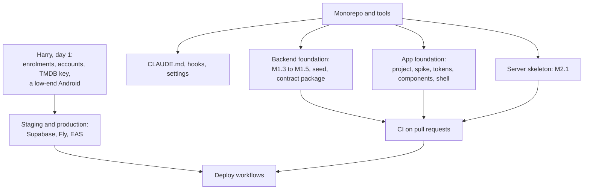

# Groundwork

Everything set up before the first feature: the monorepo, the tools, the local stack, cloud sessions, CI and repository settings, environments and accounts, every secret, and the app's foundations (structure, styling, tokens, components, motion, haptics and sound, the app shell). Written on 29 October 2026; library versions were checked on npm the same day.

It builds on [operations.md](operations.md) (environments, CI, secrets), [app-structure.md](app-structure.md), [server-structure.md](server-structure.md), [security.md](security.md), the [agent workflow](../agent-workflow.md) and the Figma file's [design system page](https://www.figma.com/design/v2ZGLbGmzZ7032V9AI5vWM). Where this doc changes another one, it says so in [Changes to the roadmap and other docs](#changes-to-the-roadmap-and-other-docs). Questions are in [Decisions for Harry](#decisions-for-harry).

## Contents

1. [Order of work](#order-of-work)
2. [The repository](#the-repository)
3. [Tools](#tools)
4. [The local environment](#the-local-environment)
5. [Cloud sessions](#cloud-sessions)
6. [CI and repository settings](#ci-and-repository-settings)
7. [Accounts](#accounts)
8. [Secrets](#secrets)
9. [The app's foundations](#the-apps-foundations)
10. [The backend's foundations](#the-backends-foundations)
11. [Claude Code setup](#claude-code-setup)
12. [Easy to forget](#easy-to-forget)
13. [Changes to the roadmap and other docs](#changes-to-the-roadmap-and-other-docs)
14. [Decisions for Harry](#decisions-for-harry)

## Order of work



- **Week 0** (2 to 6 November): the repository, the tools and a first CLAUDE.md with its hooks; Harry's accounts in parallel.
- **Weeks 1 and 2**: the backend and app foundations side by side (M1 and M3), then CI and the deploy workflows. This fits the [timeline](../agent-workflow.md#timeline) if the app lane does nothing else for those two weeks; M4's screens start in week 3 as planned.
- **One rule for all of it:** each groundwork task ends by writing or updating the skill for its area. Conventions get written once, by whoever set them.

## The repository

> **Decided on 29 October 2026: one repository** for the app, the server, Supabase and the docs.

- **Rename** `movie-swipe-backend` (GitHub keeps redirecting the old address) and archive the empty `movie-swipe-app`. The docs and their history stay where they are. `movie-swipe` is fine until the app has its name.
- **pnpm workspaces** for `mobile/`, `packages/*` and `tools/`, with hoisted `node_modules`, which is what React Native tooling expects. `server/` is its own uv project.
- **One set of commands**, as mise tasks: `mise run setup`, `dev`, `check`, `test`, `db:reset`, `db:test`, `typegen`, `tokens`, `seed:catalog`, `bots`. Harry, CI and agents all type the same thing, and CLAUDE.md only has to list them once.
- **Git hooks** with lefthook: format and lint the staged files and run gitleaks on commit; `mise run check` on the touched packages before a push.
- `.editorconfig` and the recommended editor extensions (ESLint, Prettier, Tailwind IntelliSense, Ruff, Expo Tools).

```
movie-swipe/
  mobile/              the Expo app; routes in mobile/src/app/
  server/              the Python recommendation server (uv)
  supabase/            config.toml, migrations/, tests/ (pgTAP), seed.sql
  packages/contract/   the api client, generated types, payload types, Realtime events
  tools/               next, doc-section, typegen, bot players, seed-local-catalog, checks
  docs/
  .claude/             agents, skills, hooks, settings
  .github/             workflows, the pull request template
  mise.toml  pnpm-workspace.yaml  lefthook.yml  CLAUDE.md
```

`packages/contract` exists because the app, the bot players and the load test all make the same calls. One typed client serves all three.

## Tools

Pinned in `mise.toml` unless noted, so the Mac, CI and cloud sessions run the same versions.

| Tool | For | Notes |
| --- | --- | --- |
| Node 24 (LTS) | The app, the tools | SDK 58 accepts 22.13 or newer, 24.3 or newer, or 26; no odd versions |
| pnpm | Workspaces | |
| Python 3.13 and uv | The server | |
| Supabase CLI | Local stack, migrations, pgTAP, generated types | |
| EAS CLI | Builds, updates, submissions | |
| flyctl | Server deploys | |
| Maestro | End-to-end flows | |
| lefthook, gitleaks | Git hooks, secret scanning | |
| Squawk | Lints migrations for locks and unsafe changes | Backs the "migrations only add" rule |
| Ruff, pyright | Python lint, format and types | Dev dependencies through uv |
| ESLint, Prettier with the Tailwind class sorter, TypeScript | The app | Dev dependencies |
| **Mac only:** Xcode, Android Studio with an emulator, Watchman, a Docker runtime | Local builds and `supabase start` | OrbStack is lighter than Docker Desktop |
| **Devices:** an iPhone and a low-end Android | The card stack spike (M3.12) and every feel check | A 3 to 4 year old budget Android is what matters most |

## The local environment

**The first time:** install Xcode, Android Studio, OrbStack and mise, then `mise install` and `mise run setup`. Setup installs the pnpm and uv dependencies, copies each `.env.example` to an ignored `.env.local`, runs `supabase start` and `supabase db reset` (migrations and the synthetic seed), creates the local `app_server` login and generates the types. Then a development build on each phone with `npx expo run:ios --device` and `run:android`. These build on the Mac, so they don't use EAS's 15 builds a month.

**Every day:** `mise run dev` starts whatever isn't running: the local stack, the server processes a task needs (none for most app work, since `deck_engine` is `sql` in the first release) and Metro.

- **Phones can't reach `127.0.0.1`.** The dev script writes the Mac's network address into the app's local settings, so a phone on the same Wi-Fi reaches the local Supabase, Realtime included.
- **Real posters locally:** `mise run seed:catalog` with your own TMDB key loads about 2,000 films. Never committed, because of TMDB's 6-month rule.
- **Playing alone:** `mise run bots -- --code 482913 --count 3` fills a room. A first bot that only joins and stays present is worth building in M4, not M6.19, so the lobby can be tested with one phone.
- **Switching backends:** the dev menu switches between local and staging.

## Cloud sessions

Checked in this cloud container today:

- Postgres 16 is installed, and npm and PyPI are reachable directly.
- Docker isn't running but starts (`dockerd`). Pulling images failed, though: Docker Hub answered "429 Too Many Requests" and Amazon's public registry "Data limit exceeded". Both are limits on anonymous pulls from a shared address. So `supabase start`, which pulls about a dozen images, can't be relied on here.

**So cloud sessions get a lighter database.** A setup script (in the environment's settings: the cloud environment menu in the session's title bar, then Edit, then Setup script) installs the mise tools, the pnpm and uv dependencies, and pgTAP and pgvector for the local Postgres 16. Then `mise run db:lite` loads small stand-ins for Supabase's `auth`, `realtime` and `pgmq` schemas, the migrations and the seed. That's how the original 120 checks ran. The few tests that need the real stack (Realtime delivery, real sign-in) are tagged and run only in CI and on the Mac.

The setup script can't read the environment's secrets, and needs none: tests use recorded TMDB responses and the synthetic seed.

| Work | Cloud session | Mac | CI |
| --- | --- | --- | --- |
| SQL and pgTAP | The lite database | The full stack | The full stack |
| Server | Yes | Yes | Yes |
| App logic (Jest) | Yes | Yes | Yes |
| App screens (simulator, Maestro) | No | Yes | Maestro on EAS, nightly |
| Feel | No | The phones | No |

## CI and repository settings

**Workflows**, operations.md's list merged into one repository:

| Workflow | When | Does |
| --- | --- | --- |
| `ci.yml` | Every pull request | Works out which parts changed and runs only those jobs. **Database:** `supabase start` with only the services it needs, `db reset`, pgTAP, Squawk on new migrations, M1.7's check for tables without row-level security and functions open to phones, the generated types compared with the committed ones. **Server:** Ruff, pyright, pytest, contract tests against the same stack. **App:** ESLint with the design-system rules, TypeScript, Jest, `expo install --check`, the translation key check, the generated tokens compared with `tokens.json`. **Docs:** links. **Title:** starts with a task id |
| `staging.yml` | Merge to `main` | Migrations to staging, then the server to Fly staging, then the app (an EAS Update on the preview channel, or a preview build if the native fingerprint changed). Once the game exists, a bot game on staging must reach a pick |
| `production.yml` | By hand, with Harry's approval | The same, to production |
| `nightly.yml` | Every night | Maestro flows on EAS against staging, a bot game, a dependency audit |
| `backup.yml` | Weekly | The logical dump of production |
| `roadmap.yml` | Merge to `main` | Ticks the task named in the title and updates the progress line |

- **Path filters** keep a docs-only or app-only pull request from starting the database. With about 140 pull requests in the first release, they're what keeps CI near GitHub's free 2,000 minutes a month for private repositories; beyond that, Linux minutes cost a few dollars a month.
- **Actions pinned to commit SHAs** (M1.15), kept current by Dependabot.

**Repository settings:**

- **`main` is protected:** a pull request, passing CI and an up-to-date branch are required before merging, so CI runs on what will actually land (see the [parallel migration trap](../agent-workflow.md#where-agents-run-and-how-many-at-once)). Squash merges only, so the pull request title (task id and title) becomes the commit.
- **GitHub environments** `staging` and `production`, each with its own secrets; `production` needs Harry's approval.
- **Dependabot** security alerts on. Version updates grouped, and never for Expo-managed packages: those only move together, with `npx expo install --fix` during an SDK upgrade.
- **Secret scanning.** As far as I know, GitHub's push protection on private repositories is a paid add-on (worth checking on your plan). gitleaks in the git hook and in CI covers it for free.
- **A pull request template** with the brief's sections and "How it was tested", and labels for size (S, M, L), lane and type.

## Accounts

The three environments are operations.md's: local, staging and production.

| Account | When | Notes |
| --- | --- | --- |
| A password manager | Day 1 | Every secret lives here first |
| Apple Developer (individual) | Day 1 | Enrolment can take days, so it goes first |
| Google Play (personal) | Day 1 | Identity check. The 14-day testing count starts later |
| TMDB | Day 1 | A developer key for local and staging, and the licence email (M0.5) |
| GitHub | Week 0 | The monorepo, its environments and settings |
| Supabase | Week 0 | Pro organization, staging and production in Paris, the settings checklist (M1.1, M1.2) |
| Expo (EAS) | Week 0 | One project, Free plan until launch |
| Fly.io | Week 1 | One organization, staging and production apps in Paris |
| Sentry (EU) | Week 1 | Two projects (app and server), environments as tags |
| PostHog (EU) | Before M9 | The free plan has one project, so staging and production share it: every event carries its environment, and development builds send nothing |
| Domain and support email | After the name (M0.1, M0.2) | Blocks invite links (M4.14), not the start |

Two-factor authentication on every account (M0.6). Harry opens them; an agent can write the checklist for each.

**The bundle id doesn't have to wait for the name.** Players never see it, and it can't change once the store records exist. Choose a neutral one now (for example `com.harryviennot.<codename>`, with `.dev` and `.preview` variants) and M3 isn't blocked by M0.1. Only the display name, the URL scheme and the domain wait for the name.

## Secrets

Every secret starts in the password manager; the places below hold copies. Nothing secret is committed: each package has a committed `.env.example` and an ignored `.env.local`. Anything starting with `EXPO_PUBLIC_` ends up inside the app, so it's configuration, never a secret.

| Value | Needed from | Lives in | Secret |
| --- | --- | --- | --- |
| Supabase URL and publishable key, per environment | M3.5 | EAS environment variables (`EXPO_PUBLIC_`), `mobile/.env.local` | No, but per environment |
| Sentry DSN for the app, PostHog project key | M3.9, M9.1 | EAS environment variables | No |
| Sentry auth token for source maps | M3.9 | EAS secret | Yes |
| `EXPO_TOKEN` | M3.3 | GitHub Actions | Yes |
| `SUPABASE_ACCESS_TOKEN`, each project's database password and ref | M1.15 | GitHub's `staging` and `production` environments | Yes |
| The server's database logins, one per process | M2.12 | Fly secrets; the local login in `server/.env.local` | Yes |
| TMDB API token | M2.3 | Fly secrets (pipeline worker); your own key in `server/.env.local` | Yes |
| Fly deploy token | M2.12 | GitHub Actions | Yes |
| A Supabase secret key, for account deletion only | M8.5 | Fly secrets, the HTTP API process only | Yes |
| Sentry DSN for the server | M9.4 | Fly secrets | No |
| App Store Connect API key, Google Play service account | M10.2 | EAS credentials | Yes |
| Android upload key, iOS certificates | M10.2 | Managed by EAS | Yes |
| Turnstile keys (the CAPTCHA, kept off) | M7 | Supabase Auth settings | Yes |
| Apple and Google sign-in keys | M15 | Supabase Auth settings | Yes |
| RevenueCat keys | M21 | Later | Yes |
| Read-only tokens for agents (staging Supabase, PostHog) | When needed | The cloud environment's secrets. Never production | Yes |

Both the app and the server check their configuration when they start, and refuse to start with a clear message if a value is missing or malformed. Rotation is in [security.md](security.md#secrets-and-the-servers-database-logins).

## The app's foundations

### Structure

Your proposal, with two additions: pieces reused across screens that know about films or rooms get their own tier, and logic stays out of components.

```
mobile/
  src/
    app/                  routes only, one file per screen (Expo Router, SDK 58's default place)
    components/
      ui/                 reusable primitives that know nothing about films or rooms
      shared/             reusable pieces that do: movie card, poster thumb, player pill, room ticket
      screens/            single-use pieces, one folder per screen, named like its route
        home/  join/  host/  lobby/  swipe/  final-cut/  winner/  settings/  …
    features/             logic without JSX: hooks, stores, the vote queue, room state
    theme/                tokens.json, the generated theme and tokens.ts, motion
    lib/                  haptics, sound, analytics, storage, formatting, server time
    i18n/                 setup, locales/fr, locales/en
  scripts/                tokens (theme and icons from tokens.json), check-i18n, check-gallery
  .maestro/
```

**Rules:**

- `ui/` imports nothing else from the app; `shared/` imports only `ui/`; `screens/` import both. An ESLint boundaries rule enforces it.
- When a single-use piece is needed by a second screen, it moves to `shared/` (or to `ui/`, if it knows nothing about the app) in that same pull request, and gets its gallery entry.
- A new component that looks like an existing one is a blocking review finding.
- Routes stay thin: they lay out a screen from `screens/` pieces and `features/` hooks. Logic in `features/` is tested without rendering anything.

### Styling: NativeWind or Uniwind

> **Decided on 29 October 2026: Uniwind.** Built in the groundwork: Uniwind 1.13 with Tailwind 4.3 on SDK 58 bundles for iOS and renders on the web. The M3.12 spike confirms it on a low-end Android.

Checked on npm today:

| | NativeWind 4.2.7 | NativeWind 5 | Uniwind 1.13.1 |
| --- | --- | --- | --- |
| Status | Stable, npm's `latest` | Release candidate (5.0.0-rc.0), no date for stable | Stable, released 28 October 2026 |
| Tailwind | 3 (Tailwind 4.3 is current) | 4 | 4 |
| How it works | Resolves classes while the app runs | Resolves classes while the app runs | Compiles classes when the app is built |
| Speed | | | About twice NativeWind's, in its makers' own benchmark |
| SDK 58 | Runs on React Native 0.88 in one community report | One community project pairs the RC with SDK 58 | Supports React Native 0.81 and later; no SDK 58 statement found |

The class names are the same in all three, so the components don't depend on the choice. Only the configuration does.

**Recommended:** write everything with Tailwind classes, as you asked, and pick the engine in half a day inside the M3.12 spike, on the low-end Android. Try Uniwind first (current Tailwind, faster, stable); fall back to NativeWind 4.2.7 if Uniwind misbehaves on SDK 58. If you'd rather skip the spike, NativeWind 4.2.7 is the safe choice today, with a move to Tailwind 4 once NativeWind 5 is stable.

Either way:

- **Classes for layout and static styles.** Anything that animates goes through Reanimated's animated styles, with values from `tokens.ts`, never through changing classes.
- **Shadows, the arcade lips and the glows** use React Native's `boxShadow` (New Architecture, both platforms). Gradients use `expo-linear-gradient`.

### Tokens

The Figma's design system page is complete enough to build from: colors, 13 type styles, spacing, radius and strokes, effects (card and sheet elevation, five arcade lips, three glows, a focus ring), gradients (three spotlights, the card scrim, the marquee sunset), motion, and 38 icons.

1. **`theme/tokens.json` holds every token**, in the W3C design tokens format. The designer agent fills it once from the Figma variables through the Figma MCP (Figma's REST API for variables needs an Enterprise plan). From then on the file is the source; when a token changes, the Figma is updated to match.
2. **`mise run tokens` generates** the Tailwind theme and `tokens.ts` from it. CI fails if they're out of date.
3. **The theme replaces Tailwind's defaults** (palette, spacing scale, radii, fonts) rather than extending them, so `bg-red-500` or `p-7` mean nothing, and a lint rule flags any class the theme doesn't define.
4. **One `Text` component** with the Figma's 13 type styles as variants (`<Text variant="display-l">`). Nothing else sets a font family, size or line height.
5. **Fonts:** Staatliches, Schibsted Grotesk and IBM Plex Mono, all under the SIL Open Font License, embedded at build time with the `expo-font` config plugin so no screen flashes the wrong font. Their licence files sit next to them.
6. **Icons:** the 38 Figma icons exported as SVG into one typed `<Icon name="heart" />` (react-native-svg), so a missing icon is a type error.

### Components

The Figma already has the first set:

| Component | Tier | In the Figma |
| --- | --- | --- |
| Button | `ui` | Primary, Secondary, Ghost, Danger, Marquee; sizes L and S; default, pressed, disabled. "Arcade buttons with a hard lip" |
| Icon button | `ui` | Filled, plain; 40 points; back, settings, share |
| Chip | `ui` | Default, selected |
| Tag | `ui` | Neutral, Accent, Like, Nope, Marquee, Wildcard |
| Avatar | `ui` | S, M, L in 10 colors |
| Input | `ui` | Focused, error |
| PIN box | `ui` | Empty, active, filled |
| Toggle | `ui` | On, off |
| Option card | `ui` | Single choice between modes |
| List row, Top bar | `ui` | |
| Toast | `ui` | Info, warn |
| Swipe action | `shared` | Nope, Undo, Super, Like, Seen; default, pressed, lit |
| Movie card | `shared` | Front, and the back it flips to |
| Player pill, Room ticket, Service tile | `shared` | |
| Poster thumb, Result row, Rating logos | `shared` | |

**Missing from the Figma, needed by every screen:** `Text`, `Icon`, `Screen` (safe areas, background, top bar), `Pressable` (the one touchable everything tappable uses: the press animation, the haptic, a 44-point minimum target, a required accessibility label), `Sheet`, `Skeleton`, `EmptyState`, `ErrorState`, `Banner` (Reconnecting, offline), `Countdown`, `MarqueeBulbs` (the chasing lights, the brand's signature) and `Spotlight` (the gradient backdrops). The designer specs each from the screens it appears on.

**The gallery:** `src/app/dev/gallery.tsx`, in development builds only, shows every `ui/` and `shared/` component in every state, with fixture data and the Figma's fictional posters. A Maestro flow screenshots it. The designer compares it with the Figma page once when the set is done, and after that only for the components a pull request changes.

### Keeping every screen consistent

Enforced by lint and CI rather than by review, so it costs no tokens:

- No hex colors, raw spacing or font-size numbers, or arbitrary values (`bg-[#123456]`, `p-[13px]`) outside `theme/`.
- No `Text`, `Pressable` or `TouchableOpacity` from React Native outside `ui/`. Screens use ours.
- The import boundaries above.
- Every visible string goes through `t()`, with its key in both locales; a hard-coded string in JSX fails the lint.
- An icon-only button without an accessibility label doesn't compile.

What's left for the reviewer: a new component that duplicates an existing one, or a screen restyling a primitive with extra classes instead of adding a variant.

### Motion, haptics and sound

- **Motion tokens come from the Figma:** instant 80 ms (taps, toggles), fast 150 ms (chips, button presses), base 250 ms (card return, sheet fade), slow 400 ms (sheet slide, card fly-out), celebrate 800 ms (the match reveal, the bulb chase). Three easings: standard, exit (cards leaving) and arcade (an overshoot for stamps and buttons). Code adds springs for anything a finger drives (the card's drag and throw, presses) and the Reduce Motion fallbacks.
- **Layout animations** (entering and exiting) as named presets, so lists and toasts move the same way everywhere.
- **`lib/haptics.ts`:** one function per meaning (`commit`, `press`, `throw`, `match`, `veto`, `countdown`), the vocabulary in [the agent workflow](../agent-workflow.md#the-motion-system), and a setting to turn them off.
- **`lib/sound.ts`** with `expo-audio`. Decided on 29 October 2026: sound for the match and the reveal only. Preloaded, mixed with other audio so it never pauses the TV or music, quiet when the phone is set to silent, and a setting to turn it off. The sounds themselves are a content task: commissioned, or licensed for use in an app, each under about 1.5 seconds.

### The app shell

Built before any screen:

- **The root layout's providers:** gestures, safe areas, TanStack Query, translations, fonts, Sentry, an error screen, the toast host.
- **Every route** in [app-structure.md](app-structure.md#screens-and-navigation) created as a placeholder from day one, including the room layout that picks the screen from the room's state. Links and navigation work from the start, and each feature fills its screen in place.
- **`app.config.ts`** with the three variants (bundle ids, names, icons with a visible DEV or PREVIEW badge, so builds can't be confused), dark only, the fingerprint runtime version.
- **A dev menu** in development builds: local or staging backend, reset the hints and onboarding, clear the vote queue, open the gallery, show the room's state.
- **App config at launch:** `api.app_config` read once (minimum version, image base, feature switches), so a feature can ship switched off.
- **Server time:** countdowns such as the Final Cut's 45 seconds run from the server's deadline, corrected by the phone's clock offset, so a phone with a wrong clock doesn't close early.
- **Translations:** French written first, English next to it, plurals through i18next.
- **Accessibility basics:** a cap on font scaling for the display font (Staatliches at 48 points can't triple without breaking a screen), 44-point targets, Reduce Motion.

### Testing the app

- **Jest** with `jest-expo` and Testing Library, with the mocks Reanimated, haptics, audio and images need, and the styling engine's test setup.
- **A first Maestro flow:** launch, open the gallery, screenshot it. Each slice then adds its own flow.
- **Screenshots are for the designer, not pass-or-fail snapshots.** Pixel snapshots across devices break on every font or OS update and would keep agents busy for nothing.

## The backend's foundations

Mostly roadmap M1, plus a few additions that pay off in every later task:

- **M1.3 to M1.5:** the `supabase/` folder, the 120 checks rewritten as pgTAP, `schema.sql` as the baseline migration.
- **pgTAP helpers:** create a room with a number of seats, act as a given seat, deal a known deck. Every later rule test is then a few lines, quicker for agents to write and cheaper to read.
- **M1.14:** the synthetic seed.
- **`packages/contract`:** `mise run typegen` generates the `api` types from the local database into it, next to the hand-written payload types and their checks, the Realtime event types and one wrapper per function. CI fails if the generated file is stale.
- **M1.7's security check and Squawk** in CI.
- **M2.1:** the server's skeleton (uv, the folder layout, settings, the Docker image, an empty test in CI).
- **The stand-ins** for cloud sessions (`auth`, `realtime`, `pgmq`).

## Claude Code setup

The [agent workflow's week 0](../agent-workflow.md#week-0-what-wed-set-up), built once the repository and tools exist, so it can name real commands:

- **CLAUDE.md** at the root, and in `mobile/`, `server/` and `supabase/`.
- **Hooks:** format on edit; refuse edits to `docs/archive/`, generated files, merged migrations and `.env` files; `mise run check` on the touched packages when an agent stops.
- **Settings:** the permission allowlist (`mise run`, tests, read-only git) and the MCP servers (Figma for the designer; Supabase local and staging only, read-only).
- **The eight agents and the skills**, each skill written by the groundwork task that sets its conventions: the database harness writes `supabase-sql`, the app shell `expo-app`, the tokens and components `design-system`, the motion tokens `motion`.
- **`tools/next`, `tools/doc-section`** and the roadmap Action.

## Easy to forget

1. **A low-end Android phone.** Buy one now if you don't have one.
2. **EAS's free plan** gives 15 builds per platform a month, in a slower queue. Daily development builds are made on the Mac; EAS makes the preview and store builds; JavaScript changes go out as updates.
3. **Expo's packages move together.** Never bump one alone; use `npx expo install --fix` during SDK upgrades.
4. **The iOS privacy manifest** declared in the app config from the start. The store forms come in M11.
5. **The app icon and splash placeholders** on day one, different for each variant.
6. **Staging test accounts for bots:** anonymous sign-ins are limited to 30 an hour per address.
7. **Licences** for the sounds and the fonts, kept next to the files.
8. **Section 07 of the Figma** holds a copy of the original app's movie card. This plan assumes the new card.

## Changes to the roadmap and other docs

Applied once this list is agreed, in one pull request:

- **New in M0:** the monorepo (M0.10) and the Claude Code setup (M0.11).
- **New in M1:** the pgTAP helpers, `packages/contract` and typegen, the stand-ins for cloud sessions.
- **M3.4 split into:** the styling engine (chosen in the M3.12 spike), the tokens pipeline, fonts and icons, the `ui/` and `shared/` components with the gallery, motion, haptics and sound, the app shell with every route stubbed, the consistency lint rules, the dev menu.
- **New in M4:** the early bot that joins and stays present.
- **Into the first release, as decided:** the recap card (M16.1) and Play again (M16.2, M16.3) move into M6, with the match and reveal sounds as a content task.
- **The roadmap's "Where" column and rule 5:** one repository, and boxes ticked by the Action after merge.
- **app-structure.md:** its folder structure is replaced by the one above, and its links to `movie-swipe-app` point to the monorepo.

## Decisions for Harry

| Question | Recommended |
| --- | --- |
| The styling engine | Spike Uniwind first on the low-end Android, with NativeWind 4.2.7 as the fallback |
| The component tiers | `ui/`, `shared/` and `screens/<screen>/`, as above |
| The bundle id | A neutral one now, so the app can start before the name |
| The movie card | The new card, not section 07's classic copy |
| Cloud sessions' database | The lite Postgres with stand-ins; the full Supabase stack in CI and on the Mac |
