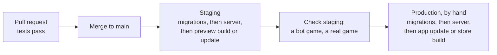

# Operations

How one developer runs Flimme: the environments, how the schema becomes versioned migrations, the Supabase settings that must be set, where every secret lives, continuous integration, releasing and rolling back, monitoring and alerts, backups, the retention jobs, the load test, the monthly bill, and what to do when something breaks. Written on 29 October 2026.

It builds on the [data model](data-model.md) (schemas, queues, scheduled jobs, retention), the [recommendation server](recommendation-server.md) (its four processes), [app-structure.md](app-structure.md#builds-updates-and-versions) (build profiles, over-the-air updates, `min_app_version`), [tmdb.md](../integrations/tmdb.md#keeping-it-fresh) (the catalog jobs and their alerts) and the [deck engine](deck-engine.md) (its logs). The server's own codebase, host and deploys are in [server-structure.md](server-structure.md); threats and abuse in [security.md](security.md); product analytics in [analytics.md](../product/analytics.md); personal data and its retention in [privacy.md](../product/privacy.md); store releases in [store-listing.md](../product/store-listing.md). Decisions are in [decisions.md](../decisions.md).

Facts about outside services were checked on their live sites on 29 October 2026 (see [Sources checked](#sources-checked)). Every threshold and price marked as a starting value is a placeholder.

## Contents

1. [Principles](#principles)
2. [Environments](#environments)
3. [From schema.sql to migrations](#from-schemasql-to-migrations)
4. [Supabase settings](#supabase-settings)
5. [Secrets](#secrets)
6. [Continuous integration](#continuous-integration)
7. [Releasing](#releasing)
8. [Monitoring and alerts](#monitoring-and-alerts)
9. [Backups and restore](#backups-and-restore)
10. [Retention jobs](#retention-jobs)
11. [Load test](#load-test)
12. [Monthly costs](#monthly-costs)
13. [Incidents](#incidents)
14. [Changes this asks elsewhere](#changes-this-asks-elsewhere)
15. [Starting values](#starting-values)
16. [Sources checked](#sources-checked)

## Principles

1. **Automate everything but the production button.** Tests, staging deploys and builds run by themselves; promoting to production is one deliberate click.
2. **Nothing reaches production without passing staging**, and staging runs the same code, migrations and settings.
3. **Backward compatible by default.** A release only adds; removing or renaming waits until no installed app or running server uses the old thing (expand, release, contract).
4. **An alert means "act now".** Everything else goes in the weekly review, so alerts stay rare enough to be read.
5. **The database is the only hard dependency.** If the server is down, games carry on with the SQL fallback deck; if TMDB is down, decks use the last good data. Operations protect Postgres first.

## Environments

| | Local | Staging | Production |
| --- | --- | --- | --- |
| Supabase | `supabase start` on the developer's machine (Docker) | A second project in the same Pro organization, Micro compute, West EU (Paris) | Pro project, Micro compute to start, West EU (Paris) |
| Data | Synthetic seed, plus an optional small real catalog fetched with your own TMDB key | The full France catalog from its own ingest, test accounts, bot players | Real |
| Recommendation server | Runs locally against local Supabase | One small instance with staging configuration ([server-structure.md](server-structure.md)) | Production instance, same region as the database |
| App | Development build (`….dev`) | Preview builds: TestFlight and Play internal testing (`….preview`) | Store builds |
| EAS environment and update channel | development | preview | production |
| Who uses it | The developer | The developer, playtesters, the load test | Everyone |

**Why a separate staging project** rather than a Supabase branch: a branch costs the same per hour as a Micro project, starts without data, needs auth secrets set again, and dashboard branching is in beta. A plain second project is simpler to reason about and to point a preview build at. Default; see the question in [Starting values](#starting-values).

**Region.** Supabase has a Paris region (`eu-west-3`). Players are French first, and it keeps personal data in France. The server goes in the same region ([server-structure.md](server-structure.md)).

### Seed and test data

- **`supabase/seed.sql`, committed: synthetic only.** Countries, a French provider list with made-up names, genres, the six moods, taste check films, about 2,000 invented films with random embeddings, availability and certifications, and a few test profiles. Loaded by `supabase db reset` locally and in CI. No TMDB content goes into git: TMDB's terms allow keeping its data for 6 months at most ([tmdb.md](../integrations/tmdb.md#terms-licence-and-attribution)), and a seed file in a repository is a copy kept forever.
- **`tools/seed-local-catalog`, never committed.** Runs the real ingest code against TMDB with the developer's own key and fills the local database with about 2,000 popular films available in France, so decks look real while building the app. Re-run it to refresh.
- **Staging** ingests the full France catalog itself, on the same schedule as production, so the sweeps, the 20% guard and the alerts are exercised before they matter.
- **Test accounts** on staging: a set of email and password users for bots and the load test, since anonymous sign-ins are limited per IP address (see [Supabase settings](#supabase-settings)).

## From schema.sql to migrations

Today [schema.sql](schema.sql) is one reference file, and the 120 checks described in the data model's [What was tested](data-model.md#what-was-tested) aren't in the repository. Before the first line of product code:

1. **Apply the pending changes** listed in the data model's Pending note (deck engine, game modes, TMDB, app structure, onboarding) to schema.sql, and drop what's gone (Streaming Availability).
2. **Write the 120 checks down as pgTAP tests** in `supabase/tests/`, run with `supabase test db`. With the real local stack from `supabase start`, the stand-ins for Supabase's auth, Realtime and Queues are no longer needed.
3. **Make schema.sql the first migration**: `supabase/migrations/<timestamp>_baseline.sql`. From then on, migrations are the source of truth. `docs/architecture/schema.sql` is retired, with a note pointing to the migrations folder; the data model doc keeps explaining the design.
4. **Every later change is a new migration**: `supabase migration new <name>`, written by hand (or generated with `supabase db diff -f <name>` after a change made in the local dashboard), checked with `supabase db reset` and the tests, committed.

Rules:

- **Never edit the remote schema by hand.** If it happens, capture it with `supabase db pull` and fix the history with `supabase migration list` and `supabase migration repair`.
- **No down migrations.** A bad migration is fixed forward with a new one. A destructive change (dropping a column or table) ships only in a "contract" release, after a backup has been checked that day.
- **The app's API changes as the data model says** ([The app's API](data-model.md#the-apps-api)): adding a column to a view or an optional argument is safe; anything else ships as `function_v2` next to the old one. The old one is dropped only once `min_app_version` in `api.app_config` is above every build that called it.
- **Generated types.** The CI regenerates the `api` types from the local database and fails if they differ from the committed file, so a renamed column breaks the build, not a live game ([app-structure.md](app-structure.md#talking-to-the-backend)).

## Supabase settings

Set on both staging and production, by hand once, then checked against this list at every release:

| Setting | Value | Where | Why |
| --- | --- | --- | --- |
| Region | West EU (Paris), `eu-west-3` | At project creation | French players; data stays in France |
| Exposed schemas | `api` only | Project settings, Data API, "Exposed schemas" | The app reaches nothing but `api` ([data model](data-model.md#the-apps-api)). After setting it, check that a table in `public` doesn't answer through `/rest/v1/` |
| Automatically expose new tables | Off | Data API settings | A new table is never reachable by accident |
| GraphQL | Off: drop the `pg_graphql` extension in the baseline migration | Migration, or Database, Extensions | Unused surface. Supabase's docs don't spell out the switch; check that `/graphql/v1` no longer answers |
| Realtime "Allow public access" | Off | Realtime settings | Private channels only; phones open them with `private: true` ([app-structure.md](app-structure.md#realtime)) |
| Anonymous sign-ins | On | Authentication | Guests |
| Auth rate limits | Defaults at launch: 30 anonymous sign-ins per hour per IP address | Authentication, Rate Limits | Watch the 429s: a venue or a mobile network sharing one address could hit it. Raise if needed; CAPTCHA and abuse are in [security.md](security.md) |
| Apple and Google sign-in | On, with their keys | Authentication, Providers | [Sign-in](app-structure.md#sign-in) |
| JWT signing keys | Asymmetric (ES256) | Authentication, JWT signing keys | The server verifies phones' tokens against the public JWKS endpoint, with no shared secret |
| API keys | The publishable key in the app; one secret key per server component | Project settings, API keys | The legacy `anon` and `service_role` keys are being deprecated by the end of 2026 |
| Extensions | `vector`, `pg_trgm`, `pgmq` (Queues), `pg_cron` (Cron) | Baseline migration | Needed by the schema |
| Compute | Micro to start; Small if the [load test](#load-test) misses its targets | Compute and disk | Small also unlocks point-in-time recovery |
| Spend cap | On during the closed beta; off at public launch | Organization billing | With the cap on, going over a quota restricts the project instead of billing it. A busy night must never cut games off; overages are cheap (see [Monthly costs](#monthly-costs)) |

## Secrets

Nothing secret is committed. Local values live in an ignored `.env.local`.

| Secret | Lives in | Used by |
| --- | --- | --- |
| Supabase URL and publishable key | EAS environment variables (`EXPO_PUBLIC_`), per environment | The app. Not secret, but per environment |
| PostHog project key, Sentry DSN for the app | EAS environment variables (`EXPO_PUBLIC_`) | The app |
| Sentry auth token (source map upload) | EAS secret | EAS Build and EAS Update |
| App Store Connect API key, Google Play service account | EAS credentials | EAS Submit |
| The `app_server` database password (its connection string) | The server host's secrets | The server ([contract](recommendation-server.md#the-contract-with-the-database)) |
| A Supabase secret key for account deletion only | The server host's secrets | The server's HTTP API |
| TMDB API token | The server host's secrets; your own key in `.env.local` | The pipeline worker, `tools/seed-local-catalog` |
| Sentry DSN for the server | The server host's secrets | The server |
| Apple and Google sign-in keys | Supabase Auth settings | Supabase |
| `SUPABASE_ACCESS_TOKEN`, each project's database password and project ref | GitHub Actions secrets, in `staging` and `production` environments | CI deploys |
| The server host's deploy token | GitHub Actions secrets | CI deploys |
| `EXPO_TOKEN` | GitHub Actions secrets (app repository) | CI triggering EAS |

- **One secret per component**, as Supabase recommends for secret keys, so a leak means rotating one thing.
- **Production secrets** only exist in the `production` GitHub environment and the production server.
- **Rotation**: the steps for each secret, and when to rotate, are in [security.md](security.md).

## Continuous integration

GitHub Actions in both repositories. Builds run on Expo's machines (EAS), not on GitHub's macOS runners, which cost about ten times Linux.

**Backend repository** (`movie-swipe-backend`: `supabase/`, the server, the docs):

| Workflow | When | Does |
| --- | --- | --- |
| `ci.yml` | Every pull request | `supabase start`, `supabase db reset` (migrations and the synthetic seed), `supabase test db` (pgTAP), regenerate the `api` types and compare, the server's lint and tests against the local stack ([server-structure.md](server-structure.md)), the docs' link check |
| `staging.yml` | Merge to `main` | `supabase link` to staging, `supabase db push`, then deploy the server to staging |
| `production.yml` | By hand (`workflow_dispatch`), after checking staging | `supabase db push` to production, then deploy the server to production |
| `backup.yml` | Weekly | A logical dump of production to private storage (see [Backups and restore](#backups-and-restore)) |

**App repository** (`movie-swipe-app`):

| Workflow | When | Does |
| --- | --- | --- |
| `ci.yml` | Every pull request | Lint, TypeScript check, unit tests ([app-structure.md](app-structure.md#testing)) |
| `preview.yml` | Merge to `main` | If the native fingerprint changed: an EAS preview build for TestFlight and Play internal testing. Otherwise an EAS Update on the `preview` channel |
| `production.yml` | By hand | An EAS Update on the `production` channel, or a store build and submission when the fingerprint changed |
| End to end | Nightly and before a release | The Maestro flows on EAS Workflows, against staging |

The two Supabase deploy workflows follow Supabase's own guide (`supabase/setup-cli`, `SUPABASE_ACCESS_TOKEN`, the database password and project ref per environment). GitHub's free plan includes $12 of compute a month for private repositories, which by our count is about 2,000 minutes on Linux runners: enough for one developer.

## Releasing

**Order: database, then server, then app.** Each step must work with the one before it and the one after:

1. **Migrations first.** They only add (expand): new tables, columns with defaults, new functions, `_v2` next to the old.
2. **Server second.** It uses the new parts and still accepts the old.
3. **App last.** An over-the-air update when only JavaScript changed; a store build when the fingerprint changed. `min_app_version` goes up only when old builds can no longer work.
4. **Contract later**: a separate release drops what nothing uses any more.

**Rolling back:**

| What | How |
| --- | --- |
| Server | Redeploy the previous version ([server-structure.md](server-structure.md)). Games carry on with the SQL fallback while it restarts |
| App update | `eas update:rollback`: back to the previous update or to the one embedded in the build |
| Store build | Can't be pulled back: ship a fix as an update if possible, otherwise a new build, and raise `min_app_version` if the broken one must stop |
| Migration | Fix forward with a new migration. Restoring a backup is the last resort: it takes the project offline (see below) |

**Store timing.** A new personal Google Play account must run a closed test with at least 12 testers, opted in for at least 14 days in a row, before it can apply for production. Plan the closed beta around it; details in [store-listing.md](../product/store-listing.md).

## Monitoring and alerts

**Where alerts arrive:** Sentry, by email and the Sentry phone app. A health check job in the pipeline worker runs every 5 minutes, reads `internal.ops_health()` (a new function, see [Changes this asks elsewhere](#changes-this-asks-elsewhere)) and sends one Sentry event per threshold crossed; Sentry groups repeats. One Sentry uptime monitor watches the server's HTTP API health endpoint (Sentry's uptime page says one monitor comes with every plan).

| Signal | Measured from | Alert when (starting values) | First move |
| --- | --- | --- | --- |
| App crashes | Sentry, app | A new issue, or crash-free sessions under 99% in a day | Roll back the update if it came with one |
| Server errors | Sentry, server | A new issue, or 10 times the usual rate | Read the issue; redeploy the previous version if it came with a release |
| Deck worker latency | `rec.requests.latency_ms` | p95 over 1 second for 15 minutes | Check queue depth and database CPU |
| Fallback deals | `rec.requests.is_fallback` | Over 5% of deals in an hour | The server is slow or down: restart, then look |
| Queue depth | `pgmq.metrics_all()`: `queue_length`, `oldest_msg_age_sec` | `deck_requests` oldest message over 10 seconds; `room_finished` and `taste_refresh` over 15 minutes; the others over 6 hours | Workers stuck or crashed |
| Scheduled jobs | `cron.job_run_details` | `sweep_rooms` missed 3 runs in a row; retention not run in 36 hours | Check `pg_cron` and the database |
| Catalog jobs | `ingest_runs` | A daily job unfinished after 36 hours; the 20% guard tripped; a 429 rate over 1% ([tmdb.md](../integrations/tmdb.md#failures-and-retries)) | Decks keep working on the last good data; fix the job |
| "Not there anymore?" reports | Reports on the winner screen ([tmdb.md](../integrations/tmdb.md#the-watch-link)) | Over 5% of winners reported in a week | TMDB's data is lagging: look at the sweep |
| Letterboxd | `linked_accounts.last_error`, imports | Over 10% of a day's syncs failing; any import stuck in `matching` for an hour | A feed format change, or the matcher |
| Sign-ins | Supabase auth logs | Anonymous sign-ins answered 429 more than 20 times in an hour | Shared addresses hitting the limit, or abuse ([security.md](security.md)) |
| Database | Supabase reports and advisors | CPU over 80% for 30 minutes; disk over 70% of the 8 GB included | Look for slow queries; plan the next compute size |
| Realtime messages | Supabase usage page | Projected month over 80% of the 5 million included | Nothing urgent: overage is $2.50 a million. Note it in the weekly review |

**The weekly review**, 15 minutes: Supabase usage and advisors, the bill, Sentry's top issues, the deck engine's numbers (time to a pick, fallback rate, repeat rate) and the product dashboards from [analytics.md](../product/analytics.md).

**Logs.** Supabase keeps API and database logs for 7 days on Pro. The server logs as structured JSON to its host ([server-structure.md](server-structure.md)). No personal data in logs or Sentry events: profile ids only, never names, codes or emails.

## Backups and restore

What Supabase Pro gives:

- **Daily backups, kept 7 days.** They don't include files in Supabase Storage (we keep none there that matter: training exports live in the server's object storage).
- **Restoring takes the project offline**, for longer the bigger the database. A restore into a new project goes through "Duplicate project".
- **Passwords of custom roles aren't in daily backups.** After any restore, reset the `app_server` login's password and update the server's secret, or the server can't connect.
- **Point-in-time recovery** restores to the second, but costs $100 a month per 7 days of history and needs at least Small compute. Not at launch (default).

What we add:

- **A weekly logical dump** of production (`backup.yml`, with the Supabase CLI) to private, encrypted storage, kept 4 weeks (starting value). How long backups holding personal data may be kept, and how deletions reach them, is for [privacy.md](../product/privacy.md).
- **A restore drill before the closed beta, then every 6 months:** restore the latest daily backup into a new project, reset `app_server`, point a staging server at it, run the pgTAP suite and one bot game, and write down how long it took.

## Retention jobs

The data model's [Retention](data-model.md#retention) table runs as one daily job (04:30, Supabase Cron), `internal.run_retention()`, plus two jobs on the server for what SQL can't do alone:

| Data | Rule | Run by |
| --- | --- | --- |
| Lobbies that never started | Abandoned after 3 hours (the minute sweeper), deleted after 7 days | Cron |
| Deck entries never voted on | 1 day after the room ends | Cron |
| Room cards nobody voted on | 7 days after the room ends | Cron |
| `swipe_log`, `rec.requests` | 13 months | Cron |
| `rec.request_items` | 90 days, after the monthly export to object storage | The trainer exports, then Cron deletes |
| `import_rows` unmatched | 30 days | Cron |
| `rate_limits` | 1 day | Cron |
| `card_history` | 12 months after the last showing ([deck engine](deck-engine.md#changes-to-the-data-model)) | Cron |
| TMDB content of films missing for 6 months | Cleared ([tmdb.md](../integrations/tmdb.md#keeping-it-fresh)) | Pipeline worker |
| Guest accounts inactive for 90 days | Deleted with their data, through the same auth admin call as account deletion | Pipeline worker |

Each run writes a row to `ingest_runs` (kind `retention`) with what it deleted, which the health check watches.

## Load test

From the revival plan's checklist: 50 rooms at once.

**When:** on staging, before the closed beta and again before the public launch, with staging temporarily on production's compute size (compute is billed by the hour, so a test costs cents).

**The scenario:**

- 45 rooms of 4 bot players and 5 rooms of 10, about 230 bots, ramped up over 5 minutes.
- Bots are the bot-player script from [app-structure.md](app-structure.md#testing): they sign in with staging's test accounts (one machine would hit the anonymous sign-in limit), join by code, and swipe every 2 to 4 seconds, liking about 30% of cards.
- Each room plays to a pick, then starts again, for 30 minutes.
- The nightly catalog sweep runs during the test, as the worst case.

**Targets (starting values):**

| Measure | Target |
| --- | --- |
| `cast_vote` round trip, p95 | Under 300 ms |
| A match reaching the other phones, p95 | Under 1 second after the deciding swipe |
| `internal.deck_candidates`, p95 | Under 150 ms (the data model's budget; it measured 105 to 220 ms on a test machine) |
| A deal from the deck worker, p95 | Under 1 second |
| Fallback deals | None |
| Lost or duplicated votes | None |
| Database CPU | Under 70% sustained |
| New Sentry issues | None |

If a target is missed: find the slow queries in Supabase's query performance report first; then try Small compute; then the data model's own fixes (a precomputed eligible set per room, or an HNSW pre-filter).

**What it says about capacity.** Assuming one Realtime connection per phone, Pro's 500 included connections cover about 125 four-player rooms at the same moment; beyond that, connections cost $10 per 1,000. The data model's estimate of about 350 Realtime messages per 4-player game means the 5 million included messages cover about 14,000 games a month.

## Monthly costs

Prices checked on 29 October 2026, in US dollars, before tax. France only.

| Item | Closed beta | Public launch | Notes |
| --- | --- | --- | --- |
| Supabase Pro, production | $25 | $25 | Includes $10 of compute: one Micro project. Small would add about $5 |
| Supabase, staging project (Micro) | About $10 | About $10 | Compute is per project; the $10 credit covers only one |
| Supabase overages | $0 | Watch | Realtime $2.50 per million messages over 5 million; 100,000 monthly active users included; posters come from TMDB's image servers, not ours, so egress stays small |
| Point-in-time recovery | Not used | Not used | $100 a month per 7 days, needs Small compute |
| Recommendation server host | See [server-structure.md](server-structure.md) | See [server-structure.md](server-structure.md) | Production and staging |
| TMDB | $0 or $149 | $149 | $149 a month under $1 million revenue; whether the deck engine needs it from the beta is open ([tmdb.md](../integrations/tmdb.md#terms-licence-and-attribution)) |
| EAS | $0 (Free: 15 Android and 15 iOS builds, 1,000 update users, low-priority queue) | $19 (Starter: $45 of build credit, 3,000 update users, then $0.005 each) | Free caps updates at 1,000 monthly users, so launch needs Starter |
| Sentry | $0 (Developer: 1 user, 5,000 errors) | $0, or $26 a month (Team, billed yearly) if 5,000 errors isn't enough | |
| PostHog | $0 | $0 | Free: 1 million events, 5,000 recordings, 1 project, 1 year of data; usage stops at the limit, so no surprise bill |
| GitHub Actions | $0 | $0 | $12 of compute included a month for private repositories |
| Apple Developer Program | About $8 ($99 a year) | About $8 | |
| Google Play | $25 once | | One-time registration |
| Domain for invite links | Depends on the name | | Open with the app's name |
| **Total, before the server host** | **About $43, or $192 with TMDB** | **About $211 with TMDB** | |

The public launch total matches the monetization doc's estimate of $200 to $250 a month in fixed costs ([Break-even](../product/monetization.md#break-even)) once the server host is added.

## Incidents

A short checklist for when something is wrong:

1. **Is it the server?** Check the fallback rate and the server's Sentry. Games continue on SQL fallback decks; restart, or redeploy the previous version.
2. **Is it Supabase?** Check Supabase's status page. Nothing to fix on our side; the app shows "Reconnecting" and re-reads the truth when it's back.
3. **Is it a release?** Roll back the newest thing first: the app update, then the server. Migrations are fixed forward.
4. **Is it TMDB?** Decks keep working on the last good data, and unfinished sweeps delete nothing. Wait, watch the 36-hour alert.
5. **A leaked secret?** Rotate it at once, following [security.md](security.md), and check the logs for its use.
6. **Personal data exposed?** Follow [privacy.md](../product/privacy.md): GDPR breach rules start a clock.
7. **Afterwards**, five lines in a GitHub issue labelled `incident`: what happened, when, impact, cause, what changes.

## Changes this asks elsewhere

**Repository layout (backend):** `supabase/` with `config.toml`, `migrations/`, `seed.sql` (synthetic) and `tests/` (pgTAP); `tools/seed-local-catalog`; `.github/workflows/` with the four workflows above. The server's own folders are in [server-structure.md](server-structure.md).

**Data model** (not yet in [data-model.md](data-model.md) or [schema.sql](schema.sql)):

| Where | Change |
| --- | --- |
| `internal.ops_health()` | New: returns the numbers the health check watches (deal latency and fallback share over the last hour, queue metrics, the last runs of `sweep_rooms` and retention, unfinished `ingest_runs`, Letterboxd failures, the share of winners reported). Callable by `app_server` only |
| `internal.run_retention()` | New: the daily retention job, writing its counts to `ingest_runs` |
| `ingest_runs.kind` | Add `retention` |
| Baseline migration | Drops `pg_graphql`; enables `vector`, `pg_trgm`, `pgmq`, `pg_cron` |
| `docs/architecture/schema.sql` | Retired once the baseline migration exists; the 120 checks become pgTAP tests |

**Other docs:** the data model's What was tested section should say where the tests now live; the revival plan's "Load test with 50 rooms at once" points here.

## Starting values

All placeholders until the first months of real use.

| Value | Start |
| --- | --- |
| Environments | Local, staging (second Pro project, Micro), production (Pro, Micro), all in Paris |
| Production deploys | By hand after staging; staging deploys on every merge |
| Health check | Every 5 minutes |
| Alert thresholds | As in the [monitoring table](#monitoring-and-alerts) |
| Weekly logical dump | Kept 4 weeks |
| Restore drill | Before the closed beta, then every 6 months |
| Point-in-time recovery | Off |
| Spend cap | On in the closed beta, off at public launch |
| Load test | 45 rooms of 4 and 5 of 10, 30 minutes, targets as above |
| Compute | Micro; Small if the load test misses |

## Sources checked

All on 29 October 2026:

- Supabase: [pricing](https://supabase.com/pricing) (plans, quotas, overages, backups, point-in-time recovery, log retention, spend cap, branching); [compute](https://supabase.com/docs/guides/platform/manage-your-usage/compute) (Micro and Small prices, one $10 credit per organization); [backups](https://supabase.com/docs/guides/platform/backups) (7 days on Pro, no Storage objects, downtime, custom role passwords, point-in-time recovery needs Small); [regions](https://supabase.com/docs/guides/platform/regions) (Paris, `eu-west-3`); [database migrations](https://supabase.com/docs/guides/deployment/database-migrations) and [managing environments](https://supabase.com/docs/guides/deployment/managing-environments) (CLI commands and GitHub Actions); [testing](https://supabase.com/docs/guides/local-development/testing/overview) (pgTAP, `supabase test db`); [branching](https://supabase.com/docs/guides/deployment/branching); [custom schemas](https://supabase.com/docs/guides/api/using-custom-schemas) and [hardening the Data API](https://supabase.com/docs/guides/database/hardening-data-api) ("Exposed schemas", "Automatically expose new tables"); [GraphQL configuration](https://supabase.com/docs/guides/graphql/configuration) (no switch documented); [Realtime authorization](https://supabase.com/docs/guides/realtime/authorization) ("Allow public access", `private: true`); [auth rate limits](https://supabase.com/docs/guides/auth/rate-limits); [API keys](https://supabase.com/docs/guides/api/api-keys) (publishable and secret keys, legacy keys deprecated by the end of 2026); [JWT signing keys](https://supabase.com/docs/guides/auth/signing-keys) (ES256, JWKS endpoint, rotation); [Queues](https://supabase.com/docs/guides/queues); [Cron](https://supabase.com/docs/guides/cron) (`cron.job_run_details`).
- [pgmq SQL functions](https://pgmq.github.io/pgmq/api/sql/functions/): `pgmq.metrics_all()` and its columns.
- Expo: [EAS pricing](https://expo.dev/pricing); [EAS Update rollbacks](https://docs.expo.dev/eas-update/rollbacks/) (`eas update:rollback`).
- [Sentry pricing](https://sentry.io/pricing/) and its [uptime monitoring page](https://sentry.io/product/uptime-monitoring/) (one monitor included; the page isn't dated).
- [PostHog pricing](https://posthog.com/pricing): the free allowances and billing limits.
- [GitHub Actions billing](https://docs.github.com/en/billing/concepts/product-billing/github-actions): $12 included for private repositories, per-minute rates.
- [Apple Developer Program enrollment](https://developer.apple.com/programs/enroll/): $99 a year.
- Google Play: [registration fee](https://support.google.com/googleplay/android-developer/answer/6112435) ($25 once) and [testing requirements for personal accounts](https://support.google.com/googleplay/android-developer/answer/14151465) (12 testers for 14 days).
