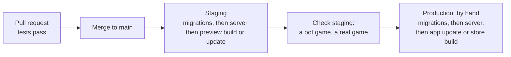

# Operations

How one developer runs Flimme: the environments, how the schema becomes versioned migrations, the Supabase settings that must be set, where every secret lives, continuous integration, releasing and rolling back, monitoring and alerts, backups, the retention jobs, the load test, the monthly bill, and what to do when something breaks. Written on 29 October 2026.

It builds on the [data model](data-model.md) (schemas, queues, scheduled jobs, retention), the [recommendation server](recommendation-server.md) (its four processes), [app-structure.md](app-structure.md#builds-updates-and-versions) (build profiles, over-the-air updates, `min_app_version`), [tmdb.md](../integrations/tmdb.md#keeping-it-fresh) (the catalog jobs and their alerts) and the [deck engine](deck-engine.md) (its logs). The server's own codebase, host and deploys are in [server-structure.md](server-structure.md); threats and abuse in [security.md](security.md); product analytics in [analytics.md](../product/analytics.md); personal data and its retention in [privacy.md](../product/privacy.md); store releases in [store-listing.md](../product/store-listing.md). Decisions are in [decisions.md](../decisions.md).

Facts about outside services were checked on their live sites on 29 October 2026 (see [Sources checked](#sources-checked)). Every threshold and price marked as a starting value is a placeholder.

## Contents

1. [Principles](#principles)
2. [Environments](#environments)
3. [From schema.sql to migrations](#from-schemasql-to-migrations)
4. [Supabase settings](#supabase-settings)
5. [Secrets](#secrets)
6. [Continuous integration](#continuous-integration)
7. [Releasing](#releasing)
8. [Monitoring and alerts](#monitoring-and-alerts)
9. [Backups and restore](#backups-and-restore)
10. [Retention jobs](#retention-jobs)
11. [Load test](#load-test)
12. [Monthly costs](#monthly-costs)
13. [Incidents](#incidents)
14. [Changes this asks elsewhere](#changes-this-asks-elsewhere)
15. [Starting values](#starting-values)
16. [Sources checked](#sources-checked)

## Principles

1. **Automate everything but the production button.** Tests, staging deploys and builds run by themselves; promoting to production is one deliberate click.
2. **Nothing reaches production without passing staging**, and staging runs the same code, migrations and settings.
3. **Backward compatible by default.** A release only adds; removing or renaming waits until no installed app or running server uses the old thing (expand, release, contract).
4. **An alert means "act now".** Everything else goes in the weekly review, so alerts stay rare enough to be read.
5. **The database is the only hard dependency.** If the server is down, games carry on with the SQL fallback deck; if TMDB is down, decks use the last good data. Operations protect Postgres first.

## Environments

| | Local | Staging | Production |
| --- | --- | --- | --- |
| Supabase | `supabase start` on the developer's machine (Docker) | A second project in the same organization, West EU (Ireland). Free plan, then Micro compute from M2.15 | Central EU (Frankfurt). Free plan, then Pro with Micro compute from M2.15 |
| Data | Synthetic seed, plus an optional small real catalog fetched with your own TMDB key | The full France catalog from its own ingest, test accounts, bot players | Real |
| Recommendation server | Runs locally against local Supabase | One small instance with staging configuration ([server-structure.md](server-structure.md)) | Production instance, same region as the database |
| App | Development build (`….dev`) | Preview builds: TestFlight and Play internal testing (`….preview`) | Store builds |
| EAS environment and update channel | development | preview | production |
| Who uses it | The developer | The developer, playtesters, the load test | Everyone |

**Why a separate staging project** rather than a Supabase branch: a branch costs the same per hour as a Micro project, starts without data, needs auth secrets set again, and dashboard branching is in beta. A plain second project is simpler to reason about and to point a preview build at. Default; see the question in [Starting values](#starting-values).

**Region.** Staging is in Ireland (`eu-west-1`) and production in Frankfurt (`eu-central-1`), both in the EU ([decided on 2 November 2026](../decisions.md)). Paris was the first choice; the projects were created elsewhere and kept. The server goes in the Fly.io region next to each database: London for staging, Frankfurt for production ([server-structure.md](server-structure.md#hosting)). Since the two environments are in different regions, latency measured on staging (the [load test](#load-test)) is a close estimate of production's, not an exact one.

**Plan.** Both projects start on Supabase's Free plan ([decided on 2 November 2026](../decisions.md), kept on 3 November 2026). The organization moves to Pro in M2.15 when either project's database size (the dashboard's figure) passes 400 MB, or before the internal alpha (M10.3), whichever comes first. Measured on staging on 3 November 2026: 1,857 films added about 10 MB, about 5.5 KB per film across all catalog tables and indexes, and the dashboard showed 38 MB after that load. The full catalog (40,000 to 60,000 films, plus France's availability) is projected at about 250 to 400 MB, under Free's 500 MB. Free means (checked on 2 November 2026): a project pauses after a week without activity (restore it from the dashboard), a 500 MB database, shared compute, 200 Realtime connections at once, no backups and one day of logs. What needs Pro: the full catalog, which could pass Free's 500 MB (M2.13); the speed check on real compute (M5.8); daily backups and the restore drill (M9.6); the load test's 230 players (M9.7); real players from the internal alpha on (M10.3).

### Seed and test data

- **`supabase/seed.sql`, committed: synthetic only.** France, ten made-up services (ids 8001 to 8010), French age ratings, twelve invented genres and 500 invented films, each with French and English text, a poster path, a certification, two or three offers and one deterministic placeholder vector (the SQL deal does not use vectors, since the real catalog has none, but it needs a poster path). The rows are generated in SQL from the film number, so every load is the same, and the spread guarantees that every quality preset, age cap and the 105-minute budget finds 40 films or more. No moods, taste check films or test profiles: the first release has none, guests sign in anonymously. Loaded by `supabase db reset` locally and in CI. No TMDB content goes into git: TMDB's terms allow keeping its data for 6 months at most ([tmdb.md](../integrations/tmdb.md#terms-licence-and-attribution)), and a seed file in a repository is a copy kept forever. The same goes for the server's test fixtures: they are synthetic, in TMDB's response shape, with movie ids from 60,000,001 (a test fails on any other id). A developer may record a real response into the git-ignored `server/tests/fixtures/.recorded/` and scrub it with `server/tools/scrub_fixture.py` first.
- **`server backfill --limit 2000` seeds a local catalog** (decision of 2 Nov 2026: it replaces the planned `tools/seed-local-catalog`). It runs the real ingest code against TMDB with the developer's own key and fills the local database with the 2,000 most popular films above the floor, so decks look real while building the app. The synthetic seed can stay in the database: its genre slugs start with `seed_` so TMDB's genres never collide with them. Offers arrive with the availability sweep (M2.10). Re-run it to carry on or refresh; an interrupted run resumes.
- **Staging** ingests the full France catalog itself, on the same schedule as production, so the sweeps, the 20% guard and the alerts are exercised before they matter.
- **Test accounts** on staging: a set of email and password users for bots and the load test, since anonymous sign-ins are limited per IP address (see [Supabase settings](#supabase-settings)).

## From schema.sql to migrations

[schema.sql](schema.sql) was one reference file, and the 120 checks described in the data model's [What was tested](data-model.md#what-was-tested) weren't in the repository. Before the first line of product code:

1. **Apply the pending changes**, each as its own migration after the baseline (M1.6 on), listed in the data model's Pending note (deck engine, game modes, TMDB, app structure, onboarding) to schema.sql, and drop what's gone (Streaming Availability).
2. **Write the 120 checks down as pgTAP tests** (done, M1.4) in `supabase/tests/`, run with `supabase test db`. With the real local stack from `supabase start`, the stand-ins for Supabase's auth, Realtime and Queues are no longer needed.
3. **Make schema.sql the first migration** (done, M1.5): `supabase/migrations/<timestamp>_baseline.sql`. From then on, migrations are the source of truth. `docs/architecture/schema.sql` is retired, now a note pointing to the migrations folder; the data model doc keeps explaining the design.
4. **Every later change is a new migration**: `supabase migration new <name>`, written by hand (or generated with `supabase db diff -f <name>` after a change made in the local dashboard), checked with `supabase db reset` and the tests, committed.

Rules:

- **Never edit the remote schema by hand.** If it happens, capture it with `supabase db pull` and fix the history with `supabase migration list` and `supabase migration repair`.
- **No down migrations.** A bad migration is fixed forward with a new one. A destructive change (dropping a column or table) ships only in a "contract" release, after a backup has been checked that day.
- **The app's API changes as the data model says** ([The app's API](data-model.md#the-apps-api)): adding a column to a view or an optional argument is safe; anything else ships as `function_v2` next to the old one. The old one is dropped only once `min_app_version` in `api.app_config` is above every build that called it.
- **Generated types.** The CI regenerates the `api` types from the local database and fails if they differ from the committed file, so a renamed column breaks the build, not a live game ([app-structure.md](app-structure.md#talking-to-the-backend)).

## Supabase settings

Set on both staging and production, by hand once, then checked against this list at every release:

| Setting | Value | Where | Why |
| --- | --- | --- | --- |
| Region | Staging: West EU (Ireland), `eu-west-1`. Production: Central EU (Frankfurt), `eu-central-1` | At project creation | Players' data stays in the EU |
| Exposed schemas | `api` only | Project settings, Data API, "Exposed schemas", once the baseline migration has created `api` on the project (M1.15) | The app reaches nothing but `api` ([data model](data-model.md#the-apps-api)). After setting it, check that a table in `public` doesn't answer through `/rest/v1/` |
| Automatically expose new tables | Off | Data API settings | A new table is never reachable by accident |
| GraphQL | Off: drop the `pg_graphql` extension in the baseline migration | Migration, or Database, Extensions | Unused surface. Supabase's docs don't spell out the switch; check that `/graphql/v1` no longer answers |
| Realtime "Allow public access" | Off | Realtime settings | Private channels only; phones open them with `private: true` ([app-structure.md](app-structure.md#realtime)) |
| Anonymous sign-ins | On | Authentication | Guests |
| Auth rate limits | Defaults at launch: 30 anonymous sign-ins per hour per IP address | Authentication, Rate Limits | Watch the 429s: a venue or a mobile network sharing one address could hit it. Raise if needed; CAPTCHA and abuse are in [security.md](security.md) |
| Apple and Google sign-in | On, with their keys | Authentication, Providers | [Sign-in](app-structure.md#sign-in) |
| JWT signing keys | Asymmetric (ES256) | Authentication, JWT signing keys | The server verifies phones' tokens against the public JWKS endpoint, with no shared secret |
| API keys | The publishable key in the app; one secret key per server component | Project settings, API keys | The legacy `anon` and `service_role` keys are being deprecated by the end of 2026 |
| Extensions | `vector`, `pg_trgm`, `pgmq` (Queues), `pg_cron` (Cron) | Baseline migration | Needed by the schema |
| Compute | Micro from M2.15 (Free has shared compute); Small if the [load test](#load-test) misses its targets | Compute and disk | Small also unlocks point-in-time recovery |
| Spend cap | On from M2.15 (it comes with Pro) through the closed beta; off at public launch | Organization billing | With the cap on, going over a quota restricts the project instead of billing it. A busy night must never cut games off; overages are cheap (see [Monthly costs](#monthly-costs)) |

## Secrets

Nothing secret is committed. Local values live in an ignored `.env.local`.

| Secret | Lives in | Used by |
| --- | --- | --- |
| Supabase URL and publishable key | EAS environment variables (`EXPO_PUBLIC_`), per environment | The app. Not secret, but per environment |
| PostHog project key, Sentry DSN for the app | EAS environment variables (`EXPO_PUBLIC_`) | The app |
| Sentry auth token (source map upload) | EAS secret (builds), and the `SENTRY_AUTH_TOKEN` GitHub Actions secret (updates published by `staging.yml`) | EAS Build, and the `app` job |
| `EXPO_TOKEN` | GitHub Actions secret | `staging.yml`'s `app` job and `preview-build.yml`: they call EAS |
| App Store Connect API key, Google Play service account | EAS credentials | EAS Submit |
| One database password per process login: `flimme_deck`, `flimme_pipeline`, `flimme_trainer` (role `app_server`) and `flimme_http` (role `app_http`), each as its connection string | The server host's secrets: `flimme-api-<env>` holds `flimme_http`'s as `API_DATABASE_URL`, `flimme-workers-<env>` the others as `PIPELINE_DATABASE_URL`, `DECK_DATABASE_URL` and `TRAINER_DATABASE_URL` (session-mode pooler URL, port 5432, user `<role>.<project ref>`). Set by Harry with `node tools/server-logins.mjs <env>`: it generates each password, sends Postgres only its SCRAM hash, tests the login through the pooler and stages the URL on Fly. The passwords exist only on Fly; to replace them, run it again. Never in a migration | Each server process ([contract](recommendation-server.md#the-contract-with-the-database)) |
| A Supabase secret key for account deletion only | The server host's secrets | The server's HTTP API |
| A PostHog personal API key (scope `person:write`) and project id, to forget a deleted player | The server host's secrets | The server's HTTP API |
| TMDB API token | The server host's secrets; your own key in `.env.local` | The pipeline worker, `server backfill` |
| Sentry DSN for the server | The server host's secrets | The server |
| Apple and Google sign-in keys | Supabase Auth settings | Supabase |
| `SUPABASE_ACCESS_TOKEN`, each project's database password and project ref | GitHub Actions secrets, in `staging` and `production` environments | CI deploys |
| Fly.io deploy tokens, one per app: `FLY_API_TOKEN_API` and `FLY_API_TOKEN_WORKERS` | GitHub Actions secrets, in `staging` and `production` environments | CI deploys |
| `EXPO_TOKEN` | GitHub Actions secrets (app repository) | CI triggering EAS |

- **One secret per component**, as Supabase recommends for secret keys, so a leak means rotating one thing.
- **Production secrets** only exist in the `production` GitHub environment and the production server.
- **Rotation**: the steps for each secret, and when to rotate, are in [security.md](security.md).

## Continuous integration

GitHub Actions in the one repository (`.github/workflows/`). Builds run on Expo's machines (EAS), not on GitHub's macOS runners, which cost about ten times Linux. Every `uses:` is pinned to a full commit SHA with a `# vX.Y.Z` comment, which Dependabot keeps current, and every workflow sets `permissions: contents: read` at the top.

| Workflow | When | Does |
| --- | --- | --- |
| `ci.yml` | Every pull request, and pushes to `main` | Only the parts that changed. Mobile: lint, types, Jest ([app-structure.md](app-structure.md#testing)). Server: ruff, pyright, pytest ([server-structure.md](server-structure.md)). Database: `supabase start`, `supabase db reset`, `supabase test db` (pgTAP), Squawk on new migrations, the `api` types regenerated and compared. Always: the pull request title, gitleaks, every action pinned to a SHA, the CI tools' tests, and the docs' link check. On pull requests: new migrations sort after every migration on `main` |
| `staging.yml` | Merge to `main` that touches `supabase/migrations/**`, `server/**`, `mobile/**` or `packages/**`, or by hand | In the `staging` environment: `supabase link`, `supabase db push`, then a smoke test of the Data API. Then the `server` job deploys the pipeline worker to `flimme-workers-staging` (`server/fly.workers.staging.toml`), unless the app has no `PIPELINE_DATABASE_URL` secret yet, and the `api` job deploys the HTTP API to `flimme-api-staging` (`server/fly.api.staging.toml`, one machine), unless `FLY_API_TOKEN_API` is empty, the app does not exist, or it lacks the `API_DATABASE_URL` or `SUPABASE_URL` secret (a warning, never red). Last the `app` job: for each platform it asks EAS whether a finished preview build has this commit's native fingerprint (`tools/preview-update-plan.mjs`). If so, `eas update --channel preview --environment preview` and the update's source maps go to Sentry. If not, no build starts (the free plan has 15 builds per platform a month) and the job summary says to run `preview-build.yml` |
| `preview-build.yml` | By hand, choosing `all`, `ios` or `android` | `eas build --profile preview --no-wait`: the build runs on EAS and the job ends once it is queued. Harry runs it when `staging.yml` says the native fingerprint changed |
| `production.yml` | By hand (`workflow_dispatch`), after checking staging | In the `production` environment, which holds the job until Harry approves: the same steps against production, from `main` only, then the `server` job deploys the pipeline worker to `flimme-workers-production`, with the same secrets check, and the `api` job deploys the API to `flimme-api-production` (two machines) with its own |
| `roadmap.yml` | A pull request merges | Ticks the roadmap task whose id starts the title; a `Docs`, `Chore`, `Fix` or `Bootstrap` title ticks nothing |
| `backup.yml` | Sundays 03:30 UTC, or by hand choosing `production` or `staging` | In that GitHub environment: `supabase db dump` three times (roles, schema, data), each file encrypted with `age` on the runner, uploaded to the private Tigris bucket, then dumps older than 28 days deleted. Ends green with a warning until the settings below exist (see [Backups and restore](#backups-and-restore)) |

The end-to-end flows run on EAS Workflows (the Maestro flows, nightly and before a release, against staging), and the app's production updates are EAS's own workflows ([app-structure.md](app-structure.md)). Preview updates and builds go through the two GitHub workflows above.

The two Supabase deploy workflows follow Supabase's own guide (`supabase/setup-cli`, `SUPABASE_ACCESS_TOKEN`, the database password and project ref per environment). Each GitHub environment holds three secrets, `SUPABASE_ACCESS_TOKEN`, `SUPABASE_DB_PASSWORD` and `SUPABASE_PROJECT_ID` (the project ref, which the dashboard calls the project ID), and two variables, `SUPABASE_URL` and `SUPABASE_PUBLISHABLE_KEY` (neither is secret: the app ships with them).

**Data API settings stay by hand.** Exposed schemas set to `api` only and "Automatically expose new tables" off are set once on each project in the dashboard, which keeps the access token's use to `db push`. The smoke step checks them on every deploy (`tools/smoke-data-api.mjs`): `public` is refused, `/graphql/v1` gives no data, and `api` answers.

**Migration order.** `supabase db push` refuses a local migration older than one already applied, so the pull request check fails a new migration that sorts before or with the latest one on `main`. Rename it with `git mv` to a fresh timestamp.

GitHub's free plan includes $12 of compute a month for private repositories, which by our count is about 2,000 minutes on Linux runners: enough for one developer.

## Releasing

**Order: database, then server, then app.** Each step must work with the one before it and the one after:

1. **Migrations first.** They only add (expand): new tables, columns with defaults, new functions, `_v2` next to the old.
2. **Server second.** It uses the new parts and still accepts the old.
3. **App last.** An over-the-air update when only JavaScript changed; a store build when the fingerprint changed. `min_app_version` goes up only when old builds can no longer work.
4. **Contract later**: a separate release drops what nothing uses any more.

**Rolling back:**

| What | How |
| --- | --- |
| Server | Redeploy the previous version ([server-structure.md](server-structure.md)). Games carry on with the SQL fallback while it restarts |
| App update | `eas update:rollback`: back to the previous update or to the one embedded in the build |
| Store build | Can't be pulled back: ship a fix as an update if possible, otherwise a new build, and raise `min_app_version` if the broken one must stop |
| Migration | Fix forward with a new migration. Restoring a backup is the last resort: it takes the project offline (see below) |

**Store timing.** A new personal Google Play account must run a closed test with at least 12 testers, opted in for at least 14 days in a row, before it can apply for production. Plan the closed beta around it; details in [store-listing.md](../product/store-listing.md).

## Monitoring and alerts

**Where alerts arrive:** Sentry, by email and the Sentry phone app. A health check in the pipeline worker runs every 5 minutes on its own timer (first run 30 seconds after start; not a queued message, so a broken `pg_cron` or a backed-up `catalog_refresh` cannot hide it), reads `internal.ops_health()` (M9.5) and sends one Sentry event per threshold crossed; Sentry groups repeats by the fingerprint `["ops-health", <signal>]`. The thresholds live in the SQL function. Latency and size signals are warnings, the rest errors. Each loop ends with a Sentry cron check-in (monitor `ops-health`, every 5 minutes, margin 5, max runtime 2), so a stopped worker shows as a missed check-in; if `ops_health()` fails or takes over 10 seconds, the loop sends one error event and checks in as `error`. The worker only runs the check when `SENTRY_DSN` is set. Events carry the signal's numbers only; a report event says how many reports and their ids cut to 8 characters (tag `report_ids`: find them with `id::text like 'a1b2c3d4%'`), and the worker sets `alerted_at` once Sentry has the event, so a failed send is retried. **Not wired yet:** anonymous sign-ins answered 429 and database CPU (both need Supabase's API and an access token), Letterboxd and "Not there anymore?" (until those features). The deal signals are quiet while `deck_engine` is `sql` now, since a deal does not record which engine dealt it. Database load is measured by size (percent of 8 GB) and connections (percent of `max_connections`). One Sentry uptime monitor watches the server's HTTP API health endpoint (Sentry's uptime page says one monitor comes with every plan).

| Signal | Measured from | Alert when (starting values) | First move |
| --- | --- | --- | --- |
| App crashes | Sentry, app | A new issue, or crash-free sessions under 99% in a day | Roll back the update if it came with one |
| Server errors | Sentry, server | A new issue, or 10 times the usual rate | Read the issue; redeploy the previous version if it came with a release |
| Deck worker latency | `rec.requests.latency_ms` | p95 over 1 second for 15 minutes | Check queue depth and database CPU |
| Fallback deals | `rec.requests.is_fallback` | Over 5% of deals in an hour. Ignore rooms dealt while `deck_engine` is `sql`: those deals are SQL by design and still log `is_fallback` (M1.13) | The server is slow or down: restart, then look |
| Queue depth | `pgmq.metrics_all()`: `queue_length`, `oldest_msg_age_sec` | `deck_requests` oldest message over 10 seconds; `room_finished` and `taste_refresh` over 15 minutes; the others over 6 hours | Workers stuck or crashed |
| Scheduled jobs | `cron.job_run_details` | `sweep_rooms` missed 3 runs in a row; retention not run in 36 hours | Check `pg_cron` and the database |
| Catalog jobs | `ingest_runs` | A daily job unfinished after 36 hours; the 20% guard tripped; a 429 rate over 1% ([tmdb.md](../integrations/tmdb.md#failures-and-retries)) | Decks keep working on the last good data; fix the job |
| Player reports | `member_reports` | Any row with `alerted_at is null`: alert at once (M9.5), then set `alerted_at` | Read the report and the seat's name; remove the player or ban by hand |
| "Not there anymore?" reports | Reports on the winner screen ([tmdb.md](../integrations/tmdb.md#the-watch-link)) | Over 5% of winners reported in a week | TMDB's data is lagging: look at the sweep |
| Letterboxd | `linked_accounts.last_error`, imports | Over 10% of a day's syncs failing; any import stuck in `matching` for an hour | A feed format change, or the matcher |
| Sign-ins | Supabase auth logs | Anonymous sign-ins answered 429 more than 20 times in an hour | Shared addresses hitting the limit, or abuse ([security.md](security.md)) |
| Database | Supabase reports and advisors | CPU over 80% for 30 minutes; disk over 70% of the 8 GB included | Look for slow queries; plan the next compute size |
| Realtime messages | Supabase usage page | Projected month over 80% of the 5 million included | Nothing urgent: overage is $2.50 a million. Note it in the weekly review |

**The weekly review**, 15 minutes: Supabase usage and advisors, the bill, Sentry's top issues, the deck engine's numbers (time to a pick, fallback rate, repeat rate) and the product dashboards from [analytics.md](../product/analytics.md).

**Logs.** Supabase keeps API and database logs for 7 days on Pro. The server logs as structured JSON to its host ([server-structure.md](server-structure.md)). No personal data in logs or Sentry events: profile ids only, never names, codes or emails.

## Backups and restore

What Supabase Pro gives:

- **Daily backups, kept 7 days.** They don't include files in Supabase Storage (we keep none there that matter: training exports live in the server's object storage).
- **Restoring takes the project offline**, for longer the bigger the database. A restore into a new project goes through "Duplicate project".
- **Passwords of custom roles aren't in daily backups.** After any restore, run `node tools/server-logins.mjs <env>` for that project and redeploy both server apps, or the server can't connect. It resets all four logins (`flimme_deck`, `flimme_pipeline`, `flimme_trainer`, `flimme_http`) and their Fly secrets.
- **Point-in-time recovery** restores to the second, but costs $100 a month per 7 days of history and needs at least Small compute. Not at launch (default).

What we add:

- **A weekly logical dump** of production (`backup.yml`, with the Supabase CLI) to private, encrypted storage, kept 4 weeks (starting value). How long backups holding personal data may be kept, and how deletions reach them, is for [privacy.md](../product/privacy.md).
- **A restore drill before the closed beta, then every 6 months:** restore the latest daily backup into a new project, reset the four server logins, point a staging server at it, run the pgTAP suite and one bot game, and write down how long it took.

The weekly dump, as built (M9.6):

- **What goes in.** Three files from `supabase db dump`, as Supabase's guide for moving a project does: `roles.sql` (`--role-only`), `schema.sql`, and `data.sql` (`--data-only --use-copy`), covering `auth.users` and every `public`, `internal` and `rec` table. The workflow refuses to upload a data file without `auth.users` and `public.profiles`. Left out: the queues (`pgmq`), `cron.job_run_details`, Supabase's own schemas (`storage`, `realtime`) and the migration history (`supabase_migrations`), none of which the CLI dumps.
- **Encrypted on the runner.** Each file goes through `age` to the public key in the GitHub variable `BACKUP_AGE_RECIPIENT`, and the plain file is removed at once. The private key exists only in Harry's password manager, never in the repository or in CI. A dump is never a workflow artifact (the repository is public).
- **Where.** The private Tigris bucket named by the variable `BACKUP_BUCKET` (endpoint `https://fly.storage.tigris.dev`), as `<env>/<UTC date>/{roles,schema,data}.sql.age`. The credentials are the secrets `BACKUP_S3_ACCESS_KEY_ID` and `BACKUP_S3_SECRET_ACCESS_KEY`. Variables and secrets live in the `production` GitHub environment, and in `staging` for a manual staging run. The workflow also needs the three `SUPABASE_*` secrets the deploy workflows use. If any is missing the run ends green with a `::warning::` naming it.
- **Kept 28 days.** After a successful upload the same run deletes that environment's objects dated more than 28 days ago (`tools/backup-retention.mjs`).
- **Fetch and decrypt one.** With the bucket's credentials in your own shell: `aws s3 cp --recursive --endpoint-url https://fly.storage.tigris.dev s3://<bucket>/production/<date>/ ./dump`, then `age --decrypt --identity <key file> --output dump/data.sql dump/data.sql.age` for each file, or let the restore script decrypt.
- **Restore.** `tools/restore-dump.sh <dump folder> <target database URL> [--identity <age key file>]` into an empty database: roles, schema, then data with `session_replication_role = replica`, stopping at the first error, then row counts of a fixed list of tables. It refuses a `*.supabase.co` or pooler host unless `--i-mean-it` is passed. The target must already have what a Supabase project has (the `auth` and `realtime` schemas, `supabase_realtime_admin`, `supabase_functions_admin`): restore into a new Supabase project, never a bare Postgres.
- **After any restore.** Passwords of custom roles aren't in a logical dump either: run `node tools/server-logins.mjs <env>` and redeploy both server apps. The dump has no migration history, so mark the migrations applied before the next deploy (`supabase migration repair --status applied <versions>`), or `supabase db push` will try to run them again.
- **The local drill.** `tools/restore-drill.sh` builds a throwaway source database in its own container (every migration, the seed, one synthetic room), dumps it the way `backup.yml` does, encrypts with a throwaway key, restores into a second empty container with `restore-dump.sh`, and compares counts of users, profiles, rooms and seats, the numbers of tables, `api` views, functions and policies, and that `api.app_config` answers. It never touches the shared local stack, and removes both containers (ports 54998 and 54999). Last run (5 Nov 2026, a Mac): the restore took 2 seconds and the whole drill 11, on a database of 500 synthetic films. The bare image lacks some Supabase parts, so the drill adds stand-ins for them (see the script); that is why it proves the dump and the restore order, not Supabase's own platform.
- **Not yet proven:** a restore into a real Supabase project and a staging server running on it. That drill is M9.8 (Harry, after M2.15).

Harry sets up once (step H5 of the slice plan): a private Tigris bucket, an `age` key pair (`age-keygen`, public key into `BACKUP_AGE_RECIPIENT`, private key into the password manager only), and a Tigris access key limited to that bucket. Then run `backup.yml` by hand with `staging` and check the objects appear.

## Retention jobs

The data model's [Retention](data-model.md#retention) table runs as one daily job (04:30, Supabase Cron), `internal.run_retention()`, plus one more cron job for guests and a server job for what SQL can't do alone:

| Data | Rule | Run by |
| --- | --- | --- |
| Lobbies that never started | Abandoned after 3 hours (the minute sweeper), deleted after 7 days | Cron |
| Deck entries never voted on | 1 day after the room ends | Cron |
| Room cards nobody voted on | 7 days after the room ends | Cron |
| `swipe_log`, `rec.requests` | 13 months | Cron |
| `rec.request_items` | 90 days, after the monthly export to object storage | The trainer exports, then Cron deletes (not in `run_retention` yet: it waits for the trainer, M22.1) |
| `import_rows` unmatched | 30 days | Cron |
| `rate_limits` | 1 day | Cron |
| `member_reports` | 12 months after `created_at` (M8.9) | Cron |
| `card_history` | 12 months after the last showing ([deck engine](deck-engine.md#changes-to-the-data-model)) | Cron (joins `run_retention` with the task that creates its table) |
| TMDB content of films missing for 6 months | Cleared ([tmdb.md](../integrations/tmdb.md#keeping-it-fresh)) | Pipeline worker |
| Guest accounts inactive for 90 days | Deleted from `auth.users` with their data (M8.8): anonymous users only, at most 1,000 a run, at 04:45 UTC. Inactive is the latest of the account's and profile's `created_at`, `last_seen_at` and the seats' `last_active_at`. Past seats stay, anonymous | Cron (`internal.delete_inactive_guests`, job `guest_cleanup_daily`) |

Each run writes a row to `ingest_runs` (kind `retention`) with what it deleted, which the health check watches. "After the room ends" is `coalesce(ended_at, expires_at)` of a room in `done` or `abandoned`; a room in play is never touched. A rule deletes at most 50,000 rows a night and says `capped` when more wait for the next night. A failing rule raises: the whole run rolls back, `cron.job_run_details` shows it as failed and no `retention` row is written, so the health check sees a missing run.

## Load test

From the revival plan's checklist: 50 rooms at once.

**When:** on staging, before the closed beta and again before the public launch, with staging temporarily on production's compute size (compute is billed by the hour, so a test costs cents).

**The scenario:**

- 45 rooms of 4 bot players and 5 rooms of 10, about 230 bots, ramped up over 5 minutes.
- Bots are the bot-player script from [app-structure.md](app-structure.md#testing): they sign in with staging's test accounts (one machine would hit the anonymous sign-in limit), join by code, and swipe every 2 to 4 seconds, liking about 30% of cards.
- Each room plays to a pick, then starts again, for 30 minutes.
- The nightly catalog sweep runs during the test, as the worst case.

**Targets (starting values):**

| Measure | Target |
| --- | --- |
| `cast_vote` round trip, p95 | Under 300 ms |
| A match reaching the other phones, p95 | Under 1 second after the deciding swipe |
| `internal.deck_candidates`, p95 | Under 150 ms (the data model's budget; it measured 105 to 220 ms on a test machine) |
| A deal from the deck worker, p95 | Under 1 second |
| Fallback deals | None |
| Lost or duplicated votes | None |
| Database CPU | Under 70% sustained |
| New Sentry issues | None |

If a target is missed: find the slow queries in Supabase's query performance report first; then try Small compute; then the data model's own fixes (a precomputed eligible set per room, or an HNSW pre-filter).

**What it says about capacity.** Assuming one Realtime connection per phone, Pro's 500 included connections cover about 125 four-player rooms at the same moment; beyond that, connections cost $10 per 1,000. The data model's estimate of about 350 Realtime messages per 4-player game means the 5 million included messages cover about 14,000 games a month.

## Monthly costs

Prices checked on 29 October 2026, in US dollars, before tax. France only.

| Item | Closed beta | Public launch | Notes |
| --- | --- | --- | --- |
| Supabase Pro, production | $25 | $25 | Includes $10 of compute: one Micro project. Small would add about $5 |
| Supabase, staging project (Micro) | About $10 | About $10 | Compute is per project; the $10 credit covers only one |
| Supabase overages | $0 | Watch | Realtime $2.50 per million messages over 5 million; 100,000 monthly active users included; posters come from TMDB's image servers, not ours, so egress stays small |
| Point-in-time recovery | Not used | Not used | $100 a month per 7 days, needs Small compute |
| Recommendation server host | See [server-structure.md](server-structure.md) | See [server-structure.md](server-structure.md) | Production and staging |
| TMDB | $0 or $149 | $149 | $149 a month under $1 million revenue; whether the deck engine needs it from the beta is open ([tmdb.md](../integrations/tmdb.md#terms-licence-and-attribution)) |
| EAS | $0 (Free: 15 Android and 15 iOS builds, 1,000 update users, low-priority queue) | $19 (Starter: $45 of build credit, 3,000 update users, then $0.005 each) | Free caps updates at 1,000 monthly users, so launch needs Starter |
| VPS with Dokploy (Docker and Traefik) | $0 extra | $0 extra | Hosts the invite page and the verification files; the VPS is an existing cost (decided 4 November 2026) |
| Sentry | $0 (Developer: 1 user, 5,000 errors) | $0, or $26 a month (Team, billed yearly) if 5,000 errors isn't enough | |
| PostHog | $0 | $0 | Free: 1 million events, 5,000 recordings, 1 project, 1 year of data; usage stops at the limit, so no surprise bill |
| GitHub Actions | $0 | $0 | $12 of compute included a month for private repositories |
| Apple Developer Program | About $8 ($99 a year) | About $8 | |
| Google Play | $25 once | | One-time registration |
| Domain for invite links | Depends on the name | | flimme.com, owned by Harry (decided 4 November 2026) |
| **Total, before the server host** | **About $43, or $192 with TMDB** | **About $211 with TMDB** | |

The public launch total matches the monetization doc's estimate of $200 to $250 a month in fixed costs ([Break-even](../product/monetization.md#break-even)) once the server host is added.

## Incidents

A short checklist for when something is wrong:

1. **Is it the server?** Check the fallback rate and the server's Sentry. Games continue on SQL fallback decks; restart, or redeploy the previous version.
2. **Is it Supabase?** Check Supabase's status page. Nothing to fix on our side; the app shows "Reconnecting" and re-reads the truth when it's back.
3. **Is it a release?** Roll back the newest thing first: the app update, then the server. Migrations are fixed forward.
4. **Is it TMDB?** Decks keep working on the last good data, and unfinished sweeps delete nothing. Wait, watch the 36-hour alert.
5. **A leaked secret?** Rotate it at once, following [security.md](security.md), and check the logs for its use. After rotating a Supabase signing key, restart the API (`fly apps restart flimme-api-<env>`): it keeps the project's public keys for 10 minutes and refetches on an unknown key id, but a restart is the sure flush.
6. **Personal data exposed?** Follow [privacy.md](../product/privacy.md): GDPR breach rules start a clock.
7. **Afterwards**, five lines in a GitHub issue labelled `incident`: what happened, when, impact, cause, what changes.

## Changes this asks elsewhere

**Repository layout (backend):** `supabase/` with `config.toml`, `migrations/`, `seed.sql` (synthetic) and `tests/` (pgTAP); `server backfill --limit` for a local catalog; `.github/workflows/` with the four workflows above. The server's own folders are in [server-structure.md](server-structure.md).

**Data model** (not yet in [data-model.md](data-model.md) or [schema.sql](schema.sql)):

| Where | Change |
| --- | --- |
| `internal.ops_health()` | New (M9.5): returns each signal as `{name, value, threshold, crossed}` (queue ages, `sweep_rooms` runs, retention, catalog runs, the sweep guard, 429 rate and agreement, new reports with their ids, deal latency and fallback share, database size and connections), and `internal.mark_reports_alerted(ids)` sets `alerted_at`. Callable by `app_server` only |
| `internal.run_retention()` | New: the daily retention job, writing its counts to `ingest_runs` |
| `ingest_runs.kind` | Add `retention` and `guest_cleanup` |
| Baseline migration | Drops `pg_graphql`; enables `vector`, `pg_trgm`, `pgmq`, `pg_cron` |
| `docs/architecture/schema.sql` | Retired once the baseline migration exists; the 120 checks become pgTAP tests |

**Other docs:** the data model's What was tested section should say where the tests now live; the revival plan's "Load test with 50 rooms at once" points here.

## Starting values

All placeholders until the first months of real use.

| Value | Start |
| --- | --- |
| Environments | Local, staging and production; staging in Ireland, production in Frankfurt; Free plan until M2.15, then Pro with Micro compute |
| Production deploys | By hand after staging; staging deploys on every merge |
| Health check | Every 5 minutes |
| Alert thresholds | As in the [monitoring table](#monitoring-and-alerts) |
| Weekly logical dump | Kept 4 weeks |
| Restore drill | Before the closed beta, then every 6 months |
| Point-in-time recovery | Off |
| Spend cap | On in the closed beta, off at public launch |
| Load test | 45 rooms of 4 and 5 of 10, 30 minutes, targets as above |
| Compute | Micro; Small if the load test misses |

## Sources checked

All on 29 October 2026:

- Supabase: [pricing](https://supabase.com/pricing) (plans, quotas, overages, backups, point-in-time recovery, log retention, spend cap, branching); [compute](https://supabase.com/docs/guides/platform/manage-your-usage/compute) (Micro and Small prices, one $10 credit per organization); [backups](https://supabase.com/docs/guides/platform/backups) (7 days on Pro, no Storage objects, downtime, custom role passwords, point-in-time recovery needs Small); [regions](https://supabase.com/docs/guides/platform/regions) (Paris, `eu-west-3`); [database migrations](https://supabase.com/docs/guides/deployment/database-migrations) and [managing environments](https://supabase.com/docs/guides/deployment/managing-environments) (CLI commands and GitHub Actions); [testing](https://supabase.com/docs/guides/local-development/testing/overview) (pgTAP, `supabase test db`); [branching](https://supabase.com/docs/guides/deployment/branching); [custom schemas](https://supabase.com/docs/guides/api/using-custom-schemas) and [hardening the Data API](https://supabase.com/docs/guides/database/hardening-data-api) ("Exposed schemas", "Automatically expose new tables"); [GraphQL configuration](https://supabase.com/docs/guides/graphql/configuration) (no switch documented); [Realtime authorization](https://supabase.com/docs/guides/realtime/authorization) ("Allow public access", `private: true`); [auth rate limits](https://supabase.com/docs/guides/auth/rate-limits); [API keys](https://supabase.com/docs/guides/api/api-keys) (publishable and secret keys, legacy keys deprecated by the end of 2026); [JWT signing keys](https://supabase.com/docs/guides/auth/signing-keys) (ES256, JWKS endpoint, rotation); [Queues](https://supabase.com/docs/guides/queues); [Cron](https://supabase.com/docs/guides/cron) (`cron.job_run_details`).
- [pgmq SQL functions](https://pgmq.github.io/pgmq/api/sql/functions/): `pgmq.metrics_all()` and its columns.
- Expo: [EAS pricing](https://expo.dev/pricing); [EAS Update rollbacks](https://docs.expo.dev/eas-update/rollbacks/) (`eas update:rollback`).
- [Sentry pricing](https://sentry.io/pricing/) and its [uptime monitoring page](https://sentry.io/product/uptime-monitoring/) (one monitor included; the page isn't dated).
- [PostHog pricing](https://posthog.com/pricing): the free allowances and billing limits.
- [GitHub Actions billing](https://docs.github.com/en/billing/concepts/product-billing/github-actions): $12 included for private repositories, per-minute rates.
- [Apple Developer Program enrollment](https://developer.apple.com/programs/enroll/): $99 a year.
- Google Play: [registration fee](https://support.google.com/googleplay/android-developer/answer/6112435) ($25 once) and [testing requirements for personal accounts](https://support.google.com/googleplay/android-developer/answer/14151465) (12 testers for 14 days).
