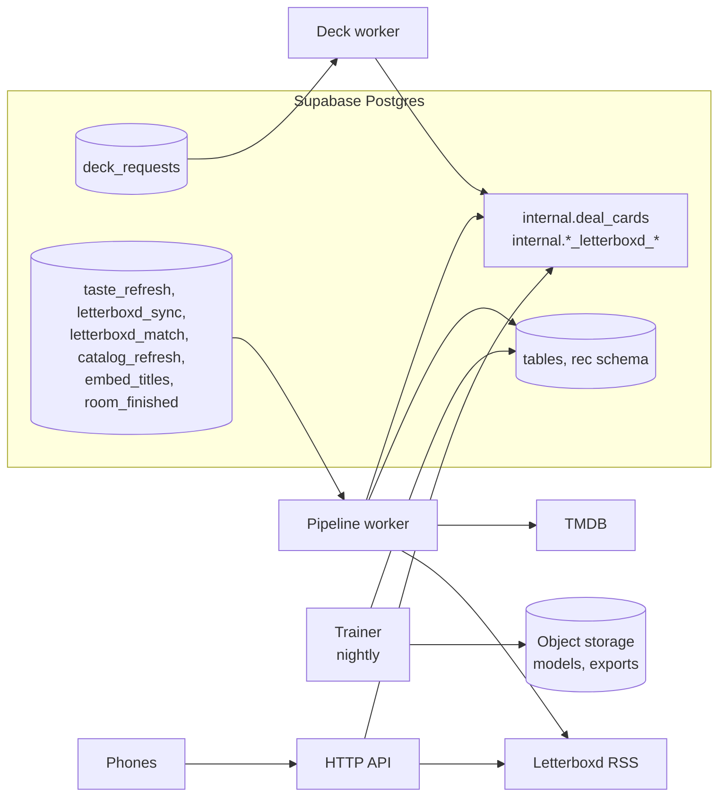

# Server structure

How the recommendation server's code is built: its language, its folder and module layout, how the four processes share one codebase, how they consume Supabase Queues safely, how they talk to the database, how the deck worker stays well under a second, how the HTTP API checks players, what configuration it needs, how to run and test it locally, and where it's hosted. Written on 29 October 2026.

[recommendation-server.md](recommendation-server.md) stays the what: the processes, the contract with the database, the algorithm's stages. This doc is the how. It builds on the [deck engine](deck-engine.md) (the stages turned into modules here), [tmdb.md](../integrations/tmdb.md) (the catalog jobs), [letterboxd.md](../integrations/letterboxd.md) (imports and syncs) and the [data model](data-model.md) (queues, roles, contract functions). Environments, CI, monitoring and backups are in [operations.md](operations.md); threats and abuse are in [security.md](security.md). Decisions are in [decisions.md](../decisions.md).

Every number marked as a starting value or an estimate is a placeholder until measured.

## Contents

1. [The language](#the-language)
2. [Principles](#principles)
3. [One codebase, four processes](#one-codebase-four-processes)
4. [Folder layout](#folder-layout)
5. [The deck engine as modules](#the-deck-engine-as-modules)
6. [Consuming the queues](#consuming-the-queues)
7. [The database layer](#the-database-layer)
8. [The deck worker](#the-deck-worker)
9. [The pipeline worker](#the-pipeline-worker)
10. [The HTTP API](#the-http-api)
11. [The trainer](#the-trainer)
12. [Recipes and models in memory](#recipes-and-models-in-memory)
13. [Configuration and secrets](#configuration-and-secrets)
14. [Local development](#local-development)
15. [Testing](#testing)
16. [Hosting](#hosting)
17. [Deploying](#deploying)
18. [Changes this asks elsewhere](#changes-this-asks-elsewhere)
19. [Starting values](#starting-values)
20. [Sources](#sources)

## The language

> **Decided on 29 October 2026: Python.** FastAPI serves the HTTP API; the workers and the trainer are plain async Python processes. The reasoning below is kept for the record.

What the server has to do, now that the other docs exist:

| Job | From | What it needs |
| --- | --- | --- |
| Score and deal decks in well under a second | [deck-engine.md](deck-engine.md) | Fast vector maths over a few hundred films and up to 10 seats; weighted sampling; reading and writing JSON payloads |
| Run trained models in the deck worker | [deck-engine.md](deck-engine.md#logging-and-upgrading) (upgrade path, step 2) | Loading a ranker trained by the trainer, and computing exactly the same features online as offline |
| Train and evaluate models nightly | [recommendation-server.md](recommendation-server.md#processes) | Gradient-boosted trees, ranking metrics, off-policy evaluation with logged propensities, notebooks to tune recipes |
| Embed 60,000 films and score moods | [tmdb.md](../integrations/tmdb.md#embeddings-and-moods) | gte-small on CPU, in batches |
| Ingest TMDB and Letterboxd | [tmdb.md](../integrations/tmdb.md), [letterboxd.md](../integrations/letterboxd.md) | An HTTP client with rate limiting and retries; CSV and RSS parsing |
| Answer phones | [app-structure.md](app-structure.md#talking-to-the-backend) | A small authenticated HTTP API |

| | Python everywhere | TypeScript, with training in Python |
| --- | --- | --- |
| Deck scoring | numpy: a few lines, milliseconds | Plain arrays or a typed-array library; fine at this size |
| Trained ranker in the deck worker | Loads natively; the same feature code serves training and dealing | Trained in Python, exported (to ONNX, for example) and run in Node; feature code written twice, so it can drift |
| Training, evaluation, notebooks | Native | A second codebase in Python anyway |
| gte-small | onnxruntime with the ONNX weights of `Supabase/gte-small` | Transformers.js runs the same `Supabase/gte-small` weights |
| Sharing with the app | Nothing to share: the contract is SQL functions and JSON | Could share types, but the server never uses the `api` schema the app's types come from |
| Size of the image | Larger (numerical libraries) | Smaller |

**Recommendation: Python, for all four processes.** The deciding point is the trained ranker. The most common way recommenders go wrong is computing a feature one way when training and another way when serving. With one language, `engine/features.py` is the only place a feature is computed, and both the trainer and the deck worker import it. TypeScript would buy shared types with the app, but the server never touches the `api` schema those types describe.

The rest of this doc is written for Python, and the layout holds either way: if Harry picks TypeScript, the modules, queues, latency budget and hosting stay the same, and the trainer becomes a separate Python project that exports models.

**The Python stack** (defaults, all mainstream libraries):

| Need | Choice |
| --- | --- |
| Packaging | uv, with a lock file |
| Database | psycopg 3, async, with a connection pool |
| Payloads | pydantic models for every JSON payload in and out |
| HTTP API | FastAPI |
| Maths | numpy; later LightGBM for the ranker, polars for training data |
| Embeddings | onnxruntime and tokenizers, with the `Supabase/gte-small` ONNX weights |
| Outside calls | httpx, with one shared client per process |
| RSS | defusedxml before parsing, since feeds are outside input |
| Errors | Sentry (set up in [operations.md](operations.md)) |
| Python version | The newest release that psycopg, onnxruntime and LightGBM all publish wheels for |

## Principles

1. **Load, compute, write.** Every job reads what it needs, runs pure functions that do no input or output, and writes the result. The pure middle is where all the logic lives, so it can be tested and replayed without a database.
2. **Every message can arrive twice.** Queues redeliver after a crash, so every handler is safe to run again ([Consuming the queues](#consuming-the-queues)).
3. **The server is never on the critical path.** If the deck worker is slow or down, the database deals the SQL baseline after 8 seconds ([data model](data-model.md#start-dealing-the-deck)). The server's job is to be better, not to be required.
4. **The database decides, through functions.** The server writes decks and Letterboxd data only through `internal.*` functions, never by editing game tables.
5. **One image, four commands.** The same build runs every process, so a fix to shared code reaches all of them in one deploy.

## One codebase, four processes



| Process | Command | Runs | Instances at launch |
| --- | --- | --- | --- |
| Deck worker | `server deck-worker` | Always on, consumes `deck_requests` | 2, for redundancy |
| Pipeline worker | `server pipeline-worker` | Always on, consumes the other queues | 1, so TMDB's rate limit can be kept in memory |
| HTTP API | `server api` | Always on, behind HTTPS | 2, for redundancy |
| Trainer | `server trainer nightly` | Once a night, then exits | Scheduled |

Plus one-off commands from the same image: `server backfill` (the first catalog load, [tmdb.md](../integrations/tmdb.md#the-first-full-load)), `server replay` (the simulation harness), `server moods-review` (the deck engine's mood lists).

They share everything under `src/`: the configuration, the database layer, the engine, the TMDB and Letterboxd clients. Each process is only a thin entry point that picks which handlers to run.

## Folder layout

```
server/
  pyproject.toml, uv.lock, Dockerfile
  src/server/
    config.py             settings from the environment, validated at start
    cli.py                the commands above
    db/
      pool.py             the connection pool, statement timeouts
      queues.py           read, delete, archive, extend the visibility timeout
      contract.py         one typed wrapper per internal.* function
      payloads.py         pydantic models: deal payload, candidates, Letterboxd payloads
      queries/            the server's own SQL, one file per query
    engine/               pure functions only (see the next section)
      recipes.py  candidates.py  fit.py  group.py  freshness.py
      deck.py  labels.py  live.py  features.py  vectors.py
    taste/                the taste builder
    moods/                the mood scorer
    catalog/              TMDB client, sweep, fetch, popularity, changes, embeddings
    letterboxd/           RSS fetch and parse, the RSS check, film matching, imports
    rooms/                end-of-room work: stats, card history, seen films
    workers/
      runner.py           the generic queue loop
      deck.py             the deck_requests handler
      pipeline.py         the handlers for the other queues
    api/                  FastAPI: auth, Letterboxd upload, account deletion, health
    trainer/              title stats, training data export, training, evaluation
  tests/
    unit/  contract/  replay/  fixtures/
  tools/
    moods_review.py
```

## The deck engine as modules

Each stage of the [deck engine](deck-engine.md#the-pipeline) is one module with fixed inputs and outputs. Only the first and last steps of a deal touch the database.

| Stage | Module and function | Takes | Gives | Input or output |
| --- | --- | --- | --- | --- |
| Candidates | `engine.candidates.fetch(conn, room, recipe)` | The room id, the merged recipe | `Candidates`: about 300 films with crowd score, mood fit, random flag, and each seat's similarity and fatigue | Reads, through `internal.deck_candidates` |
| Context | `engine.candidates.load_context(conn, room)` | The room id | `RoomContext`: seats with confidence, leanings and watchlists; tonight's votes; the room's live taste; recent card history | Reads |
| Player fit | `engine.fit.score(cands, ctx, recipe)` | Candidates, context, recipe | `FitTable`: a fit from 0 to 5 per seat and film, with its features | Pure |
| Group score | `engine.group.score(fits, cands, ctx, recipe)` | Fits, candidates, context | `GroupScores`: group score and min fit per film, dropped films marked | Pure |
| Deck builder | `engine.deck.build(scores, ctx, phase, recipe, rng)` | Scores, context, the game's phase, a seeded random generator | `DealPayload`: pool entries and each seat's cards, with source, propensity, features and label | Pure |
| Labels | `engine.labels.pick(film, ctx)` | A film and the room's context | A reason code and its parameters | Pure |
| Live learning | `engine.live.update(votes, model, recipe)` | Tonight's votes, the room's model | The new room model, tonight leanings, dropped genres | Pure |
| Write | `db.contract.deal_cards(conn, room, payload)` | The payload | `ok` or `closed` | Writes |
| Taste builder | `taste.build(signals, params)` | A player's signals, the taste model's parameters | `TasteProfile`: embedding, leanings, confidence | Pure |
| Mood scorer | `moods.score(film, moods, centres)` | A film, the mood rows, each mood's centre | A score and raw score per mood | Pure |

`engine/features.py` defines every logged feature (`sim`, `lean`, `crowd`, `conf`, `watchlist`, `tonight`, `fatigue`, `mood_fit`, `group`, `min_fit`, `live`, `phase`, `slot`, `label`) and computes them in one place. The deck worker logs them into the deal payload; the trainer reads them back from `rec.request_items`. A trained ranker replaces `engine.fit.score` behind the same signature.

`engine/vectors.py` keeps every film's embedding in memory (60,000 films × 384 numbers × 4 bytes is about 92 MB), for the variety rule and the "Because Sam loved Arrival" label, so a deal never ships vectors over the network.

## Consuming the queues

The queues are Supabase Queues, which is the pgmq extension. Reading a message hides it for a visibility timeout; if the worker doesn't delete it in time, it becomes visible again and is redelivered. Each read returns the message's id, `read_ct` (how many times it has been read), when it was enqueued, when it becomes visible again, and its JSON body.

**The loop** (`workers/runner.py`), the same for every queue:

1. `pgmq.read_with_poll(queue, vt, qty, max_poll_seconds, poll_interval_ms)`: waits for messages without busy-looping. For `deck_requests` it polls every 100 ms, so a request waits at most a tenth of a second to be picked up.
2. If `read_ct` is over the queue's limit, the message is **poisoned**: `pgmq.archive` moves it to the queue's archive table, the error is logged, and an alert goes out ([operations.md](operations.md)). It's never retried silently forever.
3. Otherwise the handler runs. A long job extends its own timeout with `pgmq.set_vt` before it runs out.
4. On success, `pgmq.delete`. On a failure worth retrying, nothing: the timeout brings it back. On a failure that will never succeed (bad input), `pgmq.archive` straight away.
5. On shutdown, the loop stops reading, lets the handlers in progress finish, and exits. Anything unfinished comes back after its timeout.

The server calls these pgmq functions directly with SQL. No client library is needed, and it keeps one database driver.

**Per queue** (starting values):

| Queue | Visibility timeout | Poisoned after | Handler | Why running it twice is safe |
| --- | --- | --- | --- | --- |
| `deck_requests` | 10 s | 3 reads | Deal a start or a refill | A start is skipped unless the room is still `dealing`; a refill is skipped unless the seat's `refill_requested_at` is still set; any request older than 20 s is skipped, because the SQL fallback has dealt by then. `deal_cards` returns `closed` if the room moved on |
| `taste_refresh` | 60 s | 5 | Rebuild one profile | Rebuilt from scratch every time; skipped if the profile was computed after the message was enqueued |
| `letterboxd_sync` | 120 s | 5 | Fetch and apply one feed | Conditional request; `apply_letterboxd_feed` recognises entries it already has |
| `letterboxd_match` | 300 s | 5 | Match an import's films, then finish it | Matched rows are applied and deleted; `finish_letterboxd_import` runs once per import |
| `catalog_refresh` | 300 s | 5 | Fetch a batch of TMDB films or run a sweep step | Upserts; a sweep only deletes after it completed ([tmdb.md](../integrations/tmdb.md#the-daily-sweep)) |
| `embed_titles` | 300 s | 5 | Embed changed films, re-score moods | Skips films whose `source_hash` is unchanged |
| `room_finished` | 60 s | 5 | Room stats, card history, seen films, taste refreshes | Stats are overwritten; card history is skipped for a film whose `last_room_id` is already this room, so nothing is counted twice |

`winner_links` is gone (migration `remove_v1_dropped`): Streaming Availability is dropped from v1. `letterboxd_match` is new (see [Changes this asks elsewhere](#changes-this-asks-elsewhere)).

## The database layer

**Connecting.** The server logs in as its own user, granted the `app_server` role ([data model](data-model.md#who-sees-what)), never with the project's secret key. Supabase documents the direct connection (port 5432) for persistent servers, but it's IPv6 unless the project buys the IPv4 add-on. The shared pooler's session mode (also port 5432) works over IPv4 from any host and supports prepared statements. **Default: the shared pooler in session mode**, which works on every host below. Transaction mode (port 6543) is for serverless functions and doesn't keep session state, so it isn't used.

**Connections**, starting values: 4 for each deck worker, 4 for the pipeline worker, 4 for each API instance, 2 for the trainer: about 22 in all. `read_with_poll` holds a connection while it waits, which is why each worker keeps one connection just for reading. Check against the project's limits on its database settings page.

**Timeouts.** Every connection sets a statement timeout: 2 seconds for the deck worker, 60 seconds for the pipeline worker, 5 seconds for the API, longer for the trainer's batch queries.

**Contract functions.** `db/contract.py` has one typed wrapper per function the server may call:

| Function | Called by | Payload model |
| --- | --- | --- |
| `internal.deck_candidates(room, limit, misery_line)` | Deck worker | `Candidates` |
| `internal.deal_cards(room, payload)` | Deck worker | `DealPayload` |
| `internal.start_letterboxd_import(profile, payload)` | HTTP API | `LetterboxdUpload` |
| `internal.finish_letterboxd_import(import)` | Pipeline worker | |
| `internal.apply_letterboxd_feed(account, feed, etag, last_modified)` | Pipeline worker | `FeedItems` |
| `internal.broadcast_room(room, event, payload)` | Pipeline worker | |
| `internal.enqueue(queue, message)` | All | |

The payload models are the contract with Postgres: the SQL functions document their JSON in comments in [schema.sql](schema.sql), and the contract tests check the two agree ([Testing](#testing)). Everything else the server reads is plain SQL in `db/queries/`, one file per query, so a column rename shows up in one place and in the tests.

## The deck worker

What happens between a phone's swipe that triggers a refill and the new cards being in the database:

| Step | What | Budget (estimate) |
| --- | --- | --- |
| 1 | The message is picked up (polling every 100 ms) | Up to 100 ms |
| 2 | Guard: is the room still `dealing`, or the seat's refill flag still set? | 10 ms |
| 3 | Load the room's context in one or two queries | 30 ms |
| 4 | `internal.deck_candidates`: measured at about 105 ms for 2 players, 150 for 4, 220 for 10 ([data model](data-model.md#sizes-and-speed)) | 100 to 220 ms |
| 5 | Player fit and group score with numpy: about 350 films × 10 seats | Under 10 ms |
| 6 | Deck building: 25 draws with the variety rule, from vectors in memory | Under 20 ms |
| 7 | `internal.deal_cards`, which takes the room lock and logs every card | 30 to 60 ms |
| | **Total, from enqueue to commit** | **About 300 to 450 ms** |

**Targets** (starting values): median under 400 ms, 95th percentile under 800 ms, measured from the message's enqueue time to the commit and logged in `rec.requests.latency_ms`. Each seat has 15 cards of buffer, so even a 2-second refill is invisible to players; the 8-second SQL fallback is the backstop.

**Concurrency.** One deck worker runs up to 8 deals at once (starting value). Deals for different rooms never wait on each other; two refills in the same room queue on the room lock, a few milliseconds each.

**Load** (estimate): a 4-player game makes about 21 deals (the start, then a refill every 10 swipes per seat). At 10,000 games a month that's about 210,000 deals, a fraction of a deal per second on average, and a few a second on a busy Friday evening. One worker is plenty; the second is there for when the first restarts.

**Experiments.** A room's variant is chosen from a hash of its id against the experiment's traffic shares, so every request in the room gets the same variant without storing it, and it's logged on every request as before.

## The pipeline worker

Everything that isn't urgent: catalog jobs, embeddings, Letterboxd, taste profiles, end-of-room work.

- **Schedules live in the database.** Supabase Cron enqueues the TMDB jobs and the Letterboxd syncs ([data model](data-model.md#queues-and-scheduled-jobs), [tmdb.md](../integrations/tmdb.md#keeping-it-fresh)); the worker only consumes.
- **One instance at launch,** so TMDB's rate (20 requests a second with 8 in flight, [tmdb.md](../integrations/tmdb.md#failures-and-retries)) is enforced by one in-memory limiter. A second instance would need a shared limiter in the database.
- **Each queue has its own concurrency limit** (starting values: 4 for `taste_refresh`, 2 for `letterboxd_match`, 2 for `letterboxd_sync`, 4 for `catalog_refresh`, 1 for `embed_titles`, 2 for `room_finished`), so a big catalog job never delays a player waiting for their import.
- **Embeddings** run gte-small on the CPU in batches of 32. The first load embeds 60,000 films; if that's slow on the always-on machine, the backfill runs it once on a bigger temporary machine. Measure it in the first spike.
- **Letterboxd feeds** are fetched with the app's name in the User-Agent, conditional requests and a 10-second timeout, and parsed only after defusedxml has checked them ([letterboxd.md](../integrations/letterboxd.md#ground-rules)).

## The HTTP API

Small, and only for what phones can't do through the `api` schema.

| Route | Does | Notes |
| --- | --- | --- |
| `POST /v1/letterboxd/import` | Takes the phone's export payload and consent version, runs the RSS check, calls `internal.start_letterboxd_import`, queues `letterboxd_match` | Answers 202 with the import id; the phone follows progress through `api.my_imports` ([app-structure.md](app-structure.md#letterboxd-on-the-phone)) |
| `GET /v1/letterboxd/search?q=` | Searches TMDB for the screen that fixes unmatched films | New: [app-structure.md](app-structure.md#changes-this-asks-of-the-backend) found nothing lets a player fix one |
| `POST /v1/account/delete` | Deletes the player's auth user through Supabase's admin API, which cascades | The only use of the project's secret key; details in [privacy.md](../product/privacy.md) |
| `GET /healthz` | Checks the process and its database connection | For the host's health checks |

Later, with Host Pro: `POST /v1/webhooks/revenuecat` ([data model](data-model.md#later-how-each-future-feature-lands)). Routes are versioned like the `api` schema: an incompatible change ships as `/v2` next to `/v1`.

**Checking the player.** Every route except health takes the player's Supabase access token as a bearer token. Supabase recommends asymmetric signing keys (ES256 preferred) and publishes the public keys at `https://<project>.supabase.co/auth/v1/.well-known/jwks.json`. The API:

- verifies the signature against those keys, cached in memory for 10 minutes, and refetches once when it sees an unknown key id, so key rotation works;
- checks the expiry, the issuer and the `authenticated` audience;
- takes the user id from `sub` and the guest flag from `is_anonymous`;
- never accepts the legacy shared JWT secret, which Supabase keeps only for backward compatibility.

Request size limits, rate limits per player and abuse cases are in [security.md](security.md).

## The trainer

Once a night, scheduled on the host, then it exits.

- **v1:** rebuilds `rec.title_stats` from votes; exports `rec.request_items` older than 90 days to Parquet in object storage and deletes them ([data model](data-model.md#retention)); computes the deck engine's metrics per recipe and variant ([deck-engine.md](deck-engine.md#measuring-it)).
- **Later:** trains the ranker on the logged features with their votes as labels, evaluates it offline (ranking quality and replayed time to a match, using the logged propensities), and registers it in `rec.models` as `shadow`.
- **Object storage.** Default: a private bucket in Supabase Storage, so there's no extra provider. Models and training exports carry seat ids, never profile ids or names.

## Recipes and models in memory

- **Recipes** (`rec.deck_recipes`) are loaded at start and reloaded every 60 seconds. The merged recipe for a mode, variant and set of moods is cached until the next reload. Every request logs the merged values in `rec.requests.strategy`, so a change mid-evening is visible in the logs.
- **The taste model's parameters** (`rec.models`, kind `taste`) are read the same way by the pipeline worker.
- **Film vectors** are loaded into the deck worker at start and refreshed every night after the embeddings job.
- **A trained ranker**, later, is downloaded from object storage when `rec.models` marks a new version active, and swapped in without a restart.

## Configuration and secrets

All from environment variables, validated at start: the process refuses to start with a missing or malformed value.

| Variable | Used by | What |
| --- | --- | --- |
| `DATABASE_URL` | All | The `app_server` login, through the shared pooler in session mode |
| `SUPABASE_URL` | API, trainer | For the signing keys, the admin API and Storage |
| `SUPABASE_SECRET_KEY` | API | Only for deleting accounts |
| `STORAGE_BUCKET` | Trainer, deck worker | Models and training exports |
| `TMDB_READ_TOKEN` | Pipeline worker, API | TMDB's read access token |
| `LETTERBOXD_USER_AGENT` | Pipeline worker, API | The app's name and contact, for feed requests |
| `SENTRY_DSN` | All | Error reports ([operations.md](operations.md)) |
| `ENVIRONMENT` | All | `local`, `staging` or `production` |

No Streaming Availability key: it's dropped from v1. How secrets are stored per environment and rotated is in [operations.md](operations.md).

## Local development

1. **Supabase locally** with the Supabase CLI (`supabase start`, in Docker), loaded with the schema as migrations ([operations.md](operations.md) owns the move from schema.sql to migrations). Two local quirks reported by the community: enabling pgmq from a normal migration can fail on permissions (enabling it in the CLI's roles file works), and pgmq's tables should be created in hand-written migrations rather than pulled.
2. **A local `app_server` login**, created by a seed script.
3. **A small catalog**: about 2,000 films loaded once with a developer TMDB key into a fixture dump, so most development needs no network.
4. **Synthetic players**: a seed script makes profiles with different tastes, some with fake Letterboxd histories.
5. **Run any process** with `uv run server <command>` against the local database, with settings from `.env.local`.

## Testing

| Kind | What it checks | Runs |
| --- | --- | --- |
| Unit tests | Each pure stage: fits, group scores, the misery line, fatigue, the shuffle, variety, slots, labels, live learning, the taste builder, the mood scorer | Every commit, in seconds |
| Rules as tests | Things that must always hold: a dropped film is never dealt; the opening is the same for every seat; rewatches stay at or under 1 card in 10; propensities are between 0 and 1; a deal never repeats a card the seat already has | Every commit |
| Contract tests | Against a local Supabase with the real schema: every query in `db/queries/` runs; `deal_cards` accepts what the deck builder makes; the Letterboxd payloads round-trip; running a queue message twice changes nothing | Every commit, in CI ([operations.md](operations.md)) |
| Recorded outside calls | TMDB and Letterboxd responses recorded once and replayed, so tests never hit the network | Every commit |
| Simulation | Bot players with hidden tastes play thousands of games against a recipe: time to a pick, swipes per pick, repeat rate over several games of the same group, misery. Used to compare recipes before playtests | On demand: `server replay` |
| Log replay | Later, once real games exist: re-deal logged requests with a new recipe or model and estimate the result from the logged propensities | On demand |

The 50-room load test is in [operations.md](operations.md).

## Hosting

> **Decided on 29 October 2026: Fly.io in Paris, with Supabase in Paris (`eu-west-3`).**

The workers hold queue connections, so they need always-on machines, not per-request serverless. They should sit close to the Supabase project. **Default region: Paris** (Supabase's `eu-west-3`), for French players and EU data; Supabase's regions page points projects that need the EU to Frankfurt, Ireland or Paris.

What we'd run: two deck workers with 1 GB each, one pipeline worker with 2 GB (embeddings), two small API instances, and the nightly trainer.

| Host | European regions | Prices checked on 29 October 2026 | Estimate for our setup | Notes |
| --- | --- | --- | --- | --- |
| **Fly.io** | Paris, Frankfurt, Amsterdam, London, Stockholm | shared-cpu-1x 512 MB $3.69 a month, 1 GB $6.70, shared-cpu-2x 2 GB $13.39 (US list prices; Frankfurt 1 GB is $7.73). Outbound data in Europe $0.02 a GB. No free allowance | About $40 to $45 a month | A machine per process from one image, rolling deploys, scheduled machines for the trainer, a Paris region next to Supabase |
| Hetzner Cloud | Nuremberg, Falkenstein, Helsinki | 1 vCPU 2 GB €11.99, 2 vCPU 4 GB €19.99, 4 vCPU 8 GB €35.99 a month, excluding VAT, 20 TB of traffic included | €20 a month on one server, €40 on two | Cheapest by far, but we run the server ourselves: updates, deploys, restarts, redundancy |
| Railway | Amsterdam | Pro plan $20 a month including $20 of usage; about $20 per vCPU and $10 per GB of memory per month; outbound $0.05 a GB | Usage-based; about 5 GB of memory always on is about $50 a month in memory alone | Simple deploys; no Paris region |
| Render | Frankfurt | Background workers from $7 a month (512 MB) and $25 (1 CPU, 2 GB); no free workers | About $55 a month, plus the workspace plan (not checked) | Simple deploys; no Paris region |

**Recommendation: Fly.io in Paris.** It's the only option in the same city as the Supabase project, it fits the four-process shape directly, and at our size it costs less than a pair of Hetzner servers once our own time is counted. Hetzner is the fallback if costs ever matter more than time.

## Deploying

1. **Schema first.** A release that needs a schema change ships the migration first, and only additive changes go out before the code that uses them ([operations.md](operations.md)). The server always works with the schema before and after its own release.
2. **One image** built from the repository, tagged with the commit.
3. **Rolling restart**, process by process: the API (health checks gate traffic), then the deck workers one at a time, then the pipeline worker. A worker that's told to stop finishes its current messages within its visibility timeout; anything cut short is redelivered.
4. **Rollback** is redeploying the previous image. Recipe changes need no deploy: they're rows.

## Changes this asks elsewhere

Not applied to [data-model.md](data-model.md) or [schema.sql](schema.sql).

| Where | Change | Why |
| --- | --- | --- |
| Queues | Grant `app_server` the right to read, delete, archive and extend messages on the queues it consumes (pgmq's functions and the queue and archive tables). schema.sql only has a comment saying so. **Done** (migration `grant_app_server_queues`, M1.12a; `letterboxd_match` gets its grants when its queue is created) | Without it, the server can't consume anything |
| Queues | Add `letterboxd_match` | The Letterboxd connect flow says the HTTP API "queues matching", but no queue is named for it. A separate queue keeps a player watching their import from waiting behind scheduled syncs |
| Queues | `winner_links` dropped | Streaming Availability is dropped from v1 |
| `rec.requests` | Add `queue_ms`: how long the request waited in the queue | Splits slow deals into "waited" and "computed" |
| `room_finished` | Card history is updated only for films whose `last_room_id` isn't already this room | Makes the end-of-room job safe to run twice |
| HTTP API | `GET /v1/letterboxd/search` for fixing unmatched films | The gap [app-structure.md](app-structure.md#changes-this-asks-of-the-backend) found |
| Object storage | A private Supabase Storage bucket for models and training exports | The data model mentions object storage without saying which |

## Starting values

| Value | Start |
| --- | --- |
| Deck worker instances, concurrent deals each | 2, 8 |
| Deal latency targets | Median under 400 ms, 95th percentile under 800 ms |
| Deck requests skipped when older than | 20 s |
| Polling interval on `deck_requests` | 100 ms |
| Visibility timeouts and poison limits | As in [Consuming the queues](#consuming-the-queues) |
| Connections | 4 per deck worker, 4 for the pipeline worker, 4 per API instance, 2 for the trainer |
| Statement timeouts | Deck worker 2 s, API 5 s, pipeline worker 60 s |
| Pipeline concurrency per queue | taste 4, Letterboxd match 2, Letterboxd sync 2, catalog 4, embeddings 1, room finished 2 |
| Embedding batch | 32 films |
| Signing keys cached for | 10 minutes |
| Recipes reloaded every | 60 s |

## Sources

Checked on 29 October 2026:

- Supabase: [Queues API](https://supabase.com/docs/guides/queues/api) and [the pgmq extension](https://supabase.com/docs/guides/queues/pgmq) (visibility timeout, archive); [connecting to Postgres](https://supabase.com/docs/guides/database/connecting-to-postgres) (direct connection for persistent servers, IPv6 unless the IPv4 add-on; session mode on IPv4 with prepared statements; transaction mode for serverless); [JWT signing keys](https://supabase.com/docs/guides/auth/signing-keys) (ES256 preferred, the JWKS path, 10-minute caches, the legacy secret); [available regions](https://supabase.com/docs/guides/platform/regions) and [regions](https://supabase.com/regions) (Paris `eu-west-3`, Frankfurt, Ireland as EU options); [local development workflow](https://supabase.com/docs/guides/local-development/cli-workflows)
- [pgmq SQL functions](https://pgmq.github.io/pgmq/latest/api/sql/functions/): `read`, `read_with_poll`, `set_vt`, `archive`, `delete`, the message record's columns
- Community reports on pgmq in local migrations: [Supabase discussion #41729](https://github.com/orgs/supabase/discussions/41729), [issue #32531](https://github.com/supabase/supabase/issues/32531)
- [pgmq Python client](https://github.com/pgmq/pgmq-py) (sync with psycopg, async with asyncpg; not used, the server calls the SQL functions directly)
- [Supabase/gte-small](https://huggingface.co/Supabase/gte-small): gte-small with ONNX weights, 384 dimensions, English only, MIT licence
- Hosting: [Fly.io pricing](https://docs.fly.io/about/pricing) and [regions](https://docs.fly.io/reference/regions/); [Hetzner Cloud regular performance plans](https://www.hetzner.com/cloud/regular-performance/); [Railway pricing](https://railway.com/pricing) and [regions](https://docs.railway.com/reference/regions); [Render pricing](https://render.com/pricing), [compute plans](https://render.com/docs/compute-plans) and [regions](https://render.com/docs/regions)
