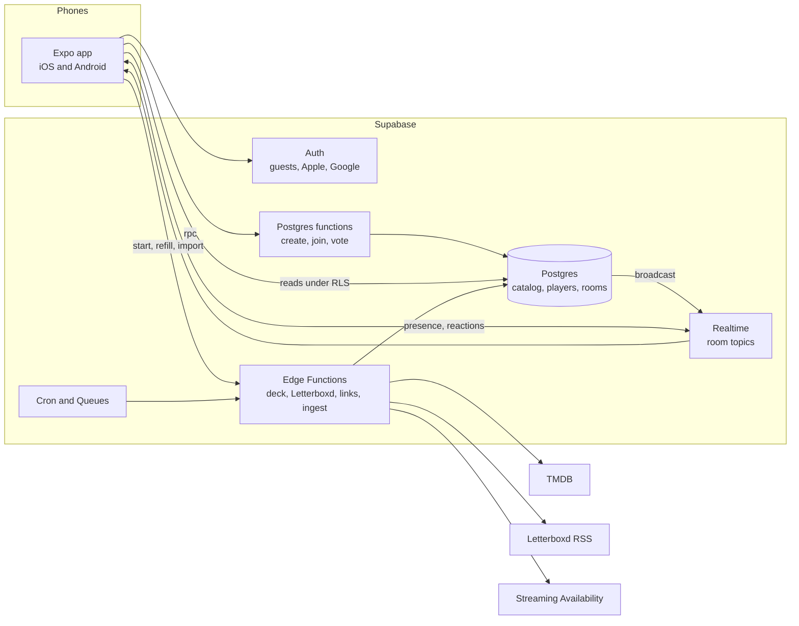
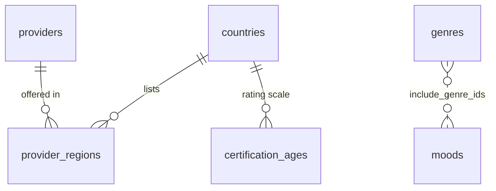
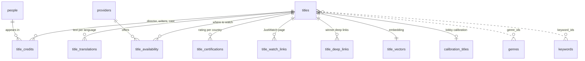
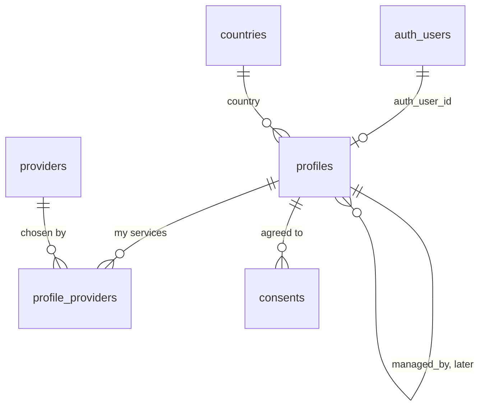
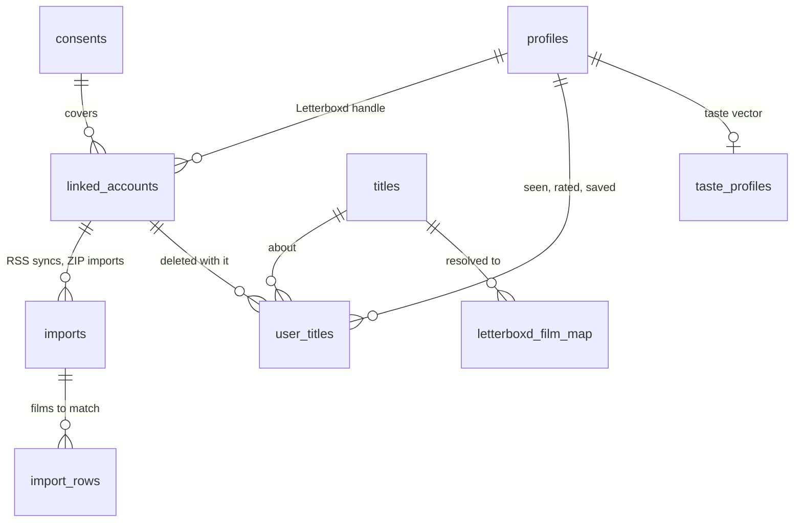
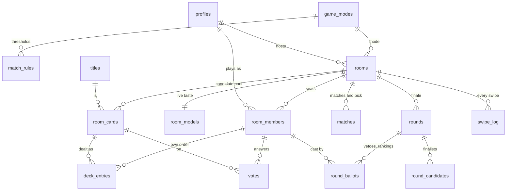
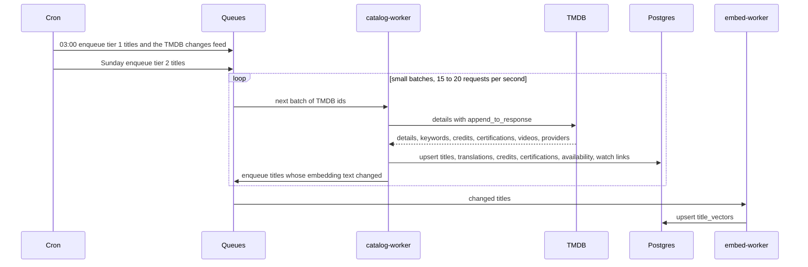
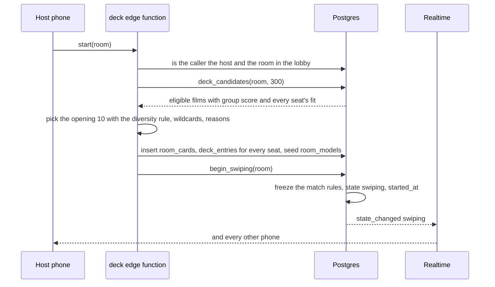
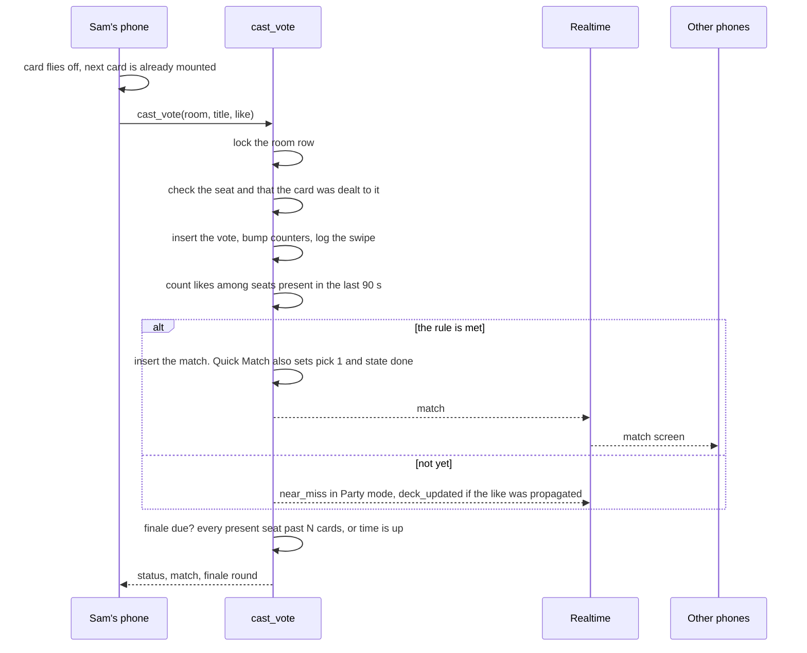
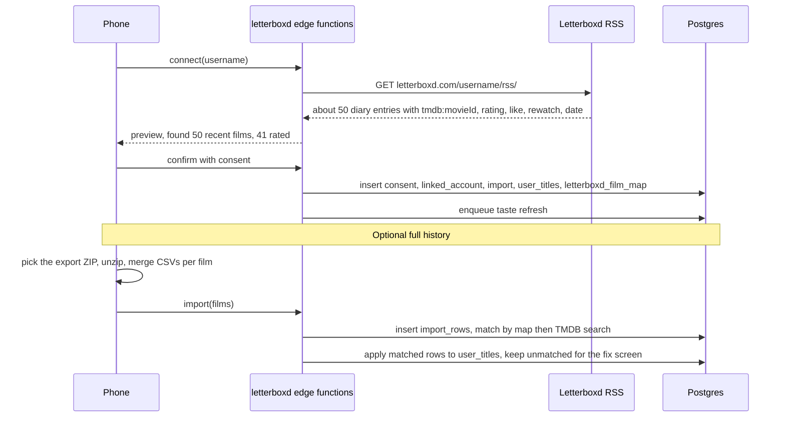

# MovieMatch data model

The database for the first public release of MovieMatch, and how every part of it talks to the others. It is built from the [revival plan](../revival-plan/README.md) (stack, catalog, deck engine, game design, Letterboxd) and the [monetization options](../monetization/README.md) (Host Pro, family modes, packs). Written in October 2026.

- **[schema.sql](schema.sql)** is the reference DDL for everything marked v1 below: tables, indexes, row-level security, the realtime policies and the game functions (create, join, vote, match, like propagation, finale start, undo, leave, and the deck query). It loads cleanly on Postgres 16 with pgvector, and the game functions were run through the scenarios listed in [What was tested](#what-was-tested).
- **v1** means the first release: the revival plan's Launch items and roadmap phases 1 to 5.
- **Later** means after launch: the revival plan's Later items and every paid feature in the monetization doc. The [Later](#later-how-each-future-feature-lands) section shows where each one plugs in.

## Contents

1. [At a glance](#at-a-glance)
2. [Nine decisions that shape everything](#nine-decisions-that-shape-everything)
3. [Reference data](#1-reference-data)
4. [Catalog](#2-catalog)
5. [Players](#3-players)
6. [Film history and taste](#4-film-history-and-taste)
7. [Rooms and the game](#5-rooms-and-the-game)
8. [Operations](#6-operations)
9. [How it fits together](#how-it-fits-together)
10. [Who sees what](#who-sees-what)
11. [Realtime](#realtime)
12. [Functions, edge functions and jobs](#functions-edge-functions-and-jobs)
13. [Sizes and speed](#sizes-and-speed)
14. [Retention](#retention)
15. [Later: how each future feature lands](#later-how-each-future-feature-lands)
16. [Open questions](#open-questions)
17. [What was tested](#what-was-tested)

## At a glance

| | v1 |
| --- | --- |
| Tables | 41, in six areas: reference data, catalog, players, film history and taste, rooms and the game, operations |
| Writes from the phone | 6 game functions (create, join, heartbeat, leave, vote, undo) plus a handful still to write (lobby settings, calibration, finale ballots, after-game answer). Direct writes only for your own profile fields and services |
| Realtime topics | 2 per room: `room:<id>` for server events, `room:<id>:live` for presence and reactions |
| Background work | 9 edge functions, 5 scheduled jobs and 5 queues, all off the game path |
| External calls during a game | None. TMDB and Letterboxd are read on a schedule; Streaming Availability is called once per game, for the winner |

## Nine decisions that shape everything

1. **Postgres decides, Realtime only tells.** Every vote, join and match is decided inside one database transaction. Realtime fans the result out. A phone that misses a message can always re-read the truth. This removes the old app's two sources of truth (Firestore and MongoDB) and the 500 ms sleep.
2. **Phones read, functions write.** Row-level security lets phones read what they may see. All game writes go through `security definer` functions that check the caller, so no client can overwrite a room document the way the old app did.
3. **A player is a profile, not a login.** `profiles` has its own id and an optional `auth_user_id`. At launch they are always equal (one guest or account per profile). Later, kid profiles are profiles with no login, managed by a parent, without changing any other table.
4. **Votes belong to seats.** A seat (`room_members`) is one player in one room. Votes, decks and ballots point at the seat. Deleting an account leaves an anonymous seat, so other people's game history stays correct, and pass-and-play later is simply one phone controlling several seats.
5. **Titles have their own id.** TMDB numbers movies and TV shows separately, so the same id can be both a movie and a show. `titles.id` is ours, with `(media_type, tmdb_id)` unique, so series mode adds rows, not a migration.
6. **Facts are stored per source.** What a player has seen, rated or saved is one row per film per source (Letterboxd, calibration, the app). Disconnecting Letterboxd deletes exactly what came from Letterboxd, by cascade.
7. **Rules are data.** Game modes and match thresholds live in `game_modes` and `match_rules`, and each room freezes its rules when swiping starts. Tuning a threshold is an update, not a release, and analytics always know which rule a game used.
8. **The pool and the deck are separate.** `room_cards` is the room's set of candidate films with shared scores and counters. `deck_entries` is each seat's own order through it. This is what makes the shared opening, like propagation, late joiners and (later) packs and sponsored cards all the same mechanism.
9. **Later features add, never rewrite.** Everything in the Later section is new tables, new columns, new enum values or new rows in a config table.

## 1. Reference data

Small tables, filled by the ingest job, readable by every signed-in player.

**countries**: one row per ISO country. `catalog_enabled` marks the countries whose availability is ingested.

| Column | Type | Notes |
| --- | --- | --- |
| code | char(2) PK | ISO 3166-1, upper case |
| default_language | text | Language for TMDB text when a player has none set |
| catalog_enabled | boolean | Availability is ingested for this country |

**genres**: TMDB genres. `media_types` keeps TV-only genres (News, Reality, Talk Show) out of movie rooms, which the old app got wrong.

| Column | Type | Notes |
| --- | --- | --- |
| id | integer PK | TMDB genre id |
| slug | text unique | `horror`, `comedy` |
| names | jsonb | `{"en": "Comedy", "fr": "Comédie"}` |
| media_types | media_type[] | `{movie}`, `{tv}` or both |

**keywords** (id, name) and **people** (id, name, profile_path, popularity, updated_at) use TMDB ids as keys.

**providers**: streaming services.

| Column | Type | Notes |
| --- | --- | --- |
| id | integer PK | TMDB watch provider id (8 is Netflix) |
| name, logo_path | text | |
| streaming_availability_id | text | Service id for "Open in Netflix" links, null until mapped |

**provider_regions**: which services exist in which country, with TMDB's display order. Replaces the old 64,000-line `countries.json`. Key: (provider_id, country).

**certification_ages**: maps each country's ratings to a minimum age (`US PG-13` is 13, `FR 12` is 12, `FR U` is 0). Used to fill `title_certifications.min_age` and for the age cap. Key: (country, certification).

**moods**: the mood chips.

| Column | Type | Notes |
| --- | --- | --- |
| slug | text PK | `cozy`, `mind_bending`, `laugh`, `scary`, `background` |
| names | jsonb | Per language |
| include_genre_ids, exclude_genre_ids, keyword_ids | integer[] | What the mood means for the deck |
| runtime_max | smallint | "Background noise" might cap runtime |
| sort, is_active | | Display order, switch off without deleting |

## 2. Catalog

About 40,000 popular movies at launch, written only by ingest jobs. Nothing here is personal.

**titles**: one row per film (later, per show).

| Column | Type | Notes |
| --- | --- | --- |
| id | bigint PK | Ours, generated |
| media_type | media_type | `movie` at launch, `tv` later |
| tmdb_id | integer | Unique together with media_type |
| imdb_id | text | Kept for lookups, never shown |
| original_title, original_language | text | |
| release_date | date | |
| release_year | smallint | Generated from release_date, for decade filters and affinities |
| runtime_min | smallint | Time budget filter |
| genre_ids, keyword_ids | integer[] | GIN index on genre_ids for the deck filter |
| collection_id | integer | TMDB collection, so the opening never shows five sequels of one franchise |
| popularity, vote_average, vote_count | | From TMDB |
| quality_score | real | Vote average weighted by vote count, 0 to 10, computed at ingest |
| poster_path, backdrop_path | text | The app requests w500 or w780, never /original |
| poster_placeholder | text | Blurhash or thumbhash shown while the poster loads |
| trailer_key | text | YouTube key for the card back |
| is_adult | boolean | Always excluded |
| is_active | boolean | Titles are deactivated, never deleted, because votes point at them |
| refresh_tier | smallint | 1 refreshed daily (popular), 2 weekly (long tail) |
| tmdb_changed_at, refreshed_at | timestamptz | For the changes feed and refresh scheduling |

**title_translations**: title, overview, tagline and an optional localized poster per language. Key: (title_id, language). A trigram index on `title` serves search (manual Letterboxd fixes, custom decks later). More languages later are more rows.

**title_credits**: directors, writers and the top 8 cast. Key: (title_id, person_id, role). Feeds the card back, the embedding text and "Jo gave the director's last film 4.5★".

**title_certifications**: the rating in each country and its `min_age`. Key: (title_id, country).

**title_availability**: the heart of the deck filter.

| Column | Type | Notes |
| --- | --- | --- |
| title_id, country, provider_id, kind | PK | kind is `subscription`, `free`, `ads`, `rent` or `buy` |
| checked_at | timestamptz | Last ingest that saw it |

Index `(country, provider_id, kind, title_id)` answers "is this film on any of tonight's services here" without touching the titles table.

**title_watch_links**: TMDB's JustWatch-powered watch page per title and country. JustWatch must be credited wherever availability shows.

**title_deep_links**: "Open in Netflix" links from Streaming Availability, fetched only for winners and cached until `expires_at`. Key: (title_id, country, provider_id, kind).

**title_vectors**: one 384-dimension gte-small embedding per title, built from a short text (title, year, genres, top keywords, director, main cast, overview). `source_hash` says when the text changed and the film needs re-embedding. Kept out of `titles` so catalog reads never drag 1.5 KB vectors along. An HNSW index serves "films like this one"; the deck query itself filters first and then compares against the few thousand eligible films directly.

**calibration_titles**: the 8 to 10 well-known films used in the lobby, each tagged with the taste axis it splits (`horror`, `romcom`, `arthouse`, `blockbuster`, `animated`).

## 3. Players

**profiles**: one row per player. Created by a trigger the moment Supabase creates an auth user, guest or not.

| Column | Type | Notes |
| --- | --- | --- |
| id | uuid PK | Equal to the auth user id at launch |
| auth_user_id | uuid unique | Supabase auth user. Linking Apple or Google keeps the same id, so a guest keeps their history |
| managed_by | uuid | Null at launch. Later, the parent of a kid profile. Exactly one of auth_user_id and managed_by is set |
| display_name | text | Up to 24 characters. Asked on first launch; required to create or join a room |
| avatar_key | text | A preset avatar, never a photo |
| country | char(2) | Default room country when this player hosts |
| language | text | Language for titles and overviews |
| created_at, updated_at, last_seen_at | timestamptz | |

Whether a profile is a guest is not stored: it is the `is_anonymous` claim in the Supabase token, which flips when the player signs in with Apple or Google.

**profile_providers**: the services a player has. Key: (profile_id, provider_id). One of only two tables a phone writes directly.

**consents**: what a player agreed to and which wording version. Kinds at launch: `letterboxd_import`, `analytics`. One active consent per kind; revoking sets `revoked_at`. A Letterboxd link points at its consent row.

## 4. Film history and taste

Everything the game knows about a player's taste. All of it is private to the player; rooms only ever see derived results.

**linked_accounts**: a player's Letterboxd username, treated as a public handle, not a login.

| Column | Type | Notes |
| --- | --- | --- |
| id | uuid PK | |
| profile_id | uuid | One per provider per player |
| provider | linked_provider | `letterboxd` (later `trakt`, `tmdb`) |
| username | text | |
| consent_id | uuid | The consent the player gave before the first import |
| feed_etag, feed_last_modified | text | For conditional RSS requests |
| last_synced_at, next_sync_after | timestamptz | RSS is re-read at most every 6 hours |
| last_error | text | Shown on the settings screen |

**imports**: one row per RSS sync or ZIP import, with counts (`films_total`, `films_matched`, `films_unmatched`) and status. Powers "Found 50 recent films, 41 rated".

**import_rows**: one row per film from a Letterboxd export. The phone unzips the export and merges the CSVs per film before sending, so only title, year, Letterboxd link, watched, rating, liked, watchlist, last watched date and rewatch count leave the device. Matched rows are applied and deleted; unmatched rows stay for the quick manual fix.

**letterboxd_film_map**: shared by everyone. Each Letterboxd film is resolved to a TMDB title once: from the RSS feed's `tmdb:movieId` (free and exact), else a TMDB search by title and year (plus or minus one), else a manual fix. Holds no personal data.

**user_titles**: the film history, one row per player, film and source.

| Column | Type | Notes |
| --- | --- | --- |
| profile_id, title_id, source | PK | source is `letterboxd`, `calibration` or `app` |
| linked_account_id | uuid | Set exactly when source is `letterboxd`; cascade deletes on disconnect |
| seen | boolean | Feeds the seen filter |
| rating | numeric(2,1) | 0.5 to 5 in half stars |
| liked | boolean | Letterboxd heart |
| on_watchlist | boolean | Feeds watchlist overlap |
| reaction | reaction | `love`, `fine` or `nope`: calibration answers and the after-game question |
| rewatch_count, last_watched_on | | Recency weighting |

Sources at launch:

- `letterboxd`: RSS (last ~50 diary entries) and the ZIP export (full history), merged into one row per film.
- `calibration`: lobby answers. Love, Fine and Nope mean seen; Haven't seen is stored with `seen = false` so the film isn't asked again.
- `app`: "seen it" swipes (written when the room ends, so an undo never needs compensating) and "Did you watch it?" answers.

The view **user_title_facts** merges the sources into one row per player and film (seen if any source says so, the Letterboxd rating, liked, on watchlist, latest reaction).

**taste_profiles**: one per player.

| Column | Type | Notes |
| --- | --- | --- |
| profile_id | uuid PK | |
| embedding | vector(384) | Recency-weighted average of the embeddings of films the player reacted to, using the plan's weights (5★ +1, 4★ +0.6, 3★ +0.1, 2★ -0.5, 1★ -1, heart +0.3, logged without rating +0.2; love +1, fine +0.2, nope -1) |
| affinities | jsonb | Readable weights by genre, decade, director and language, for "why this card" labels |
| signal_count | integer | How much the profile is based on |
| model, computed_at | | Which embedding model, and when |

Rebuilt by a queue worker after an import, after calibration (synchronously, it's 10 films), and after each game.

## 5. Rooms and the game

### Configuration

**game_modes**: one row per mode.

| Column | Type | Notes |
| --- | --- | --- |
| slug | text PK | `quick_match`, `final_cut`, `date_night` at launch |
| min_players, max_players | smallint | Date Night is 2 and 2 |
| ends_on_first_match | boolean | True for Quick Match and Date Night. In Final Cut, matches join the shortlist |
| defaults | jsonb | Room setting defaults for the mode |
| is_active, sort | | |

**match_rules**: when a like becomes a match, and when the finale starts. Seeded with the plan's starting values:

| Mode | Players | Instant match | Finale |
| --- | --- | --- | --- |
| Quick Match | 2 | Both like it | Final Cut of 3 after 40 cards |
| Quick Match | 3 to 4 | Everyone likes it | Final Cut of 4 after 50 cards or 8 minutes |
| Quick Match | 5 to 10 | 70% like it | Ranked vote of 4 after 50 cards or 10 minutes |
| Date Night | 2 | Both like it | Final Cut of 3 after 40 cards |
| Final Cut | 2 to 4 | Everyone likes it (joins the shortlist) | Final Cut of 4 after 30 cards or 10 minutes |
| Final Cut | 5 to 10 | 70% like it (joins the shortlist) | Final Cut of 4 after 30 cards or 10 minutes |

Columns: mode, min_players, max_players, instant_rule (`all_like` or `share_like`), share_threshold, finale_kind (`final_cut` or `ranked_vote`), finale_after_cards (per present player), finale_after_seconds, finale_size. The 10-minute limits for 5 or more players and for Final Cut are my starting values; the plan only gives 8 minutes for 3 to 4 players.

### The room

**rooms**

| Column | Type | Notes |
| --- | --- | --- |
| id | uuid PK | |
| code | char(6) | Six digits. Unique among open rooms only (partial index), so codes are recycled |
| host_id | uuid | Moves to the longest-seated player if the host leaves |
| mode | text | References game_modes |
| state | room_state | `lobby`, `swiping`, `finale`, `done`, `abandoned` |
| country | char(2) | From the host's profile; drives availability and certifications |
| service_rule | service_rule | `any_member` (default: you're watching on one screen) or `every_member` (long-distance) |
| offer_kinds | offer_kind[] | Default subscription, free, ads. Rent and buy are there for a later "rent it" option |
| runtime_max | smallint | "We have 2 hours" |
| seen_rule | seen_rule | `hide_seen` (default), `allow_rewatch` (only films everyone who saw them rated 4★ or more), `show_all` |
| quality | quality_preset | `standard` (150+ votes, 6.2+), `hidden_gems`, `guilty_pleasures` |
| max_age | smallint | Age cap from certifications. Null means none |
| reveal | reveal_mode | `party` (near-miss teasers) or `blind` |
| max_players | smallint | 10 at launch |
| provider_ids | integer[] | Tonight's services, recomputed from the seats on every join, leave and change |
| rule | jsonb | The mode's match_rules rows, frozen at start |
| seed | integer | Random seed, so the shared opening and wildcards are reproducible for debugging |
| stats | jsonb | Written when the room ends: duration, swipes, players. Feeds the recap card |
| created_at, started_at, finale_at, decided_at, ended_at | timestamptz | The funnel: created, first card, match |
| expires_at | timestamptz | Lobbies that never start are abandoned after 3 hours |

**room_models**: the room's live taste. Starts as the average of the seated players' profiles; the deck engine nudges it toward liked films and away from noped ones at each refill, and records genres the room dropped ("everyone noped two horror films quickly"). Kept apart from `rooms` so the hot room row stays small.

### Seats

**room_members**: one player in one room.

| Column | Type | Notes |
| --- | --- | --- |
| id | uuid PK | The seat id. Everything in the game points here |
| room_id | uuid | |
| profile_id | uuid | Who plays this seat. Set to null if the account is deleted |
| controlled_by | uuid | Whose device may act for the seat. Equal to profile_id at launch; a parent's profile for pass-and-play later |
| role | member_role | `host` or `guest` |
| display_name, avatar_key | text | Snapshot at join, so other players never read your profile |
| provider_ids | integer[] | This player's services tonight, prefilled from their profile |
| mood_slugs, genre_ids | | "Tonight I want", a soft boost in their fit score |
| joined_at, left_at | timestamptz | Rejoining clears left_at and keeps the same seat |
| last_active_at | timestamptz | Heartbeat. Only seats active in the last 90 seconds count for match rules |
| calibrated_at, done_at | timestamptz | Lobby calibration finished; reached the finale card count |
| swipe_count | integer | Progress ring |
| super_likes_left, vetoes_left | smallint | 2 super likes and 1 Final Cut veto per game |
| watched_answer, post_reaction, followup_at | | "Did you watch it?" after the game |

Unique (room_id, profile_id): one seat per player per room.

### Cards, decks and votes

**room_cards**: the room's candidate pool, written by the deck engine.

| Column | Type | Notes |
| --- | --- | --- |
| room_id, title_id | PK | |
| source | card_source | `ranked` or `wildcard` (about 1 card in 8) |
| state | card_state | `active`, `dropped` (someone has seen it, under hide_seen), `matched`, `finalist` |
| group_score | real | Average fit plus watchlist, live room and quality terms (see below) |
| min_fit | real | The least happy player's predicted fit |
| fits | jsonb | Every seat's predicted fit, for logs and tuning |
| reason_code, reason_params | | "Because you all liked Arrival", "On Sam and Jo's watchlists", "94 min", "Wildcard". Params hold seat and title ids; the phone renders names and text in its language |
| member_ratings | jsonb | A seated player's Letterboxd rating of this film, shown on the card back |
| like_count, super_like_count, nope_count, seen_count | smallint | Updated by the vote function. Hidden from phones by column grants |

**deck_entries**: each seat's order through the pool.

| Column | Type | Notes |
| --- | --- | --- |
| room_member_id, title_id | PK | |
| room_id | uuid | With title_id, a foreign key to room_cards |
| sort_key | double precision | Order. Fractional, so a card can be slotted between two others without renumbering |
| source | deck_source | `opening` (the first 10, same order for everyone), `ranked`, `propagated` (moved up because someone liked it), `wildcard` |
| score | real | The score that put the card here, logged with the vote for tuning |

**votes**: one answer per seat per film. Key: (room_member_id, title_id), which also makes offline retries harmless: a retried vote returns `duplicate`.

| Column | Type | Notes |
| --- | --- | --- |
| answer | vote_answer | `nope`, `like`, `super_like`, `seen` (swipe up) |
| created_at | timestamptz | Server time |
| client_created_at | timestamptz | When the phone recorded it, if it was queued offline |

An undo deletes the vote; the swipe log keeps both.

**swipe_log**: append-only record of every vote and undo, with the deck source and score that produced the card and how long the card was on screen. No profile id: it points at the seat, so it stays anonymous once an account is gone. This is the data to tune the scoring weights on.

**matches**: every film that met the room's rule, plus the night's pick.

| Column | Type | Notes |
| --- | --- | --- |
| room_id, title_id | PK | |
| kind | match_kind | `unanimous`, `majority`, `finale` |
| like_count, present_count | smallint | "3 of 3", for the match screen and the recap |
| pick_order | smallint | 1 is the night's pick. Unique per room. Double feature later uses 2 and 3 |

### The finale

**rounds**: one finale per room at launch (`seq` 1). `kind` is `final_cut` (veto stage, then rank stage) or `ranked_vote` (rank stage only). `stage_closes_at` is the deadline for the current stage; the stage also closes early when every present seat has voted.

**round_candidates**: the 3 or 4 finalists, seeded by matches first, then likes (super likes count double), then group score. A veto sets `vetoed_at` and `vetoed_by`. `points` holds the ranked vote result (Borda count: first place gets the most points).

**round_ballots**: `veto` (one title), `pass` (no veto), or `rank` (one row per title with its rank). One veto or pass per seat per round; one rank per seat per title.

## 6. Operations

**rate_limits**: counters per key and 10-minute window. `join:<profile id>` allows 10 join attempts per window, so the million 6-digit codes can't be walked. Supabase also rate-limits anonymous sign-ins per IP (configurable in the Auth settings), which stops an attacker from minting fresh guests to reset the counter.

**ingest_runs**: one row per catalog job run (backfill, daily providers, weekly long tail, daily changes, embeddings), with counts, errors and a resume cursor.

Queues (Supabase Queues, not tables in schema.sql): `catalog_refresh`, `embed_titles`, `letterboxd_sync`, `taste_refresh`, `winner_links`.

## How it fits together

### Catalog ingest

- The first load of 40,000 titles runs once as a script from a laptop or CI (about 35 to 45 minutes at a polite rate); Edge Functions are built for short requests.
- Availability rows a refresh no longer sees are deleted, so `checked_at` is never older than the refresh rhythm.
- `quality_score` and `poster_placeholder` are computed in the worker. Titles that drop out of TMDB are marked `is_active = false`.

### First launch

1. The app calls Supabase anonymous sign-in. The auth trigger creates the profile with the same id.
2. The player types a name; the phone updates `profiles.display_name`, `country` (device region) and `language`, and inserts `profile_providers`.
3. Signing in with Apple or Google later links the identity to the same auth user. Nothing in the database moves.

### Create and join

1. The host calls `create_room(mode)`. It picks a free 6-digit code (retrying on the rare collision), creates the host seat, the room model and the service list. Later, the hosting cap and the room's tier are decided here.
2. The invite is `/join/482913` as a link and a QR code.
3. A guest calls `join_room(code)`. It counts the attempt first, then answers `ok`, `not_found`, `full`, `in_finale`, `name_required` or `rate_limited`. It never raises an error on a wrong code: an error would roll back the attempt counter. A player who already has a seat gets the same seat back (`rejoined: true`), which fixes the old rejoin-lands-in-lobby bug.
4. Each new seat recomputes `rooms.provider_ids` and broadcasts `member_joined`.

### Lobby

- Each player adjusts their services, moods and genres for tonight on their seat. The host edits room settings (time budget, seen rule, quality, reveal mode, age cap). Both are function calls that broadcast `settings_changed`.
- Players without Letterboxd answer the 8 to 10 calibration films. Answers become `user_titles` rows with source `calibration`, the taste profile is rebuilt on the spot, and `calibrated_at` is set so friends see the tick.
- Presence on `room:<id>:live` shows who's here.

### Start: dealing the deck

`deck_candidates` is the single deck query from the plan. In one statement it:

1. **Filters**: active movies on tonight's services in the room's country, with an allowed offer kind; within the time budget; above the quality floor; under the age cap; not seen by any seated player under the seen rule; not in a genre the room dropped; not already in the pool.
2. **Scores each seat**: fit is 0 to 5, the player's own percentile for the film among tonight's eligible films, by embedding similarity to their taste profile, or by popularity if they have none yet. A film matching their moods or genres for tonight gets +0.5.
3. **Scores the group** with "average without misery": films where any player's fit is under the misery line are dropped, then
   `group_score = average fit + 0.3 × 5 × share of players with it on their watchlist + 0.2 × live room signal + 0.1 × quality score / 2`,
   with every term on a 0 to 5 scale.

The edge function then applies the rules that are easier to tune in TypeScript: the opening's diversity (at most 2 per main genre, 1 per collection), 1 wildcard in 8, and the reason label. The first 10 cards go to every seat in the same order, then each seat gets about 20 personalized cards.

### A swipe

Details that matter:

- **One lock per room.** The vote takes a row lock on its room, so votes in the same room run one after another (a few milliseconds each) and two last likes can never both see "not yet". Rooms never wait on each other. This was tested with two overlapping transactions: the second waited for the first, then matched.
- **Present players only.** A seat counts if it hasn't left and its phone sent a heartbeat or vote in the last 90 seconds (phones call `touch_room` every 30 seconds). Someone whose phone died doesn't block every match.
- **Seen it.** Under `hide_seen`, a "seen it" answer drops the card for the whole room and removes it from every deck that hasn't reached it. Under the other two seen rules it abstains: it neither counts as a like nor blocks one.
- **Super likes** spend one of the seat's two, count as likes for the rule and count double when seeding the finale.
- **Offline.** The phone queues votes and retries. The primary key makes retries return `duplicate`, and a vote that arrives after the room is decided returns `closed`.
- **Undo** removes the seat's last vote while its card is still active, restores counters and the super like, and logs the undo.

### Like propagation and refills

- The first like on a card moves it into every other seat's upcoming cards, between their 3rd and 4th (the phone keeps 3 mounted), unless it was already closer. Those seats get `deck_updated` and refetch what's behind their mounted cards.
- When a seat has 15 cards left, its phone calls the deck edge function to refill. The function updates `room_models` from the votes so far, calls `deck_candidates` again (now with the live room signal), and appends about 20 cards: about 85% best-scored, 15% exploring a different direction.
- Late joiners get the active opening cards at join time, then a refill.

### Leaving and coming back

- `leave_room` marks the seat, hands the host role to the longest-seated player, recomputes services and re-checks liked cards: if everyone still here liked a card, that's a match now. Tested: two players liked a card, the third left, and the room matched.
- A phone that silently disappears stops counting after 90 seconds. The minute sweeper re-checks liked cards in rooms where a seat timed out, so the same rule applies without an explicit leave.
- Reopening the app calls `join_room` with the room's code: same seat, same votes, and the phone reloads its remaining deck.

### Finale

1. When the rule's card count or time limit is reached (checked after every vote and by the minute sweeper), `start_finale` seeds 3 or 4 finalists: matches first, then the most liked, then group score. State becomes `finale`; `finale_started` carries the round, the films and the deadline.
2. **Final Cut**: each seat may veto one finalist or pass, within 45 seconds. A veto can't remove the last two films standing.
3. **Rank**: each seat orders the remaining films within 60 seconds. Borda count picks the winner; ties go to more super likes, then group score.
4. The winner becomes a `matches` row with kind `finale` and `pick_order` 1, and the room is done.

The veto, rank and stage-closing functions are described here but not yet in schema.sql.

### After the match

When a room becomes done, `finalize_room` (to write, called from a trigger on `rooms.state`):

1. Writes `rooms.stats` for the recap card ("Paddington 2 in 3 min 42 s, 3 people, 41 swipes").
2. Turns "seen it" swipes into `user_titles` rows with source `app`.
3. Enqueues `winner_links`, which calls Streaming Availability once for the winner in the room's country and fills `title_deep_links`. The phone shows TMDB's watch page until the deep links arrive, then `result` is broadcast.
4. Enqueues a taste refresh for every seat.

"Log on Letterboxd" needs no data: `letterboxd.com/tmdb/{tmdb_id}` redirects to the film.

On a later app open, "Did you watch it?" writes the seat's `watched_answer` and `post_reaction`, and a `user_titles` row with source `app`, which feeds the next game.

### Letterboxd

- **Freshness**: on app open or when joining a room, if `next_sync_after` has passed, a sync is queued. Requests are conditional (`feed_etag`, `feed_last_modified`), cached, and name the app in the User-Agent. A few requests per player per day at most.
- **What's stored**: TMDB title, rating, liked, rewatch count, watched date, watchlist flag, source. No review text.
- **Disconnect**: deleting the `linked_accounts` row cascades to its imports, import rows and every `user_titles` row from Letterboxd. The taste profile is then rebuilt without them.

### Deleting an account, exporting data

- **Delete** (App Store guideline 5.1.1(v)): an edge function deletes the auth user. That cascades to the profile, services, consents, linked accounts, imports, film history and taste profile. Seats in past rooms keep their votes but lose `profile_id`, `controlled_by` and their display name (a trigger blanks the snapshot), so the swipe log and other players' history stay correct and anonymous. Rooms hosted by the player keep running with `host_id` null.
- **Export** (GDPR): a function returns the profile, services, consents, linked accounts, film history and the player's own votes as JSON.

## Who sees what

Every table has row-level security on. Phones use the `authenticated` role (guests included); `anon` gets nothing.

| Data | Phones can read | Written by |
| --- | --- | --- |
| Catalog and reference tables, game modes, match rules, calibration films | Everything | Ingest jobs |
| `profiles` | Their own (and, later, profiles they manage) | Their own name, avatar, country and language directly; the rest by functions |
| `profile_providers` | Their own | Their own, directly |
| `consents`, `linked_accounts`, `imports`, `import_rows`, `user_titles`, `taste_profiles` | Their own | Edge functions and functions |
| `rooms`, `room_members`, `matches`, `rounds`, `round_candidates` | Rooms they have a seat in | Functions |
| `room_cards` | Rooms they have a seat in, without counters, scores or fits | Functions and the deck engine |
| `deck_entries`, `votes`, `round_ballots` | Their own seat | Functions |
| `title_vectors`, `room_models`, `swipe_log`, `letterboxd_film_map`, `rate_limits`, `ingest_runs` | Nothing | Service role |
| Realtime `room:<id>` | Seated players | The database only |
| Realtime `room:<id>:live` | Seated players | Seated players |

- Nobody can list rooms. You find a room only by its code, through `join_room`.
- Other players' answers never reach a phone as rows. In Party mode they arrive as counts ("2 of 3 of you liked this"); in Blind mode not at all. That's why the counters on `room_cards` are hidden with column grants: phones must name the columns they select.
- Two topics per room stop a player from forging server events: phones can't send on `room:<id>`, so a fake `match` can't appear there.

## Realtime

| Event | Topic | Sent by | Payload | The phone |
| --- | --- | --- | --- | --- |
| `member_joined` | room | join_room | seat, name, avatar | Adds the avatar |
| `member_left` | room | leave_room | seat, new host seat | Removes it, moves the crown |
| `settings_changed` | room | lobby functions | changed fields | Refetches the room |
| `state_changed` | room | begin_swiping, finale, finalize | state | Moves to the next screen |
| `deck_updated` | room | cast_vote, deck engine | seat ids | Those seats refetch behind their mounted cards |
| `near_miss` | room | cast_vote, Party mode only | title, likes, of | "2 of 3 of you liked this" |
| `match` | room | cast_vote, leave_room, sweeper | title, kind, likes, of, decided | Match screen |
| `finale_started` | room | start_finale | round, titles, kind, deadline | Final Cut screen |
| `round_progress` | room | ballot functions | stage, ballots in | Progress dots |
| `result` | room | finalize_room | winner, deep links ready | Winner screen |
| presence | live | phones | seat, swipe count, done | Progress rings, "Sam is done" |
| `reaction` | live | phones | emoji | Pops it on screen |

Message budget: progress travels in presence updates every 5 swipes rather than one message per swipe. Counting every delivery to every phone, a 4-player game with 60 swipes each comes to roughly 350 messages, so Supabase Pro's 5 million a month covers about 14,000 games.

## Functions, edge functions and jobs

### Postgres functions the phone calls

| Function | What it does | In schema.sql |
| --- | --- | --- |
| `create_room(mode, country)` | New room, host seat, code | Yes |
| `join_room(code)` | Join or rejoin, rate limited, never raises on a wrong code | Yes |
| `touch_room(room)` | Heartbeat every 30 seconds | Yes |
| `leave_room(room)` | Leave, hand over host, re-check matches | Yes |
| `cast_vote(room, title, answer, seat, dwell_ms, client_at)` | The vote transaction | Yes |
| `undo_last_vote(room, seat)` | Undo | Yes |
| `update_room_settings(room, patch)` | Host, lobby only | To write |
| `set_seat_prefs(room, services, moods, genres)` | A player's tonight settings | To write |
| `submit_calibration(room, answers)` | Calibration answers and taste rebuild | To write |
| `cast_ballot(round, kind, title, rank)` | Veto, pass, rank | To write |
| `answer_followup(room, watched, reaction)` | "Did you watch it?" | To write |
| `my_next_cards(room, language)` | Card payloads for the seat's next cards: title, poster, placeholder, runtime, genres, TMDB score, overview, director, cast, trailer, tonight's services for it, reason, member ratings | To write |
| `export_my_data()` | GDPR export | To write |

The optional `seat` argument on `cast_vote` and `undo_last_vote` is what pass-and-play uses later; at launch phones leave it out.

### Internal functions

`check_card_match`, `propagate_like`, `start_finale`, `maybe_start_finale`, `begin_swiping`, `deck_candidates`, `refresh_room_providers`, `present_member_ids`, `pick_rule` and `broadcast_room` are in schema.sql. Still to write: `close_round_stage`, `finalize_room`, `sweep_rooms`, `refresh_taste`.

### Edge functions

| Function | Trigger | Does |
| --- | --- | --- |
| `deck` | Host taps start; a phone has 15 cards left | Builds or refills the deck around `deck_candidates`, updates `room_models` |
| `letterboxd-connect` | Settings screen | Feed preview, then link with consent |
| `letterboxd-sync` | Queue | Conditional RSS fetch, upserts history and the film map |
| `letterboxd-import` | Export upload | Matches and applies export rows |
| `winner-links` | Queue, once per game | Streaming Availability deep links for the winner |
| `catalog-worker` | Queue | TMDB fetch and catalog upsert |
| `embed-worker` | Queue | gte-small embeddings |
| `taste-worker` | Queue | Rebuilds taste profiles |
| `delete-account` | Settings screen | Deletes the auth user |

### Scheduled jobs

| When | Job |
| --- | --- |
| Every minute | `sweep_rooms`: finales by time, stage deadlines, re-check matches after a seat times out, abandon expired lobbies |
| 03:00 daily | Enqueue tier 1 titles and the TMDB changes feed |
| 04:00 Sunday | Enqueue tier 2 titles |
| After each ingest batch | Enqueue changed embeddings |
| 04:30 daily | Retention cleanup |
| On app open and join | Enqueue a Letterboxd sync when due (not a cron, but the same queue) |

## Sizes and speed

| What | Rough size |
| --- | --- |
| `titles` | 40,000 rows |
| `title_translations` | 80,000 rows (English and French) |
| `title_vectors` | 40,000 × 384 × 4 bytes, about 60 MB before the index |
| `title_availability` | About 50,000 to 100,000 rows per enabled country, so the launch country list matters most for size |
| One 4-player game | About 200 room cards, 320 deck entries, 240 votes, 250 swipe log rows |

All of it fits comfortably in Supabase Pro's 8 GB; Free's 500 MB is too tight once vectors and a few countries are in.

**Deck query timing**, measured on this session's 4-core container with Postgres 16 and pgvector 0.6, on a synthetic catalog of 40,000 films with random vectors, 10,300 of them eligible for the room:

| Players in the room | `deck_candidates(room, 300)` |
| --- | --- |
| 2 | about 105 ms |
| 4 | about 150 ms |
| 10 | about 220 ms |

The plan's budget is under 150 ms. Two to four players meet it on this machine; ten don't yet. The distance math and sorting are only about 30 ms of that; most of the rest is the eligibility filter and aggregation. If real data on Supabase hardware is still slow: precompute each room's eligible set once at start (it only changes when seats change services), or cap the candidates with an HNSW search around the room's average taste before scoring. The first version of the query, which carried embeddings through its sorts, took 240 to 430 ms and spilled 65 MB to disk; the version in schema.sql keeps rows narrow.

## Retention

| Data | Kept |
| --- | --- |
| Lobbies that never started | Abandoned after 3 hours, deleted after 7 days |
| Finished rooms, seats, votes, matches, rounds | While the account exists (history, crews later). Anonymous once an account is deleted |
| `deck_entries` never voted on | Deleted 1 day after the room ends |
| `room_cards` nobody voted on | Deleted 7 days after the room ends |
| `swipe_log` | 13 months |
| `import_rows` | Matched rows at once; unmatched after 30 days |
| `title_deep_links` | Until `expires_at` (7 days) |
| `rate_limits` | 1 day |
| Guest accounts with no activity for 90 days | Deleted with their data (Supabase doesn't clean them up on its own) |

## Later: how each future feature lands

None of these need a change to a v1 key or relationship.

| Feature | From | What changes | Already in v1 |
| --- | --- | --- | --- |
| Host Pro, Night Pass | Monetization | New `entitlements` (profile, product, period, store, transaction ids) and `store_events` (raw RevenueCat webhooks). `rooms.tier` column, set at create from the host's entitlement, so the whole room gets Pro for that game | Room creation is one function, so the check has one home |
| 3 free games a month | Monetization | `create_room` counts the host's rooms with `started_at` this month (empty lobbies never count). New `hosting_credits` ledger for rewarded ads and passes. Hosting a second game asks for Apple or Google sign-in | Index on `rooms (host_id, started_at)` |
| Bigger rooms (free 6, Pro 20) | Monetization | `create_room` sets `max_players` from the tier; a full room asks the host, never a guest | `rooms.max_players` |
| Deck packs, custom decks | Monetization | New `decks` (slug, kind pack or custom, owner, names, rules, kids_safe) and `deck_titles`. `rooms.deck_id`. `deck_candidates` restricts eligibility to the deck. Packs bought one by one are entitlements | The pool and deck split; deck sources |
| Crews and history | Revival, Pro | New `crews` and `crew_members`; `rooms.crew_id`; a crew's default settings. History and "how often you agree" are queries over rooms, matches and votes, never imported Letterboxd data | Finished rooms and votes are kept |
| Family profiles | Monetization, Pro | `profiles.birth_year`, consent kind `parental`. A kid profile has `managed_by` set and no login. Youngest seated age sets `rooms.max_age`. New `rooms.kids_present`, which turns off ads, affiliate links and sponsored cards | `profiles.managed_by`, `my_profile_ids()` already includes managed profiles, `rooms.max_age`, certifications |
| Pass and play | Monetization, Pro | Several seats with `controlled_by` = the parent's profile on one phone; the phone passes the seat id | `controlled_by`, the seat argument on `cast_vote` |
| Parent veto | Monetization, Pro | `vetoes_left` 1 for parents, 0 for kids | `vetoes_left`, rounds and ballots |
| Kid's choice night | Monetization, Pro | `room_members.vote_weight`; `check_card_match` sums weights instead of counting | Seat-based counting in one function |
| Tournament bracket | Monetization, Pro | `finale_kind` value `bracket`; each heat is a round with two candidates, `seq` 1, 2, 3 | `rounds.seq`, generic ballots |
| Double feature | Monetization, Pro | Deck engine picks 2 or 3 films that fit `runtime_max` as a total | `matches.pick_order` |
| Watchlist Showdown | Revival, free | New game mode row; eligibility limited to films on 2 or more seated watchlists | `user_titles.on_watchlist`, watchlist count in `deck_candidates` |
| Pick for me (solo) | Revival, Pro | Game mode with 1 player; the vote check uses the mode's `min_players` instead of 2 | Rooms and seats work with one seat |
| Era, language, hidden gems, guilty pleasures | Revival, Pro | `rooms.year_min`, `year_max`, `original_languages` | `release_year`, `original_language`, `quality_preset` already has all three presets |
| Series mode | Revival | `titles` rows with `media_type = tv`, a `rooms.media_type` setting, episode runtime | `media_type` in the key, `genres.media_types` |
| Web guests | Revival | None: anonymous sign-in works in the browser | Guests are ordinary auth users |
| More languages | Revival | More `title_translations` rows and `names` keys | Translations are rows, not columns |
| Learn from our own games | Revival | New `title_cooccurrence` (title a, title b, lift, count), built nightly from votes, as an extra term in the group score | `swipe_log` with scores, `votes` |
| Better embedding model | Revival | New `title_vectors_v2` with the new dimension, switch the query, drop the old | `model` and `source_hash` columns |
| Other history sources (TMDB account, Trakt) | Revival | New `linked_provider` and `title_fact_source` values | Facts are stored per source |
| "Rent it" and affiliate links | Monetization | `rooms.offer_kinds` includes rent and buy; new `affiliate_clicks` (room, host profile, title, program); shown on the host's phone only, never with kids present | `offer_kind` already has rent and buy |
| Rewarded ads | Monetization | `hosting_credits` rows with source `rewarded_ad` | |
| Venue mode | Monetization | `rooms.kind` (`group`, `solo`, `venue`) and `venues`; `max_players` up to 200; probably the room server below | Seats, votes and match rules are per room |
| Sponsored cards | Monetization | New `sponsored_placements` (title, countries, dates, frequency cap 1 in 20, minimum group score); `card_source` value `sponsored`; never with kids present | Card sources and reasons |
| Push reminders ("Did you watch it?") | Revival | New `devices` (profile, Expo push token, platform) | |
| Room server (Durable Objects) | Revival | None in the schema: the object calls the same functions, or batches votes into them | All game rules live in functions |

## Open questions

1. **Super nope.** The plan's 5-to-10-player rule says "nobody used a super nope", but the four launch answers are Nope, Like, Super like and Seen it. Either add a fifth answer (`super_nope`, one per game, blocks a majority match) or drop the clause. The schema takes either: it's one enum value and one line in `check_card_match`.
2. **Member ratings on cards.** A Letterboxd rating means the player has seen the film, so under the default `hide_seen` a card never shows a seated player's rating of that same film. It can still show "Jo gave the director's last film 4.5★". If member ratings on the card matter, consider `allow_rewatch` as the default.
3. **Fit scale and the misery line.** Fits here are each player's own percentile (0 to 5), so a 2.5 misery line would drop every film below anyone's median, which is most of them in a group of four. schema.sql uses 1.0 (each player's bottom 20%) as the starting value. Tune it on playtests with the swipe log.
4. **Countries at launch.** Which countries get availability ingested (France, Belgium, Switzerland, Canada, the US, the UK?) decides most of the database size.
5. **Hosting cap month.** "Resets on the 1st" in UTC or in the host's time zone. UTC is simpler; local is friendlier.
6. **Joining mid-game.** The design lets people join while swiping (they get the opening, then a refill) but not during the finale. Confirm that's the wanted behavior.
7. **Room size at launch.** 10, because the match rules go up to 10. The monetization doc's free 6 and Pro 20 apply once Pro exists.

## What was tested

In this session, on a throwaway Postgres 16 database with pgvector 0.6 and small stand-ins for Supabase's `auth` and `realtime` schemas (the stand-ins are not part of schema.sql):

- schema.sql loads with no errors on a fresh database: 41 tables, 1 view, 22 functions, policies and grants.
- Sign-up trigger creates a profile per auth user. A player can update their own name but not another player's, and can't touch columns outside the grant.
- Create and join by code, wrong code, rejoin to the same seat, join without a name, a non-member sees no rooms, the 11th join attempt in 10 minutes is refused.
- Service union for `any_member`; `every_member` with Netflix and Disney+ players leaves no services and no candidates.
- Votes: retry returns `duplicate`, undo restores the super like, "seen it" drops the card for the others and a later vote on it returns `dropped`, a third like matches unanimously and ends a Quick Match, votes after that return `closed`. Players see only their own votes and can't read card counters.
- Like propagation moves a liked 10th card to 4th place in the other decks.
- A player leaving completes a match the remaining players had both liked; the host role moves when the host leaves.
- Final Cut mode records a match without ending the room, then opens the finale with the matched film seeded first once both seats reach the card count.
- Five players: 4 likes and a nope out of 5 is a majority match under the 70% rule.
- Two overlapping votes on the same card: the second waits for the first's lock and then matches.
- Deck filters: hide_seen, allow_rewatch (4.5★ film back in, 3★ film still out), age cap, time budget, watchlist overlap boost, taste fit.
- Disconnecting Letterboxd deletes only that player's Letterboxd rows. Deleting the auth user removes the profile, consents, linked account and services, while their 4 past seats and 5 votes stay with no profile, no controller and a blank name.
- All 10 Mermaid diagrams in this file render with Mermaid 11.
- Deck query timing at 40,000 films, in [Sizes and speed](#sizes-and-speed).

Not tested: anything that needs a real Supabase project (Realtime delivery, the auth token's `is_anonymous` claim, Queues, Edge Functions), and the functions marked "to write".
