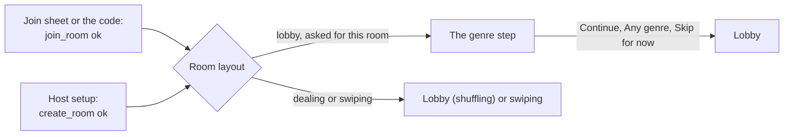

# The genre step

Route `/room/[id]/genre-step`, a full-screen step in the room's stack. Every player sees it once, as they arrive in a room that is still in the lobby: a guest right after joining, the host right after **Open the room**. Decided by Harry on 6 November 2026 (design pass (b), M6.60); built by M6.64. The rules are the lobby's ([your genres tonight](lobby.md#your-genres-tonight)); this page only says what the step does differently.

## Purpose

Ask the one question that changes tonight's deck before the player sits in the lobby: "Your genres tonight", up to 3, or any genre. It takes one tap to skip and never blocks anyone. The lobby's row and sheet stay for changes until Start.

## Where it lives

- **Who is asked.** A phone that has just joined or opened this room. Each path into a room ([join sheet](join-sheet.md#answers-apijoin_room-with-the-room-reference), [the code](join-code.md), [host setup](host-setup.md#what-open-the-room-does)) calls `askGenres(roomId)` (`features/genres/step.ts`, memory only) after `ok`, then navigates as today. The room layout sends a room it was asked about to the step when the room is in `lobby`, and forgets the request. A cold start, a return to the foreground, a reconnect and a link to a room the player is already seated in never show it. A late joiner (the room is `dealing` or `swiping`) never sees it: picks are locked.
- **The host.** The step reads the room's offer, so it comes after the room exists: **Open the room** creates the room as today, then the layout shows the step, then the lobby (where the invite sheet opens by itself, [invite sheet](invite-sheet.md#when-it-opens)). Nobody else can be in the room yet: nobody has the code. The host's picks are saved at once, with `api.set_seat_prefs` on their seat.
- **Why not before the room exists.** The offer is "genres with 30 films or more tonight" for the room's services, filters and the seats' seen films (`internal.offered_genres(room)`). It cannot be read before `create_room` without a new function that takes the setup's choices and copies `internal.eligible_titles` without a room. Default: no backend change (question 1).
- **`isAllowed`.** `genre-step` is allowed in `lobby` only (`features/room/screens.ts`). When Start happens while a guest is on the step, the layout replaces it with the lobby and its shuffling overlay, as for the genre sheet.
- **No offer tonight.** When `api.room_genres` answers with no `options`, the step replaces itself with the lobby at once (`animation: 'none'`), with no message. The lobby's row says `yourGenres.none`.

## Layout

`Screen` with `scroll` and a `footer`, `bg-bg-canvas`, no `TopBar` (no back: the room's stack turns gestures off, and Android's back opens the leave alert through `RoomLeaveGuard`, as in the lobby). A column, `px-5 pt-8 gap-3`:

1. **Eyebrow**, `mono-eyebrow` tone `marquee`: `genreStep.eyebrow` with the room code, grouped as on the ticket ("SALLE 482 913").
2. **Title**, `display-m`, `accessibilityRole="header"`, at most 2 lines: `genreStep.title`.
3. **Helper**, `body-m` tone `secondary`: `genreStep.helper`.
4. **The status line**, `min-h-6`, `mt-1`: `genreStep.count` ("1/3") in `mono-data` tone `muted` with no picks and `accent` from the first pick. A refused 4th tap replaces it with `lobby:genresSheet.cap` in `body-s` tone `secondary` (a polite live region, `announceForAccessibility` on iOS) until the next tap. The line is reserved, so the chips only move if the cap note wraps at a large text size.
5. **The chips**, `GenreChips` (new in `shared/`, below), `mt-2`, a wrapping row with `gap-2`, sorted by name in the player's language.
6. **Footer:** `Button` primary L `block`. With no pick its label is `genreStep.any` and it goes to the lobby with no call (or it clears saved picks, see below). With picks its label is `genreStep.continue`; it saves, then goes to the lobby. Under it, only in the failed and offline states, `Button` ghost L `block` `genreStep.skip`.

**Counts.** A chip shows how many present players picked the genre, your own pick included, as in the sheet. On a phone that is the only present seat (the host, alone at first) no count is drawn: a "1" on your own pick is noise. Counts follow `genres_changed` live, in place.

**Saving.** Continue sends only the genre ids (`api.set_seat_prefs` with `p_genre_ids`, never with services: a combined call sends `seat_updated`, which names the seat). No call when the selection equals the saved picks. A player who saved picks earlier (left and came back in the same lobby) starts on them, so "Any genre" on a cleared selection sends the empty list.

**Sizes.** On a 375 by 667 phone the eyebrow, title, helper, status line and two rows of chips fit above the footer; the rest scrolls. At the largest text the title takes 2 lines at `display-m`'s capped scale, the chips wrap to one or two per line and scroll, and the footer stays pinned with its button at one line ("TOUS LES GENRES" fits a block button at 375).

## States and answers

| State or answer | What the player sees |
| --- | --- |
| Loading (`api.room_genres` and the genre names) | The eyebrow, title and helper at once; eight `Skeleton` chips (`h-9 rounded-pill`, widths `w-20` and `w-24` alternating); the status line empty; the footer button enabled as `genreStep.any` (skipping never waits) |
| No offer tonight | The lobby, at once (above) |
| Loaded | The chips, the count, the footer |
| A 4th tap | The cap note (above); the chip stays off; no haptic, no toast |
| `ok` | The lobby (`router.replace`) |
| Nothing changed | The lobby, no call |
| `locked` (Start happened during the save) | `showToast` info `lobby:genresLocked.*`, then the layout's own move to the lobby |
| `closed` | The layout follows the room's state |
| `unknown_genre` | `showToast` warn `lobby:errors.genresStale`; the step reads the offer again and the selection resets to the saved picks |
| `too_many` (a bug) | `showToast` warn `common:errors.generic.title`, reported to Sentry; the step stays |
| The read failed (online) | `EmptyState` `error` in the chips' place, `lobby:genresSheet.failed`, action `lobby:genresSheet.retry`; the footer shows `genreStep.any` and the ghost `genreStep.skip` is hidden (the primary already skips) |
| Offline with nothing loaded | `EmptyState` with `wifi-off`, `lobby:genresSheet.offline`, Retry; the footer as above. Back online, it reads again by itself |
| Offline with the offer loaded | The chips stay. Continue fails at once with `showToast` warn `lobby:errors.genres` and no call; the ghost `genreStep.skip` appears |
| The save call failed | `showToast` warn `lobby:errors.genres`; Continue works again; the ghost `genreStep.skip` appears and goes to the lobby without saving |
| A removed seat or 42501 | The room layout sends the phone Home, as everywhere in the room |

Skipping after a failure keeps nothing: the lobby's row shows the saved picks (none), and the sheet is one tap away.

## New component: `GenreChips` (`shared/genre-chips`)

The genre sheet's chips, moved out so the step and the sheet draw the same thing (M6.64 moves them; the sheet then uses it). Props: `options` (`{ id, name, count }[]`, already sorted), `selected` (ids), `onToggle(id)`, `showCounts`. Each is the `Chip` with `count` (none drawn when 0 or when `showCounts` is false), role `checkbox`, label `lobby:genresSheet.chip` ("Comedy, 3 players"; without counts, just the name). The 3-pick cap stays in `features/lobby/genres.ts` (`toggleGenre`), not in the component. Gallery: loading (the skeleton row), none selected, three selected with counts, without counts, and a long French name ("Science-Fiction") at the largest text.

## Copy (`lobby` namespace, `genreStep`)

| Key | French | English |
| --- | --- | --- |
| `genreStep.eyebrow` | Salle {{code}} | Room {{code}} |
| `genreStep.title` | Tes genres ce soir | Your genres tonight |
| `genreStep.helper` | Choisis-en jusqu'à 3 pour orienter les films de ce soir. Les autres voient combien les ont choisis, jamais qui. | Pick up to 3 to steer tonight's films. Others see how many picked each, never who. |
| `genreStep.count` | {{count}}/3 | {{count}}/3 |
| `genreStep.any` | Tous les genres | Any genre |
| `genreStep.continue` | Continuer | Continue |
| `genreStep.skip` | Passer pour l'instant | Skip for now |
| `genreStep.a11yCount` | {{count}} sur 3 choisis | {{count}} of 3 picked |
| `genreStep.a11yLoading` | Chargement des genres de ce soir | Loading tonight's genres |

Reused: `genresSheet.cap`, `genresSheet.chip_one` and `_other`, `genresSheet.failed`, `genresSheet.offline`, `genresSheet.retry`, `genresLocked.*`, `errors.genres`, `errors.genresStale`. "Salle" follows the glossary (proposed).

## Motion, haptics, sound

- The step arrives with the stack's default push from the join sheet or host setup, and leaves for the lobby with `router.replace` (the stack's default fade). No celebration: arriving in the lobby is the moment.
- A chip toggles with `Chip`'s own `timing.toggle`; the status line's number changes in place. The cap note fades in and out (`layout.fadeIn`, `layout.fadeOut`). Skeletons give way to the chips with `layout.fadeIn`.
- Haptics: `haptics.press()` on chips and buttons (through `Pressable`); none for the refused 4th tap (a gentle limit, not a refusal); `errorFeedback()` only for `too_many`, which is a bug. No sound (Join already ticked).
- Reduce Motion: the fades stay, nothing moves.

## Accessibility

- Focus order: the eyebrow, the title (a header), the helper, the status line ("1 of 3 picked", `genreStep.a11yCount`), the chips in order, the footer button, then Skip for now when it shows.
- Each chip is a checkbox with its count in the label. The cap note is a polite live region. The footer button's label follows its text.
- Loading announces `genreStep.a11yLoading` once. The step never moves focus on its own.
- Tap targets are 44 points (`Chip` 36 with the `Pressable` padding).

## Questions

1. **The host's offer before the room exists.** Default: none needed, the room opens first and the step reads `api.room_genres`. Harry's wording put the step "before the room opens"; this order gives the exact offer with no backend change. For the backend if Harry wants it before: a new `api.genre_offer(p_country, p_provider_ids, p_runtime_max, p_max_age)` that returns the genre ids with 30 films or more, built on a room-free copy of `internal.eligible_titles`, and the picks sent with `create_room` or right after.
2. **The step on every join, or only the first of the night?** Default: every fresh join to a room in the lobby, since picks belong to a seat and a new room starts empty.
3. **Counts for a lone host.** Default: hidden while the phone is the only present seat.
4. **Leaving from the step.** Default: no visible Leave; Android's back and the room's leave alert cover it, and the lobby has Leave one tap later.
