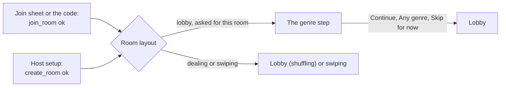

# The genre step

Route `/room/[id]/genre-step`, a full-screen step in the room's stack. Every player sees it once, as they arrive in a room that is still in the lobby: a guest right after joining, the host right after **Open the room**. Decided by Harry on 6 November 2026 (design pass (b), M6.60); built by M6.64. The rules are the lobby's ([your genres tonight](lobby.md#your-genres-tonight)); this page only says what the step does differently. Since the 11 November 2026 family playtest it also holds **Not tonight** (M6.70 and M6.71): genres and people a player skips for the night, in [their own section](#not-tonight-m670-and-m671).

## Purpose

Ask the one question that changes tonight's deck before the player sits in the lobby: "Your genres tonight", up to 3, or any genre. It takes one tap to skip and never blocks anyone. The lobby's row and sheet stay for changes until Start.

## Where it lives

- **Who is asked.** A phone that has just joined or opened this room. Each path into a room ([join sheet](join-sheet.md#answers-apijoin_room-with-the-room-reference), [the code](join-code.md), [host setup](host-setup.md#what-open-the-room-does)) calls `askGenres(roomId)` (`features/genres/step.ts`, memory only) after `ok`, then navigates as today. The room layout sends a room it was asked about to the step when the room is in `lobby`, and forgets the request. A cold start, a return to the foreground, a reconnect and a link to a room the player is already seated in never show it. A late joiner (the room is `dealing` or `swiping`) never sees it: picks are locked.
- **The host.** The step reads the room's offer, so it comes after the room exists: **Open the room** creates the room as today, then the layout shows the step, then the lobby (where the invite sheet opens by itself, [invite sheet](invite-sheet.md#when-it-opens)). Nobody else can be in the room yet: nobody has the code. The host's picks are saved at once, with `api.set_seat_prefs` on their seat.
- **Why not before the room exists.** The offer is "genres with 30 films or more tonight" for the room's services, filters and the seats' seen films (`internal.offered_genres(room)`). It cannot be read before `create_room` without a new function that takes the setup's choices and copies `internal.eligible_titles` without a room. Default: no backend change (question 1).
- **`isAllowed`.** `genre-step` is allowed in `lobby` only (`features/room/screens.ts`). When Start happens while a guest is on the step, the layout replaces it with the lobby and its shuffling overlay, as for the genre sheet.
- **No offer tonight.** When `api.room_genres` answers with no `options`, the step replaces itself with the lobby at once (`animation: 'none'`), with no message. The lobby's row says `yourGenres.none`.

## Layout

M6.70 replaces items 3 to 5 with the two sections of [Not tonight](#the-layout-with-not-tonight), and changes the footer's label rule.

`Screen` with `scroll` and a `footer`, `bg-bg-canvas`, no `TopBar` (no back: the room's stack turns gestures off, and Android's back opens the leave alert through `RoomLeaveGuard`, as in the lobby). A column, `px-5 pt-8 gap-3`:

1. **Eyebrow**, `mono-eyebrow` tone `marquee`: `genreStep.eyebrow` with the room code, grouped as on the ticket ("SALLE 482 913").
2. **Title**, `display-m`, `accessibilityRole="header"`, at most 2 lines: `genreStep.title`.
3. **Helper**, `body-m` tone `secondary`: `genreStep.helper`.
4. **The status line**, `min-h-6`, `mt-1`: `genreStep.count` ("1/3") in `mono-data` tone `muted` with no picks and `accent` from the first pick. A refused 4th tap replaces it with `lobby:genresSheet.cap` in `body-s` tone `secondary` (a polite live region, `announceForAccessibility` on iOS) until the next tap. The line is reserved, so the chips only move if the cap note wraps at a large text size.
5. **The chips**, `GenreChips` (new in `shared/`, below), `mt-2`, a wrapping row with `gap-2`, sorted by name in the player's language.
6. **Footer:** `Button` primary L `block`. With no pick its label is `genreStep.any` and it goes to the lobby with no call (or it clears saved picks, see below). With picks its label is `genreStep.continue`; it saves, then goes to the lobby. Under it, only in the failed and offline states, `Button` ghost L `block` `genreStep.skip`.

**Counts.** A chip shows how many present players picked the genre, your own pick included, as in the sheet. On a phone that is the only present seat (the host, alone at first) no count is drawn: a "1" on your own pick is noise. Counts follow `genres_changed` live, in place.

**Saving.** Continue sends only the genre ids (`api.set_seat_prefs` with `p_genre_ids`, never with services: a combined call sends `seat_updated`, which names the seat). No call when the selection equals the saved picks. A player who saved picks earlier (left and came back in the same lobby) starts on them, so "Any genre" on a cleared selection sends the empty list.

**Sizes.** On a 375 by 667 phone the eyebrow, title, helper, status line and two rows of chips fit above the footer; the rest scrolls. At the largest text the title takes 2 lines at `display-m`'s capped scale, the chips wrap to one or two per line and scroll, and the footer stays pinned with its button at one line ("TOUS LES GENRES" fits a block button at 375).

## States and answers

| State or answer | What the player sees |
| --- | --- |
| Loading (`api.room_genres` and the genre names) | The eyebrow, title and helper at once; eight `Skeleton` chips (`h-9 rounded-pill`, widths `w-20` and `w-24` alternating); the status line empty; the footer button enabled as `genreStep.any` (skipping never waits) |
| No offer tonight | The lobby, at once (above) |
| Loaded | The chips, the count, the footer |
| A 4th tap | The cap note (above); the chip stays off; no haptic, no toast |
| `ok` | The lobby (`router.replace`) |
| Nothing changed | The lobby, no call |
| `locked` (Start happened during the save) | `showToast` info `lobby:genresLocked.*`, then the layout's own move to the lobby |
| `closed` | The layout follows the room's state |
| `unknown_genre` | `showToast` warn `lobby:errors.genresStale`; the step reads the offer again and the selection resets to the saved picks |
| `too_many` (a bug) | `showToast` warn `common:errors.generic.title`, reported to Sentry; the step stays |
| The read failed (online) | `EmptyState` `error` in the chips' place, `lobby:genresSheet.failed`, action `lobby:genresSheet.retry`; the footer shows `genreStep.any` and the ghost `genreStep.skip` is hidden (the primary already skips) |
| Offline with nothing loaded | `EmptyState` with `wifi-off`, `lobby:genresSheet.offline`, Retry; the footer as above. Back online, it reads again by itself |
| Offline with the offer loaded | The chips stay. Continue fails at once with `showToast` warn `lobby:errors.genres` and no call; the ghost `genreStep.skip` appears |
| The save call failed | `showToast` warn `lobby:errors.genres`; Continue works again; the ghost `genreStep.skip` appears and goes to the lobby without saving |
| A removed seat or 42501 | The room layout sends the phone Home, as everywhere in the room |

Skipping after a failure keeps nothing: the lobby's row shows the saved picks (none), and the sheet is one tap away.

## New component: `GenreChips` (`shared/genre-chips`)

The genre sheet's chips, moved out so the step and the sheet draw the same thing (M6.64 moves them; the sheet then uses it). Props: `options` (`{ id, name, count }[]`, already sorted), `selected` (ids), `onToggle(id)`, `showCounts`. Each is the `Chip` with `count` (none drawn when 0 or when `showCounts` is false), role `checkbox`, label `lobby:genresSheet.chip` ("Comedy, 3 players"; without counts, just the name). The 3-pick cap stays in `features/lobby/genres.ts` (`toggleGenre`), not in the component. Gallery: loading (the skeleton row), none selected, three selected with counts, without counts, and a long French name ("Science-Fiction") at the largest text.

## Copy (`lobby` namespace, `genreStep`)

| Key | French | English |
| --- | --- | --- |
| `genreStep.eyebrow` | Salle {{code}} | Room {{code}} |
| `genreStep.title` | Tes genres ce soir | Your genres tonight |
| `genreStep.helper` | Choisis-en jusqu'à 3 pour orienter les films de ce soir. Les autres voient combien les ont choisis, jamais qui. | Pick up to 3 to steer tonight's films. Others see how many picked each, never who. |
| `genreStep.count` | {{count}}/3 | {{count}}/3 |
| `genreStep.any` | Tous les genres | Any genre |
| `genreStep.continue` | Continuer | Continue |
| `genreStep.skip` | Passer pour l'instant | Skip for now |
| `genreStep.a11yCount` | {{count}} sur 3 choisis | {{count}} of 3 picked |
| `genreStep.a11yLoading` | Chargement des genres de ce soir | Loading tonight's genres |

Reused: `genresSheet.cap`, `genresSheet.chip_one` and `_other`, `genresSheet.failed`, `genresSheet.offline`, `genresSheet.retry`, `genresLocked.*`, `errors.genres`, `errors.genresStale`. "Salle" follows the glossary (proposed).

## Motion, haptics, sound

- The step arrives with the stack's default push from the join sheet or host setup, and leaves for the lobby with `router.replace` (the stack's default fade). No celebration: arriving in the lobby is the moment.
- A chip toggles with `Chip`'s own `timing.toggle`; the status line's number changes in place. The cap note fades in and out (`layout.fadeIn`, `layout.fadeOut`). Skeletons give way to the chips with `layout.fadeIn`.
- Haptics: `haptics.press()` on chips and buttons (through `Pressable`); none for the refused 4th tap (a gentle limit, not a refusal); `errorFeedback()` only for `too_many`, which is a bug. No sound (Join already ticked).
- Reduce Motion: the fades stay, nothing moves.

## Accessibility

- Focus order: the eyebrow, the title (a header), the helper, the status line ("1 of 3 picked", `genreStep.a11yCount`), the chips in order, the footer button, then Skip for now when it shows.
- Each chip is a checkbox with its count in the label. The cap note is a polite live region. The footer button's label follows its text.
- Loading announces `genreStep.a11yLoading` once. The step never moves focus on its own.
- Tap targets are 44 points (`Chip` 36 with the `Pressable` padding).

## Not tonight (M6.70 and M6.71)

From the 11 November 2026 family playtest: "loads of animated movies… you should be able to take off things you don't want, ie no animated movies, nothing with Brad Pitt". Harry chose genres and people, both now, and decided the rules on 11 November 2026 ([game modes](../../product/game-modes.md#not-tonight)); this screen keeps to them. **Terms:** a player *skips* a genre or a person; a genre anyone skips is *out tonight* (the rule's word, the state's name and the key names). "Pas ce soir / Not tonight" is only the title of the section the player sees.

- **Caps.** Each player skips up to 3 genres and up to 3 people. **The room's limit:** at most 4 genres out tonight for the whole room; skipping a genre that is already out always works, a new fifth one is refused (`room_limit`). People have no room limit. Each value is one constant in `features/lobby/genres.ts` (`SKIP_GENRES_MAX`, `SKIP_PEOPLE_MAX`, `ROOM_OUT_GENRES_MAX`), passed to the copy as `{{max}}`: changing a value changes no string. The copy assumes values of 2 or more.
- **Which genres and people.** Any TMDB movie genre, not only tonight's offer. Any person with a director or cast credit in the catalog.
- **Lobby only.** The step and the lobby's genres sheet, until Start. Skips lock at Start, like picks.
- **A skip leaves everyone's deck.** A film in a skipped genre, and every film with a skipped person among its directors or top 8 billed cast.
- **Out tonight, never who.** A genre anyone skips is out tonight on every phone, with no count and no name, and can't be picked (`out_tonight`). Skipping it takes it off every seat's picks, the skipper's own included, in the same call; lifting the skip doesn't bring the picks back.
- **Skipped people are private.** Only the player who skipped them sees them. Other phones show nothing at all.
- **Saved with the picks.** Nothing is saved until Continue (the step) or Done (the sheet), as today.

### How a player skips

**Two labelled sections on one screen, not a second chip state.** A chip that cycles (off, picked, skipped) makes a parent's first tap on "Animation" pick it, the opposite of what they meant, and the state is invisible until they try. Two sections say what a tap does before the tap: "In the mood for" picks, "Not tonight" skips. Both always show every state, so nothing depends on a mode.

### The layout with Not tonight

The step's column (`px-5 pt-8 gap-3`), from the top:

1. **Eyebrow** and **title**, unchanged (`genreStep.eyebrow`, `genreStep.title`).
2. **Helper**, `body-m` tone `secondary`: `genreStep.helper`, rewritten to cover both sections.
3. **`TonightPrefs`** (new in `shared/`, [below](#new-component-tonightprefs-sharedtonight-prefs)), `mt-2`:
   1. **In the mood for.** A heading row, `flex-row items-baseline justify-between`: `prefs.wants.title` in `title-m` (role `header`), and `prefs.count` in `mono-data` (tone `muted` with no pick, `accent` from the first). Under it one `body-s` tone `secondary` line, `min-h-4.5`: `prefs.wants.helper`, replaced until the next tap by the cap note (`genresSheet.cap`) or by `prefs.pickOut` (a polite live region). Then `GenreChips` in pick mode, `mt-1`: tonight's offered genres, sorted by name, with counts and the out tonight look.
   2. **A divider,** `mt-4 border-t border-border-subtle pt-5`.
   3. **Not tonight.** A heading row: `Icon` `ban`, 18, `nope-text`, then `prefs.notTonight.title` in `title-m` (role `header`). Under it `prefs.notTonight.helper`, `body-s` tone `secondary`.
   4. **Genres**, `mt-3`: a row with `prefs.notTonight.genres` in `mono-eyebrow` tone `secondary` and `prefs.count` in `mono-data` at the right (tone `muted`, `nope` from the first skip). Under it the cap note line (`prefs.notTonight.genreCap`, `body-s` secondary, only after a refused tap, polite). The same line shows the room limit note (`prefs.notTonight.roomLimit`) after a refused tap. Then `GenreChips` in skip mode, `mt-1`: every TMDB movie genre (`useGenres()`, sorted by name), not only tonight's offer, with no counts ever.
   5. **People**, `mt-4`: a row with `prefs.notTonight.people` and its `prefs.count`. Then a wrapping row (`flex-row flex-wrap gap-2`) of the skipped people's chips in the order they were added, and last `Button` secondary S, icon `plus`, `prefs.notTonight.addPerson`, which pushes the [people search sheet](skip-people.md). At the cap the button is disabled and `prefs.notTonight.peopleCap` shows under the row (`body-s` secondary) for as long as the cap holds.
4. **Footer:** as today, with one change to the label rule. The primary reads `genreStep.any` only when the draft has no pick **and** no skip (genres or people); otherwise `genreStep.continue`. "Any genre" next to a skipped Animation would contradict the screen.

On a 375 by 667 phone at the default text size, the Not tonight heading peeks above the footer (the wants chips take four or five rows), so a player sees the section exists without scrolling. If a translation pushes it below, `genreStep.helper` already names both sections.

### The chip looks

| Look | Where | Fill and border | Icon (16) | Label | After the label |
| --- | --- | --- | --- | --- | --- |
| Off | both | `bg-bg-raised`, `border border-border-default` | none | `body-m-strong` primary | the count, wants only (not drawn at 0 or for a lone player) |
| Picked | In the mood for | `bg-accent-default` | `check`, `text-on-accent` | on-accent | the count |
| Skipped | Not tonight, genres | `bg-nope-soft`, `border border-nope-default` | `ban`, `nope-text` | primary | nothing |
| Out tonight | In the mood for | `bg-bg-canvas`, `border border-dashed border-border-strong` | `ban`, `text-muted` | muted | `prefs.outTonight` in `mono-data` tone `nope` |
| A skipped person | Not tonight, people | as Skipped | `ban`, `nope-text` | primary | `Icon` `x`, 16, `text-secondary` |

- **Out tonight** is not pressable (a11y state `disabled`) but is not dimmed with `opacity-disabled`: its text must stay readable. It never shows a count, and it never shows whose skip it is: the out tonight chip looks the same on every phone, the skipper's included. The skipper sees their own skip only in their Not tonight section (the Skipped look), which is private to their phone.
- **A skipped person** is a button: a tap removes them from the draft (`layout.fadeOut`), saved on Continue or Done like the rest.
- Chips keep the 130 ms press delay of scrolling lists (the family-feedback fix), so a scroll that starts on a chip never ticks.

### What a tap does

| Tap | Result |
| --- | --- |
| An off genre, In the mood for | Picked, as today (cap 3, the cap note on a 4th) |
| A genre, Not tonight | Skipped (or unskipped). Its chip in In the mood for turns out tonight at once, in place. Unskipping it brings the chip back only if nobody else skipped it; if it stays out tonight, nothing says why |
| A genre this player had picked, Not tonight | Skipped, and the pick leaves the draft (the count drops); `prefs.a11y.pickMoved` is announced. No note, no haptic beyond the press |
| A 4th genre skip | Refused: the chip stays off, the genre cap note shows; no haptic, no toast (a gentle limit, as for picks) |
| A skip of a genre not yet out, when the room already has 4 out (the room's out genres plus this draft's unsaved skips) | Refused on the phone: the chip stays off, `prefs.notTonight.roomLimit` shows in the genres line (polite live region); no haptic, no sound, no toast (a gentle limit). A genre already out can always be skipped |
| An out tonight chip, In the mood for | Nothing (disabled). To bring it back the player unskips it below, if the skip is theirs |
| Add a person | The [search sheet](skip-people.md); the chosen person comes back as a chip with `layout.popIn`, announced (`skipPeople.a11y.added`) |
| A skipped person | Removed |

**Someone else skips a genre this player picked.** The server drops that genre from every seat's picks in the skipper's call, and lifting the skip later doesn't bring the pick back. On this phone, `genres_changed` re-reads `api.room_genres`: the chip turns out tonight in place, the pick leaves the saved picks, the draft and the cap (a place frees up), and the wants line shows `prefs.pickOut` until the next tap, announced politely. No toast, no haptic. If the genre comes back later, its chip is off, not picked.

**Saving.** Continue (and the sheet's Done) sends the picks as today (`api.set_seat_prefs`, genre ids only) when they changed, and the skips (`api.set_seat_skips`, genre ids and person ids) when they changed: at most two calls, skips first, then picks. Skips go first because saving the picks first would refuse a pick of a genre the player has just lifted a skip on, with a false `out_tonight`. A failure of either is `errors.genres` and the step stays. If M6.68 folds both into one call, nothing here changes. A skip-only change never sends `seat_updated`.

**The draft** (`features/lobby/tonight-draft.ts`, memory only): the picks, the skipped genre ids, and the skipped people as `{ id, name }`. The step, the lobby sheet and the search sheet share it, so a person chosen in the search sheet lands in the screen under it. It starts from the seat's saved values (`api.room_genres` returns this seat's own skips, with the people's names, to this seat only).

**Start while the draft has unsaved changes** (the player is on the step, the sheet or the search sheet): the layout moves to the lobby as today, and `showToast` info `genresLocked.*` says the changes didn't make it. Without unsaved changes, no toast.

### States and answers (added to the table above)

| State or answer | What the player sees |
| --- | --- |
| Loading | Eight `Skeleton` chips under each section heading, and the add person button enabled (the draft can take a person before the genres load) |
| No offer tonight | As today: the step replaces itself with the lobby. Not tonight isn't reachable that night (question 6) |
| Every offered genre is out tonight | In the mood for shows only out tonight chips; its line reads `prefs.wants.helper`; Continue still works |
| `set_seat_skips` `ok` | With the picks' `ok`, the lobby |
| `set_seat_prefs` `out_tonight` (a pick hit a genre that went out while the step was open) | No toast. The step re-reads `api.room_genres`; the chip turns out tonight, the pick leaves the draft, the wants line shows `prefs.pickOut` (polite). The skips are not sent yet; the step stays and Continue works again |
| `set_seat_skips` `room_limit` (another phone filled the room's 4 first) | `errorFeedback()` (a refusal the player can't see coming) and `showToast` warn `prefs.errors.roomLimit`. The step re-reads `api.room_genres`, the draft keeps its skips minus the genres that aren't out (the player picks again); the step stays |
| `set_seat_skips` `unknown_person` (a person left the catalog) | `showToast` warn `prefs.errors.personGone`; the person's chip goes from the draft; the step stays and Continue sends the rest again |
| `set_seat_skips` `locked` (Start happened during the save) | As the picks' `locked`: `showToast` info `genresLocked.*`, then the layout's own move to the lobby |
| `set_seat_skips` `closed`, `too_many`, a failure | As the picks' answers above (`too_many` is a bug: the phone stops a 4th skip) |
| `set_seat_skips` `unknown_genre` (not a TMDB movie genre: a bug) | As the picks' `unknown_genre` |

### New component: `TonightPrefs` (`shared/tonight-prefs`)

The two sections above, so the step and the lobby's genres sheet draw the same thing (the sheet is a second screen, so the piece is `shared/` from the start). It holds no state and calls nothing: the screen passes the draft and the handlers.

- **Props:** `offered` (`{ id, name, count }[]`, sorted), `allGenres` (`{ id, name }[]`, sorted), `outTonight` (ids), `picks`, `skipGenres` (ids), `skipPeople` (`{ id, name }[]`), `showCounts`, `maxPicks`, `maxSkipGenres`, `maxSkipPeople`, `maxRoomOut`, `wantsNote` and `genresNote` (the line to show in place of a helper, or none), `loading`, `onTogglePick(id)`, `onToggleSkip(id)`, `onRemovePerson(id)`, `onAddPerson()`.
- **Built from** `Text`, `Icon`, `GenreChips` (both modes), `Chip` (the person chips), `Button`, `Skeleton`. The caps, the room limit and the pick and skip rules stay in `features/lobby/genres.ts` (`toggleGenre`, a new `toggleSkip`), not in the component.
- **Gallery:** loading; nothing chosen; 2 picks and 1 skip, with Animation out tonight in the picks; a genre out tonight that this player didn't skip (the same look); the room limit note; both caps reached (the add button disabled, its note); a long French name ("Science-Fiction") and a long person name at the largest text; a lone player (no counts).
- **Tests:** a skipped genre's pick chip is disabled and labelled `prefs.a11y.outTonight`; the add button is disabled at the cap; removing a person calls `onRemovePerson` with its id.

### Design-system changes

- **`Chip`** (`ui/chip`) gains three things, none about films:
  - `tone`: `accent` (today's selected look, the default) or `nope` (selected is `bg-nope-soft`, a `nope-default` hairline, the `ban` icon in `nope-text`, the label in `text-primary`);
  - `unavailable`: a short marker string; the chip draws the dashed `border-border-strong` look on `bg-bg-canvas`, the `ban` icon and the label in `text-muted`, then the marker in `mono-data` tone `nope`; it is not pressable and is announced as disabled, without `opacity-disabled`;
  - `onRemove`: draws `Icon` `x`, 16, `text-secondary` after the label; the chip becomes a `button` whose press calls `onRemove`.
  Gallery: each new look, and `unavailable` at the largest text. Tests: an `unavailable` chip ignores presses; `onRemove` fires on press.
- **`GenreChips`** (`shared/genre-chips`) gains `mode` (`pick`, the default, or `skip`) and `outTonight` (ids, pick mode only). Skip mode draws `tone="nope"`, never counts, and the `prefs.a11y.skipGenre` label; out tonight chips draw `unavailable={t('prefs.outTonight')}` and the `prefs.a11y.outTonight` label. Gallery: skip mode with two skipped; pick mode with one out tonight.
- **`Icon`** gains `search` (24 points, 2-point stroke, the same family as the others) for the [search field](skip-people.md#new-component-searchfield-uisearch-field).
- **`ListRow`** gains `description` for the search results ([the people search sheet](skip-people.md#design-system-changes)).
- **`SearchField`** (`ui/search-field`), new: [its spec](skip-people.md#new-component-searchfield-uisearch-field).
- `border-dashed`: if Uniwind's theme lacks it, the chip uses `style={{ borderStyle: 'dashed' }}` with the `border-border-strong` class; no new token.

### Never shown

- Who skipped a genre, or how many players did. An out tonight chip has no count and no name, on every phone and in every language, and looks the same on the skipper's phone.
- How many genres the room still has room for. The room limit is said only when a tap hits it.
- Another player's skipped people, or that they skipped anyone.
- A search term, a genre id or a person id in analytics or logs.

### Copy (`lobby` namespace)

| Key | French | English |
| --- | --- | --- |
| `genreStep.helper` (rewritten) | Dis-nous ce qui te tente et ce que tu ne veux pas voir ce soir. Tout est facultatif. | Tell us what you're in the mood for, and what you'd rather not see tonight. All optional. |
| `prefs.wants.title` | Tes envies | In the mood for |
| `prefs.wants.helper` | Jusqu'à {{max}} genres. Les autres voient combien les ont choisis, jamais qui. | Up to {{max}} genres. Others see how many picked each, never who. |
| `prefs.notTonight.title` | Pas ce soir | Not tonight |
| `prefs.notTonight.helper` | Ce que tu écartes sort du jeu pour tout le monde. Personne ne sait que ça vient de toi. | What you skip leaves everyone's deck. Nobody knows it came from you. |
| `prefs.notTonight.genres` | Genres | Genres |
| `prefs.notTonight.people` | Personnes | People |
| `prefs.notTonight.addPerson` | Ajouter une personne | Add a person |
| `prefs.notTonight.genreCap` | {{max}} genres au maximum. Retires-en un pour en changer. | {{max}} genres at most. Drop one to swap. |
| `prefs.notTonight.roomLimit` | {{max}} genres sont déjà hors jeu ce soir. | {{max}} genres are already out tonight. |
| `prefs.notTonight.peopleCap` | {{max}} personnes au maximum. Retires-en une pour en changer. | {{max}} people at most. Remove one to swap. |
| `prefs.count` | {{count}}/{{max}} | {{count}}/{{max}} |
| `prefs.outTonight` | hors jeu | out tonight |
| `prefs.pickOut` | Le genre {{name}} est écarté ce soir, on l'a retiré de tes envies. | {{name}} is out tonight, so we took it off your picks. |
| `prefs.errors.roomLimit` | {{max}} genres sont déjà hors jeu ce soir. Choisis à nouveau. | {{max}} genres are already out tonight. Pick again. |
| `prefs.errors.personGone` | Une des personnes écartées n'est plus dans nos films, on l'a retirée. | One person you skipped is no longer in our films, so we took them off. |
| `prefs.a11y.wantsCount` | {{count}} sur {{max}} choisis | {{count}} of {{max}} picked |
| `prefs.a11y.genresCount` | {{count}} sur {{max}} écartés | {{count}} of {{max}} skipped |
| `prefs.a11y.peopleCount` | {{count}} sur {{max}} écartées | {{count}} of {{max}} skipped |
| `prefs.a11y.outTonight` | {{name}}, hors jeu ce soir | {{name}}, out tonight |
| `prefs.a11y.skipGenre` | Écarter {{name}} | Skip {{name}} |
| `prefs.a11y.removePerson` | Retirer {{name}} | Remove {{name}} |
| `prefs.a11y.removePersonHint` | Ses films reviennent ce soir. | Their films come back tonight. |
| `prefs.a11y.pickMoved` | {{name}} retiré de tes envies | {{name}} taken off your picks |

`genreStep.count` and `genreStep.a11yCount` are replaced by `prefs.count` and `prefs.a11y.wantsCount`, and removed once unused. "AJOUTER UNE PERSONNE" fits a small button at 375 points. "Pas ce soir" and "Tes envies" are proposed glossary terms (Not tonight, In the mood for).

### Motion, haptics, sound

- Chips toggle with `Chip`'s own `timing.toggle`. A genre turning out tonight in the other section crossfades in place (`duration.fast`); nothing moves sideways, since the chip keeps its place in the sorted row.
- A person chip arrives with `layout.popIn` when the search sheet closes, and leaves with `layout.fadeOut`; the row reflows without animation.
- Notes (caps, the room limit, `pickOut`) fade in and out (`layout.fadeIn`, `layout.fadeOut`).
- Haptics: `haptics.press()` on every chip and button (through `Pressable`); none for a refused cap tap; `errorFeedback()` only for `too_many` (a bug). No sound beyond the button tick. Nothing here is a shared moment.
- Reduce Motion: the pop becomes `layout.fadeIn`; crossfades stay.

### Accessibility

- Focus order: eyebrow, title, helper; In the mood for (header), its count (`prefs.a11y.wantsCount`), its line, its chips; Not tonight (header), its helper; Genres with `prefs.a11y.genresCount`, the cap line when shown, the skip chips; People with `prefs.a11y.peopleCount`, the person chips, Add a person, the cap line; the footer.
- The two lists carry the same names, so their labels differ: a pick chip reads "Comedy, 3 players" (checkbox), a skip chip reads `prefs.a11y.skipGenre` ("Skip Animation", checkbox, checked when skipped), an out tonight chip reads `prefs.a11y.outTonight` and is disabled. A person chip is a button, `prefs.a11y.removePerson` with its hint.
- Changes are announced politely: `prefs.a11y.pickMoved`, `prefs.pickOut`, the cap notes, the room limit note, and `skipPeople.a11y.added` when a person arrives. Focus never moves on its own, except back to Add a person when the search sheet closes.
- Dynamic Type: the headings use `title-m`'s capped scale; chips wrap one or two per line and the page scrolls; the footer stays pinned. Tap targets are 44 points (`Chip` 36 plus the `Pressable` padding; `Button` S is 44 with its lip).
- The smallest screen (375 by 667): see [the layout](#the-layout-with-not-tonight). The skip list (about 19 genres) takes about 6 rows; the page scrolls about one and a half screens at the default size.

### Feel check (for M6.70 and M6.71)

- Skip Animation under Not tonight: it turns red with a ban, and above, Animation turns dashed with "out tonight" at the same moment.
- Skip a genre you picked: the pick count drops and nothing jumps.
- On a second phone in the room: Animation shows "out tonight", with no count and nothing about who; a pick of Animation there turns out tonight and frees a place.
- With 4 genres out, skip a fifth: the chip stays off and the room limit line shows, with no buzz.
- Add a person, then remove them: the chip pops in when the sheet closes, fades on tap.
- A scroll that starts on a chip never ticks; a quick tap ticks with the change.
- Largest text on a 375 by 667 simulator: nothing clips, the footer stays pinned.
- VoiceOver: "Skip Animation, checkbox" below, "Animation, out tonight, dimmed" above.

## Questions

1. **The host's offer before the room exists.** Default: none needed, the room opens first and the step reads `api.room_genres`. Harry's wording put the step "before the room opens"; this order gives the exact offer with no backend change. For the backend if Harry wants it before: a new `api.genre_offer(p_country, p_provider_ids, p_runtime_max, p_max_age)` that returns the genre ids with 30 films or more, built on a room-free copy of `internal.eligible_titles`, and the picks sent with `create_room` or right after.
2. **The step on every join, or only the first of the night?** Default: every fresh join to a room in the lobby, since picks belong to a seat and a new room starts empty.
3. **Counts for a lone host.** Default: hidden while the phone is the only present seat.
4. **Leaving from the step.** Default: no visible Leave; Android's back and the room's leave alert cover it, and the lobby has Leave one tap later.
5. **Which genres can be skipped.** Settled by [the rules](../../product/game-modes.md#not-tonight): any TMDB movie genre (`useGenres()`), not only tonight's offer. Kept here as the record.
6. **Not tonight with no offer.** Default: when no genre is offered tonight, the step still skips itself and the lobby row stays dimmed, so skips aren't reachable. Such a room has a tiny deck, and skipping would only end in "too few films".
7. **Out tonight in a 2-player room.** Settled by [the rules](../../product/game-modes.md#not-tonight): shown as everywhere, as a pick count of 1 already is.
