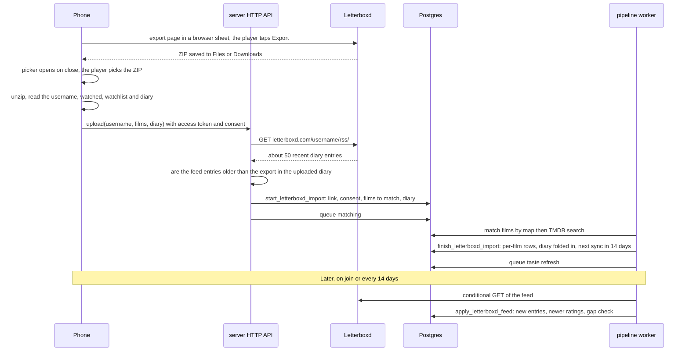

# Letterboxd integration

How MovieMatch reads a player's Letterboxd history: what Letterboxd allows, what is in the export, how a player connects, how the data stays fresh, where it is stored, and what the algorithm may do with it. Written in October 2026.

This replaces the connect flow in the [revival plan](../product/revival-plan.md#letterboxd-whats-possible), where players typed a username and the export was optional. The tables are in the [data model](../architecture/data-model.md#4-film-history-and-taste); decisions and open questions are in [decisions.md](../decisions.md).

## Contents

1. [What Letterboxd allows](#what-letterboxd-allows)
2. [The export file](#the-export-file)
3. [Connecting](#connecting)
4. [The RSS check](#the-rss-check)
5. [Keeping it fresh](#keeping-it-fresh)
6. [Where it is stored](#where-it-is-stored)
7. [Disconnecting and deleting](#disconnecting-and-deleting)
8. [Using the data](#using-the-data)
9. [Ground rules](#ground-rules)

## What Letterboxd allows

| Source | What it gives | Used for |
| --- | --- | --- |
| Official API | Everything, with OAuth | Not available: access is by application and Letterboxd isn't granting it for recommendation or personal projects |
| The member's data export | A ZIP of CSV files, downloadable only by the signed-in member | Connecting, and the full history |
| The public RSS feed, `letterboxd.com/{username}/rss/` | About the 50 most recent diary entries, each with a TMDB id, rating, heart, rewatch flag and watched date | Keeping the diary up to date after the export |
| Scraping profile pages | Everything public | Never: forbidden by the terms |
| `letterboxd.com/tmdb/{tmdb_id}` | Redirects to the film's page | "Log on Letterboxd" from the winner screen |

The feed's field names (`tmdb:movieId`, `letterboxd:memberRating`, `letterboxd:memberLike`, `letterboxd:rewatch`, `letterboxd:watchedDate`, `letterboxd:filmTitle`, `letterboxd:filmYear`) were checked on a public feed on 28 October 2026. The feed only contains diary entries: ratings given without a diary entry, films marked watched without one, and watchlist changes never appear in it.

## The export file

Structure of an export checked on 29 October 2026. The file is named `letterboxd-<username>-<yyyy>-<mm>-<dd>-<hh>-<mm>-utc.zip`, but files can be renamed, so the username is read from inside.

| File | Columns | Read |
| --- | --- | --- |
| `profile.csv` | Date Joined, Username, Given Name, Family Name, Email Address, Location, Website, Bio, Pronoun, Favorite Films | **Username only** |
| `diary.csv` | Date, Name, Year, Letterboxd URI, Rating, Rewatch, Tags, Watched Date | **Yes**, except Tags |
| `watched.csv` | Date, Name, Year, Letterboxd URI | **Yes**, as a "seen" flag |
| `watchlist.csv` | Date, Name, Year, Letterboxd URI | **Yes** |
| `ratings.csv` | Date, Name, Year, Letterboxd URI, Rating | No: ratings come only from the diary |
| `reviews.csv` | The diary columns plus Review | No |
| `likes/films.csv`, `likes/reviews.csv`, `likes/lists.csv` | Date, Name, Year, Letterboxd URI (films); Date, Content (reviews, lists) | No |
| `comments.csv` | Date, Content, Comment | No |
| `deleted/`, `orphaned/` | Diary, reviews and comments that were deleted or orphaned | No |

What the export taught us:

- **No TMDB ids.** Every `Letterboxd URI` is a `boxd.it` short link, so films are matched to TMDB by title and year. Each match is remembered in `letterboxd_film_map`, so a film is matched once for everyone.
- **Diary links point to the entry, not the film.** In `diary.csv` the link is the diary entry's own; the film's link is the one in `watched.csv`. Diary rows find their film by name and year.
- **Use "Watched Date", not "Date".** "Date" is when the entry was logged; the two often differ.
- **Ratings** are 0.5 to 5 in half stars, or empty. **Rewatch** is `Yes` or empty.
- **Many watched films have no diary entry.** In the export we checked, nearly half of them. That's why `watched.csv` is read as a seen flag: without it, the seen filter would show players films they've already watched.

## Connecting

- **Connect only by export.** "Connect Letterboxd" opens the export page (Settings, then Data) in a browser sheet: Safari View Controller on iPhone, Chrome Custom Tabs on Android, via `expo-web-browser`. The player signs in there if needed and taps Export; the ZIP lands in Files or Downloads. When the sheet closes, the app opens the file picker filtered to ZIP files, where the fresh export is at the top of Recents. Nobody can type someone else's username, and the Letterboxd password never touches the app.
- **Why not an embedded browser that catches the download.** Players would type their password into our app; Letterboxd can block embedded browsers; and while the React Native WebView tells an iOS app about a download (`onFileDownload`), on Android it hands downloads to the system's download manager, so the app never receives the file.
- **What leaves the phone**: the username from `profile.csv`; per film from `watched.csv` and `watchlist.csv`: name, year, film link, watched, on watchlist; per diary entry from `diary.csv`: name, year, entry link, watched date, logged date, rating if any, rewatch. Nothing else is read.
- **Consent** is asked before the upload and stored in `consents`; the link points at it.

## The RSS check

The export isn't signed, so a hand-made one could carry any username. When an export is uploaded, the server reads that username's public feed and checks how many of the feed's entries logged before the export appear in the uploaded diary. It stores the share it found (`rss_match_share`).

- Below about 80%, the upload is refused.
- With an empty public diary there is nothing to compare, so the upload is accepted.
- Since every app account has its own copy of its Letterboxd data, even a fake export only puts public data in the faker's own account. It can't read or delete anyone else's.

The check runs on the server, which isn't built yet; the database only stores its result.

## Keeping it fresh

- **On joining a room**: a sync is queued if the player's last sync is over 6 hours old, so tonight's deck sees last night's diary. At most one request per 10 minutes.
- **Every 14 days**: every successful sync, whatever triggered it (the export, joining a room, this job), pushes the next scheduled one 14 days out. So the hourly job (`internal.enqueue_due_letterboxd_syncs`) only reaches players who haven't played, or haven't been synced, for 14 days; frequent players never use it. A join-time sync that failed leaves the account due, and the job catches it.
- **After 12 months without playing**, scheduled syncs stop.
- **Polite requests**: from the server only, conditional (ETag and Last-Modified, so an unchanged feed costs almost nothing), cached, and naming the app in the User-Agent.
- **Gaps**: the feed holds about 50 entries. If a sync finds a full feed with none of the entries we already have, entries were missed in between. The account is flagged (`needs_new_export` in `api.my_linked_accounts`) and the app asks for a fresh export, which fills them in.
- **What only a new export refreshes**: watchlist changes and films marked watched without a diary entry. The app can suggest a fresh export now and then.

## Where it is stored

Every row belongs to one app account. Several accounts may link the same username; each keeps its own copy.

| Table | Holds |
| --- | --- |
| `linked_accounts` | The link: username from the export, consent, export date, RSS check result, feed ETag, sync times, gap flag |
| `imports`, `import_rows` | Each upload, and its films waiting to be matched. Matched rows are applied and deleted; unmatched ones stay for the fix screen (`api.my_unmatched_films`) |
| `letterboxd_entries` | Every diary entry: the whole diary from the export, then each new feed entry. An export row and a feed item for the same film and watched date are one entry. Keeps growing past the feed's 50 entries |
| `user_titles` (source `letterboxd`) | The per-film summary the deck reads: seen, latest rating, watchlist, number of watches, last watch |
| `letterboxd_film_map` | Shared, no personal data: Letterboxd film to TMDB title |

How the per-film rows are built:

1. An export replaces the account's rows with its own state: watched films are seen, watchlist films are on the watchlist, nothing is rated yet.
2. The diary is folded in: every logged film is seen, takes the rating of its most recently logged rated entry, and gets its number of watches and last watch date.
3. A film logged after the export comes off the watchlist; one re-added to the watchlist after an older watch stays on it.
4. Each feed sync folds in only the films it touched.

The server writes all of this through `internal.start_letterboxd_import`, `internal.finish_letterboxd_import` and `internal.apply_letterboxd_feed`; it matches films to TMDB itself in between. Details and payloads are in [schema.sql](../architecture/schema.sql).

## Disconnecting and deleting

- **Disconnect** (`api.disconnect_letterboxd`): deletes this account's link, which cascades to its imports, diary entries and Letterboxd rows in `user_titles`. The consent is revoked and the taste profile rebuilt. Other accounts that linked the same username keep their own copies.
- **A new export for a different username** replaces the old link and everything that came with it.
- **Account deletion** removes the link and all of the above with the rest of the account. Guest accounts inactive for 90 days are deleted the same way.
- **Data export** (`api.export_my_data`) includes the username and the whole diary.

## Using the data

- A player's Letterboxd data shapes their own taste profile and the decks of rooms they sit in. That is what they consented to, and every row of it came from their own upload or their own feed.
- The diary timeline in `letterboxd_entries` is what makes recency and taste drift usable: recent watches weigh more, rewatches are a strong signal, and a rating that changed over time is visible.
- It is not pooled across players into per-film scores ("average rating of our users on Letterboxd"). Letterboxd's terms forbid building an index of its content, and a pooled score is close to that. `rec.title_stats` uses in-app swipes only.
- There is no Letterboxd global rating to use: the feed only carries the member's own rating, the API is closed, and scraping is forbidden. The global rating is TMDB's, plus the app's own like rate.
- A trained model that takes each player's own Letterboxd ratings as input features is the grey area. It is the player's personal data used for their own recommendations, but the model itself is learned across players. Worth a short legal read before launch.

## Ground rules

From the revival plan, still standing:

- Fetch feeds from the server, cache them, send conditional requests, and name the app in the User-Agent.
- Store only what the game uses. No review text, tags or comments.
- Ask for consent before importing, and offer export and deletion: watch history is personal data under GDPR for EU players.
- Present it as "Import from Letterboxd". No Letterboxd logo or wording that suggests a partnership.
- An API application is upside only; nothing depends on it.
