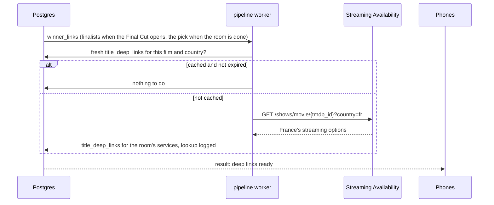

# Streaming Availability

> **Not used in v1** (decided on 29 October 2026). A group watches on the TV, not on a phone, so the winner screen only says which services have the film, and TMDB is the only where-to-watch source. No links into the services' apps, no last-minute check, no Streaming Availability plan. This doc stays as the comparison of sources, the record of [the france.tv gap](#the-francetv-gap) and the plan B ([When to revisit](#when-to-revisit)).

Where a film can be watched is the core of MovieMatch: a film only enters a deck if the room can watch it on its services tonight. This doc compares the sources for that data, recommends one, and covers how we use the Streaming Availability API by Movie of the Night: what it gives, its terms, the deep links and last-minute check on the winner screen, and how we watch for stale data. Written on 29 October 2026.

It builds on [tmdb.md](tmdb.md) (how TMDB's watch providers are ingested), the [data model](../architecture/data-model.md#2-catalog) (`title_availability`, `title_watch_links`, `title_deep_links`, `providers.streaming_availability_id`) and its [after-the-match flow](../architecture/data-model.md#after-the-match) (the `winner_links` queue). Facts about every service were checked on their live sites on 29 October 2026; see [Sources checked](#sources-checked). Decisions are in [decisions.md](../decisions.md).

Every number marked as a starting value is a placeholder.

## Contents

1. [What the data must do](#what-the-data-must-do)
2. [The sources compared](#the-sources-compared)
3. [The recommendation](#the-recommendation)
4. [What Streaming Availability gives](#what-streaming-availability-gives)
5. [Terms and attribution](#terms-and-attribution)
6. [The winner screen](#the-winner-screen)
7. [Watching for stale data](#watching-for-stale-data)
8. [Mapping services](#mapping-services)
9. [Requests and cost](#requests-and-cost)
10. [Failures](#failures)
11. [When to revisit](#when-to-revisit)
12. [Changes to the data model](#changes-to-the-data-model)
13. [Starting values](#starting-values)
14. [Sources checked](#sources-checked)

## What the data must do

A card nobody can watch is the worst card in the game: it can win, and then the night is back to square one. So the data has to be:

1. **Complete for the services families actually have.** In France: Netflix, Prime Video, Disney+, Canal+, Max, Apple TV+, Paramount+, and the free French TV streamers (Arte, france.tv, TF1+, M6+).
2. **Correct and fresh**, updated at least daily.
3. **Able to open the film**: a deep link into the service's app on the winner screen.
4. **Legal and affordable for a commercial app**, at launch and later.
5. **Easy to extend to more countries.**

## The sources compared

Checked on 29 October 2026.

| | TMDB watch providers (JustWatch data) | Streaming Availability | JustWatch, licensed directly | Watchmode |
| --- | --- | --- | --- | --- |
| Countries | JustWatch says over 140 | 65 | Over 140 (over 100 for partner integrations) | 54 |
| France | Every service on the list above except france.tv. JustWatch France lists Canal+ (and Canal+ Séries), TF1+, M6+, Arte (and ARTE VOD), but france.tv only as "France TV Amazon Channel", a paid add-on inside Prime Video, not the free app (checked on justwatch.com/fr). A TMDB France watch page also listed Canal VOD, Pathé Home, Orange VOD and Rakuten TV | 11 services: Netflix, Prime Video, Disney+, HBO Max, Apple TV, Paramount+, Mubi, Curiosity Stream, Pluto TV, Crunchyroll, Zee5. **No Canal+, Arte, france.tv, TF1+ or M6+** | The same data as TMDB's | Covered; services not checked |
| Offer kinds | Subscription, free, ads, rent, buy | Subscription, free, rent, buy, add-on; also expiry dates, video quality, audio and subtitle languages, prices | Prices and offer types | Subscription, free, rent and buy, TV channel apps |
| Deep links | **None.** TMDB: "This is *not* going to return full deep links". One TMDB watch page per film and country | **Yes:** universal links into each service's app, and direct links to start playing | **Yes:** each offer carries "a direct link to a title page for a provider", which would cover Canal+, TF1+, M6+ and Arte. Partners must show a branded JustWatch link | iOS and Android deep links on paid plans only |
| Freshness | Not published by TMDB. JustWatch says its own data refreshes at least every 24 hours | "Most of the data is updated daily" | Daily | Not checked |
| Bulk and changes | Discover by service: 20 films a page, up to 500 pages a query. No change feed for availability | Search by service: 20 films a page with a cursor. A change feed (new, removed, updated, expiring, upcoming) covering 31 days either side of today | A data dump | Not checked |
| Cost | Comes with the TMDB API: free while non-commercial, $149 a month on TMDB's commercial plan under $1 million revenue | Free: 1,000 requests a month. Starter: $49 for 25,000. Growth: $99 for 100,000. Scale: $299 for 1,000,000. A hard quota with no overage | Not published; B2B, by contact (data-partner@justwatch.com, partner-support@justwatch.com) | Free: 2,500 credits, non-commercial. $349 a month for 40,000 credits; $599 for 100,000 |
| Commercial use | Under TMDB's commercial plan. The JustWatch licensing doesn't change: attribution stays required | Allowed on every plan, the free one included | By licence | Paid plans only |
| Attribution | TMDB logo and notice; JustWatch credited wherever the data shows | Required, with a link to `movieofthenight.com/about/api` | A branded JustWatch link next to every "where to watch" | Free plan only |
| Keeping the data | 6 months at most (TMDB's terms) | "As long as required", even after the subscription ends | Not checked | While subscribed; deleted on cancelling |
| Machine learning | The free licence forbids use "in connection with" an ML or AI application; training is commercial use | Forbidden "to train, fine-tune, evaluate, or improve" ML models | Not checked | Not checked |
| In the data model already | `title_availability`, `provider_regions`, `title_watch_links` | `title_deep_links`, `providers.streaming_availability_id` | | |

## The recommendation

**TMDB's watch providers decide what's eligible. Streaming Availability is used at the winner moment: for deep links, and as a last check that the film is still there.** That's the current plan, re-examined and kept, with the last-minute check and a staleness metric added.

Why:

1. **Coverage decides it.** In France, Streaming Availability has no Canal+ and none of the free TV streamers. A family whose host has Canal+ (as in the Figma lobby) would get decks missing everything they can watch there. TMDB's JustWatch data has Canal+, TF1+, M6+ and Arte. france.tv is missing from every source checked (see [The france.tv gap](#the-francetv-gap)).
2. **Countries are nearly free with TMDB.** Its per-film data covers every country in one request. Streaming Availability charges requests per country swept.
3. **Streaming Availability is strongest where we need it least often.** Deep links, expiry dates and audio languages matter on the winner screen, which is one request per game.
4. **It's already modelled.** `title_availability` and `title_deep_links` fit this split as they are.

Rejected:

- **Streaming Availability as the eligibility source**: the French coverage gap, and a request cost that grows with every country.
- **Both as equal sources, merged**: two sources disagree daily, and every disagreement needs a rule about who wins. One source of truth plus one check is simpler.
- **JustWatch licensed directly, for now**: the best data, with links into every service including the French ones, but an unpublished price and a partnership process. Not rejected outright: ask for a price now, at the same time as TMDB. If it's reasonable, JustWatch alone could replace both TMDB's provider data and Streaming Availability's links (see [When to revisit](#when-to-revisit)).
- **Watchmode**: costs more, and deep links need a paid plan.

The risks of this choice, and what covers them:

| Risk | Cover |
| --- | --- |
| TMDB's copy of JustWatch data lags behind the services | The winner-time check measures it on every game (see [Watching for stale data](#watching-for-stale-data)) |
| No deep link for services Streaming Availability lacks (Canal+, Arte, TF1+, M6+) | The winner screen opens TMDB's watch page for those, which leads to the service |
| TMDB loses or restricts JustWatch data | Plan B in [When to revisit](#when-to-revisit) |

### The france.tv gap

No source checked carries france.tv, France Télévisions' free app: JustWatch France lists only "France TV Amazon Channel", so TMDB can't have it either, and Streaming Availability doesn't cover it. TF1, M6, Canal+ and France Télévisions publish no catalogue API that we could find, and collecting data from their sites ourselves is ruled out.

What we do about it:

- **Accept the gap at launch.** Films on france.tv are mostly catch-up for a limited time after they air, a small share of what families pick.
- **Ask JustWatch** whether its partner data includes france.tv, in the same email as the price.
- **Later idea: "On TV tonight".** A card for the film airing tonight on a national channel. It needs TV listings, for which we found no official free source, only community files with unclear terms.

## What Streaming Availability gives

API version 4, at `api.movieofthenight.com/v4` with an `X-API-Key` header (also sold through RapidAPI).

| Endpoint | Use for us |
| --- | --- |
| `GET /shows/{id}` | The winner and finalists. Takes a TMDB id as `movie/{tmdb_id}`. With `country=fr` it returns only France's options, which the docs recommend for speed |
| `GET /shows/search/filters` | Every film on given services in a country: up to 32 catalogs per call, 20 films a page, cursor pagination. Not used at launch |
| `GET /changes` | New, removed, updated, expiring and upcoming items per country and service, 25 a page, from 31 days back to 31 days ahead. Not used at launch; see [When to revisit](#when-to-revisit) |
| `GET /countries` | The services and add-ons per country, for [mapping services](#mapping-services) |

Each streaming option carries: the service (and add-on, if any), the type (subscription, free, rent, buy, add-on), a deep link to the film's page, a direct link to start playing when there is one, video quality, audio and subtitle languages, a price for rentals and purchases, and an expiry date when the film is leaving. The exact field names are to be taken from their OpenAPI specification when we build.

## Terms and attribution

From the terms and the pricing page, read on 29 October 2026:

- **Commercial use** is allowed on every plan, the free one included.
- **Attribution** is required wherever the data shows: "the streaming availability information is provided by Streaming Availability API by Movie of the Night", with a link to `https://www.movieofthenight.com/about/api`. An About page is enough. The About screen carries it next to TMDB's and JustWatch's credits.
- **Keeping data** is allowed for "as long as required by the functional needs" of the app, even after a subscription ends.
- **No redistribution** as a standalone data product, and no competing service. Showing it in our app is fine.
- **No machine learning:** the data may not be used "to train, fine-tune, evaluate, or improve machine learning models or artificial intelligence systems". **Our rule:** nothing from Streaming Availability ever goes into the deck engine's features, logs or training data. It's display only.
- **Images** (posters and logos) are third-party content they don't license. We use TMDB's images, never theirs.
- **The quota is hard:** at the limit, access stops until the next billing cycle. The winner screen must never depend on it (see [Failures](#failures)).

## The winner screen

1. **Prefetch.** When the Final Cut opens, `winner_links` is queued for its 3 or 4 finalists, so the winner screen has its links the moment the vote ends. Quick Match queues only the pick.
2. **Lookup.** One call per film per country, cached for 7 days, or until the film's expiry date if that's sooner.
3. **What the winner screen shows**, for each of the room's services that has the film:
   - "Open in Netflix", using the universal link that opens the app if it's installed, or the website if not.
   - "Leaving on 3 November" when the film has an expiry date in the next 14 days.
   - The audio and subtitle languages, so a French family sees at a glance whether there's a French version.
4. **Services Streaming Availability doesn't cover** (Canal+, the free French streamers) get TMDB's watch page, as today.
5. **The last check.** If Streaming Availability says the film is no longer on a room service where TMDB said it was, the button for that service is replaced by "May have left Netflix". The app shows the room's other services that have it, or the TMDB watch page if there are none. The film is queued for a fresh TMDB check, and the mismatch is counted (next section).

The phone shows TMDB's watch page until the `result` event arrives, as the data model already plans.

## Watching for stale data

TMDB doesn't say how often its watch-provider data refreshes. The winner-time lookup measures it for free, on exactly the films that matter.

- **Mismatch rate:** the share of picks where Streaming Availability says a room service no longer carries the film, among services both sources cover. It's recorded with each lookup.
- **Under 3% (starting value):** nothing to do.
- **Over 3% for two weeks running:** run a weekly full comparison for the services both cover. That's every film Streaming Availability lists on Netflix, Prime Video, Disney+, HBO Max, Apple TV, Paramount+ and Mubi in France, through `/shows/search/filters`, compared with `title_availability`. At 20 films a request, that's under 1,000 requests a week (estimate), which needs the Starter plan. If TMDB is confirmed to lag, decide then whether those services take their eligibility from Streaming Availability (see [When to revisit](#when-to-revisit)).

## Mapping services

`providers.streaming_availability_id` maps each TMDB provider to a Streaming Availability service id. It's seeded by hand per country, from `/countries` and TMDB's provider list.

| TMDB provider (France) | Streaming Availability id |
| --- | --- |
| Netflix, and its variant "Netflix Standard with Ads" | `netflix` |
| Amazon Prime Video | `prime` |
| Disney Plus | `disney` |
| Max (HBO Max) | `hbo` |
| Apple TV+ (subscription) and the Apple TV store (rent and buy) | `apple`, told apart by the option's type |
| Paramount Plus | `paramount` |
| Mubi, Pluto TV, Crunchyroll | `mubi`, `plutotv`, `crunchyroll` |
| Canal+, Arte, TF1+, M6+ | None: TMDB's watch page. (france.tv isn't in the data at all) |

TMDB's provider names and ids are to be confirmed on the first API calls. Channels sold through Prime Video or Apple TV map to Streaming Availability's add-ons later, when they're listed.

## Requests and cost

| Use | Requests |
| --- | --- |
| Winner links | 1 per new film per country; finalists prefetched, so up to 4 per Final Cut game. With the 7-day cache, about 1.5 per game (estimate) |
| The weekly comparison | Only if the mismatch rate calls for it: under 1,000 a week in France (estimate) |

| Games a month | Requests a month (estimate) | Plan |
| --- | --- | --- |
| Up to about 600 (building and the closed beta) | Up to 1,000 | Free |
| Up to about 15,000 | Up to 25,000 | Starter, $49 a month |
| Up to about 60,000 | Up to 100,000 | Growth, $99 a month |

An alert goes out at 80% of the month's quota.

## Failures

| Case | What happens |
| --- | --- |
| Timeout (5 seconds) or a 5xx | One retry after a minute; meanwhile the winner screen shows TMDB's watch page |
| Film unknown to Streaming Availability (404) | The negative result is cached for 7 days; TMDB's watch page |
| Quota used up | Lookups stop until the next cycle. The winner screen shows TMDB's watch page, and an alert has already gone out at 80% |
| The service is down for a day | The game is unaffected: eligibility never depends on it |

## When to revisit

| Trigger | Then |
| --- | --- |
| The mismatch rate stays over 3% after the weekly comparison confirms TMDB lags | Take eligibility for the services Streaming Availability covers from its own data: a full sweep, then its `/changes` feed daily. TMDB stays for the rest. `title_availability` would then need a `source` column |
| Streaming Availability adds Canal+ and the French free streamers | Reconsider it as the single source for France |
| TMDB loses or restricts JustWatch data, or JustWatch asks for a licence | Plan B: Streaming Availability for the services it covers, plus a JustWatch licence (data-partner@justwatch.com) for the rest |
| Revenue nears $1 million | TMDB moves to a custom quote; compare it with a direct JustWatch licence |
| JustWatch's price comes back reasonable | Take availability and links from JustWatch alone: one source, links into the French apps, and Streaming Availability no longer needed |

Later, as a game idea: Streaming Availability's expiring changes could drive a "Leaving Netflix in 4 days" label on cards. It's display only, so its terms allow it; it would cost a few requests a day per country.

## Changes to the data model

None of these are in [data-model.md](../architecture/data-model.md) or [schema.sql](../architecture/schema.sql) yet. TMDB's side of the changes is in [tmdb.md](tmdb.md#changes-to-the-data-model).

| Where | Change |
| --- | --- |
| `title_deep_links` | Add `video_link` (start playing), `audio_languages`, `subtitle_languages` and `leaves_on` (the service's expiry date). `expires_at` stays our cache expiry |
| New `title_deep_link_lookups` | Per film, country and lookup: when, found or not, and which room services disagreed with TMDB. It holds the negative cache and the mismatch rate. Server only |
| `winner_links` | Also queued for each finalist when the Final Cut opens |

## Starting values

All placeholders.

| Value | Start |
| --- | --- |
| Deep link cache | 7 days, or the film's expiry date if sooner |
| Negative cache | 7 days |
| "Leaving on" shown | Expiry within 14 days |
| Lookup timeout | 5 seconds, one retry after a minute |
| Mismatch threshold | 3%, two weeks running |
| Quota alert | 80% of the month |
| Plan | Free while building and in the closed beta; Starter from launch |

## Sources checked

All on 29 October 2026:

- [Streaming Availability pricing](https://www.movieofthenight.com/about/api/pricing): plans, quotas, daily updates, caching, commercial use, attribution
- [Streaming Availability overview](https://www.movieofthenight.com/about/api): 65 countries, 2,285 catalogs, deep links, expiry dates, audio and subtitles
- [Streaming Availability terms](https://developers.movieofthenight.com/terms-and-conditions): licence, attribution wording, caching, no redistribution, no machine learning, hard quota
- Streaming Availability docs: [countries and services](https://docs.movieofthenight.com/guide/countries-and-services) (France's 11 services), [shows](https://docs.movieofthenight.com/resource/shows), [changes](https://docs.movieofthenight.com/resource/changes), [pagination](https://docs.movieofthenight.com/guide/pagination)
- [TMDB watch providers](https://developer.themoviedb.org/reference/movie-watch-providers): JustWatch attribution, no deep links
- [TMDB forum, 30 September 2026](https://www.themoviedb.org/talk/6abd0df8de4482c46644287e) and [31 March 2026](https://www.themoviedb.org/talk/69cbf4f91b914f0e9542a772): JustWatch licensing under the commercial plan; the $149 plan
- [A TMDB France watch page](https://www.themoviedb.org/movie/1064213-anora/watch?locale=FR): French services covered
- JustWatch France, checked directly: [home page](https://www.justwatch.com/fr) (provider list: Canal+, TF1+, M6+, Arte, but france.tv only as France TV Amazon Channel), [Canal+](https://www.justwatch.com/fr/plateforme/canal-plus) (998 titles), [TF1+](https://www.justwatch.com/fr/plateforme/tf1-plus) (2,161), [M6+](https://www.justwatch.com/fr/plateforme/m6-plus) (782), [Arte](https://www.justwatch.com/fr/plateforme/arte) (206); `/fr/plateforme/france-tv` redirects to the home page
- JustWatch: [content insights](https://www.media.justwatch.com/content-insights) (over 140 countries, refreshed at least every 24 hours), [streaming API](https://www.justwatch.com/al/JustWatch-Streaming-API) (contact), [content partner docs](https://apis.justwatch.com/docs/content_partner/) (an API, a data dump or a widget; daily updates; over 100 countries and 500 services; offers with a direct link to the title on each service; branding rules)
- [Watchmode](https://api.watchmode.com/): 54 countries, plans and credits, deep links on paid plans, caching rules
