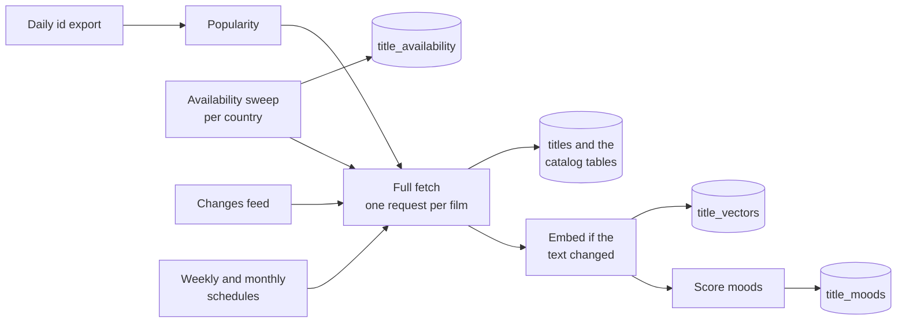

# TMDB

How Flimme builds its film catalog from TMDB and keeps it fresh, including where every film can be watched, which decides what may appear in a deck. Written on 29 October 2026.

It builds on the [data model](../architecture/data-model.md#2-catalog) (the catalog tables), the [recommendation server](../architecture/recommendation-server.md#processes) (its pipeline worker runs everything here) and the [deck engine](../architecture/deck-engine.md) (embeddings and moods). TMDB is the only where-to-watch source in v1 ([decisions](../decisions.md)); [streaming-availability.md](streaming-availability.md) keeps the winner's deep links as plan B only. Facts about TMDB were checked on its live documentation, terms and forum on 29 October 2026; see [Sources checked](#sources-checked). Decisions are in [decisions.md](../decisions.md).

Every number marked as a starting value is a placeholder to tune once the first load has run.

## Contents

1. [What we use TMDB for](#what-we-use-tmdb-for)
2. [Terms, licence and attribution](#terms-licence-and-attribution)
3. [Which films are in the catalog](#which-films-are-in-the-catalog)
4. [One request per film](#one-request-per-film)
5. [Where to watch](#where-to-watch)
6. [Keeping it fresh](#keeping-it-fresh)
7. [The first full load](#the-first-full-load)
8. [Images](#images)
9. [Certifications and age](#certifications-and-age)
10. [Translations](#translations)
11. [Embeddings and moods](#embeddings-and-moods)
12. [Failures and retries](#failures-and-retries)
13. [Countries at launch](#countries-at-launch)
14. [Requests and cost](#requests-and-cost)
15. [Changes to the data model](#changes-to-the-data-model)
16. [Starting values](#starting-values)
17. [Sources checked](#sources-checked)

## What we use TMDB for

| Use | What | Where it goes |
| --- | --- | --- |
| Catalog | Titles, overviews and taglines in English and French, genres, keywords, directors, writers, cast, runtime, release date, franchise, trailer | `titles`, `title_translations`, `title_credits`, `people`, `keywords` |
| Quality | Vote average and count, popularity | `titles`; the deck's crowd score and quality floors |
| Where to watch | Which services carry each film in each country, by subscription, free or with ads. TMDB gets this data from JustWatch | `title_availability`, `title_watch_links`, `providers`, `provider_regions` |
| Age | Certifications per country | `title_certifications` |
| Images | Posters, backdrops and service logos, served by TMDB's image CDN straight to phones | Paths in `titles`, `title_translations` and `providers` |
| Letterboxd matching | Search by title and year for export films not yet in `letterboxd_film_map` | See [the export file](letterboxd.md#the-export-file) |

Every API call runs from the pipeline worker on the recommendation server. Phones only load images, and nothing calls TMDB during a game.

## Terms, licence and attribution

What TMDB's terms (last updated 20 October 2023), its FAQ and its staff say today:

| Topic | What applies | Source |
| --- | --- | --- |
| Price | Free for non-commercial use. A project is commercial "if the primary purpose is to create revenue". Under $1 million in revenue, a commercial plan costs $149 a month; above that, a custom quote | FAQ; TMDB staff on the forum, 31 March 2026 |
| Attribution | The TMDB logo (an approved version, unmodified) and a notice that the app "uses TMDB and the TMDB APIs but is not endorsed, certified, or otherwise approved by TMDB", in an About or Credits section | Terms section 3; FAQ |
| Watch providers | "You must attribute the source of the data as JustWatch". Misuse means losing API access. A commercial plan "doesn't change anything regarding the licensing of JustWatch data": attribution stays required | Watch providers reference; TMDB staff on the forum, 30 September 2026 |
| Caching | Nothing obtained from TMDB may be kept "for longer than 6 months" | Terms 1.C |
| Rate | "Around 40 requests per second", per IP address, with no key-based quota. Respect a 429 | Rate limiting guide; TMDB staff, 31 March 2026 |
| Machine learning | The free licence forbids using TMDB content "in connection with, including for training, a machine learning (ML) or artificial intelligence (AI) based Application". Training or validating an ML system with TMDB content is listed as commercial use | Terms 1.C and 2.A |

What this means for us:

- **Attribution.** The About screen carries the TMDB logo and notice. A JustWatch credit appears wherever services show: the card back, the winner screen, the room's list of services.
- **Six months.** Every stored film is re-fetched at least monthly (see [Keeping it fresh](#keeping-it-fresh)). Films TMDB removes lose their TMDB content within 6 months of the last successful fetch.
- **Machine learning is the open risk.** The deck engine embeds TMDB text, scores moods from TMDB keywords, and later trains models on features that include TMDB data. That reads as an "ML based Application" under the free licence. So the plan in [monetization.md](../product/monetization.md) to stay non-commercial under TMDB until Pro may not hold: the engine itself may need the commercial agreement from the first public build, even with no revenue.

  **Recommendation:** before building the catalog, email sales@themoviedb.org and describe the three uses: embeddings computed on our server from TMDB text with an open model; ranking models trained on our players' swipes with TMDB metadata among the features; an optional language model tagging moods from synopses. Ask in writing whether the $149 plan covers them. Budget $149 a month from the closed beta until they answer.

## Which films are in the catalog

The rule: **every film a group might pick that is watchable in an enabled country, plus the well-known films taste needs**, above a floor.

Two sources, merged:

1. **Popular films.** TMDB publishes a file of every valid movie id with its popularity every day (`files.tmdb.org/p/exports/movie_ids_MM_DD_YYYY.json.gz`, all files ready by 08:00 UTC and kept for 3 months). The top 60,000 by popularity, leaving out adult and video entries, are candidates.
2. **Watchable films.** The daily [availability sweep](#the-daily-sweep) lists every film on each listed service in each enabled country. Any film it finds that isn't in the catalog yet becomes a candidate. This is what makes availability the core: a film on Canal+ is in the catalog because it's on Canal+, not because it's popular worldwide.

A candidate is fetched once and kept if it passes the **floor**: released (TMDB status "Released" and a past release date), at least 40 minutes long, at least 30 votes, not adult. That's the lowest floor any deck uses (Hidden gems); the room's quality preset sets the real one.

Expected size: 40,000 to 60,000 films (starting estimate). Films are never deleted, because votes point at them. They're deactivated (`is_active` false) when TMDB removes them or flags them adult. The taste check films and the moods' example films are well-known, so always well inside the top 60,000.

## One request per film

```
GET /3/movie/{tmdb_id}
    ?language=en-US
    &append_to_response=translations,keywords,credits,release_dates,videos,watch/providers,images
    &include_image_language=fr,en,null
```

That's seven appended parts; the endpoint allows up to 20. To confirm on the first test call: `watch/providers` works as an appended part (it's in the movie namespace, but no official example shows it appended).

| Part | Stored as |
| --- | --- |
| Details | `titles`: TMDB id, IMDb id, original title and language, release date, runtime, genre ids, collection id (`belongs_to_collection`), popularity, vote average and count, poster and backdrop paths, adult flag. `title_translations` for `en`: title, overview, tagline |
| `translations` | `title_translations` for `fr`, preferring France's French over other variants. Empty fields stay empty: cards fall back to English, then to the original title, as `internal.card_payloads` already does |
| `keywords` | `keywords`, `titles.keyword_ids` |
| `credits` | `people` and `title_credits`: the directors, up to 3 writers, the first 8 cast members by billing order |
| `release_dates` | `title_certifications` for enabled countries (see [Certifications and age](#certifications-and-age)) |
| `videos` | `titles.trailer_key`: the official YouTube trailer, English first, then French, then a teaser |
| `watch/providers` | Reconciliation with the daily sweep, and `title_watch_links` (TMDB's watch page per enabled country) |
| `images` | The best-voted French poster, as `title_translations.poster_path` for `fr` |

Computed at ingest:

- **`quality_score`** = (v / (v + m)) × R + (m / (v + m)) × C, where R is the film's vote average, v its vote count, C the catalog's average vote and m = 100. Films with few votes are pulled toward the average, so a 9.0 from 40 votes doesn't outrank an 8.4 from 20,000. The value of m interacts with the deck's quality presets, Hidden gems (7.0 or more) especially, so tune them together.
- **`poster_placeholder`**: a thumbhash of the w92 poster, computed when the poster path changes.
- **`refresh_tier`**: 1 when the film is available by subscription, free or with ads in an enabled country, else 2.
- **The embedding text** and its hash (see [Embeddings and moods](#embeddings-and-moods)).

## Where to watch

A deck only shows films available on tonight's services in the room's country (`title_availability`). That data comes from TMDB's watch providers, which TMDB gets from JustWatch. Why this source rather than Streaming Availability is in [the recommendation](streaming-availability.md#the-recommendation). In short, it's the only affordable source that covers the services French families use: Canal+, TF1+, M6+ and Arte included. france.tv is the one gap, in every source checked (see [the france.tv gap](streaming-availability.md#the-francetv-gap)).

### The daily sweep

Each night, for each enabled country, each listed service (variants included, see below) and each offer kind we use:

```
GET /3/discover/movie
    ?watch_region=FR&with_watch_providers={provider_id}
    &with_watch_monetization_types={flatrate | free | ads}
    &vote_count.gte=30&include_adult=false&sort_by=popularity.desc&page={1..n}
```

- 20 films a page, up to 500 pages, so 10,000 films per query. (The 500-page cap is reported on TMDB's forum, not in its reference.) A service with more films than that is split by release year.
- The result is the complete list of (film, service, kind) for the country. It's compared with `title_availability`: new rows are added, rows no longer seen are deleted, and `checked_at` is updated.
- A service's rows are only deleted if its sweep finished completely. If one run would remove more than 20% of a service's films in a country, it isn't applied and an alert goes out: a glitch upstream must not empty decks.
- Films not yet in the catalog are queued for a full fetch.

**Offer kinds.** TMDB's `flatrate` becomes `subscription`; `free` and `ads` keep their names. Rent and buy are neither swept nor stored at launch: on the TMDB France page checked today, one recent film had 11 rental and 11 purchase offers, so storing them would add about 20 rows per film per country for a "rent it" option that doesn't exist yet.

**Reconciliation.** The weekly full fetch of each watchable film also brings its per-film watch providers. Where they disagree with the sweep, the per-film answer wins for that film and the disagreement is counted. If agreement falls under 98% (starting value), daily availability switches to per-film calls: one request per active film, about 50,000 a day, still well within TMDB's rate.

### Services, variants and channels

TMDB lists some services more than once. On a TMDB France watch page checked today, "Netflix" and "Netflix Standard with Ads" were separate providers, and JustWatch's France listings show channels such as "Cine+ OCS Amazon Channel" alongside Prime Video. Players think in services, so:

- **A variant** (Netflix Standard with Ads) points at its main service through a new `providers.parent_id`. A player who picks Netflix gets films on either.
- **A channel** (a Prime Video or Apple TV channel) is a service of its own, because it needs its own subscription. It's only listed where it matters, such as Cine+ OCS in France.
- **Which services a country's picker shows**, and in what order, is curated per country: a new `provider_regions.is_listed`, ordered by TMDB's display priority for that country.
- **Free services** are those with only free or ad-supported offers in a country, such as Arte or Pluto TV. Anyone can watch them. Default: they count as available to every room in that country without anyone picking them, and the host can switch them off. This is a product choice for Harry.

The exact TMDB provider ids and offer kinds of each French service are to be confirmed on the first API calls. Curating them is part of enabling a country.

### The watch link

`title_watch_links` keeps TMDB's watch page for each film and country (the `link` field), refreshed by the weekly fetch.

**The winner screen** says where to watch: the logos of the room's services that have the film (subscription, free or with ads), with the JustWatch credit and TMDB's watch page as "More details". No links into the services' apps: a group watches on the TV, not on a phone ([decisions.md](../decisions.md)).

**"Not there anymore?"** Players can report that the film isn't on a service any more. A report re-fetches that film's services at once, and the share of winners reported is our measure of how stale TMDB's data is. It needs one small api function.

## Keeping it fresh



| Job | When | What | `ingest_runs` kind |
| --- | --- | --- | --- |
| Popularity | Daily, after 08:00 UTC | Read the export file, update `titles.popularity` across the catalog, queue ids newly in the top 60,000 | `popularity_daily` |
| Availability sweep | Daily, 03:00 Paris time | As above, per enabled country | `availability_sweep` |
| Changes | Daily | `/3/movie/changes` for the last 24 hours (up to 14 days after an outage), kept to films in the catalog; a full fetch of each | `changes_daily` |
| Watchable films | Weekly | Full fetch of tier 1 films: fresh votes, per-film providers, watch links | `details_weekly` |
| Everything else | Monthly | Full fetch of tier 2 and inactive films, which keeps every film inside TMDB's 6-month rule | `details_monthly` |
| Reference data | Weekly | Genres in English and French, each enabled country's providers with their display priorities, certification lists | `reference_weekly` |
| Embeddings and moods | After a fetch that changed the embedding text, and after a mood changes | See [Embeddings and moods](#embeddings-and-moods) | `embeddings`, `moods` |

A film TMDB no longer returns (404) is deactivated at once. If it's still missing 6 months after its last successful fetch, its TMDB text, images, credits and vector are cleared. The bare row stays, so old votes still point at something.

## The first full load

The same worker code, run once from a laptop or CI, as the data model plans:

1. **Reference data:** genres, the providers and display priorities of enabled countries, certification lists. The listed services, variants, free services and `certification_ages` are seeded by hand.
2. **Candidates:** the top 60,000 from the export file, plus the first availability sweep.
3. **Full fetch** of every candidate at 20 requests per second: about 60,000 requests, under an hour. It can resume: `ingest_runs.cursor` holds the position.
4. **The floor, tiers and quality score.** C is computed once every film is in.
5. **Embeddings, mood scores and thumbhashes.**

## Images

Only paths are stored. Phones build `https://image.tmdb.org/t/p/{size}{path}` and cache with expo-image. The sizes TMDB's configuration offers: posters w92, w154, w185, w342, w500, w780 and original; backdrops w300, w780, w1280 and original; logos w45 to w500 and original.

| Use | Size |
| --- | --- |
| Card front | w500, w780 on large screens |
| Lists, the Final Cut, the recap card | w185 or w342 |
| Card back | w780 backdrop |
| Service logos | w92 |
| Placeholder | A thumbhash of the w92 poster, made at ingest |

Never `original`.

## Certifications and age

From `release_dates`, for each enabled country:

1. Take the non-empty certification of the most recent release of type 3 (theatrical), else type 4 (digital), else type 6 (TV), else any type.
2. Its `min_age` comes from `certification_ages`, seeded by hand per country. France is straightforward (U is 0; 10, 12, 16 and 18 are themselves). US ratings need a policy, for example PG at 7 (placeholder) and PG-13 at 13.
3. With no certification in that country, use the US certification's age, marked with a new `title_certifications.inferred_from` set to `US`.
4. With none at all, no row is written, and rooms with an age cap leave the film out. Safe by default.

## Translations

English and French at launch, from the `translations` part. Missing French text falls back to English, then to the original title. Adding a language means adding it to the fetch; the monthly cycle fills it in. Embeddings always use the English text.

## Embeddings and moods

- **The text**, in English: `{title} ({year}). {genres}. Keywords: {first 10 keywords}. Directed by {directors}. Starring {first 3 cast}. {overview}`
- **The model:** gte-small, with 384 dimensions, English only, truncating at 512 tokens, MIT licence (checked on its model card). The revival plan used Supabase's built-in gte-small through Edge Functions. With no Edge Functions, the pipeline worker runs the same model itself, so vectors keep 384 dimensions and stay comparable.
- **`source_hash`** is a hash of the text. A fetch only re-embeds a film when its text changed (the `embed_titles` queue).
- **Moods.** After embedding, the film is scored for every mood ([deck engine](../architecture/deck-engine.md#scoring)). A change to a mood row re-scores every film.
- **Keyword ids** for mood hints come from the `keywords` part.

## Failures and retries

| Case | What happens |
| --- | --- |
| 429 | Wait for `Retry-After` if sent, else 1 second, doubling up to 60. The worker halves its rate for 5 minutes |
| 5xx or a timeout (10 seconds) | 3 retries with backoff, then the message goes back to its queue (visibility timeout). After 5 deliveries it's logged as an error in `ingest_runs` and dropped |
| 404 | The film is deactivated; its content is cleared after 6 months |
| A sweep that didn't finish | No deletions for that service that night |
| A sweep that would remove more than 20% of a service | Not applied; alert |
| A daily job unfinished after 36 hours | Alert. Decks keep working on the last good data |

The worker runs at 20 requests per second with 8 in flight (starting values), half of TMDB's ceiling.

## Countries at launch

This answers the "Countries at launch" question in [decisions.md](../decisions.md). With TMDB, a country costs few requests: the per-film fetch already returns every country, so only the sweep adds requests, a few thousand a night. The data model estimates 50,000 to 100,000 availability rows per country. The real cost of a country is curation:

- its listed services, variants, channels and free services,
- its certification ages,
- its default language,
- checking a sample of decks by hand.

**Recommendation:** France for the closed beta. Belgium and Switzerland next: French-speaking, so no new copy. Then the UK, Ireland, the US and Canada once the English copy is done. A player in a country that isn't enabled can join rooms but not host one, and sees "Not available in your country yet".

## Requests and cost

Starting estimates for France alone:

| Job | Requests |
| --- | --- |
| Availability sweep | 2,000 to 5,000 a day |
| Changes | 100 to 200 pages, plus 500 to 2,000 fetches a day |
| Weekly fetch | 15,000 to 25,000 a week |
| Monthly fetch | About 30,000 a month |
| First load | About 60,000, once |

That's about 10,000 requests a day, roughly 10 minutes at 20 a second. The money is TMDB's licence: $0 while non-commercial, or $149 a month on the commercial plan (see [Terms](#terms-licence-and-attribution)).

## Changes to the data model

None of these are in [data-model.md](../architecture/data-model.md) or [schema.sql](../architecture/schema.sql) yet.

| Where | Change |
| --- | --- |
| `providers` | Add `parent_id`: a variant points at its main service |
| `provider_regions` | Add `is_listed` (shown in that country's picker) and `free_for_all` (counts for every room in the country) |
| `rooms` | Add `include_free_services`, default true. `internal.refresh_room_providers` adds the country's `free_for_all` services when it's on |
| Players' services | `profile_providers` and the seats' services hold main services only; the deck filter expands them to their variants |
| `titles` | `refresh_tier` becomes 1 = available in an enabled country (weekly fetch), 2 = the rest (monthly fetch). Add `tmdb_missing_since` |
| `title_certifications` | Add `inferred_from`: the country whose certification was used, null when it's the country's own |
| `title_availability` | Rent and buy aren't stored at launch |
| Streaming Availability | Dropped from v1: `title_deep_links`, `providers.streaming_availability_id`, the `winner_links` queue are gone (migration `remove_v1_dropped`), and the `result` event is never sent |
| New `api.report_unavailable(room, title, provider)` | A player's "Not there anymore?" on the winner screen; queues a re-fetch of the film |
| `ingest_runs.kind` | `backfill`, `availability_sweep`, `popularity_daily`, `changes_daily`, `details_weekly`, `details_monthly`, `reference_weekly`, `embeddings`, `moods` |

## Starting values

All placeholders until the first load has run.

| Value | Start |
| --- | --- |
| Popular candidates | Top 60,000 by popularity |
| Floor | Released, 40 minutes or more, 30 votes or more, not adult |
| `quality_score` | m = 100; C = the catalog's average vote, recomputed weekly |
| Rate | 20 requests per second, 8 in flight |
| Timeouts and retries | 10 seconds; 3 retries; dropped after 5 deliveries |
| Sweep guard | No run removes more than 20% of a service's films in a country |
| Reconciliation | Switch to per-film availability under 98% agreement |
| Alerts | A daily job unfinished after 36 hours |
| Countries | France |
| Languages | English and French |

## Sources checked

All on 29 October 2026:

- [TMDB API terms of use](https://www.themoviedb.org/api-terms-of-use) (last updated 20 October 2023): the 6-month cache limit, commercial use, attribution, machine learning
- [TMDB FAQ](https://developer.themoviedb.org/docs/faq): what counts as commercial, the attribution notice and logo
- [TMDB forum, 31 March 2026](https://www.themoviedb.org/talk/69cbf4f91b914f0e9542a772): the $149 a month commercial plan under $1 million revenue; the 40 requests per second IP limit
- [TMDB forum, 30 September 2026](https://www.themoviedb.org/talk/6abd0df8de4482c46644287e): JustWatch licensing unchanged under a commercial plan; a free key is fine while earning nothing
- [Rate limiting](https://developer.themoviedb.org/docs/rate-limiting), [daily ID exports](https://developer.themoviedb.org/docs/daily-id-exports), [tracking changes](https://developer.themoviedb.org/docs/tracking-content-changes) and [the movie change list](https://developer.themoviedb.org/reference/movie-changes)
- [Movie details](https://developer.themoviedb.org/reference/movie-details) (20 appended parts at most), [watch providers](https://developer.themoviedb.org/reference/movie-watch-providers) (JustWatch attribution, no deep links), [the provider list](https://developer.themoviedb.org/reference/watch-providers-movie-list), [discover](https://developer.themoviedb.org/reference/discover-movie), [release dates](https://developer.themoviedb.org/reference/movie-release-dates) and [configuration](https://developer.themoviedb.org/reference/configuration-details)
- [TMDB forum thread on the 500-page discover cap](https://themoviedb.org/talk/6489a3f0e375c000ff4ab1b2)
- [A TMDB France watch page](https://www.themoviedb.org/movie/1064213-anora/watch?locale=FR): Netflix and "Netflix Standard with Ads" as separate providers; French rental and purchase stores
- [JustWatch France](https://www.justwatch.com/fr), checked directly: Canal+, TF1+, M6+ and Arte are listed; france.tv only as "France TV Amazon Channel"
- [gte-small model card](https://huggingface.co/thenlper/gte-small): 384 dimensions, English only, 512 tokens, MIT licence
