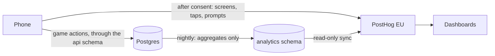

# Analytics

How we know whether MovieMatch works: the questions analytics must answer at launch, every metric the other docs name (defined once, with where its number comes from and a starting target), the events the app sends to PostHog, identity, consent and kids, the funnels and first dashboards, how the deck engine's A/B tests are read, and PostHog's plan and hosting. Written on 29 October 2026.

It gathers the metrics from the revival plan's [Measure these from day one](revival-plan.md#measure-these-from-day-one), the deck engine's [Measuring it](../architecture/deck-engine.md#measuring-it), game modes' [Time to a pick](game-modes.md#time-to-a-pick), onboarding's [Measuring it](onboarding.md#measuring-it) and app structure's [Analytics and crash reports](../architecture/app-structure.md#analytics-and-crash-reports). The tables it reads are in the [data model](../architecture/data-model.md#5-rooms-and-the-game). The legal basis for analytics, the consent wording and the age rules are in [privacy.md](privacy.md); system monitoring (deal latency, errors, crashes) is in [operations.md](../architecture/operations.md), not here. Decisions are in [decisions.md](../decisions.md).

Every target and number marked as a starting value is a placeholder until the closed beta.

## Contents

1. [What analytics must answer](#what-analytics-must-answer)
2. [Two sources: the database and PostHog](#two-sources-the-database-and-posthog)
3. [Every metric](#every-metric)
4. [Events sent to PostHog](#events-sent-to-posthog)
5. [Identity](#identity)
6. [Consent and kids](#consent-and-kids)
7. [Funnels](#funnels)
8. [Dashboards to build first](#dashboards-to-build-first)
9. [Reading A/B tests](#reading-ab-tests)
10. [Feature flags and session replay](#feature-flags-and-session-replay)
11. [PostHog: plan, cost and hosting](#posthog-plan-cost-and-hosting)
12. [Changes this asks elsewhere](#changes-this-asks-elsewhere)
13. [Starting values](#starting-values)
14. [Sources checked](#sources-checked)

## What analytics must answer

Six questions at launch, each with one headline number. Every other metric explains a headline.

| Question | Headline metric |
| --- | --- |
| Does picking a film take under 5 minutes? | [Time to a pick](#game) and rooms that end with a pick |
| Is the pick a good one? | "Did you watch it?" yes rate, and misery |
| Does the deck feel fresh from one game to the next? | [Repeat rate](#game) |
| Is getting into a game fast? | Link to first swipe, for invited players |
| Do invited players come back, and start hosting? | Second game within 14 days; guests who become hosts |
| Do groups come back? | Groups back within 30 days |

The last one is the gate in [monetization.md](monetization.md#recommended-sequence) for switching on Host Pro.

## Two sources: the database and PostHog

**The database is the source of truth for everything that happens in a game.** Rooms, seats, votes, `swipe_log`, matches, rounds, `card_history`, `rec.requests` and `rec.request_items` already record every room, every card and every answer, for every player. They're exact, they don't depend on a phone being online, and they don't depend on anyone accepting analytics.

**PostHog only gets what the server can't see:** which screens were opened, taps that don't call the backend (sharing an invite, opening TMDB's watch page), prompts shown and dismissed, the answer to the notifications permission, how long the first card took to appear, errors shown. And only from players who accepted analytics.

**Per-swipe data never goes to PostHog.** A 4-player game is about 240 votes: sending them would duplicate what the database already holds, multiply the event count, and put people's film choices at a third party. The same goes for film ids, titles, ratings, taste check answers and anything from Letterboxd.

**How database numbers reach dashboards.** Each night, the recommendation server's trainer (which already rebuilds `rec.title_stats` nightly, see [Processes](../architecture/recommendation-server.md#processes)) refreshes a set of aggregate-only views in a new `analytics` schema: counts, rates and percentiles by day, country, mode, group size and experiment variant, with no profile, seat or room ids. PostHog's Supabase source syncs that schema with a read-only role, so every dashboard lives in one place and nothing personal leaves our database. The nightly aggregates also outlive the raw rows: `rec.request_items` is kept 90 days and `swipe_log` 13 months ([Retention](../architecture/data-model.md#retention)), but their daily summaries stay.

## Every metric

Deduplicated from the docs above. "DB" means the database through the nightly views; "PostHog" means app events, consented players only. Definitions use these words:

- **A player** is a profile. **A seat** is one player in one room. Seats of deleted accounts count in room totals, never in per-player metrics.
- **Present** is as in the match rules: a seat active in the last 90 seconds.
- **A started room** has `started_at` set (swiping began). **A pick** is the room's `matches` row with `pick_order` 1.
- **A guest** joined a room someone else hosts. **Without an account** means a Supabase anonymous user (`is_anonymous` on the auth user); the two aren't the same.

### Game

| Metric | Definition | Source | Starting target | Named in |
| --- | --- | --- | --- | --- |
| **Time to a pick** | Median and 90th percentile of `decided_at` minus `started_at`, rooms with a pick, by group size (2, 3 to 4, 5 to 10) and mode | DB: `rooms` | Median under 5 minutes, 90th percentile under 7, for 2 to 4 players | Revival plan, deck engine, game modes |
| Time from room to pick | The same from `created_at`, so it includes the lobby | DB: `rooms` | Watch | |
| **Rooms that end with a pick** | Started rooms whose `rooms.stats.outcome` is `match` or `finale`, out of all started rooms; also the share ending `no_pick` and `abandoned` | DB: `rooms.stats` | 90% with a pick | Revival plan, game modes |
| Pick within 5 minutes | Started rooms with a pick less than 5 minutes after `started_at`, out of all started rooms | DB: `rooms` | 60%, then rising | The A/B decision metric, see [Reading A/B tests](#reading-ab-tests) |
| Instant matches | Picks with outcome `match`, out of all picks | DB: `rooms.stats` | Watch | Game modes |
| **Swipes per pick** | Median, over present seats at the pick, of votes cast between `started_at` and `decided_at` | DB: `votes` | Under 40 | Revival plan, deck engine |
| Time to first card | `started_at` minus `dealing_at` (the deal), and the share of starts dealt by the SQL fallback (`rec.requests.is_fallback`) | DB: `rooms`, `rec.requests` | Under 2 seconds; fallback under 5% | Revival plan |
| First card on screen | Time from the room turning to swiping to the first card drawn on the phone | PostHog: `game:first_card_view` | Under 1 second | Revival plan |
| **Repeat rate** | Answered cards whose film the same player also answered in another room in the previous 30 days, out of all answered cards from players with a profile. Rematch cards (`deck_source` `rematch`) excluded | DB: `votes`, `room_members`, `swipe_log` | Under 10% | Deck engine |
| Like rate by phase and source | Likes and super likes out of answered cards ("Seen it" left out), by phase (warm-up, narrow, close) and by deck source (opening, ranked, propagated, wildcard, rematch) | DB: `swipe_log`, `rec.request_items` | Rises from warm-up to close; wildcards at least 0.8 × ranked | Deck engine |
| **Misery** | Picks where a seat present at the pick had a predicted fit under 2 in `room_cards.fits` | DB: `room_cards` | Low; watch the trend | Deck engine |
| **"Did you watch it?"** | Answer rate (seats with a profile in rooms with a pick who answered), yes share, and Love it share among yes | DB: `room_members` | Yes share 60% | Game modes |
| Not there anymore | Picks reported unavailable on the winner screen, out of all picks: how stale TMDB's data is | DB: `api.report_unavailable` | Under 2% | TMDB |
| Host controls | Rooms using Keep swiping, Vote now, changing filters while swiping, Play again | DB: `rooms.stats` | Watch | Game modes |
| Taste check | Offered and skipped (PostHog); finished (DB: calibration answers) | PostHog and DB | Watch | Deck engine, onboarding |

### Getting in

| Metric | Definition | Source | Starting target | Named in |
| --- | --- | --- | --- | --- |
| **Link to first swipe** | Median of the seat's first vote minus the time its invite link was tapped (`room_members.link_opened_at`, see [Changes](#changes-this-asks-elsewhere)), seats that joined by link | DB | 35 seconds (onboarding's 30 seconds to the first card, plus one swipe) | Onboarding |
| Link to first card | The same to the first card on screen | PostHog | 30 seconds | Onboarding |
| First launch to Home | Median, new players | PostHog | 15 seconds | Onboarding |
| First launch to room open | Median of the first `rooms.created_at` minus `profiles.created_at`, new players whose first room is one they host | DB | 1 minute | Onboarding |
| Join failures | Join attempts by status (`not_found`, `full`, `starting`, `in_finale`, `rate_limited`, `closed`) | PostHog: `join:attempt_finish` | Watch | Onboarding |
| Notifications | Asked, accepted | PostHog | Watch | Onboarding |
| Letterboxd | Offered, started, file picked (PostHog); imported or failed, with the reason (DB: `imports`) | PostHog and DB | Watch | Onboarding |
| Analytics opt-outs and opt-ins | Players who turned analytics off, and EU, UK and Swiss players who opted in to detailed stats, out of active players | DB: `consents` | Watch: it says how far PostHog's numbers can be trusted |
| **Time to finish onboarding** | Median of a new player's first vote minus `profiles.created_at`: from first launch to the first swipe of their first game, split by guests who joined by link, guests who typed a code, and hosts | DB | 1 minute for guests (placeholder); watch for hosts, who wait for friends | Harry |

### Coming back

| Metric | Definition | Source | Starting target | Named in |
| --- | --- | --- | --- | --- |
| **Second game** | New players (first seat in the week) who play another started room within 14 days | DB | 30% | |
| **Guests who become hosts** | Players whose first seat was a guest seat who host a started room within 30 days | DB | 10% | Monetization |
| **Groups back within 30 days** | Rooms with a pick and at least 2 players with a profile, where at least 2 of the same players play another started room together within 30 days. It stands in for "crews back within 30 days" until crews exist | DB | Set by Harry before launch; suggested 25% | Revival plan, monetization |
| Active hosts | Players who hosted a started room in the last 7 days (weekly) and 30 days (monthly) | DB | Watch: the break-even in [monetization.md](monetization.md#break-even) is counted in active hosts | Monetization |
| **Time to first watch** | For new players: the share who answer "Did you watch it?" with yes within 7 days of their first launch, and the median time from first launch to that pick's room ending | DB: `room_members.watched_answer`, `rooms.ended_at` | Watch; it's the closest we get to "the app ended a movie night" | Harry |
| Accounts saved | Players without an account at their third game who link Apple or Google by their tenth | DB: auth users | Watch | Onboarding |
| Guests who install | Web guests who later play in the app | DB | Only if web guests launch | Revival plan, onboarding |

Analytics counts how many players connected Letterboxd, never anything from their diaries, as [letterboxd.md](../integrations/letterboxd.md#using-the-data) requires.

## Events sent to PostHog

### Naming

PostHog's own guidance, adopted as is:

- **Events are `category:object_action`**, lowercase snake case, present tense: `join:attempt_finish`, not `Joined Room`.
- **A fixed list of verbs**: `open`, `view`, `show`, `tap`, `start`, `finish`, `skip`, `submit`, `share`, `accept`, `dismiss`, `answer`. No others.
- **Properties are `object_adjective`**: `service_count`. Booleans start with `is_` or `has_`; durations end in `_ms`.
- **Names are fixed strings in code**, never built from data. They live as one typed list in the app's analytics wrapper (`src/lib/analytics.ts`, see [app structure](../architecture/app-structure.md#analytics-and-crash-reports)), so a typo doesn't compile.
- **Enum values, never free text.** No names, codes, links, emails, usernames, film ids or titles.

### Events

Besides PostHog's own app lifecycle events (`Application Installed`, `Application Opened`, `Application Backgrounded`) and screen views, which the wrapper sends with the route pattern (`/join/[code]`, never the code itself):

| Event | Fired when | Properties |
| --- | --- | --- |
| `onboarding:name_submit` | The first launch's name screen is done | `has_avatar`, `source` (`invite`, `organic`) |
| `join:link_open` | The app opens an invite link | `has_room_ref` |
| `join:code_submit` | A code is typed or a QR code scanned in the app | `via` (`code`, `qr`) |
| `join:attempt_finish` | `api.join_room` answers | `via` (`link`, `code`, `qr`, `rejoin`, `play_again`), `status` |
| `room:create_finish` | The host opens a room | `mode`, `mood_count`, `has_time_budget`, `seen_rule`, `quality`, `service_count` |
| `room:invite_share` | The host shares the room | `method` (`share_sheet`, `qr_show`, `code_copy`) |
| `lobby:services_submit` | A player sets their services | `service_count`, `step` (`room_setup`, `lobby`, `settings`) |
| `lobby:taste_check_show` | The taste check opens | `placement` (`auto`, `card`) |
| `lobby:taste_check_finish` | It ends with answers | `answered_count`, `dont_know_count` |
| `lobby:taste_check_skip` | It's skipped or the game starts first | `answered_count`, `is_game_started` |
| `game:first_card_view` | The first card is drawn, once per seat per game | `ms_since_swiping`, `ms_since_link_open` (joined by link only), `mode`, `room_size` (`2`, `3_4`, `5_10`) |
| `game:hint_show` | A first-game hint appears | `hint` (`swipe`, `seen_it`, `super_like`, `undo`) |
| `game:nothing_left_view` | The "Nothing left" screen shows | `is_host` |
| `winner:view` | The winner screen shows | `outcome` (`match`, `finale`), `room_size` |
| `winner:watch_page_open` | "More details" opens TMDB's watch page | |
| `winner:letterboxd_log_tap` | "Log on Letterboxd" | |
| `winner:recap_share` | The recap card is shared | `method` |
| `followup:view` | "Did you watch it?" shows | `from` (`notification`, `app_open`, `home_card`) |
| `prompt:show`, `prompt:accept`, `prompt:dismiss` | One of the asks from [onboarding](onboarding.md#after-the-first-game) | `prompt` (`notifications`, `letterboxd`, `save_account`), `placement` (`winner`, `home`, `profile`, `settings`) |
| `notifications:permission_answer` | The system prompt returns | `is_granted`, `is_os_prompt_shown` |
| `letterboxd:connect_start` | "Connect Letterboxd" is tapped | `placement` |
| `letterboxd:export_page_open` | The export page opens in the browser sheet | |
| `letterboxd:file_pick_finish` | The picker returns | `status` (`ok`, `cancel`, `not_zip`, `not_letterboxd`) |
| `letterboxd:upload_finish` | The server answers the upload | `status` (`ok`, `rss_mismatch`, `error`) |
| `account:save_start` | Save account with Apple or Google is tapped | `provider`, `placement` |
| `account:save_finish` | It returns | `status` (`linked`, `existing_account`, `cancel`, `error`) |
| `error:view` | An error screen or banner shows | `code` (`room_closed`, `offline`, `update_required`, ...), `screen` |

Registered on every event, and set on the person: `language`, `country`, `has_account`, `has_letterboxd`, `games_played` (`0`, `1`, `2_4`, `5_plus`). PostHog adds the app version and platform itself.

What happens in a game (votes, matches, the finale, host controls, Play again) is read from the database, not sent as events.

Estimated volume: about 20 events per player per game, plus a few per app open. 10,000 games a month with 4 players each and half of them consenting is about 400,000 events, under the free plan's million (starting value).

## Identity

- **In identified mode, one person is one profile id**, as in [app structure](../architecture/app-structure.md#analytics-and-crash-reports). A guest is already a Supabase user with a profile from their first launch, so the phone calls `identify` with that id and there's no anonymous history to merge. **In anonymous mode** (the default in the EU, the UK and Switzerland) there is no `identify`: events carry a random install id, never joined to the database. A player who opts in to detailed stats switches to identified mode from then on, with no merge of the anonymous history.
- **Saving an account keeps the same id**, since linking Apple or Google keeps the Supabase user: nothing to do in PostHog.
- **Signing into an existing account** (no merge, per [Sign-in](../architecture/app-structure.md#sign-in)) calls `reset`, then `identify` with the other profile id. The two are never aliased, as they're never merged in the database.
- **Deleting an account** also deletes the person in PostHog, from the server's deletion flow (see [Changes](#changes-this-asks-elsewhere)).
- **No seat or room ids in PostHog.** Room-level numbers come from the database. PostHog's group analytics add-on isn't used.

## Consent and kids

### Analytics consent

**Decided on 29 October 2026:** product analytics (no advertising) are on by default wherever the law allows, with an opt-out in Settings, and opt-in where a country requires consent. Advertising and ad measurement always need consent.

How that applies at launch (default, to confirm in the lawyer's review):

| Region | By default | What runs |
| --- | --- | --- |
| The EU, the UK, Switzerland | On, anonymous | The CNIL's exempt mode from [privacy.md](privacy.md#analytics-without-a-consent-prompt): a random install id reset after 13 months, no `identify`, no person profiles, IP capture off, no session replay, events kept 25 months. Settings has the opt-out, and an opt-in ("Help improve the app with detailed stats") that switches to identified mode |
| Everywhere else we launch (the US, Canada) | On, identified | The profile id as the person (see [Identity](#identity)), disclosed in the privacy policy, with the opt-out in Settings |
| Advertising and ad measurement, if ads come | Off everywhere | Only with consent, and on iOS only after Apple's tracking prompt. See [If ads come](#if-ads-come) |

- **The region** comes from the device region and the profile's country. When they disagree or are missing, the stricter rule applies.
- **The opt-out and the opt-in** are stored as an `analytics` consent row with its wording version; turning analytics off calls `optOut` and `reset`.
- **The game's own records don't depend on any of this**: rooms, seats and votes exist because the game needs them, and every headline metric comes from the database, whatever a player chose.

### If ads come

Rewarded ads are the only kind the monetization doc considers: host's device only, never in rooms with kids ([monetization.md](monetization.md#options-compared)). If they come:

- The ad network's measurement (impressions, completed rewarded videos, attribution of installs to campaigns) runs only for players who consented to advertising, and on iOS only after Apple's App Tracking Transparency prompt.
- What we measure on our side, from the database: rewarded ads watched per host, extra games they unlocked, and whether hosts who watch ads keep hosting.
- An attribution provider is a separate choice, made with ads, not before.

### Kids

The monetization doc's rule is that kids are never tracked individually and analytics counts rooms and swipes in aggregate only ([Kids' safety and privacy](monetization.md#kids-safety-and-privacy)).

- **v1 has no kid profiles**, but kids join as guests on a tablet or an old phone, and the app can't tell who is holding it. **Default to confirm:** in a room with an age cap under 13, no phone in the room sends PostHog events until it leaves that room. The database still counts the room in aggregate.
- **Later, kid profiles** are never identified in PostHog and never appear in per-player metrics.
- **Whether a child can give the analytics consent at all** (in France, a child under 15 needs a parent's consent) is for [privacy.md](privacy.md).

## Funnels

Each funnel has a database version, which covers every player, and PostHog steps in front where the server can't see.

| Funnel | Steps | Source |
| --- | --- | --- |
| **Invited player** | Link opened, joined, first card on screen (PostHog), first swipe, a pick, a second game within 14 days, hosting within 30 days | PostHog for the first and third steps, DB for the rest |
| **New host** | First launch, name submitted (PostHog), room created, room started with 2 or more players, a pick, a second hosted game within 30 days | DB from room created |
| **The revival plan's minimum** | Room created, first card, match | DB |
| **Letterboxd** | Offered, connect started, export page opened, file picked (PostHog), imported, a game played after the import | DB from imported |
| **Saving an account** | Prompt shown, save started (PostHog), linked | DB for linked |

## Dashboards to build first

1. **Movie nights** (DB, weekly): rooms started, the share ending with a pick, time to a pick (median and 90th percentile) by group size, pick within 5 minutes, swipes per pick, instant matches against finales, no pick and abandoned, misery, "Did you watch it?", not-there-anymore reports.
2. **Fresh decks** (DB): repeat rate, like rate by phase and by source, wildcards against ranked cards, Rematch cards and how they do, the SQL fallback share and time to first card. Latency and errors belong to [operations.md](../architecture/operations.md).
3. **Growth** (DB): new players, second game, guests who become hosts, groups back within 30 days, active hosts, accounts saved, analytics consent rate.
4. **First minute** (PostHog, with DB anchors): link to first card and to first swipe, first launch to Home and to a room, join failures by status, taste check, the asks on the winner screen, the Letterboxd funnel.
5. **Experiments** (DB): the readout in [Reading A/B tests](#reading-ab-tests), one row per variant.

During the closed beta, the same numbers can be read straight from SQL; the PostHog sync is for when the volume makes weekly reading worth automating.

## Reading A/B tests

The deck engine assigns each room to a variant at the start and logs it on every deal (`rec.requests.experiment` and `variant`, see [Logging and upgrading](../architecture/deck-engine.md#logging-and-upgrading)). Reading a test:

- **The room is the unit.** Every metric is computed per room, then compared across variants. A player who plays several rooms can see both variants; that's fine, since the deck is dealt per room. The readout also gives each variant's number of distinct groups, so one very active group can't carry a result.
- **One decision metric, chosen before the test.** Default: **pick within 5 minutes** (a yes or no per room, which needs fewer rooms than a median and matches the goal). Time to a pick, swipes per pick and like rate are reported next to it but don't decide.
- **Guardrails** that a winner must not make worse: misery, repeat rate, rooms with no pick or abandoned, the SQL fallback share, and the "Did you watch it?" yes share.
- **Rooms needed per variant**, at 5% significance and 80% power, two variants:

  | Change to detect | Rooms per variant |
  | --- | --- |
  | Pick within 5 minutes, 60% to 70% | About 350 |
  | Pick within 5 minutes, 60% to 65% | About 1,470 |
  | Swipes per pick, 5 fewer (spread about 15) | About 140 |
  | Swipes per pick, 3 fewer | About 390 |

- **What that means for a small app.** At 100 started rooms a week, a 10-point change takes about 7 weeks with an even split. So: one test at a time, only for changes big enough to matter, an even split, at least 2 full weeks so weekends count, no stopping early because a variant looks ahead, and candidates shortlisted first by replaying logged games offline (the logged propensities make that fair).
- **The readout is a view**, `analytics.experiment_rooms`: per experiment and variant, the rooms, the decision metric with its confidence interval, the secondary metrics and the guardrails. PostHog's Experiments product isn't used for deck tests: the assignment and the data are both on the server.

## Feature flags and session replay

- **No PostHog feature flags at launch.** PostHog only runs for players who accepted analytics, so a flag would split players by consent as well as by variant. Remote switches already live in `api.app_config` (read by every app at launch) and deck experiments in the deck engine's recipes. Flags can come later for gradual rollouts of app features, knowing they only reach consenting players.
- **No session replay at launch** (`enableSessionReplay` stays false). Screens show names, avatars and room codes, and the questions above don't need it.

## PostHog: plan, cost and hosting

Checked on PostHog's site on 29 October 2026.

| | What applies |
| --- | --- |
| Hosting | **PostHog Cloud EU**, on servers in Frankfurt. The app's host is `https://eu.i.posthog.com` |
| Plan | **Free**, no card needed. Events past the monthly allowance are dropped, not billed. The paid plan only once volumes need it, with a billing limit |
| Product analytics | First 1,000,000 events a month free; then $0.00005 an event from 1 to 2 million. Identified events (with person profiles) are an add-on: first 1,000,000 free, then $0.000198 an event. PostHog says anonymous events can be up to 4 times cheaper |
| Sources (the `analytics` schema sync) | First 1,000,000 rows a month free; aggregates are a few thousand rows a month |
| Feature flags and experiments | First 1,000,000 requests a month free (not used at launch) |
| Mobile session replay | First 2,500 recordings a month free (not used at launch) |
| Retention | 1 year on the free plan, 7 years on the paid plan |
| IP addresses | **Off.** The project discards client IP data (EU organisations default to it); the country comes from the profile, not from an IP lookup |

**Settings to make when creating the project:** EU Cloud; IP data capture off; session replay off; touch autocapture off (screens are named by the wrapper); the Supabase source limited to the `analytics` schema, through the session pooler, with a dedicated read-only role and PostHog's EU addresses allowed (details for [security.md](../architecture/security.md)).

## Changes this asks elsewhere

None of these are applied yet.

| Where | Change |
| --- | --- |
| `api.join_room` | Two optional arguments, `via` (`link`, `code`, `qr`, `rejoin`, `play_again`) and `link_opened_at` (when the phone opened the link), stored on the seat as `room_members.joined_via` and `link_opened_at` |
| `rooms.stats` | Alongside game modes' `outcome`: `seconds_to_pick`, `present_at_pick`, `swipes_per_seat` (median), `finale_reason` (`cards`, `time`, `vote_now`, `shortlist_full`, `all_done`), `used_keep_swiping`, `used_vote_now`, `changed_filters`, `next_room_id` (Play again). Written by `room_finished` |
| New `analytics` schema | Aggregate-only views, refreshed nightly by the trainer: `daily_rooms`, `daily_cards`, `daily_players`, `weekly_cohorts`, `experiment_rooms`. No profile, seat or room ids. Read by a read-only role used by PostHog's Supabase source |
| Account deletion | The server's deletion flow also deletes the person in PostHog, with a PostHog API key kept as a server secret ([operations.md](../architecture/operations.md)) |
| The app's analytics wrapper | The typed event list above; drops every event while the phone is in a room with an age cap under 13; strips codes from route names |
| Onboarding | The analytics consent line on the name screen ([privacy.md](privacy.md) owns its wording) |
| Store listing | The App Privacy and Data safety answers must list product analytics, linked to the profile, for consenting players ([store-listing.md](store-listing.md)) |

## Starting values

All placeholders until the closed beta.

| Value | Start |
| --- | --- |
| Targets | As in [Every metric](#every-metric) |
| Second game window | 14 days |
| Hosting and groups-back windows | 30 days |
| Repeat window | 30 days |
| Decision metric | Pick within 5 minutes |
| Test length | Until the planned rooms per variant, at least 2 full weeks |
| Nightly refresh | After the trainer's title stats, around 03:30 in the server's time zone |
| PostHog events per player per game | About 20 |
| Kids' rule | No PostHog events from rooms with an age cap under 13 |

## Sources checked

All on 29 October 2026:

- [PostHog pricing](https://posthog.com/pricing.md): free allowances and first paid tiers, identified events, sources, feature flags, mobile replay, retention, no card on the free plan
- [Anonymous vs identified events](https://posthog.com/docs/data/anonymous-vs-identified-events): person profiles, "up to 4x cheaper", the mobile SDK options
- [PostHog for React Native](https://posthog.com/docs/libraries/react-native): `defaultOptIn`, `optIn` and `optOut`, `captureAppLifecycleEvents`, screen tracking with Expo Router, `identify` and `reset`, the EU host, `enableSessionReplay`, feature flag hooks
- [Product analytics best practices](https://posthog.com/docs/product-analytics/best-practices): `category:object_action`, snake case, a fixed verb list, property naming, fixed strings
- [Controlling data storage](https://posthog.com/docs/privacy/data-storage): EU Cloud in Frankfurt; [PostHog's docs on discarding client IP data](https://posthog.com/docs/privacy/data-collection) (EU organisations default to it)
- [PostHog's Supabase source](https://posthog.com/docs/cdp/sources/supabase): session pooler, schema and table picker, read-only role, EU addresses to allow, TLS, row-level security
- [PostHog's pricing FAQ, through search](https://posthog.com/product-analytics/pricing): events past the free allowance are dropped, billing limits
- [Supabase anonymous sign-ins](https://supabase.com/docs/guides/auth/auth-anonymous) and [users](https://supabase.com/docs/guides/auth/users): the `is_anonymous` flag on auth users
- [CNIL on audience measurement exempt from consent, through search](https://cnil.fr/fr/cookies-la-cnil-incite-les-organismes-prives-et-publics-auditer-leurs-sites-web-et-applications): the exemption exists for sites and apps and is read strictly; the conditions are for privacy.md to check
- Sample sizes: the standard two-proportion and two-mean formulas at 5% significance and 80% power, computed in this session
