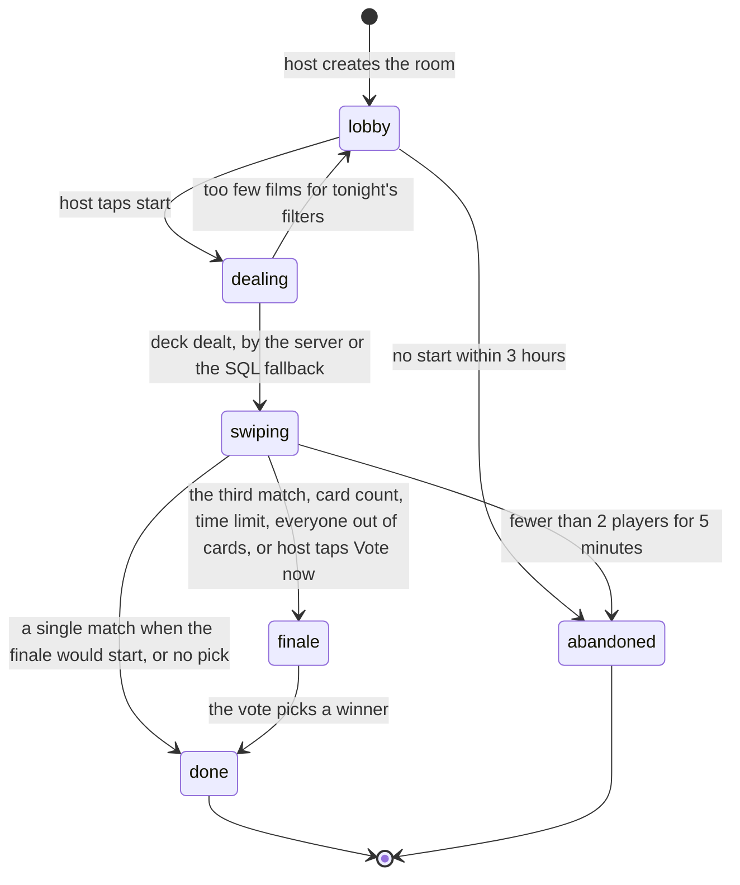

# Game modes and rules of play

The full rules of a game, from the host pressing start to the night's pick and what follows: the launch modes and how later modes slot in, the answers on a card, when a like becomes a match, who counts as present, joining and leaving, what players see in Party and Blind mode, the finale step by step, every way a game can end, the winner screen, and "Did you watch it?". It also specifies, as behaviour, the game functions [schema.sql](../architecture/schema.sql) doesn't have yet. Written on 29 October 2026.

It builds on the revival plan's [Making it fun](revival-plan.md#making-it-fun) and [When is it a match?](revival-plan.md#when-is-it-a-match), the data model's [Rooms and the game](../architecture/data-model.md#5-rooms-and-the-game), [A swipe](../architecture/data-model.md#a-swipe) and [Finale](../architecture/data-model.md#finale), and the [deck engine](../architecture/deck-engine.md). Not covered here: how cards are chosen (the deck engine), screens and app internals (app structure), and the first launch (onboarding). Decisions and open questions are in [decisions.md](../decisions.md); the defaults chosen here are listed in [Defaults chosen in this doc](#defaults-chosen-in-this-doc) and need a yes.

**Changed on 5 November 2026:** a match no longer ends the game in any launch mode. Matches build a shortlist, the third match starts the vote, and every present player with a like gets a finalist they liked (see [up to 3 matches](three-matches-and-fair-finalists.md#decided)). The sections below say so where it applies.

Every number is a starting value to tune in playtests; they are all in [Starting values](#starting-values). The changes this doc needs in the data model are in [Changes to the data model](#changes-to-the-data-model) and aren't applied yet. The [Figma](https://www.figma.com/design/v2ZGLbGmzZ7032V9AI5vWM) was checked for this doc but isn't the source of truth; where this doc follows it, it says so.

## Contents

1. [A game at a glance](#a-game-at-a-glance)
2. [The modes](#the-modes)
3. [The answers](#the-answers)
4. [When it's a match](#when-its-a-match)
5. [Who counts: presence, joining and leaving](#who-counts-presence-joining-and-leaving)
6. [What players see: Party and Blind](#what-players-see-party-and-blind)
7. [The finale](#the-finale)
8. [How a game ends](#how-a-game-ends)
9. [After the pick](#after-the-pick)
10. [Later modes](#later-modes)
11. [Time to a pick](#time-to-a-pick)
12. [Functions still to write](#functions-still-to-write)
13. [Changes to the data model](#changes-to-the-data-model)
14. [Starting values](#starting-values)
15. [Defaults chosen in this doc](#defaults-chosen-in-this-doc)

## A game at a glance

The goal from the [deck engine](../architecture/deck-engine.md#what-the-engine-is-for): everyone says yes to a film within about 5 minutes. The rules below exist to get there and to make sure every game ends with a pick, or with a clear reason why not.

A typical three-player Quick Match:

| Time | What happens |
| --- | --- |
| 0:00 | The host taps start. Everyone sees "Shuffling" for under a second |
| 0:00 to 0:35 | The shared warm-up: the same 10 cards for everyone, in the same order |
| 0:35 to 2:20 | Personal decks. Likes jump into the others' next cards; "2 of 3 of you liked this" pops up |
| About 1:30 | Everyone likes the same film: "It's a match: 1 of 3" on every phone at once. The film joins the shortlist and swiping goes on |
| The third match, or the card count (40, or 30 for 5 to 10 players) | The Final Cut: one 60-second vote between the matches, or between 4 finalists from the swipes if nothing matched, then the winner. A single match by then is the pick, with no vote |

## The modes

| | Quick Match | Final Cut | Date Night |
| --- | --- | --- | --- |
| Players | 2 to 10 | 2 to 10 | Exactly 2 |
| A match | Joins the shortlist; swiping goes on | Joins the shortlist; swiping goes on | Joins the shortlist; swiping goes on |
| Swiping ends | At the third match, or at the card count, the time limit or everyone done | The same | The same |
| With 3 matches | A vote between them | A vote between them | A vote between them |
| With 1 or 2 matches when swiping ends | 1 is the pick, with no vote; 2 go to a vote between them | Seeded first; liked films fill the vote to its size | As Quick Match |
| With no match | The finale from the swipes | The finale from the swipes | The finale from the swipes |
| Matches that end the game (`matches_to_end`) | 3 | 3 | 3 |
| Finale | Final Cut (2 to 4 players), ranked vote (5 to 10) | Final Cut | Final Cut of 3 |
| Seen rule by default | `allow_rewatch` | `allow_rewatch` | `hide_seen` |
| Deck recipe | `quick_match` | `final_cut` | `date_night` |

- **Quick Match** is the default and the fastest. It's tuned for "pick something now": a short shortlist, then a vote.
- **Final Cut** is for groups who always want a vote. It ends like the others, but 1 or 2 matches never pick alone: they are seeded first and liked films fill the vote to its size (default, Harry can reverse, 5 Nov 2026).
- **Matches that end the game** is a setting of each mode, `matches_to_end` in `game_modes.defaults`: 3 for every launch mode (decided on 5 November 2026). A later fast mode (a Blitz) can set 1, and then its first whole-room match is the pick and the room is done, as Quick Match was before.
- **Date Night** is Quick Match for a couple: films neither has seen, a shorter warm-up and a bigger watchlist bonus (see its [recipe](../architecture/deck-engine.md#recipes)).

**Solo** (decided on 5 November 2026, [solo and My films](solo-and-my-films.md#decided)) is a room with one seat, the mode `solo`: one voter, no lobby and no code anyone can join (`api.join_room` answers `not_found`), no match check, no shortlist, no finale, no card count and no time limit. It uses the `hide_seen` rule and super likes have no limit. A card every 20 cards says how many films the player liked and offers Pick one (a film they liked this session becomes the room's pick) or Keep going; leaving ends the room, and so do 30 minutes without a vote. The deal skips films the player answered in an earlier solo room and films in their My films. Solo cards are capped at 100 a day per player (`app_config.solo_daily_cards`); group rooms never count and are never capped. Solo rooms are left out of the group metrics.

Later modes are in [Later modes](#later-modes).

## The answers

| Answer | Gesture | What it does in the game |
| --- | --- | --- |
| **Like** | Swipe right, or the heart button | Counts toward a match. The first like on a film moves it into everyone else's next few cards |
| **Nope** | Swipe left, or the cross | Counts against a match (the player is a voter who didn't like it) |
| **Super like** | The star button; 2 per game | Counts as a like, and double when seeding the finale and breaking its ties. **Default to confirm:** in Party mode the card shows a small star for the other players ("Someone super liked this"), never who |
| **Seen it** | Swipe up, or the eye button | Depends on the room's seen rule (below) |
| **Undo** | The rewind button | Takes back the last swipe (below) |

**Later is not an answer.** The bookmark on a card (front corner and back) saves the film to My films > Later (decided on 6 November 2026). The player still swipes the card; the save counts for nothing tonight, is never broadcast or shown to other players, and changes no deck, count or match.

**Seen it, by seen rule**

| Seen rule | What "Seen it" does |
| --- | --- |
| `hide_seen` (Date Night) | The film leaves the game for everyone: it's dropped from every deck that hasn't reached it. It can't match |
| `allow_rewatch` (the default) and `show_all` | **Decided on 6 November 2026:** one tap on Seen it sends `seen` (a nope) and the card flies up; a chip then offers "Watch it again tonight? Yes", which turns the answer into a like (`seen_rewatch`) for 5 seconds or until the next answer. Either way the film is recorded as seen |

Today the data model makes "Seen it" an abstention under these rules: the film can match without that player. Now that `allow_rewatch` is the default, that would let a film match while someone who has seen it and doesn't want to rewatch it said nothing against it. The seen nope removes abstentions; the chip's Yes costs one tap, only in rooms that allow rewatches. For taste, both answers count as "seen" (0), as the deck engine's [signals](../architecture/deck-engine.md#signals) already say.

**Undo**

- Takes back the player's last swipe only, once: a second undo in a row isn't allowed.
- Only while the room is swiping and the card is still in play. A card that matched or became a finalist can't be undone.
- A super like comes back.
- A like that already moved the film up in other decks leaves it there. That's harmless.
- Undoing a "Seen it" that dropped the film under `hide_seen` brings the film back for the room, unless another player also said "Seen it". Other players get it again at their next refill. A mis-swipe never removes a film for good.

**Super nope: dropped (decided on 29 October 2026).** The revival plan's 5-to-10-player rule said "and nobody used a super nope", but super nope isn't one of the four answers, and the design has none. It's dropped because a fifth gesture costs every new player something to learn, and the deck's misery rule already keeps films anyone is predicted to hate out of the deck. A veto doesn't stand in for it in big groups: Quick Match with 5 to 10 players ends in a ranked vote with no veto, on purpose, so one person can't block a film most of the group wants (reason corrected on 30 October 2026). Playtests should count majority matches that included a nope and how those players answered "Did you watch it?". If that shows a problem, the fix is a tighter majority rule (for example at most one nope), not a new answer.

## When it's a match

A like (or super like, or "Watch it again tonight? Yes") makes a match when the room's rule is met among the **voters**: seats not left and heard from in the last 3 minutes, whether they answered the card or haven't reached it yet. In other words, every voter counts, and only likes help.

| Mode | Players present | A match when | Otherwise, the finale |
| --- | --- | --- | --- |
| Quick Match | 2 | Both like it | Final Cut of 3 |
| Quick Match | 3 to 4 | Everyone likes it | Final Cut of 4 |
| Quick Match | 5 to 10 | At least 70% like it (4 of 5, 5 of 7, 7 of 10) | Ranked vote of 4 |
| Date Night | 2 | Both like it | Final Cut of 3 |
| Final Cut | 2 | Both like it | Final Cut of 3 |
| Final Cut | 3 to 4 | Everyone likes it | Final Cut of 4 |
| Final Cut | 5 to 10 | At least 70% like it | Final Cut of 4 |

When the finale starts is in [The finale](#the-finale); the card counts and time limits are in [Time to a pick](#time-to-a-pick).

- **At least 2 voters.** A group room with one voter can't match. Solo rooms have no match check at all ([the modes](#the-modes)).
- **The rule follows the voters.** It's chosen for the current number of voters, so the 70% rule applies only while 5 or more are voting.
- **A match is checked** after every like, when a player leaves (the players still here may all have liked a film), and by the minute sweeper after a player times out (below).
- **Kinds.** `unanimous` when every voter liked it, `majority` otherwise. Shown as "3 of 3" or "7 of 9".
- **A match joins the shortlist** in every launch mode (decided on 5 November 2026). Every phone gets the shortlisted beat, "It's a match: 1 of 3", with the count ("3 of 3", "7 of 9") and never who said yes. The film leaves every deck and swiping goes on. The swipe screen's top bar shows the shortlist's posters.
- **The third match ends swiping** and starts the finale at once, with reason `shortlist_full`.
- **Several matches at once** (a leave, a removal or the sweeper): most liked first, and the shortlist stops at `matches_to_end`.
- **A mode with `matches_to_end` 1** (none at launch): the first match is the night's pick, the room is done, and every phone shows "It's a match" with where to watch.

**Keep swiping** is dropped (default, Harry can reverse, 5 Nov 2026): swiping already goes on after a match. A group happy with what it has uses Vote now ([When it starts](#when-it-starts)).

## Who counts: presence, joining and leaving

**Present** means seated (not left) and heard from in the last 90 seconds. Phones send a heartbeat every 30 seconds while in a room, and every swipe counts as one. A phone that's locked or in another app should be treated as silent: JavaScript timers can't be relied on while an app is in the background on iOS (community reports and an Expo forum answer, checked on 29 October 2026). Only present players count for the finale's card count and finale ballots. For match rules the voters are the seats not left and heard from in the last 3 minutes (`internal.voter_member_ids`), so a seat silent for 91 seconds is no longer present but still a voter.

| Situation | What happens |
| --- | --- |
| **Joining in the lobby** | Any time, up to the room's maximum (10; 2 for Date Night) |
| **Joining while the deck is dealt** | "Starting" for a second; the phone retries |
| **Joining while swiping** | A late joiner gets the shared opening cards still in play, then their own deck. **Default to confirm:** late joiners don't hold up the finale: the card count applies to players seated when swiping started; the time limit applies to everyone |
| **Joining during the finale** | Refused with "They're voting on the final films". A player who arrives during the finale is refused; they can join the next game with its new code if the host taps Play again (offering it to them in the refusal waits for a later task) |
| **Reconnecting** | Same code, same seat. Votes made offline are queued and retried: a retry the server already has returns "duplicate", a vote after the room was decided returns "closed" and the phone shows the result. The deck continues where it was |
| **Leaving** (the leave button) | The seat stops counting at once. Liked films are re-checked: if everyone still here liked one, that's a match now |
| **Going silent** (phone locked, app killed, no network) | The seat stops counting after 90 seconds for presence and the finale's card count. A silence alone never creates a match until it has lasted 3 minutes, so someone answering a message doesn't come back to a decided room |
| **The host leaves** | The host role moves to the longest-seated player who is present. If nobody else is present, it goes to the longest-seated seat that has not left; if nobody else is seated, no seat holds it |
| **The host goes silent in the lobby** | After 2 minutes, the host role moves the same way, so the room can still start |
| **Fewer than 2 players present while swiping** | If it lasts 5 minutes, the room is abandoned. If someone comes back before that, the game carries on. A player who tapped Leave counts the same as a dropped connection: the room waits the 5 minutes from the moment they left (from 90 seconds after the last sign of life, for a dropped one), so a lone player can still bring someone in by code |

> The host can also remove a player, who can't rejoin, and lock the room against new seats, and anyone can report a player: see [security.md](../architecture/security.md#room-codes-joining-and-the-host). Apple's guideline 1.2 asks for it ([store-listing.md](store-listing.md#passing-review)).

## Genres tonight

Each player can pick genres for tonight in the lobby (decisions.md, 6 November 2026; the genre simulation, "Per-player genres" in [simulations.md](simulations.md), passed the gate). The deck leans toward them; the match rule doesn't change.

- **Which genres:** TMDB's movie genres, but not TV Movie. A genre with fewer than 30 eligible films tonight (the room's services, age cap, time budget and the other filters) isn't offered, so a pick can't starve the deck.
- **Optional, never blocking Start.** At most 3 per player: more is refused (`too_many`), not cut.
- **Counts, never who.** Everyone sees how many players picked each genre, never which ones. A change of picks tells the other phones only that the counts changed (`genres_changed`, no seat), and they read the counts again.
- **Who counts:** the present players who picked. A player who picks nothing doesn't count in the weight, and with no picks at all the deck is exactly today's.
- **Locked at Start.** From Start, a change is refused (`locked`), and the picks of the players present at Start drive the whole game, refills included. A late joiner plays the deck as it is, and can't pick.
- **What the deck does with them:** about 3 cards in 4 come from films matching at least one pick, films matching more players' picks first; 1 in 4 stays open. The shared opening of 10 follows the same mix (8 from the picks), so everyone sees the same start. The details are in [deck-engine.md](../architecture/deck-engine.md#per-player-genres).

## What players see: Party and Blind

The host chooses before the start. Party is the default.

| Moment | Party | Blind |
| --- | --- | --- |
| While swiping | "2 of 3 of you liked this" on a film one like short of a match (at least 2 likes), shown only on the card of each player who hasn't answered it, when it's their top card ([the near miss](../design/moments.md#the-near-miss)). No star on super-liked cards in the first release | Nothing about other players' answers |
| Progress | Avatars with how far each player is, "Sam is done" | Same |
| A match that joins the shortlist | The shortlisted beat: the film and how many said yes ("3 of 3", "7 of 9"). Never who said yes | Same |
| A match that is the pick | The film, how many said yes ("3 of 3", "7 of 9") with every seated player's avatar in seat order and no marks, then where to watch. Never who said yes | The film, how many said yes ("7 of 9"), where to watch |
| The finale | Who has locked in their vote (not what). After the close: vetoed films shown as knocked out, without saying by whom, in every room size; each film's points only when at least 3 ballots were counted, never on a knocked-out film (decided on 4 November 2026) | Same |
| The winner screen | Runners-up with who liked them, as in the current design | Runners-up with how many liked them |

Never shown in either mode: who noped a film, anyone's taste check answers, or another player's swipes while the game is running. A match never shows who said yes: in a majority match ("7 of 9") that would show who didn't (decided on 4 November 2026). Showing who liked the runners-up after the pick is a change: the data model says answers reach phones only as counts (see [Changes to the data model](#changes-to-the-data-model)).

## The finale

### When it starts

The first of these:

| Trigger | Rule |
| --- | --- |
| Card count | Every present player seated at the start has answered the rule's number of cards |
| Time limit | 6 minutes since swiping started, for every rule ([Time to a pick](#time-to-a-pick)) |
| Everyone out of cards | Every present player has run out and no refill brings more (see [How a game ends](#how-a-game-ends)) |
| The third match | Every mode: as many matches as its `matches_to_end` (decided on 5 November 2026) |
| The host taps **Vote now** | **Default to confirm:** once every present player has answered at least 10 cards and at least 2 films have a like, or once the room has a match (default, Harry can reverse, 5 Nov 2026). The same button appears on the "Nothing left" screen, as in the current design |

The card count and Vote now are checked after every vote; the time limit by the minute sweeper as well.

**With fewer matches than `matches_to_end`** when the finale starts (defaults, Harry can reverse, 5 Nov 2026): in Quick Match and Date Night, a single match is the pick with no vote (the `match` event carries `reason: 'only_match'`, and phones play "It's a match"), and 2 matches go to a vote between them. In Final Cut mode they are seeded first and the vote is filled ([The finalists](#the-finalists)). With no match, every mode builds the finalists from the swipes.

**A player who reaches the card count keeps swiping** (decided on 30 October 2026). The card count waits for every present player seated at the start, so the faster players carry on, and their extra answers can still make a match. In the [simulation](simulations.md), making them wait added up to 10 points of Final Cuts.

### The finalists

**A vote between matches** (defaults, Harry can reverse, 5 Nov 2026): with 3 matches in every mode, or 2 in Quick Match and Date Night, the candidates are the matches only, most liked first, then group score, then the lowest id. With 2 films the round is "Pick one" without a veto (kind `ranked_vote`): a veto between two films is a second vote for the other.

**Otherwise**, 3 for 2 players, 4 otherwise. In order:

1. Shortlisted films (matches), most liked first.
2. **One seat each** (default, Harry can reverse, 5 Nov 2026): the liked film that gives a seat to the most present players who have none yet, ties to rule 3's order. Repeated until every present player with a like has a finalist they liked, or the list is full. A player who liked nothing gets no seat; a player who left doesn't count.
3. Films with at least one like, by likes + 2 × super likes - nopes, then by the deck's group score.
4. If that gives fewer than the finalist count: films nobody has noped yet, by group score, until the list is full (decided on 30 October 2026: a full list gives a real choice).

Built in M6.4 (`internal.start_finale`), with rule 2 added in M6.36 (a seat is present when it is not left and was heard from in the last 90 seconds; a like is `like`, `super_like` or `seen_rewatch`; a liked match counts as that player's finalist; the rule reads `votes` inside Postgres only): rule 3 needs at least one like, rule 4 never takes a noped film (a plain "Seen it" in a room that allows rewatches counts as a nope), and dropped cards are never finalists. Ties go to the deck's group score, then the lowest film id. A film everyone noped is never a finalist.

If only one film qualifies, it's the pick without a vote ("The only film anyone liked"). If none qualifies, the game goes to [No pick](#how-a-game-ends).

**How the films were chosen** is said once on the Final Cut's intro, the same line in every room: "From your likes, with one for each of you when we can." No phone marks a finalist as anyone's, not even its own player's: on a couch a neighbour sees your screen (default, Harry can reverse, 5 Nov 2026).

### The vote: "Pick one. Veto one."

**Decided on 30 October 2026:** one round of 60 seconds, rather than the data model's veto stage (45 seconds) followed by a ranking stage (60 seconds). The current design has 45 seconds; in the [simulation](simulations.md), up to 7% of ballots missed a 45-second close and up to 2% a 60-second one, for at most 5 more seconds, since the round closes as soon as everyone locks in. The first playtest measures lock-in times. Everyone does both at once:

- **Order the finalists.** Tap the posters in order. The first gets as many points as there are films, the last gets 1.
- **Veto one** (Final Cut only, one per game). Long-press a poster. A vetoed film can't be in that player's order. Until lock-in, a long press on the vetoed poster lifts the veto and a long press on another poster moves it; the veto is spent at lock-in (decided on 4 November 2026).
- **Lock in.** A ballot can't be changed afterwards. Locking in without reordering keeps the order shown, which is the seed order.
- **Ranked vote** (Quick Match with 5 to 10 players) is the same screen without the veto.

The round closes when every present player has locked in, or when the 60 seconds are up. A player who doesn't lock in simply doesn't count.

### Counting

1. **Vetoes first, revealed together** (vetoes are secret until the round closes, so nobody races to veto first):
   - If 2 or more finalists got no veto, only they stay in.
   - If exactly 1 finalist got no veto, it wins: "The only film nobody vetoed".
   - If every finalist got a veto, the 2 with the fewest vetoes stay in (ties go to the better seed).

   This replaces the data model's "a veto can't remove the last two films standing", which could ignore a veto even when one film nobody vetoed was left.
2. **Points** among the films still in: each ballot's order is read over those films only (the first of them gets as many points as there are films still in, down to 1), and the points are added up. A film still in that this ballot vetoed comes last in its order, with the fewest points (decided on 30 October 2026).
3. **Ties** go to the film with more super likes in the room, then more likes, then the higher group score, then the better seed.
4. **Nobody voted:** the best seed still in wins.

A ballot locked in before its player left still counts. The result is broadcast as a match of kind `finale`, and the room is done.

**What it costs:** the finale takes at most 60 seconds plus the reveal, and usually closes early once everyone has locked in.

## How a game ends

| End | When | Room state | The pick | Phones show |
| --- | --- | --- | --- | --- |
| **A single match** | The finale would start with exactly one match, in Quick Match or Date Night; or any match in a mode with `matches_to_end` 1 | `done` | The match | "It's a match", then the winner screen |
| **Finale pick** | The vote closes | `done` | The winner | The winner, then the winner screen |
| **No pick** | Everyone is out of cards and no film has a like, and the host doesn't change the filters within 5 minutes; or the finale has no film to show | `done`, outcome `no_pick` | None | "Nothing fits tonight": change the filters or play again |
| **Abandoned** | A lobby not started within 3 hours; fewer than 2 players present for 5 minutes while swiping; or a game still running 1 hour after the start | `abandoned` | None | "Room closed" |

**Running out of cards** (the "Nothing left" screen in the design):

- A player whose deck is empty, after a refill and the SQL fallback brought nothing, is marked done and sees what caused it: tonight's filters and how many films the room has liked.
- **How done is decided (M6.29).** A seat is done when it has no unanswered card and the SQL baseline, tried right then for that seat, deals it nothing (`room_members.done_at`). It is checked in `api.cast_vote` after a vote leaves 0 cards, and in `api.request_cards`. Under `deck_engine` `server` a queued refill holds it back until the 8-second second call runs the baseline and it deals nothing. `api.request_cards` then answers `done` with `liked`, the room's films with a like (a count, never which films or who). An undo that gives a card back clears `done_at`. Every present seat counts for "everyone done", a late joiner included; the finale's reason is `all_done`, and the card count or time limit wins when it also holds on the same vote.
- The **host** can tap **Change filters**. **Default to confirm:** the host may change the time budget, moods, quality, seen rule and services during swiping, not only in the lobby; every deck is re-ranked at once (the 3 mounted cards stay). Or the host can tap **Vote now**.
- When every present player is done, the finale starts by itself if any film has a like; otherwise the room waits for the host for 5 minutes, then ends with no pick.

**Too few films at the start.** If tonight's filters leave fewer than 20 eligible films, the deck isn't dealt: the room goes back to the lobby with "Only 12 films fit: loosen a filter", and the host adjusts. `internal.deal_cards` does this (M5.5): `start_game` answers `too_few_films` with `eligible`, `state_changed` carries `reason` and `eligible`, and the attempt is logged in `rec.requests`. Refills and late joiners deal whatever there is.

**The 1-hour limit.** A room's `expires_at` is set 3 hours after creation, and `internal.begin_swiping` moves it to 1 hour after swiping begins, so a lobby left open for 2 h 55 min isn't abandoned 5 minutes into its game. It is far beyond any real game: it only cleans up rooms nobody closed. If films have likes at that point, the finale starts instead.

`rooms.stats` records the outcome (`match`, `finale`, `no_pick`, `abandoned`) next to the duration, swipes and players.

## After the pick

**The winner screen** (as in the current design):

- **Where to watch.** The logos of the room's services that have the film, free services included, with the JustWatch credit and TMDB's watch page as "More details". No "Open in Netflix" link: the group watches on the TV. A "Not there anymore?" link reports a stale listing ([tmdb.md](../integrations/tmdb.md#the-watch-link)).
- **Log on Letterboxd**, through `letterboxd.com/tmdb/{tmdb_id}`.
- **Share recap**: a card with the film, the time from the start to the pick ("3 min 42 s"), the number of players and swipes, and the app link.
- **Runners-up**: the other finalists (or, after a single match, the most liked films), for when the stream turns out to be missing.
- **Play again**, for the host. **Default to confirm:** it opens a new room with the same mode and settings, and every phone still on the old room's screen gets "Harry started another game: Join". Players who joined during the finale were offered this.

**End-of-room work** (`room_finished`) runs once the room is done: the recap stats, "Seen it" answers saved as seen, `card_history`, and a taste refresh for every player.

**"Did you watch it?"**

- **When.** On the first app open at least 3 hours after the pick, or from a reminder notification scheduled on the phone for the next day, if the player allows notifications. Asked once per player per game. It's skippable, and it expires after 7 days.
- **Answers.** Yes, then Love it, It's fine or Not for me; No; or Something else.

| Answer | Effect |
| --- | --- |
| Yes, with a reaction | The film is seen, and the reaction is a real opinion for taste (it beats any swipe). Card memory treats it as seen |
| No | The pick becomes `picked_not_watched` in card memory: it can come back soon, as a [Rematch](../architecture/deck-engine.md#rematch) |
| Something else | As No, for now. Asking which film they watched instead could come later |

## Later modes

Each one changes a recipe, a rule or a seed row, as the data model's [Later](../architecture/data-model.md#later-how-each-future-feature-lands) section planned.

| Mode | Source | Rules that differ |
| --- | --- | --- |
| Watchlist Showdown | Revival plan, free | Quick Match rules, but cards come only from films on 2 or more players' watchlists. When those run out, the finale starts early instead of "Nothing left" |
| Pick for me (solo) | Revival plan, Pro | Replaced by the free solo mode at launch ([the modes](#the-modes)), decided on 5 November 2026. Pro lifts its daily cap (M21) |
| Family profiles and Parent veto | Monetization, Pro | Kids' seats have no veto; each parent has 1. The youngest player sets the age cap |
| Kid's choice night | Monetization, Pro | One seat's likes count double in the match rule and in the finale's points |
| Tournament bracket | Monetization, Pro | The finale is 8 or 16 films, two at a time, each heat a round of the same vote |
| Double feature | Monetization, Pro | The finale picks 2 or 3 films that fit the time budget together (`pick_order` 2 and 3) |
| Pass and play | Monetization, Pro | One phone controls several seats, with a cover screen between players; presence is the phone's |
| Venue mode | Monetization, pilot | 20 to 200 voters; majority rules and a ranked vote only. Likely needs the room server mentioned in the revival plan |

## Time to a pick

Decided on 30 October 2026, from the [simulation](simulations.md) (its bot tastes, swipe speeds and voting times are made up; playtests replace them). The slowest present player decides when the card count is reached.

| Rule | Before | Decided | Worst case |
| --- | --- | --- | --- |
| Quick Match, 2 | 40 cards, no time limit | 40 cards or 6 minutes | About 7 minutes |
| Quick Match, 3 to 4 | 50 cards or 8 minutes | 40 cards or 6 minutes | About 7 minutes |
| Quick Match, 5 to 10 | 50 cards or 10 minutes | 30 cards or 6 minutes | About 7 minutes |
| Date Night | 40 cards, no time limit | 40 cards or 6 minutes | About 7 minutes |
| Final Cut, 2 to 10 | 30 cards or 10 minutes | Third match, 30 cards or 6 minutes | About 7 minutes |
| The finale | Veto 45 s, then rank 60 s (ranked vote: 60 s) | One round of 60 s | 60 s |

What the simulation says:

- **Every size picks in time.** With these values, groups of 2 to 10 pick at a median under 5 minutes and a 90th percentile under 7, at every level of agreement.
- **The card count is the lever.** It waits for the slowest player, so with 40 cards, groups of 8 to 10 who disagree picked within 5 minutes in only 61 to 70% of games; with 30 cards, in 92 to 94%, for 2 to 7 points more Final Cuts.
- **The time limit is a safety net,** not a pace-setter: it fired in at most 1% of games, and 7 minutes for big groups changed nothing compared with 6. One limit for every rule is simpler.
- **The deck engine's phases follow automatically**, since they're a share of the card count: the narrowing phase ends at card 24 of 40, or 18 of 30.

**With up to 3 matches** (5 November 2026), the third match or the card count ends swiping in every mode. In the [proposal's simulation](three-matches-and-fair-finalists.md#the-simulation), with medium agreement and 2 to 6 players, the median time to a pick goes from 0:28 to 2:38 to 1:58 to 3:28, and 95 to 100% of games still pick within 5 minutes. The worst case doesn't change. Bot tastes are made up there too.

**With per-player genres** (6 November 2026, M6.52), the [genre simulation](simulations.md#per-player-genres) finds split picks within a few seconds of today's deck at every size, 3:34 at the median at worst (4 players), so the under-5-minute gate passes. Shared picks are faster: with 8 players, games without a match fall from 13% to 9%. Bot tastes and the catalog are made up.

## Functions still to write

Behaviour only; the SQL comes with the schema update. All of them take the room lock, like `api.cast_vote`, so they can't race a vote.

### `api.cast_ballot(round, ranking, veto)`

One call per player with the whole ballot. This replaces the data model's one-row-at-a-time `cast_ballot(round, kind, title, rank)`, so a ballot can't be half saved.

| | |
| --- | --- |
| Input | The round, the full order of the films still in it, and an optional vetoed film |
| Refused | Not a seat in the room, or the seat has left (`not_in_room`); the round is closed or more than 2 seconds past its deadline (`closed`); the seat already voted (`already_voted`); the order isn't exactly the round's films minus the veto (`invalid`); a veto in a ranked vote, or with no veto left (`no_veto`) |
| Writes | One `rank` row per film in the order, one `veto` or `pass` row. A veto spends the seat's `vetoes_left` |
| Broadcasts | `round_progress`: which seats have locked in, out of how many present (never what they voted) |
| Then | If every present seat has locked in, closes the round now (at least one seat must be present: with every present seat gone, the round closes at its deadline) |

The deadline for a ballot is `stage_closes_at` plus a 2-second grace, so a ballot sent at zero always counts. A seat that left can't vote (`not_in_room`, a status); a seat that rejoins during the round can. `of` counts present seats only, and any present seat may vote, silent or not. Answers: `ok` with `locked` (seat ids) and `of`. Done in M6.5.

### `api.close_round_stage(round)` and `internal.close_round_stage(round)`

Every phone counts down from `stage_closes_at` and calls `api.close_round_stage` at zero. It closes the round only if the deadline (`stage_closes_at` plus the 2-second grace) has passed or every present seat has locked in (`not_yet` with `closes_at` otherwise, `closed` when it was already closed), and it does nothing if the round is already closed, so several phones calling it at once is harmless. The minute sweeper is only the backstop: on its own it could close a 60-second round a minute late.

Closing a round:

1. Applies the vetoes, the points and the tie rules from [Counting](#counting). It writes each finalist's `points` and `vetoed_at`; `vetoed_by` is stored but never sent to phones.
2. Sets the round's `winner_title_id`, `closed_at` and stage `closed`.
3. Inserts the pick into `matches` (kind `finale`, `pick_order` 1, likes and present count from the card) and sets the room to `done`.
4. Broadcasts `match` with kind `finale`, `decided` true, the winner and every finalist's points and whether it was vetoed.

Edge cases: no ballots (the best seed wins); every present seat has left (it still closes at the deadline); a seat rejoins during the round (it can vote while the round is open).

### `api.round_progress(round)`

For a phone that restarted: `ok` with the `stage`, `closes_at`, `locked` (seat ids), `of` (seats present) and `me_locked`. Never what anyone voted. Done in M6.5.

On a finalist, `vetoed_at` (and `vetoed` in `api.round_candidates`) means the film was knocked out by the vetoes at the close, not that someone vetoed it: it is empty until the round closes. `api.room_seats` shows `vetoes_left` and `super_likes_left` only on the caller's own seats, so a spent veto never shows who vetoed.

### `api.start_finale_now(room)`

The host's **Vote now**. Host only, room swiping, and either every present seat has answered at least 10 cards and at least 2 films have a like, or the room has a match (5 Nov 2026). Otherwise it returns `not_yet` with the reason, which the button shows. Then it calls `internal.start_finale`.

### `api.keep_swiping(room)`

**Dropped on 5 November 2026** (default, Harry can reverse): a match no longer ends the game, so there is nothing to reopen. Kept here for the record:

Host only. The room is `done` through an instant match decided less than 60 seconds ago. It sets the room back to swiping, clears the match's `pick_order` (the match stays, as a shortlisted film), clears `decided_at` and `ended_at`, and broadcasts `state_changed` swiping. Phones go back to their decks where they left off.

### `api.play_again(room)`

Host of a `done` or `abandoned` room. Creates a room with the same mode, country and settings (services rule, offered kinds, time budget, seen rule, quality, age cap, reveal, player limit), unlocked, with the caller as host and the moods of the caller's old seat (other players choose again). Broadcasts `next_room` (`room_id`, `code`, `host_member_id`: the host's seat in the old room, never a name) on the old room's topic, so the other phones can offer "Join". Answers `ok` with `room_id` and `code`, `not_finished` (the room is still in play), `unknown_mode` (a solo room) or `name_required`; anyone but the host raises 42501. A repeat call while the next room is open returns it and sends the event again; an ended next room is replaced. The old room keeps `next_room_id`, and `api.rooms` shows it with `next_room_code` (the code while that room is open) for phones that missed the event. Players join with `api.join_room(code, room_id, 'play_again')`.

### `api.start_solo(settings)`

Opens and starts a solo room in one call (M6.40): no lobby, no invite, no host handover. The room still draws a code, and nobody can use it. At most 20 calls per 10 minutes per profile (`rate_limited`).

| | |
| --- | --- |
| Refused | No name (`name_required`), no country (`country_required`), settings that fail `internal.room_settings_error` or a `seen_rule` other than `hide_seen` (`invalid_settings` with the `field`) |
| Writes | The caller's other live solo room ends first, as `api.leave_room` ends it (one solo session at a time). Then one room in mode `solo` (`service_rule` `any_member`, `rule` null) and one host seat with `super_likes_left` 32767. The start goes through `api.start_game` unchanged |
| Answers | `ok` with `room_id`, `member_id` and `state` `swiping`; `dealing` with `room_id` and `member_id` under the server's deck engine; `too_few_films` with `eligible` (the new room is `abandoned`, not back in the lobby) |

`api.create_room('solo')` keeps answering `unknown_mode`: the mode's row has `is_active` false, so it isn't in `api.game_modes` either. `api.join_room` and `api.room_preview` treat a solo room as a code nobody holds (`not_found` or `closed`, the answers for a room that doesn't exist), for everyone, its player included. A refused join counts as a failed attempt.

### `api.solo_pick(room, title)`

The pick of a solo room (M6.40). The caller needs a live seat in the room (otherwise 42501); a room that isn't solo raises 22023. The film must carry a like or super like from the seat that still exists (`not_liked` otherwise, an undone like included). Writes the `matches` row (kind `unanimous`, 1 like, 1 present, `pick_order` 1, no `matched_at`), the card `matched`, and the room `done` with `decided_at` and `ended_at`; broadcasts `state_changed` done. A retry for the same film once done answers `ok`; anything else on a room that isn't swiping answers `closed` with the `state`.

### `internal.sweep_rooms()`

Runs every minute. Each room is handled in its own short transaction, skipping rooms another transaction has locked (they'll come round next minute), in batches, so the sweeper never holds up a vote.

`internal.sweep_rooms()` is a procedure (cron calls it; it commits after each room, in batches of 100). The work for one room is `internal.sweep_room(room)`, which answers what it did: `abandoned`, `host_changed`, `dealt`, `finale`, `no_pick`, `closed_round`, `rechecked`, `ended`, `locked` or `nothing`. **One action per room per run**, in this order: close an expired round (two seconds after its deadline); abandon (fewer than 2 seats present for 5 minutes: a dropped seat stops being present 90 seconds after it was last heard from, a seat that left the moment it left; or the 1-hour limit with nothing liked); the 1-hour finale; the re-check of liked films for a seat silent 3 minutes (once per silence, tracked by `room_members.silence_checked_at`); the room's own finale rules (`maybe_start_finale`, which also covers the time limit and everyone done); the everyone-done ending with no pick. The next row waits for the next minute, so a room nobody is in never opens a vote and a live round is never abandoned. A finale with no open round is abandoned at the 1-hour limit. A swiping solo room has one row of its own and none of the others: it ends `done`, with no pick, when its latest `swipe_log` row (a vote or an undo; the heartbeat doesn't count), or else `started_at`, is 30 minutes old. It is never abandoned for fewer than 2 seats present, never reaches the 1-hour limit or a finale, and has no no-pick wait.

| Rooms | Check | Action | Broadcast |
| --- | --- | --- | --- |
| Lobby or dealing, past `expires_at` | 3 hours without a start | `abandoned` | `state_changed` |
| Lobby, host silent for 2 minutes | | Host role to the longest-seated present player | `host_changed` |
| Dealing for over 20 seconds | The host's phone didn't retry (it may be dead) | Deal the SQL baseline | `state_changed` swiping |
| Swiping | Time limit reached | `maybe_start_finale` | `finale_started` |
| Swiping | A seat went silent 3 minutes ago or more and hasn't been re-checked | Re-check liked films for a match | `match` |
| Swiping | Every present seat done | Finale if any film has a like; otherwise, after 5 minutes, `done` with no pick | `finale_started` or `state_changed` |
| Swiping | Fewer than 2 present for 5 minutes | `abandoned` | `state_changed` |
| Swiping or finale, past the 1-hour limit | | Finale if films have likes and the room is swiping, otherwise `abandoned` | `finale_started` or `state_changed` |
| Finale, round past its deadline | No phone closed it | `internal.close_round_stage` | `match` |
| Swiping, solo | 30 minutes since the latest swipe, else since the start | `done`, no pick (`ended`) | `state_changed` |

### Changes to functions already written

| Function | Change |
| --- | --- |
| `internal.start_finale` | Finalists as in [The finalists](#the-finalists); one combined round of 60 seconds; a single qualifying film is the pick |
| `internal.maybe_start_finale` | Card count over seats seated at the start only; every rule's time limit; also starts when every present seat is done |
| `internal.check_card_match` | Counts "Watch it again tonight? Yes" as a like; no more abstentions. A match joins the shortlist; at the mode's `matches_to_end` it calls `internal.start_finale` with reason `shortlist_full`; several matches at once go most liked first (5 Nov 2026) |
| `internal.start_finale` (again) | A vote between 2 or 3 matches; a single match is the pick in Quick Match and Date Night (`only_match`); Final Cut mode fills; the one-seat-each rule (5 Nov 2026). Done in M6.35 (M6.36 for the one-seat-each rule) |
| `api.cast_vote` | Accepts the rewatch answer in rooms that allow rewatches |
| `api.undo_last_vote` | Last swipe only, once; undoing a "Seen it" brings a dropped film back |
| `api.leave_room` | Host role to the longest-seated present player |
| `api.update_room_settings` | Host may change filters while swiping; every seat's deck is re-ranked |
| `internal.begin_swiping` | Sets `expires_at` to 1 hour after the start |
| `internal.deal_cards`, `internal.deal_baseline` | Fewer than 20 eligible films at the start: back to the lobby with the reason, instead of dealing |
| `internal.maybe_start_finale`, `api.join_room`, `api.room_preview`, `api.leave_room`, `internal.deck_candidates` | The solo mode (M6.40): no finale; invisible to join and preview; leaving ends the room; the deal skips films answered in earlier solo rooms |

## Changes to the data model

Not yet in [data-model.md](../architecture/data-model.md) or [schema.sql](../architecture/schema.sql). None needs a migration: nothing is live.

| Where | Change |
| --- | --- |
| `vote_answer` | Add `seen_rewatch` ("Watch it again tonight? Yes", counts as a like and as seen). `seen` in rooms that allow rewatches counts as a nope |
| `round_stage` | One open stage, `vote`, then `closed`. `veto` and `rank` stay in the type, unused, since migrations only add (decided on 4 Nov 2026). Done in M6.4: `vote` is added |
| `rooms.finale_reason` | Why the finale started: `cards`, `time`, `all_done`, `vote_now` or `shortlist_full` (`cards` when the count and the time limit hold together). Done in M6.4; written for a round, a single-film pick and a no pick alike |
| `match_rules` | `finale_after_seconds` on every row (see [Time to a pick](#time-to-a-pick)); 40 cards for Quick Match with 2 to 4 players and Date Night, 30 for Quick Match with 5 to 10 and for Final Cut |
| `rooms.stats` | Adds `outcome`: `match`, `finale`, `no_pick` or `abandoned`, and the number of matches (5 Nov 2026). Done in M6.34; M6.35 checked it for `only_match` and a vote between 2 matches |
| `game_modes.defaults` | Adds `matches_to_end`: 3 for `quick_match`, `final_cut` and `date_night`; a missing value means 3. `ends_on_first_match` stays in the table, false for every launch mode, since migrations only add (5 Nov 2026). Done in M6.34, M6.35 |
| New functions | `api.cast_ballot` (whole ballot, done in M6.5), `api.close_round_stage` and `api.round_progress` (done in M6.5), `api.start_finale_now`, `api.play_again`, `internal.close_round_stage` (done in M6.5), `internal.sweep_rooms` |
| Realtime | New `next_room` (code of the new room) and `host_changed`. `round_progress` carries which seats have locked in. `match` for a finale carries the points and vetoes |
| Card payload | A `super_liked` flag in Party mode |
| Who sees what | In Party mode, the winner screen may show who liked each runner-up, after the pick. Swipes still never reach phones while the game runs. Done in M6.48: `api.room_runners_up` names only the likers, in Party; Blind gets counts |
| `rooms.expires_at` | Moved to 1 hour after the start when swiping begins |

## Starting values

All placeholders until playtests.

| Value | Start |
| --- | --- |
| Super likes per game | 2 |
| Vetoes per game | 1 |
| Heartbeat | Every 30 seconds |
| Present | Heard from in the last 90 seconds |
| A silence can create a match after | 3 minutes |
| Host handover when the host is silent in the lobby | 2 minutes |
| Near-miss teaser | One like short of the match rule, with at least 2 likes; Party mode only |
| Majority rule, 5 to 10 players | 70% of voters |
| Matches that end the game (`matches_to_end`) | 3 for every launch mode; 1 for a later fast mode |
| Finalists | 3 for 2 players, 4 otherwise; with 2 or 3 matches, the matches only |
| Finale card count | 40 for Quick Match with 2 to 4 players and Date Night; 30 for Quick Match with 5 to 10 and for Final Cut |
| Finale time limit | 6 minutes for every rule |
| The vote | One round of 60 seconds; 2 seconds of grace for late ballots |
| Vote now | After 10 cards each and 2 liked films, or once the room has a match |
| Too few films to start | Fewer than 20 eligible |
| Genres per player | At most 3, optional; TV Movie never offered |
| A genre is offered | With 30 eligible films or more tonight |
| Everyone out of cards, nothing liked | 5 minutes for the host to change filters |
| Fewer than 2 players present | 5 minutes, then abandoned (not in a solo room) |
| Solo room without a vote | 30 minutes, then done |
| Solo super likes | 32767 (no limit) |
| Solo starts | 20 per 10 minutes per profile |
| Solo cards a day | 100 per player, counted per Paris day on answered solo cards (`app_config.solo_daily_cards`); group play is never capped; undo gives nothing back |
| Lobby expiry | 3 hours |
| Game limit | 1 hour after the start |
| Server silence before the phone deals the SQL baseline | 8 seconds (already in the data model) |
| Dealing before the sweeper deals the SQL baseline | 20 seconds |
| "Did you watch it?" | From 3 hours after the pick; expires after 7 days |

## Defaults chosen in this doc

Each needs a yes; they're listed in [decisions.md](../decisions.md) once reviewed.

| Default | Section |
| --- | --- |
| "Seen it" in rooms that allow rewatches asks "Watch it again tonight?"; no more abstentions | [The answers](#the-answers) |
| Undo: last swipe only, once; undoing "Seen it" brings a dropped film back | [The answers](#the-answers) |
| Super-liked cards show a star to the others in Party mode | [The answers](#the-answers) |
| Final Cut mode fills its vote when it has 1 or 2 matches (replaces "starts its finale as soon as the shortlist is full", 5 Nov 2026) | [The modes](#the-modes) |
| Late joiners don't hold up the finale's card count | [Who counts](#who-counts-presence-joining-and-leaving) |
| A silence creates a match only after 3 minutes | [Who counts](#who-counts-presence-joining-and-leaving) |
| Party mode shows who liked the runners-up after the pick | [What players see](#what-players-see-party-and-blind) |
| The host's Vote now, after 10 cards each | [The finale](#the-finale) |
| The host can change filters while swiping | [How a game ends](#how-a-game-ends) |
| Play again opens a new room and invites everyone | [After the pick](#after-the-pick) |
