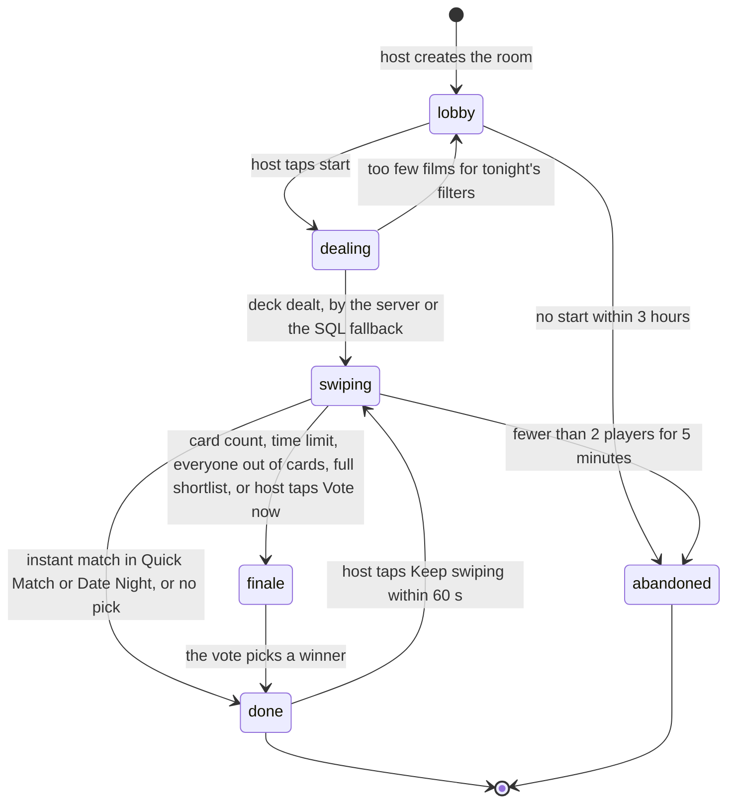

# Game modes and rules of play

The full rules of a game, from the host pressing start to the night's pick and what follows: the launch modes and how later modes slot in, the answers on a card, when a like becomes a match, who counts as present, joining and leaving, what players see in Party and Blind mode, the finale step by step, every way a game can end, the winner screen, and "Did you watch it?". It also specifies, as behaviour, the game functions [schema.sql](../architecture/schema.sql) doesn't have yet. Written on 29 October 2026.

It builds on the revival plan's [Making it fun](revival-plan.md#making-it-fun) and [When is it a match?](revival-plan.md#when-is-it-a-match), the data model's [Rooms and the game](../architecture/data-model.md#5-rooms-and-the-game), [A swipe](../architecture/data-model.md#a-swipe) and [Finale](../architecture/data-model.md#finale), and the [deck engine](../architecture/deck-engine.md). Not covered here: how cards are chosen (the deck engine), screens and app internals (app structure), and the first launch (onboarding). Decisions and open questions are in [decisions.md](../decisions.md); the defaults chosen here are listed in [Defaults chosen in this doc](#defaults-chosen-in-this-doc) and need a yes.

Every number is a starting value to tune in playtests; they are all in [Starting values](#starting-values). The changes this doc needs in the data model are in [Changes to the data model](#changes-to-the-data-model) and aren't applied yet. The [Figma](https://www.figma.com/design/v2ZGLbGmzZ7032V9AI5vWM) was checked for this doc but isn't the source of truth; where this doc follows it, it says so.

## Contents

1. [A game at a glance](#a-game-at-a-glance)
2. [The modes](#the-modes)
3. [The answers](#the-answers)
4. [When it's a match](#when-its-a-match)
5. [Who counts: presence, joining and leaving](#who-counts-presence-joining-and-leaving)
6. [What players see: Party and Blind](#what-players-see-party-and-blind)
7. [The finale](#the-finale)
8. [How a game ends](#how-a-game-ends)
9. [After the pick](#after-the-pick)
10. [Later modes](#later-modes)
11. [Time to a pick](#time-to-a-pick)
12. [Functions still to write](#functions-still-to-write)
13. [Changes to the data model](#changes-to-the-data-model)
14. [Starting values](#starting-values)
15. [Defaults chosen in this doc](#defaults-chosen-in-this-doc)

## A game at a glance

The goal from the [deck engine](../architecture/deck-engine.md#what-the-engine-is-for): everyone says yes to a film within about 5 minutes. The rules below exist to get there and to make sure every game ends with a pick, or with a clear reason why not.

A typical three-player Quick Match:

| Time | What happens |
| --- | --- |
| 0:00 | The host taps start. Everyone sees "Shuffling" for under a second |
| 0:00 to 0:35 | The shared warm-up: the same 10 cards for everyone, in the same order |
| 0:35 to 2:20 | Personal decks. Likes jump into the others' next cards; "2 of 3 of you liked this" pops up |
| About 2:00 | Everyone likes the same film: "It's a match" on every phone at once, and the game is over |
| If no match by the card count (40 proposed) | The Final Cut: one 45-second vote between 4 finalists, then the winner |

## The modes

| | Quick Match | Final Cut | Date Night |
| --- | --- | --- | --- |
| Players | 2 to 10 | 2 to 10 | Exactly 2 |
| Ends | At the first match | After a vote between the shortlist | At the first match |
| A match | Is the pick | Joins the shortlist; swiping goes on | Is the pick |
| Without a match | The finale starts at the card count or time limit | The finale starts when the shortlist is full, or at the card count or time limit | As Quick Match for 2 |
| Finale | Final Cut (2 to 4 players), ranked vote (5 to 10) | Final Cut | Final Cut of 3 |
| Seen rule by default | `allow_rewatch` | `allow_rewatch` | `hide_seen` |
| Deck recipe | `quick_match` | `final_cut` | `date_night` |

- **Quick Match** is the default and the fastest. It's tuned for "pick something now".
- **Final Cut** is for groups who want to see a few options before choosing. Swiping builds a shortlist of matches; the finale chooses between them. **Default to confirm:** the finale starts as soon as the shortlist holds as many films as the finale (4), rather than always waiting for 30 cards, so a group that agrees fast isn't kept swiping.
- **Date Night** is Quick Match for a couple: films neither has seen, a shorter warm-up and a bigger watchlist bonus (see its [recipe](../architecture/deck-engine.md#recipes)).

Later modes are in [Later modes](#later-modes).

## The answers

| Answer | Gesture | What it does in the game |
| --- | --- | --- |
| **Like** | Swipe right, or the heart button | Counts toward a match. The first like on a film moves it into everyone else's next few cards |
| **Nope** | Swipe left, or the cross | Counts against a match (the player is a voter who didn't like it) |
| **Super like** | The star button; 2 per game | Counts as a like, and double when seeding the finale and breaking its ties. **Default to confirm:** in Party mode the card shows a small star for the other players ("Someone super liked this"), never who |
| **Seen it** | Swipe up, or the eye button | Depends on the room's seen rule (below) |
| **Undo** | The rewind button | Takes back the last swipe (below) |

**Seen it, by seen rule**

| Seen rule | What "Seen it" does |
| --- | --- |
| `hide_seen` (Date Night) | The film leaves the game for everyone: it's dropped from every deck that hasn't reached it. It can't match |
| `allow_rewatch` (the default) and `show_all` | **Default to confirm:** the card asks one more question, "Watch it again tonight?". Yes counts as a like, No as a nope. Either way the film is recorded as seen |

Today the data model makes "Seen it" an abstention under these rules: the film can match without that player. Now that `allow_rewatch` is the default, that would let a film match while someone who has seen it and doesn't want to rewatch it said nothing against it. The follow-up question removes abstentions; it costs one tap, only in rooms that allow rewatches. For taste, both answers count as "seen" (0), as the deck engine's [signals](../architecture/deck-engine.md#signals) already say.

**Undo**

- Takes back the player's last swipe only, once: a second undo in a row isn't allowed. Default to confirm; today the function allows chained undos.
- Only while the room is swiping and the card is still in play. A card that matched or became a finalist can't be undone.
- A super like comes back.
- A like that already moved the film up in other decks leaves it there. That's harmless.
- Undoing a "Seen it" that dropped the film under `hide_seen` brings the film back for the room, unless another player also said "Seen it". Other players get it again at their next refill. Today the function refuses this undo; a mis-swipe would otherwise remove a film for good.

**Super nope (open question).** The revival plan's 5-to-10-player rule says "and nobody used a super nope", but super nope isn't one of the four answers, and the design has none. **Recommended default: drop it at launch.** The deck's misery rule already keeps films anyone is predicted to hate out of the deck; every player has a veto in the Final Cut; and a fifth gesture costs every new player something to learn. Playtests should count majority matches that included a nope and how those players answered "Did you watch it?". If that shows a problem, the fix is a tighter majority rule (for example at most one nope), not a new answer.

## When it's a match

A like (or super like, or "Watch it again tonight? Yes") makes a match when the room's rule is met among the **voters**: present players who answered the card, plus present players who haven't reached it yet. In other words, every present player counts, and only likes help.

| Mode | Players present | Instant match when | Otherwise, the finale |
| --- | --- | --- | --- |
| Quick Match | 2 | Both like it | Final Cut of 3 |
| Quick Match | 3 to 4 | Everyone likes it | Final Cut of 4 |
| Quick Match | 5 to 10 | At least 70% like it (4 of 5, 5 of 7, 7 of 10) | Ranked vote of 4 |
| Date Night | 2 | Both like it | Final Cut of 3 |
| Final Cut | 2 to 4 | Everyone likes it: it joins the shortlist | Final Cut of 4 |
| Final Cut | 5 to 10 | At least 70% like it: it joins the shortlist | Final Cut of 4 |

When the finale starts is in [The finale](#the-finale); the card counts and time limits are reviewed in [Time to a pick](#time-to-a-pick).

- **At least 2 voters.** A room with one player present can't match (solo play is a later mode).
- **The rule follows who is present.** It's chosen for the current number of present players, so the 70% rule applies only while 5 or more are present.
- **A match is checked** after every like, when a player leaves (the players still here may all have liked a film), and by the minute sweeper after a player times out (below).
- **Kinds.** `unanimous` when every voter liked it, `majority` otherwise. Shown as "3 of 3" or "7 of 9".
- **Quick Match and Date Night:** the match is the night's pick, the room is done, and every phone shows "It's a match" with where to watch.
- **Final Cut:** the match joins the shortlist, every phone gets a short "Shortlisted" notice, and swiping goes on.

**Keep swiping** (as in the current design). **Default to confirm:** for 60 seconds after an instant match, the host can tap "Keep swiping". The room goes back to swiping, the match stays as a shortlisted film (seeded first if a finale comes), and the next match or the finale decides. Only the host can, so one person can't reopen the night for everyone. End-of-room work waits until those 60 seconds have passed (see [After the pick](#after-the-pick)).

## Who counts: presence, joining and leaving

**Present** means seated (not left) and heard from in the last 90 seconds. Phones send a heartbeat every 30 seconds while in a room, and every swipe counts as one. A phone that's locked or in another app should be treated as silent: JavaScript timers can't be relied on while an app is in the background on iOS (community reports and an Expo forum answer, checked on 29 October 2026). Only present players count for match rules, the finale's card count and finale ballots.

| Situation | What happens |
| --- | --- |
| **Joining in the lobby** | Any time, up to the room's maximum (10; 2 for Date Night) |
| **Joining while the deck is dealt** | "Starting" for a second; the phone retries |
| **Joining while swiping** | A late joiner gets the shared opening cards still in play, then their own deck. **Default to confirm:** late joiners don't hold up the finale: the card count applies to players seated when swiping started; the time limit applies to everyone |
| **Joining during the finale** | Refused with "They're voting on the final films". The new player is offered the next game if the host taps Play again |
| **Reconnecting** | Same code, same seat. Votes made offline are queued and retried: a retry the server already has returns "duplicate", a vote after the room was decided returns "closed" and the phone shows the result. The deck continues where it was |
| **Leaving** (the leave button) | The seat stops counting at once. Liked films are re-checked: if everyone still here liked one, that's a match now |
| **Going silent** (phone locked, app killed, no network) | The seat stops counting after 90 seconds for presence and the finale's card count. **Default to confirm:** a silence alone never creates a match until it has lasted 3 minutes, so someone answering a message doesn't come back to a decided room |
| **The host leaves** | The host role moves to the longest-seated player who is present (today: the longest-seated, present or not) |
| **The host goes silent in the lobby** | After 2 minutes, the host role moves the same way, so the room can still start |
| **Fewer than 2 players present while swiping** | If it lasts 5 minutes, the room is abandoned. If someone comes back before that, the game carries on |

## What players see: Party and Blind

The host chooses before the start. Party is the default.

| Moment | Party | Blind |
| --- | --- | --- |
| While swiping | "2 of 3 of you liked this" after a like, once 2 or more players liked a film without a match. The star on super-liked cards | Nothing about other players' answers |
| Progress | Avatars with how far each player is, "Sam is done" | Same |
| A match | The film, who said yes, where to watch | The film, how many said yes ("7 of 9"), where to watch |
| The finale | Who has locked in their vote (not what). Vetoed films shown as knocked out, without saying by whom | Same |
| The winner screen | Runners-up with who liked them, as in the current design | Runners-up with how many liked them |

Never shown in either mode: who noped a film, anyone's taste check answers, or another player's swipes while the game is running. In a unanimous match, "who said yes" is everyone, so it reveals nothing new. Showing who liked the runners-up after the pick is a change: the data model says answers reach phones only as counts (see [Changes to the data model](#changes-to-the-data-model)).

## The finale

### When it starts

The first of these:

| Trigger | Rule |
| --- | --- |
| Card count | Every present player seated at the start has answered the rule's number of cards |
| Time limit | The rule's time since swiping started. Every rule has one (proposed in [Time to a pick](#time-to-a-pick)) |
| Everyone out of cards | Every present player has run out and no refill brings more (see [How a game ends](#how-a-game-ends)) |
| A full shortlist | Final Cut mode only: as many matches as finalists |
| The host taps **Vote now** | **Default to confirm:** once every present player has answered at least 10 cards and at least 2 films have a like. The same button appears on the "Nothing left" screen, as in the current design |

The card count and Vote now are checked after every vote; the time limit by the minute sweeper as well.

### The finalists

3 for 2 players, 4 otherwise. In order:

1. Shortlisted films (matches), most liked first.
2. Films with at least one like, by likes + 2 × super likes - nopes, then by the deck's group score.
3. If that gives fewer than 2: films nobody has noped yet, by group score.

Today `start_finale` fills the list by group score among every film in play, so it can pick a film everyone noped. Rule 2 needs at least one like, and rule 3 never takes a noped film.

If only one film qualifies, it's the pick without a vote ("The only film anyone liked"). If none qualifies, the game goes to [No pick](#how-a-game-ends).

### The vote: "Pick one. Veto one."

**Default to confirm:** one round of 45 seconds, as in the current design, rather than the data model's veto stage (45 seconds) followed by a ranking stage (60 seconds). Everyone does both at once:

- **Order the finalists.** Tap the posters in order. The first gets as many points as there are films, the last gets 1.
- **Veto one** (Final Cut only, one per game). Long-press a poster. A vetoed film can't be in that player's order.
- **Lock in.** A ballot can't be changed afterwards. Locking in without reordering keeps the order shown, which is the seed order.
- **Ranked vote** (Quick Match with 5 to 10 players) is the same screen without the veto.

The round closes when every present player has locked in, or when the 45 seconds are up. A player who doesn't lock in simply doesn't count.

### Counting

1. **Vetoes first, revealed together** (vetoes are secret until the round closes, so nobody races to veto first):
   - If 2 or more finalists got no veto, only they stay in.
   - If exactly 1 finalist got no veto, it wins: "The only film nobody vetoed".
   - If every finalist got a veto, the 2 with the fewest vetoes stay in (ties go to the better seed).

   This replaces the data model's "a veto can't remove the last two films standing", which could ignore a veto even when one film nobody vetoed was left.
2. **Points** among the films still in: each ballot's order is read over those films only (the first of them gets as many points as there are films still in, down to 1), and the points are added up.
3. **Ties** go to the film with more super likes in the room, then more likes, then the higher group score, then the better seed.
4. **Nobody voted:** the best seed still in wins.

A ballot locked in before its player left still counts. The result is broadcast as a match of kind `finale`, and the room is done.

**What it costs:** the finale takes at most 45 seconds plus the reveal, and usually closes early once everyone has locked in.

## How a game ends

| End | When | Room state | The pick | Phones show |
| --- | --- | --- | --- | --- |
| **Instant match** | A match in Quick Match or Date Night | `done` | The match | "It's a match", with Keep swiping for the host for 60 seconds |
| **Finale pick** | The vote closes | `done` | The winner | The winner, then the winner screen |
| **No pick** | Everyone is out of cards and no film has a like, and the host doesn't change the filters within 5 minutes; or the finale has no film to show | `done`, outcome `no_pick` | None | "Nothing fits tonight": change the filters or play again |
| **Abandoned** | A lobby not started within 3 hours; fewer than 2 players present for 5 minutes while swiping; or a game still running 1 hour after the start | `abandoned` | None | "Room closed" |

**Running out of cards** (the "Nothing left" screen in the design):

- A player whose deck is empty, after a refill and the SQL fallback brought nothing, is marked done and sees what caused it: tonight's filters and how many films the room has liked.
- The **host** can tap **Change filters**. **Default to confirm:** the host may change the time budget, moods, quality, seen rule and services during swiping, not only in the lobby; every deck is re-ranked at once (the 3 mounted cards stay). Or the host can tap **Vote now**.
- When every present player is done, the finale starts by itself if any film has a like; otherwise the room waits for the host for 5 minutes, then ends with no pick.

**Too few films at the start.** If tonight's filters leave fewer than 20 eligible films, the deck isn't dealt: the room goes back to the lobby with "Only 12 films fit: loosen a filter", and the host adjusts. Today a start with too few films would begin swiping with almost empty decks.

**The 1-hour limit.** Today a room's `expires_at` is set 3 hours after creation and isn't moved at the start, so a lobby left open for 2 h 55 min would be abandoned 5 minutes into its game. The start should set it to 1 hour after swiping begins: far beyond any real game, it only cleans up rooms nobody closed. If films have likes at that point, the finale starts instead.

`rooms.stats` records the outcome (`match`, `finale`, `no_pick`, `abandoned`) next to the duration, swipes and players.

## After the pick

**The winner screen** (as in the current design):

- **Where to watch.** "Open in Netflix" when the deep link has arrived (the server fetches it once per game), TMDB's JustWatch-powered watch page until then. The fetch starts at the pick, not after the Keep swiping window, so the link is ready in time.
- **Log on Letterboxd**, through `letterboxd.com/tmdb/{tmdb_id}`.
- **Share recap**: a card with the film, the time from the start to the pick ("3 min 42 s"), the number of players and swipes, and the app link.
- **Runners-up**: the other finalists (or, after an instant match, the most liked films), for when the stream turns out to be missing.
- **Play again**, for the host. **Default to confirm:** it opens a new room with the same mode and settings, and every phone still on the old room's screen gets "Harry started another game: Join". Players who joined during the finale were offered this.

**End-of-room work** (`room_finished`) runs once the room is done and the Keep swiping window has passed: the recap stats, "Seen it" answers saved as seen, `card_history`, and a taste refresh for every player. If the host reopened the room, that message is dropped, and a new one comes with the real end.

**"Did you watch it?"**

- **When.** On the first app open at least 3 hours after the pick, or from a reminder notification scheduled on the phone for the next day, if the player allows notifications. Asked once per player per game. It's skippable, and it expires after 7 days.
- **Answers.** Yes, then Love it, It's fine or Not for me; No; or Something else.

| Answer | Effect |
| --- | --- |
| Yes, with a reaction | The film is seen, and the reaction is a real opinion for taste (it beats any swipe). Card memory treats it as seen |
| No | The pick becomes `picked_not_watched` in card memory: it can come back soon, as a [Rematch](../architecture/deck-engine.md#rematch) |
| Something else | As No, for now. Asking which film they watched instead could come later |

## Later modes

Each one changes a recipe, a rule or a seed row, as the data model's [Later](../architecture/data-model.md#later-how-each-future-feature-lands) section planned.

| Mode | Source | Rules that differ |
| --- | --- | --- |
| Watchlist Showdown | Revival plan, free | Quick Match rules, but cards come only from films on 2 or more players' watchlists. When those run out, the finale starts early instead of "Nothing left" |
| Pick for me (solo) | Revival plan, Pro | One player. A super like is the pick; otherwise after 20 cards, a vote between their likes. The match check takes the mode's minimum of 1 voter instead of 2 |
| Family profiles and Parent veto | Monetization, Pro | Kids' seats have no veto; each parent has 1. The youngest player sets the age cap |
| Kid's choice night | Monetization, Pro | One seat's likes count double in the match rule and in the finale's points |
| Tournament bracket | Monetization, Pro | The finale is 8 or 16 films, two at a time, each heat a round of the same vote |
| Double feature | Monetization, Pro | The finale picks 2 or 3 films that fit the time budget together (`pick_order` 2 and 3) |
| Pass and play | Monetization, Pro | One phone controls several seats, with a cover screen between players; presence is the phone's |
| Venue mode | Monetization, pilot | 20 to 200 voters; majority rules and a ranked vote only. Likely needs the room server mentioned in the revival plan |

## Time to a pick

Assumptions (placeholders): a swipe takes about 3 seconds with 2 players, 3.5 with 3 or 4, 4 with 5 to 10, since bigger groups talk more. The slowest present player decides when the card count is reached. "Typical" is a game with no instant match, which is the slow case.

| Rule | Today | Typical | Worst case today | Proposed | Worst case proposed |
| --- | --- | --- | --- | --- | --- |
| Quick Match, 2 | 40 cards, no time limit | 2:00 + finale | No limit | 40 cards or 6 minutes | About 7 minutes |
| Quick Match, 3 to 4 | 50 cards or 8 minutes | 2:55 + finale | About 9:45 | 40 cards or 6 minutes | About 7 minutes |
| Quick Match, 5 to 10 | 50 cards or 10 minutes | 3:20 + finale | About 11:00 | 40 cards or 7 minutes | About 8 minutes |
| Date Night | 40 cards, no time limit | 2:00 + finale | No limit | 40 cards or 6 minutes | About 7 minutes |
| Final Cut, 2 to 10 | 30 cards or 10 minutes | 1:45 + finale | About 11:45 | Full shortlist, 30 cards or 6 minutes | About 7 minutes |
| The finale | Veto 45 s, then rank 60 s (ranked vote: 60 s) | Under 1 minute | 1:45 | One round of 45 s | 45 s |

What this says:

- **The typical game already fits 5 minutes.** Like propagation and the deck's narrowing should bring most matches well before the card count; the finale is the safety net.
- **The worst cases don't.** Two rules have no time limit at all, so one slow or distracted player can stall a 2-player game indefinitely, and the 8- and 10-minute limits plus a two-stage finale go past the ceiling of 10 minutes to choose a film. **Default to confirm:** every rule gets a time limit of 6 minutes (7 for 5 to 10 players), the card count becomes 40 for every Quick Match size, and the finale becomes one 45-second round. The worst case is then about 7 minutes for up to 4 players and 8 for bigger groups.
- **The deck engine's phases follow automatically**, since they're a share of the card count: the narrowing phase ends at card 24 of 40.

## Functions still to write

Behaviour only; the SQL comes with the schema update. All of them take the room lock, like `api.cast_vote`, so they can't race a vote.

### `api.cast_ballot(round, ranking, veto)`

One call per player with the whole ballot. This replaces the data model's one-row-at-a-time `cast_ballot(round, kind, title, rank)`, so a ballot can't be half saved.

| | |
| --- | --- |
| Input | The round, the full order of the films still in it, and an optional vetoed film |
| Refused | Not a seat in the room, or the seat has left (`not_in_room`); the round is closed or more than 2 seconds past its deadline (`closed`); the seat already voted (`already_voted`); the order isn't exactly the round's films minus the veto (`invalid`); a veto in a ranked vote, or with no veto left (`no_veto`) |
| Writes | One `rank` row per film in the order, one `veto` or `pass` row. A veto spends the seat's `vetoes_left` |
| Broadcasts | `round_progress`: which seats have locked in, out of how many present (never what they voted) |
| Then | If every present seat has locked in, closes the round now |

### `api.close_round_stage(round)` and `internal.close_round_stage(round)`

Every phone counts down from `stage_closes_at` and calls `api.close_round_stage` at zero. It closes the round only if the deadline has passed or every present seat has locked in, and it does nothing if the round is already closed, so several phones calling it at once is harmless. The minute sweeper is only the backstop: on its own it could close a 45-second round a minute late.

Closing a round:

1. Applies the vetoes, the points and the tie rules from [Counting](#counting). It writes each finalist's `points` and `vetoed_at`; `vetoed_by` is stored but never sent to phones.
2. Sets the round's `winner_title_id`, `closed_at` and stage `closed`.
3. Inserts the pick into `matches` (kind `finale`, `pick_order` 1, likes and present count from the card) and sets the room to `done`.
4. Broadcasts `match` with kind `finale`, `decided` true, the winner and every finalist's points and whether it was vetoed.

Edge cases: no ballots (the best seed wins); every present seat has left (it still closes at the deadline); a seat rejoins during the round (it can vote while the round is open).

### `api.start_finale_now(room)`

The host's **Vote now**. Host only, room swiping, every present seat has answered at least 10 cards, and at least 2 films have a like. Otherwise it returns `not_yet` with the reason, which the button shows. Then it calls `internal.start_finale`.

### `api.keep_swiping(room)`

Host only. The room is `done` through an instant match decided less than 60 seconds ago. It sets the room back to swiping, clears the match's `pick_order` (the match stays, as a shortlisted film), clears `decided_at` and `ended_at`, and broadcasts `state_changed` swiping. Phones go back to their decks where they left off.

### `api.play_again(room)`

Host of a `done` or `abandoned` room. Creates a room with the same mode, country and settings (services rule, time budget, seen rule, quality, age cap, reveal, moods), with the caller as host. Broadcasts `next_room` with the new code on the old room's topic, so the other phones can offer "Join".

### `internal.sweep_rooms()`

Runs every minute. Each room is handled in its own short transaction, skipping rooms another transaction has locked (they'll come round next minute), in batches, so the sweeper never holds up a vote.

| Rooms | Check | Action | Broadcast |
| --- | --- | --- | --- |
| Lobby or dealing, past `expires_at` | 3 hours without a start | `abandoned` | `state_changed` |
| Lobby, host silent for 2 minutes | | Host role to the longest-seated present player | `host_changed` |
| Dealing for over 20 seconds | The host's phone didn't retry (it may be dead) | Deal the SQL baseline | `state_changed` swiping |
| Swiping | Time limit reached | `maybe_start_finale` | `finale_started` |
| Swiping | A seat went silent 3 minutes ago or more and hasn't been re-checked | Re-check liked films for a match | `match` |
| Swiping | Every present seat done | Finale if any film has a like; otherwise, after 5 minutes, `done` with no pick | `finale_started` or `state_changed` |
| Swiping | Fewer than 2 present for 5 minutes | `abandoned` | `state_changed` |
| Swiping or finale, past the 1-hour limit | | Finale if films have likes and the room is swiping, otherwise `abandoned` | `finale_started` or `state_changed` |
| Finale, round past its deadline | No phone closed it | `internal.close_round_stage` | `match` |

### Changes to functions already written

| Function | Change |
| --- | --- |
| `internal.start_finale` | Finalists as in [The finalists](#the-finalists); one combined round of 45 seconds; a single qualifying film is the pick |
| `internal.maybe_start_finale` | Card count over seats seated at the start only; every rule's time limit; also starts on a full shortlist (Final Cut mode) and when every present seat is done |
| `internal.check_card_match` | Counts "Watch it again tonight? Yes" as a like; no more abstentions |
| `api.cast_vote` | Accepts the rewatch answer in rooms that allow rewatches |
| `api.undo_last_vote` | Last swipe only, once; undoing a "Seen it" brings a dropped film back |
| `api.leave_room` | Host role to the longest-seated present player |
| `api.update_room_settings` | Host may change filters while swiping; every seat's deck is re-ranked |
| `internal.begin_swiping` | Sets `expires_at` to 1 hour after the start |
| `internal.deal_cards`, `internal.deal_baseline` | Fewer than 20 eligible films at the start: back to the lobby with the reason, instead of dealing |
| End-of-room work | Waits for the Keep swiping window; dropped if the room was reopened |

## Changes to the data model

Not yet in [data-model.md](../architecture/data-model.md) or [schema.sql](../architecture/schema.sql). None needs a migration: nothing is live.

| Where | Change |
| --- | --- |
| `vote_answer` | Add `seen_rewatch` ("Watch it again tonight? Yes", counts as a like and as seen). `seen` in rooms that allow rewatches counts as a nope |
| `round_stage` | One open stage, `vote`, then `closed`. `veto` and `rank` go |
| `match_rules` | `finale_after_seconds` on every row (see [Time to a pick](#time-to-a-pick)); 40 cards for every Quick Match size |
| `rooms.stats` | Adds `outcome`: `match`, `finale`, `no_pick` or `abandoned` |
| New functions | `api.cast_ballot` (whole ballot), `api.close_round_stage`, `api.start_finale_now`, `api.keep_swiping`, `api.play_again`, `internal.close_round_stage`, `internal.sweep_rooms` |
| Realtime | New `next_room` (code of the new room) and `host_changed`. `round_progress` carries which seats have locked in. `match` for a finale carries the points and vetoes |
| Card payload | A `super_liked` flag in Party mode |
| Who sees what | In Party mode, the winner screen may show who liked each runner-up, after the pick. Swipes still never reach phones while the game runs |
| `rooms.expires_at` | Moved to 1 hour after the start when swiping begins |

## Starting values

All placeholders until playtests.

| Value | Start |
| --- | --- |
| Super likes per game | 2 |
| Vetoes per game | 1 |
| Heartbeat | Every 30 seconds |
| Present | Heard from in the last 90 seconds |
| A silence can create a match after | 3 minutes |
| Host handover when the host is silent in the lobby | 2 minutes |
| Near-miss teaser | From 2 likes, Party mode only |
| Majority rule, 5 to 10 players | 70% of voters |
| Finalists | 3 for 2 players, 4 otherwise |
| Finale card count (proposed) | 40 for Quick Match and Date Night, 30 for Final Cut |
| Finale time limit (proposed) | 6 minutes; 7 for 5 to 10 players |
| The vote | One round of 45 seconds; 2 seconds of grace for late ballots |
| Vote now | After 10 cards each and 2 liked films |
| Keep swiping window | 60 seconds after the match |
| Too few films to start | Fewer than 20 eligible |
| Everyone out of cards, nothing liked | 5 minutes for the host to change filters |
| Fewer than 2 players present | 5 minutes, then abandoned |
| Lobby expiry | 3 hours |
| Game limit | 1 hour after the start |
| Server silence before the phone deals the SQL baseline | 8 seconds (already in the data model) |
| Dealing before the sweeper deals the SQL baseline | 20 seconds |
| "Did you watch it?" | From 3 hours after the pick; expires after 7 days |

## Defaults chosen in this doc

Each needs a yes; they're listed in [decisions.md](../decisions.md) once reviewed.

| Default | Section |
| --- | --- |
| Drop super nope at launch | [The answers](#the-answers) |
| "Seen it" in rooms that allow rewatches asks "Watch it again tonight?"; no more abstentions | [The answers](#the-answers) |
| Undo: last swipe only, once; undoing "Seen it" brings a dropped film back | [The answers](#the-answers) |
| Super-liked cards show a star to the others in Party mode | [The answers](#the-answers) |
| Final Cut mode starts its finale as soon as the shortlist is full | [The modes](#the-modes) |
| The host can Keep swiping for 60 seconds after an instant match | [When it's a match](#when-its-a-match) |
| Late joiners don't hold up the finale's card count | [Who counts](#who-counts-presence-joining-and-leaving) |
| A silence creates a match only after 3 minutes | [Who counts](#who-counts-presence-joining-and-leaving) |
| Party mode shows who liked the runners-up after the pick | [What players see](#what-players-see-party-and-blind) |
| One 45-second "Pick one, veto one" round; secret vetoes; the only film nobody vetoed wins | [The finale](#the-finale) |
| The host's Vote now, after 10 cards each | [The finale](#the-finale) |
| The host can change filters while swiping | [How a game ends](#how-a-game-ends) |
| Every rule gets a time limit (6 minutes, 7 for 5 to 10), 40 cards for every Quick Match size | [Time to a pick](#time-to-a-pick) |
| Play again opens a new room and invites everyone | [After the pick](#after-the-pick) |
