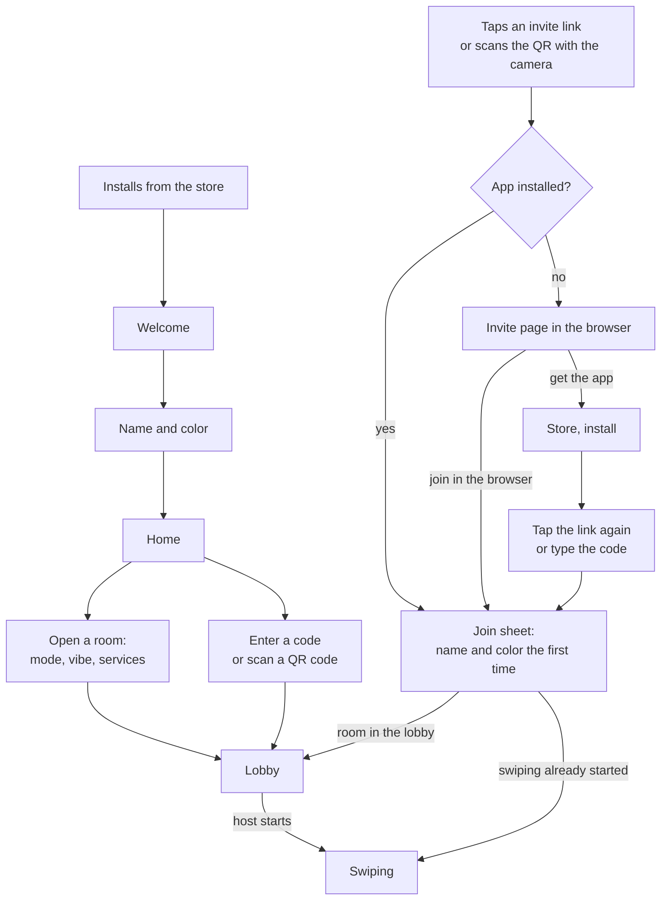

# Onboarding

How a player gets from installing the app, or tapping a friend's invite link, to their first pick, and what happens when they come back: first launch, joining and hosting, the lobby and the taste check, the first game's hints, where Letterboxd is offered, when to ask a guest to sign in, permission prompts, and the empty and error states on the way. Written on 29 October 2026 as a draft for review.

It builds on the [revival plan](revival-plan.md) (the room lifecycle, [joining and after](revival-plan.md#joining-and-after)), the data model's [first launch](../architecture/data-model.md#first-launch), [create and join](../architecture/data-model.md#create-and-join) and [lobby](../architecture/data-model.md#lobby), the deck engine's [taste check](../architecture/deck-engine.md#the-taste-check), the Letterboxd [connect flow](../integrations/letterboxd.md#connecting) and the monetization doc's [hosting cap](monetization.md#how-the-hosting-cap-works). The game rules are in `product/game-modes.md` and the app's internals in `architecture/app-structure.md`, both being written. Decisions are in [decisions.md](../decisions.md).

The [Figma file](https://www.figma.com/design/v2ZGLbGmzZ7032V9AI5vWM) (flows 01 First launch, 02 Host or join, 03 Taste check, 05 Profile and Letterboxd, 06 Edge states) is the current reference, not the source of truth. Where this doc changes it is listed in [Changes to the Figma](#changes-to-the-figma). Every number here is a placeholder until playtests; they are all in [Starting values](#starting-values).

## Contents

1. [Goals](#goals)
2. [The paths at a glance](#the-paths-at-a-glance)
3. [First launch](#first-launch)
4. [Joining from an invite link](#joining-from-an-invite-link)
5. [Joining with a code or a QR code](#joining-with-a-code-or-a-qr-code)
6. [Hosting](#hosting)
7. [The lobby](#the-lobby)
8. [The first game](#the-first-game)
9. [After the first game](#after-the-first-game)
10. [Letterboxd](#letterboxd)
11. [Accounts](#accounts)
12. [Permissions](#permissions)
13. [Coming back](#coming-back)
14. [Empty and error states](#empty-and-error-states)
15. [Changes to the Figma](#changes-to-the-figma)
16. [What this needs elsewhere](#what-this-needs-elsewhere)
17. [Measuring it](#measuring-it)
18. [Starting values](#starting-values)
19. [Open questions](#open-questions)

## Goals

- **An invited guest is swiping within about 30 seconds of tapping the link**, whether they have the app or not (see [Joining from an invite link](#joining-from-an-invite-link) for what that needs).
- **A new host has a room open within about a minute of first launch**, and a returning host in three taps.
- **Nothing stands between a player and the game.** No account, no Letterboxd and no permission prompt before the first game.

Five rules shape everything below:

1. **Play first.** The game teaches itself in the first few cards. There is no tutorial screen.
2. **No gates.** Accounts, Letterboxd, services and notifications all make the app better, and none is required to play.
3. **Ask at the moment it's useful.** Services when a room needs them, Letterboxd after a game, notifications on the winner screen, sign-in once there is history to lose.
4. **One ask at a time.** At most one nudge per screen, and at most one per app open outside the game.
5. **Guests get the shortest path.** Each movie night brings 2 to 9 people who didn't choose the app; they are the growth loop.

## The paths at a glance

| Path | Steps before the first card | Rough time |
| --- | --- | --- |
| Invited, app installed, first time | Tap the link, type a name, pick a color, Join | About 15 seconds |
| Invited, app installed, played before | Tap the link | About 5 seconds |
| Invited, no app, joins in the browser | Tap the link, Join in the browser, name, color, Join | About 25 seconds |
| Invited, no app, installs | Tap the link, store, install, open, tap the link again | A minute or more, mostly the store |
| New player, hosting | Welcome, name, Open a room, mode, vibe and services, Open the room | About a minute, plus waiting for friends |

The times are estimates for playtests to check, not measurements.

## First launch

From opening the app to Home in three taps, with no account and no permission prompt (as the Figma's flow 01 already has it).

| Screen | What it does |
| --- | --- |
| Splash | The marquee logo while the app loads. No spinner; ready in under a second |
| Welcome | One screen, three promises, two buttons: **Get started** and **I have a room code**. A small **Already have an account? Sign in** link at the bottom, for players restoring their history on a new phone (new) |
| Name and color | "What should we call you?": a name (1 to 24 characters, required to host or join) and one of 6 colors, which is the player's `avatar_key`. "No account needed. You can save your history later from your profile." |
| Home | Host a movie night, Got a room code, and below them the Letterboxd card |

**Done silently, from the device:**

- **Signing in as a guest.** The app signs in anonymously with Supabase as soon as it starts, before the name screen, so the name saves straight to the profile (`api.update_profile`).
- **Country**, from the device's region (`regionCode` in expo-localization), saved to the profile. It decides where to watch when this player hosts. Editable in Profile.
- **Language**, from the device's language. English and French at launch; anything else falls back to English. Editable in Settings.

**Not asked at first launch:**

- **Services.** They are asked the first time a room needs them: the host when opening a room, a guest optionally in the lobby. Either way they are saved to the profile, so they're asked once.
- **Letterboxd, sign-in, notifications.** Each has its own moment, below.

## Joining from an invite link

The fastest path, and the one most guests take.

### The link

- **Format:** `https://<domain>/join/<code>?r=<room ref>`. The domain waits on the app's name (open in [decisions.md](../decisions.md)).
- **Why the room reference:** codes are only unique among open rooms and get reused. A guest who taps an old link for a room that has ended could otherwise land in a stranger's newer room with the same code. With the reference, the app can say "This movie night has ended" instead.
- **The QR code** in the invite sheet encodes the same link, so a guest can scan it with their phone's normal camera: it recognises the code and offers to open the link (Apple support, checked today). The in-app scanner is only a second option.
- **No link service.** Firebase Dynamic Links shut down on 25 August 2025, and an attribution SDK would send guests' data to a third party for little gain. Universal links (iOS) and App Links (Android), set up in the Expo app config and served from the same domain as the invite page, are enough.

### App installed

The link opens the app straight on the room, skipping Welcome and Home.

- **First time on this phone:** one sheet, "Join Harry's movie night", with the name field, the colors and a **Join** button. Then the lobby, or straight into swiping if the game has started.
- **Played before:** a one-second "Joining Harry's room" and they're in.

### App not installed

The link opens the invite page in the browser (that is what universal links do when the app isn't installed, per Expo's docs). The page shows "Harry invited you to pick a movie", the room code in large type, and two buttons:

- **Join in the browser.** The same join sheet, then the lobby, in the browser, with no install. This is the only way a guest without the app gets near the 30-second goal. The backend needs nothing new: anonymous sign-in works in a browser and the API is the same ([data model](../architecture/data-model.md#later-how-each-future-feature-lands)). The revival plan lists web guests as Later; this doc recommends launching with them (see [Open questions](#open-questions)).
- **Get the app.** The store page, with a Smart App Banner on iOS. After installing, the app can't know which room the guest came from on its own, so:
  - **Launch:** the page says "Once it's installed, tap your invite link again" and keeps showing the code. The app's Welcome has **I have a room code**.
  - **Small upgrades:** on Android, the Play Install Referrer API can carry the room through the store: Google keeps the referrer for 90 days and asks apps to read it once, on first launch (checked today). On iOS, the code screen can show a **Paste** button (`ClipboardPasteButton` in expo-clipboard, iOS 16 and later), which pastes the link the page copied without the system's paste permission alert (checked today).

## Joining with a code or a QR code

- **Code:** Home's **Got a room code?** opens six boxes over a number pad. The app tries to join as soon as the sixth digit is typed; there's no Join button (as in the Figma's screen 05). Errors show under the boxes (see [Empty and error states](#empty-and-error-states)).
- **QR code in the app:** **Scan QR code** asks for the camera only when tapped. If refused: "Type the code instead", and the phone's normal camera still works.
- **Name first:** a player who comes in by code before naming themselves (they tapped **I have a room code** on Welcome) gets the name and color step after the code, so the code is never lost.

## Hosting

| Step | What the host does | Notes |
| --- | --- | --- |
| 1. Mode | Quick Match (preselected), Final Cut or Date Night, plus a time budget | The modes are in `product/game-modes.md` |
| 2. Vibe and services | Up to 3 moods (host only), the services they have, the seen rule | Services come prefilled from the profile. The first time, at least one must be picked before **Open the room**, and the choice is saved to the profile. Moods are in the [deck engine](../architecture/deck-engine.md#moods) |
| 3. Lobby | The invite sheet opens over the lobby: QR code, link, **Share invite** | The room code stays readable behind it, for a couch |

- **A returning host** needs three taps: **Open a room**, **Next**, **Open the room**, since the mode is preselected and their services are remembered.
- **Country** comes from the host's profile. If it isn't a country we have availability for, see [Empty and error states](#empty-and-error-states).
- **No sign-in to host at launch.** Once the hosting cap exists (with Pro, not at launch), Apple or Google sign-in is asked before a host's second game, as the [monetization doc](monetization.md#how-the-hosting-cap-works) says. See [Accounts](#accounts).

## The lobby

What everyone sees:

- The room code as a ticket, the number of players, and who hosts.
- Each player with a status: **Ready**, **Taste check 5/8**, **Joining** or **Letterboxd linked**.
- **One line on the rules, for guests** who didn't choose the mode: "Quick Match: we stop at the first film everyone likes."
- Which services the room can watch on.

**A guest's services.** A row "Your services", prefilled from their profile, empty the first time. Under the default rule, where the room uses every service anyone has (one screen), it's optional and says so: "Optional: adds more films." Under the long-distance rule, where only services everyone has count, it says "Needed: tonight only shows films everyone can watch." It never blocks the start.

### The taste check

The rules are the deck engine's ([The taste check](../architecture/deck-engine.md#the-taste-check)): only for players we know little about (confidence under 0.3), a question about the film rather than tonight, four answers, never the same film twice, never marks a film as seen. How it appears in the lobby:

- **Guests** who need it get it as soon as they arrive, with **Skip** always visible: "While we wait: a few quick films so the deck knows your taste." The lobby is waiting time anyway.
- **The host** gets it as a card under the player list once the invite sheet is closed. Their first job is inviting.
- **If the host starts mid-check,** the answers so far are sent, the check closes and the player goes into the game. Nobody has to finish first.
- **Players who join after swiping has started** never see it: there's no waiting time to fill.
- **Letterboxd isn't offered here** as an action: the export means leaving for the browser for a minute or two. At most a quiet line on the check: "Have Letterboxd? Connect it after the game and skip this next time."

**Starting.** The host can start any time once the mode's minimum number of players is present. Stragglers join late with the shared opening ([data model](../architecture/data-model.md#like-propagation-and-refills)).

## The first game

Hints on a player's first game only. They never block a card and never cover the buttons. The first 10 cards are the same for everyone, so a slower first swipe costs nobody anything.

| When | Hint | Gone when |
| --- | --- | --- |
| Card 1 | The card leans right, then left, once, showing the Like and Nope stamps, with "Swipe right to like, left to nope" under it | The first swipe |
| Card 2 | "Seen it? Swipe up. It doesn't count as a no." under the buttons | Card 10, or the first "Seen it" |
| Card 3 | "Tap the card for the story" | The first flip, or card 10 |
| First tap on the star, or card 5 | "2 super likes per game. They count double if it comes to a final vote." | Dismissed |

- **Buttons are always there,** with labels and screen-reader names, next to every gesture.
- **Hints are remembered per phone.** A player on a new phone sees them once more, which is acceptable.
- The Figma's permanent "Swipe up if you've seen it" line becomes the card 2 hint.

## After the first game

**The winner screen** (game rules aside) gets **one** extra ask, the first that applies:

1. **Notifications,** if never asked on this phone: "Remind me tomorrow to say how it was?" with **Yes** and **Not now**. The system prompt appears only after **Yes** (see [Permissions](#permissions)).
2. **Letterboxd,** if not linked: "Want picks that fit your taste next time? Import from Letterboxd."
3. **Save your history,** for a guest with 2 or more games: see [Accounts](#accounts).

**Rating seen films** (the deck engine's [seen-film rating](../architecture/deck-engine.md#rating-seen-films-while-waiting)) happens while the player waits on the others, before the winner screen, so it doesn't compete with this ask.

**"Did you watch it?"** ([data model](../architecture/data-model.md#after-the-match)):

- **With notifications allowed:** a local notification the next day around midday, "Did you end up watching Neon Harbor?", which opens the question.
- **Otherwise:** a card on Home on the first app open at least 3 hours after the room ended.
- Either way the question is three taps (Yes, loved it / Yes, it was fine / We watched something else) and disappears after 7 days.

## Letterboxd

### Where it's offered

| Place | How | When |
| --- | --- | --- |
| Home | A card under Host and Join: "Connect Letterboxd: skip films you've seen and get picks that fit your taste." | From the first Home. Dismissible; after a dismissal it comes back after 3 more games, then only in Profile |
| Winner screen | The one ask, if notifications were already asked | After a first or second game |
| Profile | The Letterboxd card: connected status, or an invitation | Always |
| Settings | Letterboxd data: manage, re-import, disconnect | Always |
| Lobby | Only the quiet line on the taste check | While waiting |

**Never offered:** during first launch, as a gate, or in the middle of a game.

### The pitch

- **What you get:** "Skip films you've already seen. Picks that fit your taste. Your ratings on the cards, for the room to see."
- **What we read:** your diary, the films you've marked watched, and your watchlist. Nothing else, no password, ever.
- **What happens if you leave:** "Disconnect any time and we delete everything we imported."
- **Wording:** "Import from Letterboxd". No Letterboxd logo and nothing that suggests a partnership ([ground rules](../integrations/letterboxd.md#ground-rules)).
- **Consent** is asked on the explanation screen, before anything is uploaded, and stored.

### The flow

Connecting is by export only, as decided ([Connecting](../integrations/letterboxd.md#connecting)):

1. **Explanation:** the three steps in plain words (open your Letterboxd export, tap Export, pick the file here), the pitch and the consent.
2. **Open Letterboxd:** the export page in a browser sheet. The player signs in there if needed and taps Export; the ZIP lands in Files or Downloads.
3. **Pick the file:** when the sheet closes, the system file picker opens, filtered to ZIP files. It needs no permission prompt.
4. **Import:** the phone unzips the file and uploads only what's read; the server checks it against the public feed ([the RSS check](../integrations/letterboxd.md#the-rss-check)) and matches the films.
5. **Done:** "1,183 films imported, 21 to check", with an optional fix screen for the films it couldn't match for sure. Matching carries on if the player leaves; Profile shows the progress.

The whole thing takes a minute or two. Afterwards the taste check never shows again, the lobby shows "Letterboxd linked", and the player's ratings appear on cards.

Right after a successful import, a guest is offered to save their account: "Keep your Letterboxd link if you change phones." See [Accounts](#accounts).

Errors are in [Empty and error states](#empty-and-error-states). The later prompts for a fresh export are in [Coming back](#coming-back).

## Accounts

**Everyone starts as a guest:** an anonymous Supabase user with a profile. Everything works, including Letterboxd.

### Where saving is offered

| Place | Copy | When |
| --- | --- | --- |
| Profile | "Save your history: keep your nights and stats on any device." | While a guest |
| After a Letterboxd import | "Keep your Letterboxd link if you change phones." | Once |
| Home | "Keep your 3 movie nights." | Once, after the third game; dismissible |
| Winner screen | The one ask, third in line | Guests with 2 or more games |

The save screen (the Figma's screen 21) offers **Continue with Apple** and **Continue with Google**, and **Not now**.

### When it's required

- **Never to play or to join.** Guests stay anonymous for as long as they like.
- **Once the hosting cap exists** (with Pro, not at launch): before hosting a second game, as the [monetization doc](monetization.md#how-the-hosting-cap-works) says, so reinstalling doesn't reset the count.
- **Never on a kid's profile or device** when family profiles come ([kids' safety](monetization.md#kids-safety-and-privacy)).

### How it works

- **Apple and Google only** at launch. App Store guideline 4.8 says an app that offers a third-party login such as Google must also offer an equivalent one that limits data to name and email, lets users hide their email, and doesn't track for ads (checked today). Sign in with Apple meets that.
- **Saving keeps everything.** It links the Apple or Google identity to the guest's user, so nothing in the database moves ([data model](../architecture/data-model.md#first-launch)). Supabase's docs say converting an anonymous user means linking an identity, that manual linking (in beta) must be enabled, and that native apps can link an Apple or Google ID token (checked today).
- **To check in a spike before building it:** the docs don't say what happens when the Apple or Google account already belongs to another user. The app should expect an error and offer: "This Apple ID already has MovieMatch history. Switch to it? The 2 guest nights on this phone won't come along." There's no merging in v1.
- **Restoring on a new phone:** Welcome's **Sign in** link.
- **Reinstalling as a guest starts fresh,** which the save pitch can say plainly.
- **Deleting the account** is in Settings, as App Store guideline 5.1.1(v) requires for apps that create accounts ([data model](../architecture/data-model.md#deleting-an-account-exporting-data)).

## Permissions

| Permission | Asked when | If refused |
| --- | --- | --- |
| Notifications | Only after **Yes** on the winner screen's "Remind me tomorrow?" | The follow-up card on Home instead. Not asked again for 30 days; after that only from Settings |
| Camera | Only when **Scan QR code** is tapped in the app | "Type the code instead"; the phone's normal camera still opens invite QR codes |
| Files | Never: the system file picker for the Letterboxd ZIP needs no permission | |
| Location | Never: the country comes from the device's region | |
| Tracking (App Tracking Transparency) | Never: no ad tracking at launch | |

- **Android 13 and later:** the system notification prompt only appears once the app has created a notification channel (Expo's docs, checked today), so the app creates it just before asking.
- **iOS quiet notifications:** iOS can deliver notifications quietly to Notification Center without asking first (provisional authorization). That would suit the follow-up, but a quiet notification is easy to miss. This doc recommends the in-context ask, with provisional authorization as a later experiment.

## Coming back

| Situation | What the player sees |
| --- | --- |
| A normal return | Home: greeting, the last movie night, and at most one card (the follow-up if it's due, else the Letterboxd card if it's showing, else the save card) |
| They still have a seat in a room that's in the lobby, swiping or the finale | The app opens straight into the room, on the same seat ([leaving and coming back](../architecture/data-model.md#leaving-and-coming-back)) |
| Their room ended while they were away | Home shows the result: "They picked Neon Harbor while you were away" |
| They skipped the taste check and haven't played since | The taste check is offered again in the next lobby. Once confidence reaches 0.3, never again |
| Their Letterboxd needs a fresh export (a gap in the feed) | A card on Profile, and once on Home ([keeping it fresh](../integrations/letterboxd.md#keeping-it-fresh)) |
| Their app is older than `min_app_version` | An update screen before anything else |
| Their guest account was deleted after 90 days without playing ([retention](../architecture/data-model.md#retention)) | The app finds its session gone, signs in as a new guest and recreates the profile with the name and color it remembers, without a message. The old history is gone |
| They declined notifications | No ask for 30 days |

Hints from the first game don't show again.

## Empty and error states

Every state says what happened and offers a next step, never a raw error.

| Situation | Where | What the player sees | Next step |
| --- | --- | --- | --- |
| Offline at first launch | Splash | "You're offline. MovieMatch needs a connection to start." | Retry |
| Guest sign-in fails (rate limit or bot check) | Splash | "We couldn't get you started. Try again in a minute." | Retry |
| Wrong code (`not_found`) | Under the code boxes | "No open room with this code. Check the digits with the host." | Boxes clear for another try |
| Too many attempts (`rate_limited`, 10 in 10 minutes) | Under the code boxes | "Too many tries. Ask the host for the link, or try again in a few minutes." | Paste a link, or wait |
| Room full (`full`) | Join sheet | "This room is full." | Host your own |
| Deck being dealt (`starting`) | Join sheet | "Shuffling the deck..." | The app retries every second for up to 10 seconds, then shows Retry |
| Final vote under way (`in_finale`) | Join sheet | "They're voting on the final pick right now." | Host your own, or wait for the next one |
| Old link, room ended | Join sheet | "This movie night has ended." (the Figma's screen 25) | Host a movie night, or Enter another code |
| No name yet (`name_required`) | Join | The name and color step | |
| The host's country has no availability data | Open a room | "We can't show where to watch in your country yet. You can still join friends' rooms." | Choose another country (for people abroad), or join |
| No services picked | Open a room | **Open the room** stays disabled, with "Pick at least one service" | |
| Camera refused | Scan QR code | "Type the code instead." | The code boxes |
| Not a Letterboxd export | Letterboxd import | "This doesn't look like a Letterboxd export. Pick the ZIP Letterboxd sent you." | Pick again |
| The export doesn't match the public profile (the RSS check) | Letterboxd import | "This export doesn't match the public diary of @harryv. Make sure it's your own export, made recently." | Open Letterboxd again |
| Upload failed | Letterboxd import | "The import didn't go through." | Retry, keeping the picked file |
| Apple or Google account already used | Save account | "This Apple ID already has MovieMatch history. Switch to it?" | Switch, or Cancel |
| App too old | Launch | "Update MovieMatch to keep playing." | Store |

A deck that runs out mid-game (the Figma's screen 26) is a game state, in `product/game-modes.md`.

## Changes to the Figma

| Screen | Change | Why |
| --- | --- | --- |
| 02 Welcome | Add **Already have an account? Sign in**. Change "Skips anything someone has already seen" to fit the new default seen rule, for example "Skips films you've seen, unless you all loved them" | Restoring on a new phone; the default is now `allow_rewatch` |
| New: Join sheet | "Join Harry's movie night": name, color, Join, in one sheet | The invite link path skips Welcome and Home |
| New: Invite page (web) | The room code, **Join in the browser**, **Get the app** | Guests without the app |
| 05 Join with code | Inline error states; a **Paste** button where available | Errors; the install path |
| 07 Set the vibe | Moods are host only, up to 3; the seen toggle follows the new default | Agreed in the deck engine |
| 08 Lobby | The rules line for guests, a guest's services row, the taste check card for the host | Guests who didn't choose the mode; services asked when needed |
| 09 Invite sheet | The link becomes `/join/<code>?r=...` instead of `/j/<code>`. "It closes 20 minutes after the last swipe" needs a rule in the data model, or new copy | See [What this needs elsewhere](#what-this-needs-elsewhere) |
| 10 Taste check | "What do you think of this one?" instead of "Would you watch it tonight?"; "Don't know it" instead of "Haven't seen" | Agreed: the question is about the film, not tonight |
| 11 Swipe | The permanent "Swipe up if you've seen it" line becomes a first-game hint, with the other hints | Less clutter after the first game |
| 16 Winner | Room for the one extra ask (notifications, Letterboxd or save) | Asks at the moment they're useful |
| 19 Connect Letterboxd | Replace the username screen with the export flow (explanation, open Letterboxd, pick the file, progress) | Superseded: connecting is by export only. The screen also shows hearts, which aren't read |
| 20 Import history | Merge into the new 19 | One flow |
| New: Home cards | "Did you watch it?" and "They picked X while you were away" | Coming back |

## What this needs elsewhere

Notes for other docs, not applied there:

- **Data model:** the invite link carries a room reference, and `api.join_room` takes it as an optional argument, answering `closed` when the code now belongs to another room. Today a stale code either finds nothing or finds a newer room.
- **Data model:** when does a room close? The Figma says "20 minutes after the last swipe"; the data model only abandons lobbies after 3 hours and ends rooms on a pick. Rooms where everyone has drifted away mid-game need a rule.
- **Supabase settings:** enable manual linking (for saving accounts); turn on the bot check for anonymous sign-ins, which Supabase strongly recommends; and look at the anonymous sign-in limit, 30 per hour per IP address by default (checked today), since a party or a venue shares one network.
- **Revival plan:** web guests move from Later to launch if [Open questions](#open-questions) agrees.
- **Analytics doc, when written:** the events in [Measuring it](#measuring-it).

## Measuring it

| Metric | What | Starting target |
| --- | --- | --- |
| Link to first card | Median time from tapping an invite link to the first card, invited guests | 30 seconds |
| First launch to Home | Median, new players | 15 seconds |
| First launch to room open | Median, new hosts | 1 minute |
| Join failures | Share of join attempts by status (`not_found`, `full`, `rate_limited`, `closed`) | Watch |
| Taste check | Offered, started, finished, skipped | Watch |
| Letterboxd | Offered, started, file picked, imported, failed (with the reason) | Watch |
| Notifications | Asked, accepted | Watch |
| Web guests who install | From the revival plan's guests-who-install metric | Watch |
| Accounts saved | Share of guests with 3 or more games who save | Watch |

## Starting values

All placeholders until playtests.

| Value | Start |
| --- | --- |
| Name length | 1 to 24 characters (from the data model) |
| Colors | 6 |
| Moods per room | Up to 3 (from the deck engine) |
| First-game hints | Shown until card 10 at the latest |
| Retry while the deck is dealt | Every second, up to 10 seconds |
| "Did you watch it?" notification | The next day, around midday local time |
| "Did you watch it?" card | From 3 hours after the room ended; gone after 7 days |
| Letterboxd card on Home | Back 3 games after a dismissal, then only in Profile |
| Save card on Home | Once, after the third game |
| Winner-screen save ask | Guests with 2 or more games |
| Notification re-ask | Not before 30 days, then only from Settings |
| Taste check | The deck engine's values |

## Open questions

These are Harry's calls; the doc uses the recommendation until he decides.

| Question | Recommendation |
| --- | --- |
| Launch with web guests (joining in the browser without installing)? | Yes: it's the only way a guest without the app swipes within about 30 seconds, and the backend needs nothing new. If it slips, the install path with "tap the link again" still works |
| Email sign-in as well as Apple and Google? | No, not at launch: two buttons are simpler, and Apple's rule is met |
| Where to ask for notifications? | On the winner screen of the first game, after a one-line in-app ask; quiet iOS notifications as a later experiment |
| Should the taste check open by itself for guests? | Yes for guests, as a card for the host |
| Where do guests add their services? | An optional row in the lobby, required in spirit only under the long-distance rule |
| A Sign in link on Welcome? | Yes, small, for restoring on a new phone |
