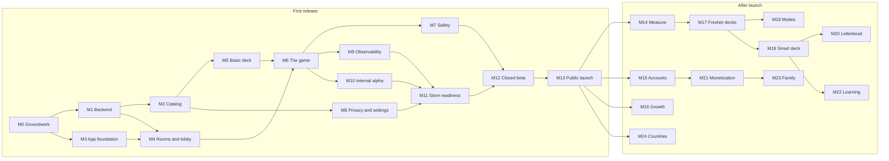

# Roadmap

Every step from an empty repository to a published app and beyond: what to build, run and publish, in what order, split into tasks small enough for one agent run each. Written on 29 October 2026 from the docs in the [docs index](../README.md). It replaces the revival plan's [Roadmap](revival-plan.md#roadmap).

The first part lists the milestones, to track the whole project. The second part takes each milestone task by task, with what each task needs first and which docs to read.

**The first release is the bare minimum that lets a group pick a film together:** rooms, the game and a simple deck. No Letterboxd, no taste profiles, no accounts, no payments. Getting real groups playing early tells us what to build next; everything else comes after launch, in the order the data suggests.

## Contents

1. [How to use this roadmap](#how-to-use-this-roadmap)
2. [The first release: what's in, what waits](#the-first-release-whats-in-what-waits)
3. [Milestones at a glance](#milestones-at-a-glance)
4. Milestones in detail
   - First release: [M0](#m0-groundwork) · [M1](#m1-backend-foundation) · [M2](#m2-catalog-for-france) · [M3](#m3-app-foundation) · [M4](#m4-first-launch-rooms-and-lobby) · [M5](#m5-basic-deck) · [M6](#m6-the-game) · [M7](#m7-safety-and-moderation) · [M8](#m8-privacy-legal-and-settings) · [M9](#m9-observability-and-analytics) · [M10](#m10-internal-alpha) · [M11](#m11-store-readiness) · [M12](#m12-closed-beta) · [M13](#m13-public-launch)
   - After launch: [M14](#m14-measure-and-learn) · [M15](#m15-accounts-and-follow-up) · [M16](#m16-growth-loop) · [M17](#m17-fresher-decks-and-moods) · [M18](#m18-more-modes-and-host-controls) · [M19](#m19-smart-deck) · [M20](#m20-letterboxd) · [M21](#m21-monetization) · [M22](#m22-learning-engine) · [M23](#m23-family) · [M24](#m24-more-countries-and-content)
5. [Assumptions and open decisions](#assumptions-and-open-decisions)
6. [Later ideas](#later-ideas)

## How to use this roadmap

Each task reads like this:

```
- [ ] **M4.8** Join with a code · app · needs M4.7, M4.1 · [onboarding](onboarding.md#joining-with-a-code-or-a-qr-code)
  Done when: a wrong code, a full room and a started room each show their message.
```

The ID, a short title, the type of work, the size once the planner has sized it (`S`, `M` or `L`, after the type), the tasks it needs first, the docs to read, and how to know it's finished. `node tools/next.mjs` lists the tasks that can start; how to run one is in [pipeline.md](../pipeline.md).

**Rules for picking and doing a task** (for people and agents alike):

1. Pick an open task whose "needs" are all ticked. Tasks with no dependency between them can run in parallel.
2. One task, one branch, one pull request.
3. Read the linked docs and [decisions.md](../decisions.md) first. Decisions win over a doc when they disagree.
4. Where a doc states a rule (a match rule, a limit, an access rule), the pull request includes a test for it.
5. Don't tick the box in the pull request: after the merge, an Action ticks the task named in the title and updates the progress and the milestone's status in [Milestones at a glance](#milestones-at-a-glance) (`tools/roadmap-tick.mjs`). That keeps parallel pull requests from all editing this file.
6. If the task forces a choice nobody made, stop and ask Harry, then record the answer in decisions.md. If a doc turns out wrong, fix it in the same pull request and say so.

**Types of work**

| Type | Means | Where |
| --- | --- | --- |
| decision | A choice Harry makes | decisions.md |
| backend | SQL: migrations, functions, access rules, Supabase settings | `supabase/` |
| server | The Python recommendation server | `server/` |
| app | The Expo app | `mobile/` |
| ops | Accounts, environments, CI, deploys, monitoring | The repository, dashboards |
| test | Tests, spikes, playtests, checks | The repository, real phones |
| design | Figma, icons, screenshots | Figma |
| content | Copy, curation of services, moods or films | Repos and the database |
| legal | Policies, terms, licences, lawyer | The domain, email |
| publishing | App Store Connect and Play Console | The stores |
| product | Recruiting testers, reviews, launch | People |

## The first release: what's in, what waits

**In the first release** (milestones M0 to M13):

| Area | What players get |
| --- | --- |
| Getting in | Guest play with no account: a name and a colour. French and English |
| Rooms | Create a room, join by code, link or QR code, a live lobby. The host picks the room's services, an age cap and a time budget |
| Safety | The host can remove a player and lock the room. Names are filtered. Anyone can report a player |
| The game | Quick Match for 2 to 10 players: like, nope, super like, seen it, undo. Instant matches, the Final Cut round when no match comes, a winner screen that says where to watch, the recap card to share, Play again, sound for the match and the reveal |
| The deck | Built in SQL: films on the room's services in France, ranked by quality and popularity, shuffled differently every game, one film per franchise, films a player marked as seen left out, likes moved into the others' next cards |
| Catalog | France only, from TMDB, refreshed every night |
| Settings | Language, the analytics opt-out, download and delete my data, credits |
| Behind the scenes | Crash reports, analytics by region, game metrics from the database, monitoring, backups |

**What waits, and where it comes back:**

| Feature | Milestone | Why it can wait |
| --- | --- | --- |
| Accounts (Apple, Google), "Did you watch it?", notifications | [M15](#m15-accounts-and-follow-up) | Guests can play. No third-party sign-in also means Apple's Sign in with Apple rule (4.8) doesn't apply yet |
| Web guests | [M16](#m16-growth-loop) | Growth comes once the core works. The recap card and Play again moved into M6 (decided on 29 October 2026) |
| Card memory, Rematch, moods, the deck worker | [M17](#m17-fresher-decks-and-moods) | The SQL shuffle already varies decks |
| Final Cut and Date Night modes, Keep swiping, Vote now | [M18](#m18-more-modes-and-host-controls) | Quick Match covers every group size |
| Taste profiles, the taste check, embeddings | [M19](#m19-smart-deck) | Needs data and TMDB's commercial agreement (its terms restrict machine learning) |
| Letterboxd | [M20](#m20-letterboxd) | The biggest single feature; needs a lawyer's read first |
| Payments | [M21](#m21-monetization) | Earn once groups come back |
| Family modes | [M23](#m23-family) | Needs accounts, payments and a legal review |
| Belgium, Switzerland, English-speaking countries, series | [M24](#m24-more-countries-and-content) | France first |

**Why this order works:**

- **No machine learning at launch** means the free app stays within TMDB's free licence, which forbids using its data in a machine-learning application. The email to TMDB still goes out first thing (M0.5).
- **The data model already has every table**, Letterboxd's included. Later milestones switch features on with their own migrations; nothing is rebuilt.
- **Every game writes the metrics** (time to a pick, rooms ending with a pick, time to finish onboarding), so the closed beta already says what matters next.

## Milestones at a glance

| # | Milestone | Done when | Tasks | Status |
| --- | --- | --- | --- | --- |
| **First release** | | | | |
| [M0](#m0-groundwork) | Groundwork | The name is chosen, every account is open, TMDB is emailed, the game rules are confirmed, the repository and the agents are set up | 11 | Not started |
| [M1](#m1-backend-foundation) | Backend foundation | Migrations and the test suite run from CI on staging and production in Paris | 17 | Not started |
| [M2](#m2-catalog-for-france) | Catalog for France | Production holds France's watchable films, swept daily for a week without help | 14 | Not started |
| [M3](#m3-app-foundation) | App foundation | A development build on iOS and Android signs in as a guest and reads the API | 16 | Not started |
| [M4](#m4-first-launch-rooms-and-lobby) | First launch, rooms and lobby | Three phones join one room by code, link and QR code, and the host can start | 16 | Not started |
| [M5](#m5-basic-deck) | Basic deck | A room is dealt in under a second, only with films its players can watch, different each game | 8 | Not started |
| [M6](#m6-the-game) | The game | 2, 4 and 8 players each reach a pick, by match and by the Final Cut, within the time limits | 24 | Not started |
| [M7](#m7-safety-and-moderation) | Safety and moderation | The security checklist for the beta is ticked | 4 | Not started |
| [M8](#m8-privacy-legal-and-settings) | Privacy, legal and settings | Policy and terms are online, and players can download and delete their data | 11 | Not started |
| [M9](#m9-observability-and-analytics) | Observability and analytics | Headline metrics, alerts and backups work, and the load test passes | 7 | Not started |
| [M10](#m10-internal-alpha) | Internal alpha | Five real movie nights on TestFlight and Play internal testing end with a pick | 4 | Not started |
| [M11](#m11-store-readiness) | Store readiness | Listings, ratings, privacy forms and the reviewers' demo room are ready on both stores | 9 | Not started |
| [M12](#m12-closed-beta) | Closed beta | Friend groups and families play, Google's 12 testers have run 14 days, and the go decision is made | 7 | Not started |
| [M13](#m13-public-launch) | Public launch | Live on both stores in France | 6 | Not started |
| **After launch** | | | | |
| [M14](#m14-measure-and-learn) | Measure and learn | Dashboards and funnels drive a weekly review | 5 | Not started |
| [M15](#m15-accounts-and-follow-up) | Accounts and follow-up | Players can save an account, and "Did you watch it?" is measured | 10 | Not started |
| [M16](#m16-growth-loop) | Growth loop | The invite page and web guests bring new players | 4 | Not started |
| [M17](#m17-fresher-decks-and-moods) | Fresher decks and moods | Repeat rate under 10%, moods live, the deck worker dealing | 15 | Not started |
| [M18](#m18-more-modes-and-host-controls) | More modes and host controls | Final Cut and Date Night modes and the host controls are live | 8 | Not started |
| [M19](#m19-smart-deck) | Smart deck | Taste-based decks beat the crowd deck in an A/B test | 10 | Not started |
| [M20](#m20-letterboxd) | Letterboxd | Players connect by export and their history shapes decks | 11 | Not started |
| [M21](#m21-monetization) | Monetization | Host Pro, the Night Pass and packs are on sale | 9 | Not started |
| [M22](#m22-learning-engine) | Learning engine | A trained model ranks decks for part of the traffic | 5 | Not started |
| [M23](#m23-family) | Family | Family profiles and family modes are live | 9 | Not started |
| [M24](#m24-more-countries-and-content) | More countries and content | Belgium, Switzerland, then English-speaking countries; crews; series | 5 | Not started |

Progress: 0 of 245 tasks done.



After launch, the order is a starting point: the weekly review in M14 can move a milestone up or down.

---

## M0 Groundwork

Everything that blocks building or publishing, started first. Several items take days of waiting (store enrolment, TMDB's answer), so they go out on day one.

Done when: the name is chosen, every account is open, TMDB is emailed, the game rules are confirmed, and the repository and the agents are set up.

- [ ] **M0.1** Choose the app's name · decision · S · [store-listing](store-listing.md#choosing-the-name)
  Done when: the name is checked on both stores, in trademark databases and for domains, and recorded in decisions.md.
- [ ] **M0.2** Buy the domain and set up a support email on it · ops · S · needs M0.1 · [app-structure](../architecture/app-structure.md#invites-and-deep-links)
  Done when: the domain resolves and support@ receives mail.
- [ ] **M0.3** Enrol in the Apple Developer Program as an individual and declare trader status · publishing · S · [store-listing](store-listing.md#developer-accounts)
  Done when: enrolment is accepted.
- [ ] **M0.4** Open a Google Play personal developer account and pass identity verification · publishing · S · [store-listing](store-listing.md#developer-accounts)
  Done when: the account is verified.
- [ ] **M0.5** Email TMDB about the licence: catalog only at launch, embeddings and trained models later · legal · S · [tmdb](../integrations/tmdb.md#terms-licence-and-attribution)
  Done when: the email is sent; the answer, when it comes, goes in decisions.md.
- [ ] **M0.6** Open the service accounts with 2FA: Supabase (Pro organization), Fly.io, Sentry (EU), PostHog (EU), Expo, GitHub secret scanning · ops · S · [operations](../architecture/operations.md#environments), [security](../architecture/security.md#dependencies-and-accounts)
  Done when: every account exists in Harry's name with 2FA on.
- [ ] **M0.7** Confirm the finale (one 45-second round) and the time limits (6 minutes, 7 for 5 to 10 players, 40 cards) · decision · M · [game-modes](game-modes.md#time-to-a-pick)
  Done when: recorded in decisions.md.
- [ ] **M0.8** Confirm web guests wait until after launch · decision · S · [onboarding](onboarding.md#joining-from-an-invite-link)
  Done when: recorded in decisions.md (this roadmap assumes yes).
- [ ] **M0.9** Update the Figma to the first release: no taste check, no Letterboxd card, no account screens, winner screen with service logos, host menu with Remove player and Lock room, Report, `/join/` links · design · M · needs M0.7, M0.8 · [onboarding](onboarding.md#changes-to-the-figma)
  Done when: the affected frames match this list.
- [ ] **M0.10** One repository: rename `movie-swipe-backend` to `flimme`, archive `movie-swipe-app`, and the shared tools (mise, pnpm workspaces, lefthook) · ops · S · [groundwork](../architecture/groundwork.md#the-repository)
  Done when: the repository is renamed, the old one archived, and `mise run check:all` passes on main.
- [ ] **M0.11** The agent setup: CLAUDE.md files, agents, skills, hooks and settings · ops · S · needs M0.10 · [pipeline](../pipeline.md#one-time-setup), [agent-workflow](../agent-workflow.md#the-roster)
  Done when: `.claude/settings.json` is in place and a first small task has gone through `/task` to a merged pull request.

## M1 Backend foundation

The database the first release needs, tested and deployable to staging and production in Paris.

Done when: migrations and the test suite run from CI on staging and production.

- [ ] **M1.1** Create the staging and production Supabase projects in Paris (`eu-west-3`) · ops · S · needs M0.6 · [operations](../architecture/operations.md#environments)
  Done when: both projects exist on Pro.
- [ ] **M1.2** Apply the Supabase settings checklist to both projects · ops · M · needs M1.1 · [operations](../architecture/operations.md#supabase-settings), [security](../architecture/security.md#supabase-settings)
  Done when: only `api` is exposed, Realtime public access is off, ES256 signing keys and the new API keys are in use, the spend cap is on.
- [ ] **M1.3** Set up the Supabase CLI in the backend repo: `supabase/` folder and the local stack · backend · S · [operations](../architecture/operations.md#from-schemasql-to-migrations)
  Done when: `supabase start` runs the local stack from the repo.
- [ ] **M1.4** Rewrite the 120 checks as pgTAP tests against `schema.sql` as it stands · test · L · needs M1.3 · [data-model](../architecture/data-model.md#what-was-tested)
  Done when: the suite runs locally and passes.
- [ ] **M1.5** Turn `schema.sql` into the baseline migration · backend · M · needs M1.4 · [operations](../architecture/operations.md#from-schemasql-to-migrations)
  Done when: the migration builds a fresh database and the suite passes on it.
- [ ] **M1.6** Remove what v1 dropped: `title_deep_links`, `providers.streaming_availability_id`, the `winner_links` queue, the `result` event · backend · M · needs M1.5 · [decisions](../decisions.md)
  Done when: none of them exist and the tests are updated.
- [ ] **M1.7** Revoke default privileges and add a CI check for tables without row-level security and functions open to phones (security gap 1) · backend · L · needs M1.5 · [security](../architecture/security.md#the-database-gaps-found)
  Done when: the check fails on purpose-built bad examples and passes on the schema.
- [ ] **M1.8** Players who left or were removed lose room access: `room_members.removed_at`, `is_room_member` and `can_use_room_topic` updated (gap 3, access part) · backend · L · needs M1.5 · [security](../architecture/security.md#the-database-gaps-found)
  Done when: tests show a removed seat reads nothing and can't send on the room's topics.
- [ ] **M1.9** One `internal.rate_limit` helper, per profile and per IP, stricter on failed joins, used by every write function (gaps 6 and 7) · backend · L · needs M1.5 · [security](../architecture/security.md#room-codes-joining-and-the-host)
  Done when: tests show the limits per profile and per IP.
- [ ] **M1.10** `api.update_room_settings` checks ranges and broadcasts the saved values (gap 5) · backend · M · needs M1.5 · [security](../architecture/security.md#the-database-gaps-found)
  Done when: out-of-range settings are refused in tests.
- [ ] **M1.11** Clamp dwell and client times, cap array sizes, draw room codes from `pgcrypto` (gaps 8 to 10) · backend · M · needs M1.5 · [security](../architecture/security.md#the-database-gaps-found)
  Done when: tests cover each.
- [ ] **M1.12** Database roles: `app_server` grants on the queues it consumes, one login per server process, a narrower role for the HTTP API (gap 11) · backend · L · needs M1.5 · [security](../architecture/security.md#secrets-and-the-servers-database-logins), [server-structure](../architecture/server-structure.md#the-database-layer)
  Done when: each role can do exactly its job in tests.
- [ ] **M1.13** `app_config` keys: `deck_engine` set to `sql`, `tmdb_image_base`, `invite_base_url`. With `sql`, starting a game and refills deal the SQL baseline at once, without the 8-second wait · backend · L · needs M1.5 · [deck-engine](../architecture/deck-engine.md#the-sql-fallback), [app-structure](../architecture/app-structure.md#changes-this-asks-of-the-backend)
  Done when: a test game starts swiping straight after `start_game`.
- [ ] **M1.14** A synthetic seed for local work and CI: a few hundred made-up films with French availability, no TMDB data · backend · M · needs M1.5 · [operations](../architecture/operations.md#seed-and-test-data)
  Done when: a local game can be played on the seed.
- [ ] **M1.15** Backend CI: the test suite on every pull request, migrations to staging on merge, to production by a manual workflow, actions pinned to commit SHAs · ops · M · needs M1.2, M1.5 · [operations](../architecture/operations.md#continuous-integration)
  Done when: a merged migration reaches staging without hands.
- [ ] **M1.16** The lite database for cloud sessions and the pgTAP helpers: stand-ins for Supabase's `auth`, `realtime` and `pgmq`, the `tests` helpers, a smoke test · test · S · needs M1.3 · [groundwork](../architecture/groundwork.md#cloud-sessions)
  Done when: the smoke test passes on the lite database and with `supabase test db`.
- [ ] **M1.17** `packages/contract` and `mise run typegen`: the generated `api` types, the answers, the Realtime events · backend · M · needs M1.5 · [groundwork](../architecture/groundwork.md#the-backends-foundations)
  Done when: the generated types are committed and CI fails when they're stale.

## M2 Catalog for France

The films a French room can watch tonight, from TMDB, refreshed every night by the server's pipeline worker. No embeddings yet.

Done when: production holds France's watchable films, and the daily sweep has run for a week without help.

- [ ] **M2.1** Server repo skeleton: Python with uv, the folder layout, settings and secrets, one Docker image, tests in CI · server · S · [server-structure](../architecture/server-structure.md#folder-layout)
  Done when: the image builds and an empty test passes in CI.
- [ ] **M2.2** Database layer and queue consumer: psycopg, typed wrappers for contract functions, the pgmq loop with visibility timeouts and poison messages · server · L · needs M2.1, M1.5, M1.12 · [server-structure](../architecture/server-structure.md#consuming-the-queues)
  Done when: a test message is consumed once, a failing one ends up archived as poison.
- [ ] **M2.3** TMDB client: polite request rate, retries, 429 handling, failure logging · server · M · needs M2.1 · [tmdb](../integrations/tmdb.md#failures-and-retries)
  Done when: tests with recorded responses cover success, 429 and errors.
- [ ] **M2.4** Catalog migration from tmdb.md: `providers.parent_id`, `provider_regions.is_listed` and `free_for_all`, `rooms.include_free_services`, refresh tiers, `title_certifications.inferred_from`, `titles.tmdb_missing_since`, `ingest_runs` kinds · backend · L · needs M1.5 · [tmdb](../integrations/tmdb.md#changes-to-the-data-model)
  Done when: migrated and tested; free services count for rooms when the switch is on.
- [ ] **M2.5** Reference data job: genres, countries, services and their regions, certification ages, image configuration · server · M · needs M2.2, M2.3, M2.4, M1.15 · [tmdb](../integrations/tmdb.md#what-we-use-tmdb-for)
  Done when: the tables fill from TMDB on staging.
- [ ] **M2.6** Curate France's services: listed services, variants under their main service, free services, display order; check the ids for Canal+, TF1+, M6+ and Arte · content · M · needs M2.5 · [tmdb](../integrations/tmdb.md#services-variants-and-channels)
  Done when: France's picker list is set in `provider_regions`.
- [ ] **M2.7** Film fetch, one request per film: details, French and English text, credits, certifications with the US fallback, trailer, watch providers, watch link, quality score · server · L · needs M2.3, M2.4, M1.15 · [tmdb](../integrations/tmdb.md#one-request-per-film)
  Done when: a fetched film fills every table it should, in tests and on staging.
- [ ] **M2.8** Poster placeholders computed at ingest · server · S · needs M2.7 · [tmdb](../integrations/tmdb.md#images)
  Done when: every film with a poster has a placeholder.
- [ ] **M2.9** Which films: popularity from the daily export file, the floor, and the `backfill` command · server · M · needs M2.7, M1.15 · [tmdb](../integrations/tmdb.md#which-films-are-in-the-catalog)
  Done when: `backfill` loads the top films on staging.
- [ ] **M2.10** The daily availability sweep for France, with the 20% guard; films not yet in the catalog are queued · server · M · needs M2.6, M2.7 · [tmdb](../integrations/tmdb.md#the-daily-sweep)
  Done when: a sweep updates `title_availability`, and a simulated glitch is refused by the guard.
- [ ] **M2.11** The refresh schedule: the changes feed, weekly and monthly fetches, the 6-month rule, enqueued by Supabase Cron · server · M · needs M2.9, M2.10 · [tmdb](../integrations/tmdb.md#keeping-it-fresh)
  Done when: each job runs on schedule on staging.
- [ ] **M2.12** Deploy the pipeline worker on Fly.io in Paris, staging and production, with its secrets · ops · M · needs M2.2, M1.15 · [server-structure](../architecture/server-structure.md#deploying), [operations](../architecture/operations.md#secrets)
  Done when: the worker runs in both environments and restarts on failure.
- [ ] **M2.13** First full load on staging, then production · ops · M · needs M2.9, M2.10, M2.12 · [tmdb](../integrations/tmdb.md#the-first-full-load)
  Done when: about 40,000 to 60,000 films, and every listed French service has availability rows.
- [ ] **M2.14** Spot-check 30 French films against TMDB's watch pages and JustWatch · test · S · needs M2.13 · [streaming-availability](../integrations/streaming-availability.md#the-sources-compared)
  Done when: mismatches are under 5% or explained.

## M3 App foundation

An empty app that builds for both platforms, signs in as a guest and talks to the API, plus the two risky spikes the first release depends on.

Done when: a development build on iOS and Android signs in as a guest and reads the API.

- [ ] **M3.1** Create the Expo SDK 58 project: Expo Router, TypeScript, development builds, lint, format, tests, folder layout · app · S · needs M0.1 · [app-structure](../architecture/app-structure.md#project-setup)
  Done when: the project runs in a development build on both platforms.
- [ ] **M3.2** EAS: build profiles (development, preview, production), fingerprint runtime versions, update channels · ops · M · needs M3.1, M0.6 · [app-structure](../architecture/app-structure.md#builds-updates-and-versions)
  Done when: each profile builds.
- [ ] **M3.3** App CI: lint and tests on every pull request, preview builds on demand · ops · S · needs M3.1 · [operations](../architecture/operations.md#continuous-integration)
  Done when: a failing test blocks a pull request.
- [ ] **M3.4** Design tokens from the Figma: `tokens.json`, the generated Uniwind theme and `tokens.ts`, the three fonts, the 38 icons · design · S · needs M3.1 · [groundwork](../architecture/groundwork.md#tokens)
  Done when: `pnpm tokens --check` passes and every type style renders in the gallery.
- [ ] **M3.5** Supabase client: guest sign-in at start, the session stored encrypted with its key in SecureStore and out of backups · app · M · needs M3.1, M1.2 · [app-structure](../architecture/app-structure.md#sign-in), [security](../architecture/security.md#the-app)
  Done when: a fresh install gets a guest user that survives a restart.
- [ ] **M3.6** Typed API layer: generated types for the `api` schema, one wrapper per function, status answers as values · app · M · needs M3.5, M1.17 · [app-structure](../architecture/app-structure.md#talking-to-the-backend)
  Done when: wrappers compile against the generated types and a status answer isn't thrown as an error.
- [ ] **M3.7** State: TanStack Query for server data, Zustand stores, persistence with expo-sqlite · app · M · needs M3.1 · [app-structure](../architecture/app-structure.md#where-state-lives)
  Done when: a persisted store survives a restart.
- [ ] **M3.8** Translations: i18next with French and English, the device language, English as fallback · app · S · needs M3.1 · [app-structure](../architecture/app-structure.md#translations)
  Done when: switching the device language switches the app.
- [ ] **M3.9** Sentry with no personal data, source maps from EAS · app · M · needs M3.2 · [app-structure](../architecture/app-structure.md#analytics-and-crash-reports)
  Done when: a test crash shows in Sentry with readable frames.
- [ ] **M3.10** `app_config` at launch and the `min_app_version` gate · app · M · needs M3.6, M1.13 · [app-structure](../architecture/app-structure.md#builds-updates-and-versions)
  Done when: raising the minimum shows the update screen.
- [ ] **M3.11** Spike: a private room channel across a token refresh, offline and back · test · M · needs M3.5 · [app-structure](../architecture/app-structure.md#spikes-to-run-first)
  Done when: the findings are written in app-structure.md.
- [ ] **M3.12** Spike: the card stack at full frame rate on a low-end Android, styled with Uniwind · test · L · needs M3.4 · [app-structure](../architecture/app-structure.md#spikes-to-run-first), [groundwork](../architecture/groundwork.md#styling-nativewind-or-uniwind)
  Done when: the findings are written in app-structure.md, and Uniwind is confirmed (or NativeWind 4.2.7 chosen) in decisions.md.
- [ ] **M3.13** The `ui/` and `shared/` components from the Figma, each with its gallery entry, and the gallery at `/dev/gallery` · app · S · needs M3.4 · [groundwork](../architecture/groundwork.md#components)
  Done when: every component of the Figma's library is in the gallery in all its states, checked on both phones against the Figma.
- [ ] **M3.14** Motion tokens, the haptics vocabulary and the sound helper (the match and the reveal only) · app · S · needs M3.4 · [groundwork](../architecture/groundwork.md#motion-haptics-and-sound)
  Done when: the gallery's motion section plays each spring and haptic on a phone.
- [ ] **M3.15** The app shell: providers, fonts, the error screen, every route stubbed, the room layout, the dev menu · app · S · needs M3.4 · [groundwork](../architecture/groundwork.md#the-app-shell)
  Done when: every route in app-structure.md opens, and the dev menu switches between local and staging.
- [x] **M3.16** The consistency checks: theme classes only, no arbitrary values or raw colors, primitives only from `ui/`, the component tiers, strings through `t()`, a gallery entry per component · app · S · needs M3.13 · [groundwork](../architecture/groundwork.md#keeping-every-screen-consistent)
  Done when: each check fails on a purpose-built bad example and passes on the app.

## M4 First launch, rooms and lobby

From opening the app to a room full of friends ready to start.

Done when: three phones join one room by code, link and QR code, see each other live, and the host can start.

- [ ] **M4.1** Invite links carry a room reference; `api.join_room` takes it, answers `closed` for a stale link, and stores how the player came in (`via`, `link_opened_at`) · backend · M · needs M1.5 · [onboarding](onboarding.md#the-link), [analytics](analytics.md#changes-this-asks-elsewhere)
  Done when: a link to a closed room can't join the newer room that reused its code.
- [ ] **M4.2** Host powers: `rooms.locked`, `api.remove_member`, `api.set_room_locked`; a removed player can't rejoin · backend · L · needs M1.8 · [security](../architecture/security.md#room-codes-joining-and-the-host)
  Done when: tests cover removing, locking and rejoining.
- [ ] **M4.3** Names normalised and filtered with an English and French blocklist; avatars from presets only · backend · M · needs M1.5 · [security](../architecture/security.md#keeping-kids-safe-on-screen)
  Done when: tests refuse blocked names, invisible characters and unknown avatars.
- [ ] **M4.4** `api.create_room` takes the room settings, so opening a room is one call · backend · S · needs M1.5, M1.10 · [app-structure](../architecture/app-structure.md#changes-this-asks-of-the-backend)
  Done when: a room is created with its settings in one call.
- [ ] **M4.5** The host role passes to the longest-seated present player when the host leaves · backend · M · needs M1.5 · [game-modes](game-modes.md#who-counts-presence-joining-and-leaving)
  Done when: tested with an absent player who joined earlier.
- [ ] **M4.6** First launch: splash, welcome, name and colour; country and language from the device · app · M · needs M3.4, M3.6, M3.8, M4.3, M3.13, M3.15 · [onboarding](onboarding.md#first-launch)
  Done when: Home is three taps from a fresh install.
- [ ] **M4.7** Home: host a movie night, join with a code · app · S · needs M4.6 · [onboarding](onboarding.md#the-paths-at-a-glance)
  Done when: both buttons lead to their flows.
- [ ] **M4.8** Join with a code: the keypad and a message for each `join_room` answer · app · M · needs M4.7, M4.1 · [onboarding](onboarding.md#joining-with-a-code-or-a-qr-code)
  Done when: a wrong code, a full room and a started room each show their message.
- [ ] **M4.9** Host setup: the country's services (saved to the profile), age cap, time budget, then "Open the room" · app · M · needs M4.7, M4.4, M2.6 · [onboarding](onboarding.md#hosting)
  Done when: a room opens with those settings.
- [ ] **M4.10** The room layout: both Realtime topics, presence, the 30-second heartbeat, re-reading on reconnect and foreground, screens by room state, the Reconnecting banner, unknown messages dropped · app · L · needs M3.6, M3.7, M3.11, M3.15 · [app-structure](../architecture/app-structure.md#realtime)
  Done when: killing the network mid-lobby and restoring it shows the right state.
- [ ] **M4.11** The lobby: code, players and their services, the host's crown, Start for the host, Leave room; an optional services row for guests · app · M · needs M4.10 · [onboarding](onboarding.md#the-lobby)
  Done when: players appear and leave live on three phones.
- [ ] **M4.12** The invite sheet: share the link, show the QR code · app · S · needs M4.11, M0.2, M4.1 · [onboarding](onboarding.md#the-link)
  Done when: sharing works on both platforms.
- [ ] **M4.13** The host menu: Remove player, Lock room · app · M · needs M4.11, M4.2 · [security](../architecture/security.md#room-codes-joining-and-the-host)
  Done when: a removed player sees why and can't come back.
- [ ] **M4.14** Universal links and App Links: verification files on the domain, Associated Domains, a minimal invite page with the code and store buttons · ops · M · needs M0.2, M3.2 · [app-structure](../architecture/app-structure.md#invites-and-deep-links), [store-listing](store-listing.md#invite-links-and-the-web-page)
  Done when: a link opens the app when installed and the invite page when not.
- [ ] **M4.15** The `/join/[code]` route: a link or a QR code from the phone's camera opens the room · app · M · needs M4.14, M4.8 · [onboarding](onboarding.md#app-installed)
  Done when: tested from a cold start on both platforms.
- [ ] **M4.16** An early bot player: joins a room by code and stays present, so the lobby can be tested with one phone · test · M · needs M4.1, M3.6, M1.17 · [groundwork](../architecture/groundwork.md#the-local-environment)
  Done when: `mise run bots` fills a local room with three present players.

## M5 Basic deck

The first release's deck, entirely in SQL: films the room can watch, ranked by quality and popularity, shuffled per game. Nobody has a taste profile yet, so every player's fit is the crowd score.

Done when: a room is dealt in under a second, only with films its players can watch, and two games in a row open with different cards.

- [ ] **M5.1** `internal.deck_candidates` for the first release: the crowd score (quality and popularity percentiles), the room's services including free services, age cap, time budget, quality floor, seen films · backend · L · needs M2.4, M1.13 · [deck-engine](../architecture/deck-engine.md#scoring-a-film-for-a-player)
  Done when: tests show each filter, and the crowd score orders the rest.
- [ ] **M5.2** The weighted shuffle in the SQL deal (noise from a hash of the room's seed and the film), with the shared opening of 10 · backend · M · needs M5.1 · [deck-engine](../architecture/deck-engine.md#weighted-shuffle)
  Done when: the same room settings give different but repeatable decks per seed.
- [ ] **M5.3** One film per franchise in the opening and in any 10 cards · backend · M · needs M5.2 · [deck-engine](../architecture/deck-engine.md#variety)
  Done when: tested with a franchise-heavy seed.
- [ ] **M5.4** "Seen it" swipes saved to `user_titles` (source `app`), so later games leave them out · backend · M · needs M1.5 · [deck-engine](../architecture/deck-engine.md#signals)
  Done when: a film swiped "Seen it" doesn't come back in the player's next room.
- [ ] **M5.5** Fewer than 20 eligible films at the start: back to the lobby with the reason, instead of dealing · backend · M · needs M5.1 · [game-modes](game-modes.md#how-a-game-ends)
  Done when: tested with a room whose services have almost nothing.
- [ ] **M5.6** Card payloads (`api.my_next_cards`, `api.title_cards`): poster, placeholder, year, runtime, genres, TMDB score, director, cast, trailer, the room's services for that film, watch link; `api.title_cards` limited to the caller's rooms (gap 2) · backend · L · needs M2.7, M1.7 · [data-model](../architecture/data-model.md#the-apps-api), [security](../architecture/security.md#the-database-gaps-found)
  Done when: a card renders from one call, and scraping other films is refused.
- [ ] **M5.7** `api.cast_vote` accepts a vote on any active card in the room's pool, even if a refill removed it from the seat's deck · backend · L · needs M1.5 · [app-structure](../architecture/app-structure.md#changes-this-asks-of-the-backend)
  Done when: the refill race is covered by a test.
- [ ] **M5.8** Check decks on the real catalog: five sample rooms (2 to 10 players, different services and age caps) look right, and 4 players deal in under 150 ms · test · M · needs M5.3, M5.6, M2.13 · [data-model](../architecture/data-model.md#sizes-and-speed)
  Done when: findings written; anything wrong becomes a task.

## M6 The game

From the host pressing Start to the night's pick.

Done when: 2, 4 and 8 players each reach a pick, by an instant match and by the Final Cut, within the time limits.

**Backend**

- [ ] **M6.1** Match rules with the confirmed values: a time limit on every rule, 40 cards for every Quick Match size · backend · L · needs M0.7, M1.5 · [game-modes](game-modes.md#time-to-a-pick)
  Done when: seeded and tested.
- [ ] **M6.2** "Seen it" in rooms that allow rewatches: the `seen_rewatch` answer counts as a like, a plain "Seen it" as a nope; no abstentions · backend · L · needs M1.5 · [game-modes](game-modes.md#the-answers)
  Done when: the match check is tested with both answers.
- [ ] **M6.3** Undo: the last swipe only, once; undoing "Seen it" brings the film back · backend · L · needs M1.5 · [game-modes](game-modes.md#the-answers)
  Done when: tested.
- [ ] **M6.4** Starting the finale: finalists need at least one like; one 45-second round; card counts use seats seated at the start; every time limit; everyone done · backend · L · needs M6.1 · [game-modes](game-modes.md#changes-to-functions-already-written)
  Done when: each trigger and the finalist rule are tested.
- [ ] **M6.5** `api.cast_ballot` (the whole ballot in one call) and `api.close_round_stage` with the counting and tie rules · backend · L · needs M6.4 · [game-modes](game-modes.md#functions-still-to-write)
  Done when: tests cover vetoes, ties, missing ballots and phones closing at once.
- [ ] **M6.6** `internal.sweep_rooms` every minute, as specified · backend · L · needs M6.5, M4.5, M1.13, M6.7 · [game-modes](game-modes.md#functions-still-to-write)
  Done when: each row of the spec's table has a test.
- [ ] **M6.7** Starting to swipe moves `expires_at` to 1 hour after the start · backend · S · needs M1.5 · [game-modes](game-modes.md#changes-to-functions-already-written)
  Done when: a room opened 3 hours earlier isn't abandoned mid-game.
- [ ] **M6.8** End of room on the server: `rooms.stats` with the outcome, seconds to the pick, players present, swipes per seat, why the finale started · server · M · needs M2.2, M6.5 · [analytics](analytics.md#changes-this-asks-elsewhere)
  Done when: every finished room on staging has its stats, written once even if the message comes twice.

**App**

- [ ] **M6.9** The swipe screen: 3 mounted cards, gestures with haptics, Like, Nope, Super like and Seen it buttons with screen-reader labels, the next 3 posters prefetched · app · L · needs M3.12, M4.10, M5.6 · [app-structure](../architecture/app-structure.md#the-card-stack)
  Done when: smooth on a low-end Android and usable with a screen reader.
- [ ] **M6.10** The card back: tap to flip, synopsis, runtime, director, cast, TMDB score, the room's services · app · L · needs M6.9 · [app-structure](../architecture/app-structure.md#the-card-stack)
  Done when: flipping works mid-stack.
- [ ] **M6.11** The vote queue: persisted, sent in order, retried, swiping offline, undo · app · L · needs M6.9, M3.7, M5.7 · [app-structure](../architecture/app-structure.md#the-vote-queue)
  Done when: votes made in airplane mode all arrive in order.
- [ ] **M6.12** "Watch it again tonight?" after "Seen it" in rooms that allow rewatches · app · M · needs M6.9, M6.2 · [game-modes](game-modes.md#the-answers)
  Done when: both answers reach the server.
- [ ] **M6.13** The near-miss message in Party mode ("2 of 3 of you liked this") · app · L · needs M6.9 · [game-modes](game-modes.md#what-players-see-party-and-blind)
  Done when: shown on the right phones, never naming anyone.
- [ ] **M6.14** The match overlay: the poster full screen, a haptic burst, everyone's avatars · app · L · needs M6.9 · [game-modes](game-modes.md#when-its-a-match)
  Done when: it appears on every phone together.
- [ ] **M6.15** The Final Cut screen: rank by dragging, veto one, a 45-second countdown, who has locked in, closing at zero · app · L · needs M6.5, M4.10 · [game-modes](game-modes.md#the-finale)
  Done when: a round with a missing ballot still closes on time.
- [ ] **M6.16** The winner screen: the poster, the logos of the room's services that have it, the JustWatch credit, "More details" to TMDB's watch page · app · L · needs M6.14, M6.15 · [game-modes](game-modes.md#after-the-pick), [tmdb](../integrations/tmdb.md#the-watch-link)
  Done when: shown after a match and after the Final Cut.
- [ ] **M6.17** "Nothing left" and the closed-room screen · app · M · needs M6.9, M5.5 · [game-modes](game-modes.md#how-a-game-ends)
  Done when: both reachable in a test room.
- [ ] **M6.18** Hints over the first game's first cards: how to swipe, Seen it, super likes · app · M · needs M6.9 · [onboarding](onboarding.md#the-first-game)
  Done when: shown once per player.

**Tests**

- [ ] **M6.19** The bot player script: signs in, joins by code, swipes · test · M · needs M6.5, M4.16 · [app-structure](../architecture/app-structure.md#testing)
  Done when: bots can fill a room on staging.
- [ ] **M6.20** End-to-end playtest on real phones: 2, 4 and 8 players, both ways to a pick, leaving and rejoining, swiping offline, removing a player · test · L · needs M6.6, M6.10, M6.11, M6.12, M6.13, M6.16, M6.17, M6.18, M6.21, M6.23, M4.13, M4.15, M6.24 · [game-modes](game-modes.md#a-game-at-a-glance)
  Done when: every run ends with a pick within the limits; bugs become tasks.

**Moved into the first release** (decided on 29 October 2026; these were M16.1 to M16.3)

- [ ] **M6.21** The recap share card ("Paddington 2 in 3 min 42 s, 3 people, 41 swipes") with the app link · app · L · needs M6.8, M6.16 · [game-modes](game-modes.md#after-the-pick)
  Done when: shareable from the winner screen.
- [ ] **M6.22** `api.play_again` and the `next_room` event · backend · M · needs M6.6 · [game-modes](game-modes.md#functions-still-to-write)
  Done when: tested.
- [ ] **M6.23** Play again on the winner screen, and "Join" on the other phones · app · M · needs M6.22, M6.16 · [game-modes](game-modes.md#after-the-pick)
  Done when: a group starts a second room in two taps.
- [ ] **M6.24** The match and reveal sounds: commissioned or licensed for use in an app, each under about 1.5 seconds, wired into `lib/sound` · content · S · needs M3.14 · [groundwork](../architecture/groundwork.md#motion-haptics-and-sound)
  Done when: both play on the match and the reveal, mixed with other audio and quiet on silent.

## M7 Safety and moderation

What stops trolls and protects kids on screen, plus the security pass before outside testers arrive. Most fixes landed in M1 and M4.

Done when: the security checklist for the closed beta is ticked.

- [ ] **M7.1** Reports: `api.report_member` stores a report, and Harry gets an alert · backend · M · needs M1.9, M9.5 · [store-listing](store-listing.md#passing-review)
  Done when: a report reaches Harry within minutes.
- [ ] **M7.2** Report a player, from the player list · app · M · needs M7.1, M4.11 · [security](../architecture/security.md#room-codes-joining-and-the-host)
  Done when: works on both platforms.
- [ ] **M7.3** No trailer button in rooms with an age cap under 13 · app · S · needs M6.10 · [security](../architecture/security.md#keeping-kids-safe-on-screen)
  Done when: tested in a capped room.
- [ ] **M7.4** Walk the security checklist for the closed beta · test · M · needs M1.6, M1.7, M1.8, M1.9, M1.10, M1.11, M1.12, M4.1, M4.2, M4.3, M7.1, M1.2, M4.10, M5.6, M7.3, M8.4 · [security](../architecture/security.md#checklist)
  Done when: every first-release item is ticked or deferred in decisions.md.

## M8 Privacy, legal and settings

What the law and the stores ask of a guest-only app.

Done when: the policy and terms are online, and players can download and delete their data from the app.

- [ ] **M8.1** Privacy policy in French and English, for the first release's data only · legal · M · needs M0.1 · [privacy](privacy.md#privacy-policy-outline)
  Done when: written from the outline and the data map.
- [ ] **M8.2** Terms of use in French and English · legal · M · needs M0.1 · [privacy](privacy.md#terms-of-use-outline)
  Done when: written from the outline.
- [ ] **M8.3** Host the policy, the terms, a support page and an account deletion request page on the domain · ops · M · needs M8.1, M8.2, M0.2 · [store-listing](store-listing.md#release-checklist)
  Done when: all four URLs are live.
- [ ] **M8.4** The server's HTTP API (FastAPI): token checks with ES256 against Supabase's signing keys, request limits, health check · server · L · needs M2.2, M1.12 · [server-structure](../architecture/server-structure.md#the-http-api), [security](../architecture/security.md#the-servers-http-api-and-letterboxd-uploads)
  Done when: a bad or expired token is refused in tests; deployed with the worker.
- [ ] **M8.5** Delete my data: an HTTP API route that deletes the guest's auth user (everything cascades) and their analytics person · server · L · needs M8.4 · [security](../architecture/security.md#account-deletion-and-data-export)
  Done when: after deletion, nothing about the player remains except anonymous seats.
- [ ] **M8.6** `api.export_my_data` matches the first release (profile, services, seen films, votes) · backend · M · needs M1.5 · [privacy](privacy.md#players-rights-in-practice)
  Done when: tested.
- [ ] **M8.7** Settings: language, analytics opt-out, download my data, delete my data, About with the TMDB logo and notice and the JustWatch credit, policy, terms, support · app · L · needs M8.5, M8.6, M3.8, M8.3 · [privacy](privacy.md#players-rights-in-practice), [tmdb](../integrations/tmdb.md#terms-licence-and-attribution)
  Done when: every item works on both platforms.
- [ ] **M8.8** Guest cleanup: guests inactive for 90 days are deleted from `auth.users` · server · M · needs M8.4, M8.5 · [security](../architecture/security.md#guest-accounts)
  Done when: a scheduled run deletes a test guest on staging.
- [ ] **M8.9** The daily retention job (`internal.run_retention`) · backend · M · needs M1.5 · [operations](../architecture/operations.md#retention-jobs)
  Done when: each retention rule is tested.
- [ ] **M8.10** Record of processing for the first release · legal · S · needs M8.1 · [privacy](privacy.md#who-is-responsible)
  Done when: written from the data map.
- [ ] **M8.11** Decide on a lawyer's review and a DPIA before launch · decision · S · [privacy](privacy.md#questions-for-a-lawyer)
  Done when: recorded in decisions.md (open today).

## M9 Observability and analytics

Knowing that the app works and how it's used, from the first outside game.

Done when: the headline metrics, alerts and backups work, and the load test passes.

- [ ] **M9.1** PostHog by region: anonymous in the EU, the UK and Switzerland unless the player opts in, identified elsewhere; the opt-out; no events from rooms with an age cap under 13 · app · L · needs M3.6, M8.7 · [analytics](analytics.md#consent-and-kids)
  Done when: tested with a French and a US device region.
- [ ] **M9.2** The first release's events, through the typed wrapper · app · M · needs M9.1 · [analytics](analytics.md#events-sent-to-posthog)
  Done when: each event shows in PostHog from a test device.
- [ ] **M9.3** SQL views for the headline metrics: time to a pick, rooms ending with a pick, time to finish onboarding, link to first swipe, second game · backend · M · needs M6.8, M4.1 · [analytics](analytics.md#every-metric)
  Done when: the views return sensible numbers on staging test games.
- [ ] **M9.4** Server logging without personal data, and Sentry on the server · server · M · needs M2.1 · [security](../architecture/security.md#logging-without-personal-data)
  Done when: a server error shows in Sentry with no personal data.
- [ ] **M9.5** `internal.ops_health()` and a health check every 5 minutes, alerting through Sentry: queue age, sweep health, the room sweeper, sign-in limits, database load · backend · M · needs M2.11, M6.6, M9.4, M2.12 · [operations](../architecture/operations.md#monitoring-and-alerts)
  Done when: a stopped worker raises an alert.
- [ ] **M9.6** Backups: the weekly logical dump and a restore drill on staging · ops · M · needs M1.1 · [operations](../architecture/operations.md#backups-and-restore)
  Done when: staging is restored from a dump and works.
- [ ] **M9.7** The load test on staging: 45 rooms of 4 and 5 rooms of 10 played by bots · test · L · needs M6.19, M6.20 · [operations](../architecture/operations.md#load-test)
  Done when: the doc's targets hold.

## M10 Internal alpha

The first real builds on real phones, through TestFlight and Play internal testing, with Harry and two or three friends.

Done when: five real movie nights end with a pick.

- [ ] **M10.1** Create the App Store Connect app and the Play Console app: bundle id, package name, French as primary language, Entertainment · publishing · S · needs M0.1, M0.3, M0.4 · [store-listing](store-listing.md#setting-up-the-store-records)
  Done when: both records exist.
- [ ] **M10.2** First production-signed builds to TestFlight internal and Play internal testing · ops · M · needs M10.1, M3.2, M3.9, M6.20, M4.14 · [store-listing](store-listing.md#the-closed-beta)
  Done when: the testers install from TestFlight and Play.
- [ ] **M10.3** A week of real movie nights with Harry and two or three friends, on the production catalog · product · M · needs M10.2, M2.13 · [store-listing](store-listing.md#the-closed-beta)
  Done when: five nights played; issues filed as tasks.
- [ ] **M10.4** Fix what blocks the alpha · app · L · needs M10.3
  Done when: no open issue stops a night from ending with a pick.

## M11 Store readiness

Everything the stores ask before outside testers and reviewers.

Done when: listings, ratings, privacy forms and the reviewers' demo room are ready on both stores.

- [ ] **M11.1** Listing copy in French and English: subtitle, descriptions, keywords, within limits, no "for kids", the TMDB and JustWatch credits · content · M · needs M0.1 · [store-listing](store-listing.md#the-listing-in-english-and-french)
  Done when: entered in both consoles.
- [ ] **M11.2** The icon, and Play's feature graphic · design · M · needs M0.1 · [store-listing](store-listing.md#screenshots-and-the-preview-video)
  Done when: exported at every size the stores ask.
- [ ] **M11.3** Screenshots with fictional posters, captioned in French and English · design · M · needs M10.4 · [store-listing](store-listing.md#screenshots-and-the-preview-video)
  Done when: uploaded at the sizes required today.
- [ ] **M11.4** A 15 to 30-second preview video from screen captures (optional) · design · M · needs M10.4 · [store-listing](store-listing.md#screenshots-and-the-preview-video)
  Done when: uploaded, or skipped in decisions.md.
- [ ] **M11.5** The age rating questionnaires (Apple, IARC) and Play's 13-and-over audience · publishing · S · needs M10.1 · [store-listing](store-listing.md#age-ratings)
  Done when: both ratings issued.
- [ ] **M11.6** App Privacy labels and Play's Data safety form for the first release · publishing · M · needs M8.1, M9.1, M10.1 · [privacy](privacy.md#store-privacy-forms)
  Done when: both submitted.
- [ ] **M11.7** The reviewers' demo room: a reserved code where two server bots join and swipe · server · L · needs M6.19, M2.12 · [store-listing](store-listing.md#passing-review)
  Done when: one phone alone reaches a pick with the demo code.
- [ ] **M11.8** Review notes: how to play alone with the demo room, no account needed, deletion in Settings · publishing · S · needs M11.7 · [store-listing](store-listing.md#passing-review)
  Done when: entered in both consoles.
- [ ] **M11.9** Support, privacy and deletion URLs; content rights; the encryption exemption; Android target API 36 · publishing · S · needs M8.3, M10.1 · [store-listing](store-listing.md#release-checklist)
  Done when: both consoles show no missing item.

## M12 Closed beta

Five to ten friend groups and three to five families play real nights. On Android, Google's rule for new personal accounts (12 testers opted in for 14 days in a row) runs at the same time, so M12.1 starts as early as possible.

Done when: the beta goals hold, the 14 days have passed, and Harry decides to launch.

- [ ] **M12.1** Play closed testing with a Google Group; 12 testers opted in, which starts the 14-day count · publishing · S · needs M10.2 · [store-listing](store-listing.md#developer-accounts)
  Done when: 12 testers have been opted in for 14 days in a row.
- [ ] **M12.2** TestFlight external testing with a public link; the first build passes TestFlight review · publishing · S · needs M10.4, M11.8 · [store-listing](store-listing.md#the-closed-beta)
  Done when: the public link works.
- [ ] **M12.3** Recruit the testers and send one message with both links and a feedback channel · product · M · needs M12.1, M12.2 · [store-listing](store-listing.md#the-closed-beta)
  Done when: the groups and families have played a first night.
- [ ] **M12.4** A weekly beta review: time to a pick, rooms ending with a pick, time to finish onboarding, bugs · product · M · needs M9.3, M12.3 · [analytics](analytics.md#every-metric)
  Done when: held weekly through the beta, with notes.
- [ ] **M12.5** Fix what the beta finds and tune the starting values: match rules, time limits, the shuffle · app · L · needs M12.4 · [decisions](../decisions.md)
  Done when: the review shows no blocker.
- [ ] **M12.6** The security checklist for the public launch, the first-release items · test · M · needs M7.4, M9.5, M8.5, M8.8, M3.5, M1.15 · [security](../architecture/security.md#checklist)
  Done when: ticked, or deferred in decisions.md.
- [ ] **M12.7** Go or no-go: the beta goals hold (median time to a pick under 5 minutes, most rooms ending with a pick) and Google's 14 days are done · decision · S · needs M12.1, M12.5, M12.6 · [analytics](analytics.md#every-metric)
  Done when: recorded in decisions.md.

## M13 Public launch

Live in France on both stores.

Done when: the app is live on both stores in France.

- [ ] **M13.1** The lawyer's review, if M8.11 says so · legal · M · needs M8.11 · [privacy](privacy.md#questions-for-a-lawyer)
  Done when: done and the policy and terms updated, or not needed.
- [ ] **M13.2** Apply for Google Play production access · publishing · S · needs M12.1 · [store-listing](store-listing.md#developer-accounts)
  Done when: granted.
- [ ] **M13.3** Production readiness: spend cap off, alerts on, backups checked, the incident checklist at hand · ops · S · needs M9.5, M9.6 · [operations](../architecture/operations.md#incidents)
  Done when: each item checked.
- [ ] **M13.4** Submit the release build to App Review and Play review, for France · publishing · M · needs M12.7, M13.1, M13.2, M11.1, M11.2, M11.3, M11.5, M11.6, M11.9 · [store-listing](store-listing.md#release-checklist)
  Done when: both accepted.
- [ ] **M13.5** Release: a phased release on iOS, a staged rollout on Play · publishing · S · needs M13.3, M13.4 · [operations](../architecture/operations.md#releasing)
  Done when: at 100% on both.
- [ ] **M13.6** Launch day: the invite page live, a share message, dashboards watched for 72 hours · product · M · needs M13.5 · [analytics](analytics.md#dashboards-to-build-first)
  Done when: 72 hours without an open incident.

---

## M14 Measure and learn

Turning the first weeks of games into decisions.

Done when: dashboards and funnels drive a weekly review that reorders this roadmap.

- [ ] **M14.1** The `analytics` schema: aggregate-only views refreshed nightly, read by a read-only role · backend · needs M6.8 · [analytics](analytics.md#dashboards-to-build-first)
  Done when: the views refresh nightly on production.
- [ ] **M14.2** PostHog's Supabase source syncing the views, and the first dashboards: the game, getting in, coming back · ops · needs M14.1, M9.1 · [analytics](analytics.md#dashboards-to-build-first)
  Done when: the three dashboards show live numbers.
- [ ] **M14.3** Funnels: invite or install, first card, first pick, second game, hosting a game · product · needs M14.2 · [analytics](analytics.md#funnels)
  Done when: built and reviewed once.
- [ ] **M14.4** A weekly review and a "what we learned" log that reorders the milestones below · product · needs M14.2
  Done when: four weekly reviews held.
- [ ] **M14.5** A feedback link on the winner screen and in Settings · app · needs M6.16, M8.7
  Done when: feedback reaches Harry.

## M15 Accounts and follow-up

Saving an account, and knowing whether the group actually watched the film.

Done when: players can save an account, and "Did you watch it?" feeds the time to first watch.

- [ ] **M15.1** Spike: linking a native Apple and Google sign-in to a guest · test · needs M3.5 · [app-structure](../architecture/app-structure.md#spikes-to-run-first)
  Done when: findings written in app-structure.md.
- [ ] **M15.2** Save account with Apple (iOS) and Google (iOS and Android), same user id; an existing account signs in without merging · app · needs M15.1 · [app-structure](../architecture/app-structure.md#sign-in), [onboarding](onboarding.md#accounts)
  Done when: a guest saves and keeps their history; reinstalling and signing in restores it.
- [ ] **M15.3** Account deletion also revokes Sign in with Apple tokens · server · needs M15.2, M8.5 · [store-listing](store-listing.md#passing-review)
  Done when: tested with a real Apple account.
- [ ] **M15.4** "Already have an account? Sign in" on Welcome · app · needs M15.2 · [onboarding](onboarding.md#first-launch)
  Done when: a new phone restores an account.
- [ ] **M15.5** "Did you watch it?" as a local notification 3 hours after the pick, or a Home card without notifications · app · needs M6.16 · [onboarding](onboarding.md#permissions), [game-modes](game-modes.md#after-the-pick)
  Done when: the answer reaches `api.answer_followup`.
- [ ] **M15.6** The time to first watch in the metric views · backend · needs M15.5, M9.3 · [analytics](analytics.md#every-metric)
  Done when: the view returns it.
- [ ] **M15.7** Rate seen films while waiting: up to 3 "Seen it" films, with `api.rate_seen_films` · app · needs M6.9 · [deck-engine](../architecture/deck-engine.md#rating-seen-films-while-waiting)
  Done when: answers saved as real opinions.
- [ ] **M15.8** One extra ask on the winner screen: notifications, else saving the account · app · needs M15.2, M15.5 · [onboarding](onboarding.md#after-the-first-game)
  Done when: only one ask ever shows per game.
- [ ] **M15.9** "Not there anymore?" on the winner screen, with `api.report_unavailable` and a re-fetch of the film · server · needs M6.16, M2.7 · [tmdb](../integrations/tmdb.md#the-watch-link)
  Done when: a report refreshes that film's services within minutes.
- [ ] **M15.10** Update the privacy policy, terms and store forms for accounts · legal · needs M15.2 · [privacy](privacy.md#store-privacy-forms)
  Done when: published and resubmitted.

## M16 Growth loop

Each movie night bringing the next players.

Done when: the invite page and web guests bring new players, visible in the funnels. The recap card and Play again moved into the first release on 29 October 2026 (M6.21 to M6.23).

- [ ] **M16.4** Invite page polish: Smart App Banner, store badges, credits, the install referrer on Android and the paste button on iOS · ops · needs M4.14 · [onboarding](onboarding.md#app-not-installed)
  Done when: an invited guest without the app reaches the room after installing.
- [ ] **M16.5** Decide on web guests, with the funnel numbers · decision · needs M14.3 · [onboarding](onboarding.md#joining-from-an-invite-link)
  Done when: recorded in decisions.md.
- [ ] **M16.6** Web guests, if M16.5 says yes: join, swipe and match in the browser · app · needs M16.5 · [onboarding](onboarding.md#app-not-installed)
  Done when: a guest without the app plays a full game in a browser.
- [ ] **M16.7** Reactions from a fixed emoji set · app · needs M4.10 · [security](../architecture/security.md#keeping-kids-safe-on-screen)
  Done when: reactions pop on every phone.

## M17 Fresher decks and moods

Decks that don't repeat from one game to the next, the deck worker taking over from SQL, and moods. Still no machine learning.

Done when: repeat rate is under 10%, moods are live and the deck worker deals every room.

- [ ] **M17.1** `card_history`, written when a room ends (also abandoned rooms), safe to run twice · backend · needs M6.8 · [deck-engine](../architecture/deck-engine.md#card-memory)
  Done when: a second game sees the first game's cards in `card_history`.
- [ ] **M17.2** Recipes: `rec.deck_recipes`, `game_modes.deck_recipe`, `internal.room_recipe` · backend · needs M1.5 · [deck-engine](../architecture/deck-engine.md#recipes)
  Done when: the base and mode recipes merge in tests.
- [ ] **M17.3** Fatigue in the candidates, from the recipe's penalty table · backend · needs M17.1, M17.2 · [deck-engine](../architecture/deck-engine.md#card-memory)
  Done when: a noped film stays away and a strong fit can still come back, in tests.
- [ ] **M17.4** The deck worker without taste: crowd fit, group score with the misery line, the deck builder (shuffle, variety by genre and franchise, slots), `deal_cards`; `deck_engine` switched to `server` · server · needs M17.3, M2.2 · [deck-engine](../architecture/deck-engine.md#building-a-deal), [server-structure](../architecture/server-structure.md#the-deck-worker)
  Done when: it deals within the latency targets, and the SQL fallback still takes over if it stops.
- [ ] **M17.5** Live learning without embeddings: each seat's tonight leanings, dropped genres · server · needs M17.4 · [deck-engine](../architecture/deck-engine.md#how-a-game-unfolds)
  Done when: tested on recorded games.
- [ ] **M17.6** The Rematch slot · server · needs M17.4 · [deck-engine](../architecture/deck-engine.md#rematch)
  Done when: a shortlisted film returns once to the same group.
- [ ] **M17.7** Exploration slots, with the odds and features of every card logged · server · needs M17.4 · [deck-engine](../architecture/deck-engine.md#logging-and-upgrading)
  Done when: `rec.request_items` holds the features for every card dealt.
- [ ] **M17.8** Reason labels that need no taste: rematch, watchlist later, hidden gem, time budget, wildcard · server · needs M17.4 · [deck-engine](../architecture/deck-engine.md#reason-labels)
  Done when: labels show on cards in French and English.
- [ ] **M17.9** Experiments: rooms assigned to a variant recipe, logged on every request · server · needs M17.2, M17.4 · [analytics](analytics.md#reading-ab-tests)
  Done when: a test experiment splits rooms as configured.
- [ ] **M17.10** Moods in the schema: the `moods` columns, `title_moods`, `rooms.mood_slugs`; seats' moods and genres dropped · backend · needs M1.5 · [deck-engine](../architecture/deck-engine.md#moods)
  Done when: migrated and tested.
- [ ] **M17.11** The mood scorer with rules and keyword hints only (example films wait for M19) · server · needs M17.10, M2.7 · [deck-engine](../architecture/deck-engine.md#scoring)
  Done when: every film has a score per mood.
- [ ] **M17.12** Curate the six moods' rules and keyword hints with the review script · content · needs M17.11 · [deck-engine](../architecture/deck-engine.md#starting-definitions)
  Done when: each mood's top 50 looks right.
- [ ] **M17.13** Mood chips in host setup and mood labels on cards · app · needs M17.10, M4.9 · [onboarding](onboarding.md#hosting)
  Done when: a room with moods shows them.
- [ ] **M17.14** The mood pool and mood share in the deck, worker and SQL fallback · server · needs M17.11, M17.4 · [deck-engine](../architecture/deck-engine.md#in-the-deck)
  Done when: about 3 cards in 4 fit the picked moods.
- [ ] **M17.15** Measure the repeat rate on live data · test · needs M17.3, M14.1 · [analytics](analytics.md#every-metric)
  Done when: under 10%, or a task to fix it.

## M18 More modes and host controls

The other launch modes and the host's controls.

Done when: Final Cut and Date Night modes and the host controls are live.

- [ ] **M18.1** The mode picker in host setup · app · needs M4.9 · [game-modes](game-modes.md#the-modes)
  Done when: the host can pick a mode.
- [ ] **M18.2** Final Cut mode: matches join a shortlist; the finale starts when it's full · backend · needs M6.4 · [game-modes](game-modes.md#the-modes)
  Done when: tested.
- [ ] **M18.3** Date Night: 2 players, nothing either has seen, its recipe · backend · needs M17.2 · [game-modes](game-modes.md#the-modes)
  Done when: tested.
- [ ] **M18.4** Keep swiping for 60 seconds after an instant match · app · needs M6.6 · [game-modes](game-modes.md#when-its-a-match)
  Done when: backend function and button work together.
- [ ] **M18.5** Vote now · app · needs M6.5 · [game-modes](game-modes.md#when-it-starts)
  Done when: backend function and button work together.
- [ ] **M18.6** Changing filters while swiping, with every deck re-ranked · app · needs M1.10, M17.4 · [game-modes](game-modes.md#how-a-game-ends)
  Done when: works mid-game.
- [ ] **M18.7** Blind mode: no near-miss messages · app · needs M6.13 · [game-modes](game-modes.md#what-players-see-party-and-blind)
  Done when: the host can switch it.
- [ ] **M18.8** Decide on, then build, the "Reading the room" banner · app · needs M17.5 · [deck-engine](../architecture/deck-engine.md#how-a-game-unfolds)
  Done when: built, or dropped in decisions.md.

## M19 Smart deck

Taste profiles, the taste check and embeddings. Needs TMDB's commercial agreement first, since its terms restrict machine learning.

Done when: taste-based decks beat the crowd deck on "a pick within 5 minutes" in an A/B test.

- [ ] **M19.1** TMDB's agreement covering embeddings and trained models, signed · legal · needs M0.5 · [tmdb](../integrations/tmdb.md#terms-licence-and-attribution)
  Done when: signed and recorded.
- [ ] **M19.2** Embeddings: gte-small on the server, the embedding text, `title_vectors`, re-embedding changed films · server · needs M19.1, M2.7 · [tmdb](../integrations/tmdb.md#embeddings-and-moods)
  Done when: every film has a vector.
- [ ] **M19.3** The taste builder: signals to values, embedding, leanings, confidence, rebuilt from scratch on `taste_refresh` · server · needs M19.2 · [deck-engine](../architecture/deck-engine.md#taste)
  Done when: tested on recorded histories.
- [ ] **M19.4** Taste check backend: `taste_profiles.confidence`, the pool, `api.taste_check_cards` (empty when not needed), answers no longer marking films as seen · backend · needs M19.3 · [deck-engine](../architecture/deck-engine.md#the-taste-check)
  Done when: tested.
- [ ] **M19.5** Pick the 40 taste-check films over 8 kinds of film · content · needs M19.4 · [deck-engine](../architecture/deck-engine.md#the-taste-check)
  Done when: seeded.
- [ ] **M19.6** The taste check in the lobby: opens for guests, a card for the host, skippable, respects the age cap · app · needs M19.4 · [onboarding](onboarding.md#the-taste-check)
  Done when: never holds up the start.
- [ ] **M19.7** Player fit with taste: the confidence blend, tonight leanings · server · needs M19.3, M17.4 · [deck-engine](../architecture/deck-engine.md#scoring-a-film-for-a-player)
  Done when: tested; logged features include taste.
- [ ] **M19.8** The room's live taste, and variety by similarity · server · needs M19.7 · [deck-engine](../architecture/deck-engine.md#variety)
  Done when: tested on recorded games.
- [ ] **M19.9** Mood example films and closeness, reviewed with the script · server · needs M19.2, M17.12 · [deck-engine](../architecture/deck-engine.md#scoring)
  Done when: each mood's lists look right.
- [ ] **M19.10** A/B test: taste deck against crowd deck · test · needs M19.7, M17.9, M14.1 · [analytics](analytics.md#reading-ab-tests)
  Done when: the readout is recorded and the winner becomes the default.

## M20 Letterboxd

Players bring their history by uploading their own export.

Done when: players connect by export, stay in sync, and their history shapes decks and cards.

- [ ] **M20.1** A lawyer's read on Letterboxd data: the shared model (option 2) and the RSS sync · legal · [privacy](privacy.md#letterboxd)
  Done when: answer recorded in decisions.md.
- [ ] **M20.2** Spikes: unzipping a real export on a low-end Android; the file picker's ZIP filter and coming back from the browser on Android · test · needs M3.1 · [app-structure](../architecture/app-structure.md#spikes-to-run-first)
  Done when: findings written.
- [ ] **M20.3** The upload route: the RSS check, limits, a safe feed fetch · server · needs M8.4 · [letterboxd](../integrations/letterboxd.md#the-rss-check), [security](../architecture/security.md#the-servers-http-api-and-letterboxd-uploads)
  Done when: a real export is accepted and a faked one refused.
- [ ] **M20.4** Matching on the `letterboxd_match` queue: the film map, TMDB search, finishing the import · server · needs M20.3, M2.3 · [letterboxd](../integrations/letterboxd.md#connecting)
  Done when: a real export imports with few unmatched films.
- [ ] **M20.5** RSS syncs (on joining a room, every 14 days) and gap detection · server · needs M20.4 · [letterboxd](../integrations/letterboxd.md#keeping-it-fresh)
  Done when: a new diary entry arrives before the next game.
- [ ] **M20.6** Backend: fixing an unmatched film, `profiles.show_letterboxd_ratings`, the consent wording · backend · needs M1.5 · [privacy](privacy.md#consents)
  Done when: tested.
- [ ] **M20.7** The connect flow: pitch, consent, browser sheet, picker, unzip, upload, import status, unmatched films · app · needs M20.1, M20.2, M20.3, M20.6 · [app-structure](../architecture/app-structure.md#letterboxd-on-the-phone), [onboarding](onboarding.md#letterboxd)
  Done when: works on both platforms with a real export.
- [ ] **M20.8** Where Letterboxd is offered (Home card, winner screen, Profile, Settings) and disconnecting · app · needs M20.7 · [onboarding](onboarding.md#where-its-offered)
  Done when: each entry point works; disconnecting deletes the data.
- [ ] **M20.9** Letterboxd in the deck: ratings in taste, the seen filter, watchlist bonus and overlap, ratings on card backs, the matching labels · server · needs M20.4, M19.3 · [deck-engine](../architecture/deck-engine.md#signals)
  Done when: a connected player's decks change accordingly.
- [ ] **M20.10** "Log on Letterboxd" on the winner screen · app · needs M6.16 · [letterboxd](../integrations/letterboxd.md#what-letterboxd-allows)
  Done when: opens the film's page.
- [ ] **M20.11** A demo Letterboxd account for reviewers, and updated review notes · publishing · needs M20.7 · [store-listing](store-listing.md#passing-review)
  Done when: entered in both consoles.

## M21 Monetization

Host Pro, the Night Pass and packs. Kids never see a store screen.

Done when: Host Pro, the Night Pass and packs are on sale.

- [ ] **M21.1** TMDB's commercial agreement signed before any revenue (if M19.1 didn't cover it) · legal · needs M0.5 · [tmdb](../integrations/tmdb.md#terms-licence-and-attribution)
  Done when: signed.
- [ ] **M21.2** Paid apps agreements, tax and banking on both stores; Apple's Small Business Program; trader status with a contact address · publishing · needs M0.3, M0.4 · [store-listing](store-listing.md#developer-accounts)
  Done when: both stores can sell.
- [ ] **M21.3** RevenueCat: products (Host Pro monthly and yearly, Night Pass), webhooks to the HTTP API, entitlements · server · needs M8.4, M15.2 · [monetization](monetization.md#options-compared)
  Done when: a sandbox purchase grants the entitlement.
- [ ] **M21.4** The room's tier from the host's entitlement, and Pro perks (bigger rooms, all modes) · backend · needs M21.3 · [monetization](monetization.md#free-vs-host-pro)
  Done when: a Pro host's room gets the perks.
- [ ] **M21.5** The hosting cap: 3 free games a month, counted when a room is created, with credits · backend · needs M21.3, M15.2 · [monetization](monetization.md#how-the-hosting-cap-works)
  Done when: the fourth game asks for Pro, a pass or a credit.
- [ ] **M21.6** The paywall on the host's phone only, behind a parental gate; the Night Pass; restoring purchases · app · needs M21.3 · [monetization](monetization.md#kids-safety-and-privacy)
  Done when: works in sandbox on both platforms.
- [ ] **M21.7** Deck packs: the tables, rooms using a pack, the first packs curated · backend · needs M17.2 · [monetization](monetization.md#family-packs)
  Done when: a room plays from a pack.
- [ ] **M21.8** Policy, terms and store forms updated for purchases · legal · needs M21.3 · [privacy](privacy.md#store-privacy-forms)
  Done when: published.
- [ ] **M21.9** "Rent it" affiliate links on the host's phone (optional) · app · needs M21.1 · [monetization](monetization.md#affiliate-payouts)
  Done when: built, or dropped in decisions.md.

## M22 Learning engine

Learning from every game logged since M17.

Done when: a trained model ranks decks for part of the traffic, and wins its A/B test.

- [ ] **M22.1** The trainer: nightly film stats, training exports to Supabase Storage, offline evaluation · server · needs M17.7 · [server-structure](../architecture/server-structure.md#the-trainer)
  Done when: a nightly run produces a report.
- [ ] **M22.2** A trained player-fit model in shadow, then a traffic share · server · needs M22.1, M19.7 · [deck-engine](../architecture/deck-engine.md#logging-and-upgrading)
  Done when: an A/B readout is recorded.
- [ ] **M22.3** Collaborative signals ("people who liked X in a room also liked Y") as a feature · server · needs M22.1 · [deck-engine](../architecture/deck-engine.md#logging-and-upgrading)
  Done when: tested offline.
- [ ] **M22.4** Learned mood scores · server · needs M22.1, M17.11 · [deck-engine](../architecture/deck-engine.md#getting-better-on-its-own-after-launch)
  Done when: blended into the scores.
- [ ] **M22.5** A bandit choosing the exploration cards · server · needs M22.2 · [deck-engine](../architecture/deck-engine.md#logging-and-upgrading)
  Done when: an A/B readout is recorded.

## M23 Family

The family bet: profiles for kids, and modes for the couch.

Done when: family profiles and family modes are live.

- [ ] **M23.1** A lawyer's read and an updated DPIA for kid profiles (COPPA, the French age of digital consent) · legal · needs M8.11 · [privacy](privacy.md#children)
  Done when: answer recorded.
- [ ] **M23.2** Family profiles: managed profiles, birth year, parental consent, `rooms.kids_present` · backend · needs M23.1, M15.2 · [data-model](../architecture/data-model.md#later-how-each-future-feature-lands)
  Done when: tested.
- [ ] **M23.3** Managing family profiles in the app · app · needs M23.2 · [monetization](monetization.md#family-game-modes-pro)
  Done when: a parent adds and removes a kid.
- [ ] **M23.4** Pass and play: one phone, several seats, a cover screen · app · needs M23.2 · [monetization](monetization.md#family-game-modes-pro)
  Done when: votes stay secret.
- [ ] **M23.5** Parent veto in the Final Cut · app · needs M23.2 · [monetization](monetization.md#family-game-modes-pro)
  Done when: only parents can veto.
- [ ] **M23.6** Kid's choice night: one kid's likes count double · app · needs M23.2 · [monetization](monetization.md#family-game-modes-pro)
  Done when: tested.
- [ ] **M23.7** The tournament bracket · app · needs M6.5 · [monetization](monetization.md#family-game-modes-pro)
  Done when: 8 films reduce to one.
- [ ] **M23.8** Double feature · server · needs M17.4 · [monetization](monetization.md#family-game-modes-pro)
  Done when: 2 or 3 films fit the time budget together.
- [ ] **M23.9** Revisit the store age rating and audience with family features · publishing · needs M23.3 · [store-listing](store-listing.md#age-ratings)
  Done when: decided and updated.

## M24 More countries and content

Done when: Belgium, Switzerland and the English-speaking countries are open, with crews and series.

- [ ] **M24.1** Belgium and Switzerland: services curated, certifications checked, catalog enabled · content · needs M2.13 · [tmdb](../integrations/tmdb.md#countries-at-launch)
  Done when: rooms in both countries get decks.
- [ ] **M24.2** The English copy complete, in the app and the listing · content · needs M13.6
  Done when: reviewed by a native speaker.
- [ ] **M24.3** The UK, Ireland, the US and Canada, with analytics by region · content · needs M24.2 · [tmdb](../integrations/tmdb.md#countries-at-launch), [analytics](analytics.md#consent-and-kids)
  Done when: rooms in each country get decks.
- [ ] **M24.4** Crews and history: saved groups, what they watched · app · needs M15.2 · [data-model](../architecture/data-model.md#later-how-each-future-feature-lands)
  Done when: a group sees its history.
- [ ] **M24.5** Series mode · server · needs M2.7 · [data-model](../architecture/data-model.md#later-how-each-future-feature-lands)
  Done when: a room can play with series.

## Assumptions and open decisions

This roadmap assumes answers to some open questions. Each has a task to confirm it.

| Assumption | Confirmed by |
| --- | --- |
| The finale is one 45-second round, and every rule has a time limit | M0.7 |
| Web guests wait until after launch | M0.8, then M16.5 |
| The first release has no accounts, no Letterboxd, no taste check, no moods and no other modes | This roadmap, at Harry's request |
| France only at launch; Belgium and Switzerland follow in M24 | M24.1 |
| No lawyer's review is scheduled unless M8.11 says so | M8.11 |
| The first release stays within TMDB's free licence because it uses no machine learning and earns nothing | M0.5 |

## Later ideas

Not scheduled; each would get its own milestone if the data asks for it:

- Rewarded ads on the host's phone, with ad measurement only with consent and Apple's tracking prompt ([monetization.md](monetization.md#options-compared), [analytics.md](analytics.md#if-ads-come))
- Push notifications from the server
- "On TV tonight" cards, if a legal source of TV listings is found ([streaming-availability.md](../integrations/streaming-availability.md#the-francetv-gap))
- JustWatch's data directly, as plan B or for france.tv
- Venue mode, sponsored cards, licensing the engine ([monetization.md](monetization.md#options-compared))
